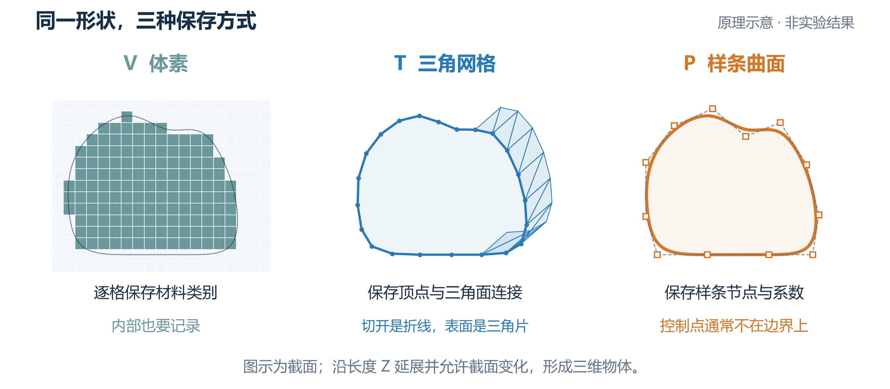
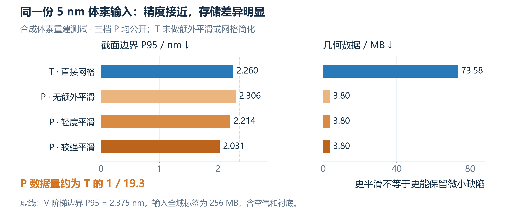
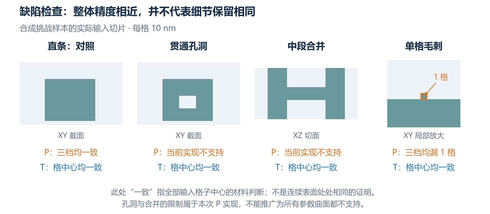

# Mark 三维几何表示比较 领导摘要

[下载三页 PDF](2026-10-24_Mark三种几何表示_领导摘要.pdf) · [离线图文版](2026-10-24_Mark三种几何表示_领导摘要.html) · [详细比较与结论](2026-10-24_Mark三种几何表示_详细比较与结论.md)

## Mark 三维几何表示比较

对象：合成 AH53 条纹。比较边界细节、数据量与编辑能力。

**建议：规则条纹优先深化 P，复杂缺陷保留 T，原始体素保留溯源。**

P 是截面放样的 B 样条曲面；T 是三角网格；V 是材料体素。P 与 T 都记录边界。

本轮 P 尚非完整 CAD 内核。图为表示原理示意，不是精度对照或实测形貌。

## 同一体素输入下，P 与 T 的误差接近

第二轮：仅输入 5 nm 材料体素，自行寻找轮廓；局部窗口为 16 × 4 μm。

**P：2.031-2.306 nm / 3.80 MB；T：2.260 nm / 73.58 MB。**

P 以较少数据保持接近的截面精度。此处 T 未做网格简化，大小差距不能泛化。

P95：95% 的已评估边界距离不超过此值。第一轮输入与评分口径不同，不混排。

## 复杂缺陷决定适用边界

第二轮的四类独立小型挑战：检查孔洞、连接关系和单格细节。

**当前 P 会漏掉单格毛刺，并拒绝孔洞与合并；T 保留了这些挑战特征。**

下一步：验证实测局部、多材料薄层，并比较受误差约束的 T 简化与 P 拟合。

已做 48 × 48 μm 合成规模验证；真实全 Mark、完整多材料内核及光学精度尚未验证。

来源：[第一轮已知轮廓与规模实验](ah53-geometry-validation/AH53_三种几何表示验证_技术验证报告.md)、[第二轮体素重建与挑战实验](ah53-geometry-validation/AH53_从体素重建P与T_检查与测试.md)。
