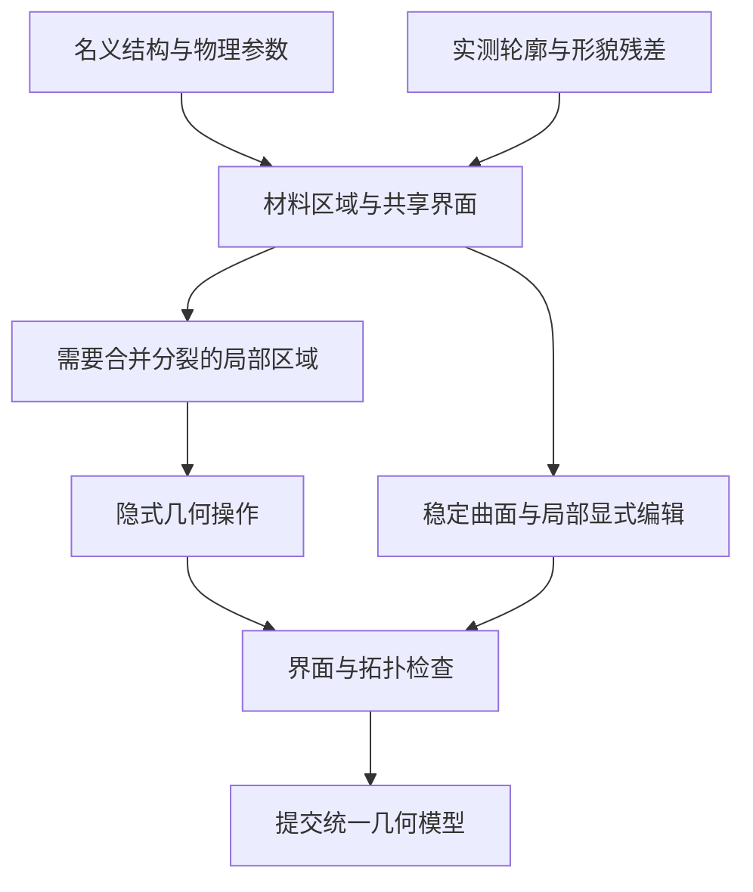

# 真实不规则三维多材料 Mark 的几何表示调研与选型报告

调研日期：2026 年 10 月 24 日；本版已根据随后完成的两轮合成几何实验修订。研究对象为横向几十微米、含多种材料、薄膜及真实形貌偏差的 alignment 或 OVL Mark。范围限于几何和材料空间分区的表达；不比较电磁求解方法及计算网格。实测文件大小用于记录本次实现的存储成本，不代表文件格式优劣。下文的采样间距只指记录几何细节的间距。

**当前建议：对连接关系稳定的条纹，继续验证基于截面放样的 B 样条参数曲面（本项目简称 P）；保留输入体素作为核对依据，以三角网格（T）承接更一般的边界及缺陷。** 完整系统仍应以材料区域及共享界面为统一语义。稀疏多材料 level set 是复杂形貌编辑的候选，尚未由本项目实测证明优于其他内核；若主要任务是整个 Mark 上反复包覆、刻蚀、合并和封口，应单独评估它与体建模路线。若主要输入是持续修订的三维断层分割，标签体应保留为主数据。

这个选择取决于数据来源与主要操作。几十微米的横向尺寸本身不能决定方法：大面积平面可以非常紧凑，覆盖整块 Mark 的纳米级独立粗糙细节则有真实的信息成本。第 5 章仍是明确假设下的理论估算；下节另列已经完成的合成结构实测。已有 48 × 48 µm 合成全域测试，但尚未完成真实多材料全 Mark、稀疏体内核或完整 CAD 实体的对照验证。

[三种方法的详细比较与结论](2026-10-24_Mark三种几何表示_详细比较与结论.md) · [给领导看的图文摘要（PDF）](2026-10-24_Mark三种几何表示_领导摘要.pdf)

## 0 实验后更新：哪些结论得到支持，哪些仍不能下

原报告的基础判断仍成立：参数化可以表达沿高度和长度变化的三维不规则形貌；体素适合保存材料占据；只记录界面可以避免重复保存均匀内部。**原文并没有说“参数化只能描述理想结构”。** 本次修订主要补充工业名称、区分两轮输入条件，并将方案建议与已完成证据对应。

本项目的 P/T/V 是三个实现简称，并非业界互斥的三大门类：P 是用样条系数描述边界的参数曲面；T 是用顶点和三角面描述边界的网格；V 是每格存材料编号的体素。**P 与 T 都是边界表达。** 本次 P 属于截面放样的 B 样条曲面重建，不是新发明的几何类别，也尚非带完整面、边、壳、容差及多材料拓扑的 CAD B-rep 实体。

| 实验 | 程序获得什么信息 | 已完成的检查 | 能支持什么结论 |
|---|---|---|---|
| 第一轮：已知轮廓后的表示比较 | P/T 获得同一批有顺序、已知分区的轮廓点；V 直接查询连续参考生成标签 | 9 组局部/全域 P/T/V，局部转换、全域 P→T 和局部编辑 | 对平滑、固定拓扑且分区已知的合成条纹，P 能紧凑而准确地保存；不是未知轮廓重建排名 |
| 第二轮：只从体素重建 P/T | 仅材料标签、原点、格子尺寸和轴顺序；重建程序不读取原始轮廓 | 5/10 nm 输入的 8 条主路线，4 类挑战的 12 次尝试，共生成 18 个模型、2 次明确拒绝 | P 在本例保持接近 T 的截面精度且文件小；当前 P 的固定拓扑和小特征限制已暴露 |

第二轮 5 nm 输入的核心结果如下。P95 是规定 XY 截面内、共同高度范围的双向弧长加权边界距离，不是全三维最大误差或制造精度。

| 方法 | 截面距离 P95 / nm | 几何文件 / MB | 本轮特征 |
|---|---:|---:|---|
| T：直接 Marching Cubes，未简化 | 2.260 | 73.583 | 输入全部格中心的目标材料判定一致；挑战中的孔洞、桥连及单格毛刺得到保留 |
| P：不额外平滑 | 2.306 | 3.804 | 仍会因重采样及插值丢失挑战中的单格毛刺 |
| P：轻度平滑，σ＝0.5h | 2.214 | 3.804 | 本次图示默认；不是依照隐藏真值选出的最优参数 |
| P：较强平滑，σ＝1h | 2.031 | 3.804 | 本例平滑参考上误差略小，不保证真实缺陷保真更好 |

同口径下，原体素阶梯边界的 P95 为 2.375 nm。P/T 的差异包含各自的边界提取、重采样和平滑策略，不能全部归因于保存形式。本次 P 文件约为未简化 T 的 1/19.3；它不是与经误差约束简化后的最佳 T 的比较。P 也没有同时赢得所有性能项：5 nm 轻度平滑 P 单次构建约 16.08 秒，T 约 11.54 秒，时间会受本机负载影响。

当前 P 遇到截面孔洞和条纹合并明确拒绝；这不是所有样条或 CAD 曲面无法表达孔洞。T 的格中心一致性也不代表恢复了体素以下的原始连续细节。两轮数据都是合成样例，未检验显微灰度分割；第二轮主要重建目标条纹，尚未验证一般多材料共享界面、三材料交线与薄膜封口。当前证据支持“P 值得继续作为稳定条纹的候选主表示”，不支持“P 对所有真实 Mark 全面优于 T/V”。

实测依据：[第一轮技术报告](ah53-geometry-validation/AH53_三种几何表示验证_技术验证报告.md)、[第二轮检查与测试](ah53-geometry-validation/AH53_从体素重建P与T_检查与测试.md)、[第二轮评分汇总](ah53-geometry-validation/results/20261024_voxel_reconstruction/summary.json)。两轮输入信息、P 的参数化与评分高度范围不同，不能直接比较其绝对 P95 来宣称算法进步或退步。

## 1 需要表达的究竟是什么

### 从外形扩展到多材料空间分区

对本课题，一个完整模型至少要回答：任意位置属于哪种材料；两种材料的界面在哪里；薄层厚度是多少；空隙与外界是否连通；哪部分形貌由测量约束，哪部分来自工艺假设或统计生成。

用 Ωₘ 表示第 m 种材料占据的区域，用 Γₐᵦ 表示材料 a 与 b 的共享界面。各材料区域的内部应互不重叠，并与空气区域共同覆盖研究范围。边界可以共享。airgap 也属于需要明确表示的空间区域，不能在生成外壳时顺手填平。

只保存最外层表面，会丢失埋藏膜层和内部空洞；对每种材料分别生成一个外壳而不约束相邻界面，又可能产生缝隙或重叠。多标签 SurfaceNets 的原始研究专门让相邻区域共用点和面，说明共享界面是独立的建模要求。[19](https://arxiv.org/html/2401.14906v1)

本文采用 X 为横向周期方向、Y 为厚度方向、Z 为条纹长度方向。不同论文使用不同坐标，参考其中形貌时应先转换坐标含义。

### 不规则形貌应分成不同难度

| 形貌类别 | Mark 中的例子 | 对表示方法的实际要求 |
|---|---|---|
| 整体位置和低频变化 | 层间偏移、线中心漂移、倾斜、膜厚渐变、CMP 凹陷 | 连续参数或缓慢变化的曲面通常足够 |
| 三维截面变化 | 沿线 CD 变化、上下不同侧壁角、圆角、上宽下窄 | 参数必须能随位置变化，不能只有一个固定截面 |
| 随机粗糙度 | 侧壁起伏、LER、LWR、上下高度不完全相关 | 保留粗糙度的空间频率、相关性和具体实现 |
| 拓扑缺陷 | 桥连、断线、分叉、封闭 airgap、颗粒与孔洞 | 支持区域合并分裂、内部边界和材料邻接变化 |
| 密集三维多相结构 | 大量孔隙、交织材料、复杂残留物 | 可能更适合体分区；单一条纹参数族会过度受限 |

“不规则”既可能只是边缘不直，也可能意味着材料连通关系发生改变。二者对软件内核的要求差别很大。

### 几种方法处在不同层面

“参数化”有两个相关含义：用参数函数表示曲线或曲面，以及用 CD、侧壁角等工程参数驱动形状。二者并不自动等同。CSG 描述由哪些实体及布尔操作组合形状；B-rep 组织边界的几何与拓扑，三角网格也是一种边界表达；体素描述空间占据；level set 用函数的等值面描述边界。稀疏树、游程编码和实例化，则决定如何组织这些几何数据。

因此，一个参数化薄膜可以生成显式曲面，也可以生成 level set；一个 level set 可以存放在稀疏体数据结构中；三角表面本身也是一种离散边界表示。下面逐项比较，是为了明确适用条件，而非把这些方法当成完全互斥的选项。

## 2 相似需求在研究和工业中采用什么方法

### 直接相关的 Mark 与光学计量研究

**OVL 目标研究常从有物理意义的非对称截面出发。** Hsieh 等的 2023 年研究用上下层光栅和中间膜层描述目标，并考虑左右侧壁差异、分段侧壁及顶部凹陷。它支持保留 CD、左右轮廓和层间位置这些参数。该研究采用周期单元，不能证明任意整块随机 Mark 都可压缩成同一个截面。[1](https://doi.org/10.3390/s23094482)

**大面积实物目标也可以使用紧凑的截面模型。** Foldyna 等研究了 100 × 100 µm 的实际光栅目标，用四个堆叠梯形描述截面，包含测量观察到的 overhang。人工粗糙目标的拟合残差更大，表明截面模型仍会遗漏沿线变化。这里的 100 µm 是实物目标尺寸，不是完整有限尺寸三维粗糙模型的求解规模。[2](https://doi.org/10.1063/1.3657865)

**参数化也能表达三维曲边。** Kato 等用随条纹方向变化的边界函数分别构造中心位移和宽度变化，并建立三维结构。参数化的能力不应被限定为理想矩形。其受控正弦扰动仍与任意实测随机侧壁有区别。[3](https://doi.org/10.1364/AO.51.006457)

**大面积随机形貌曾采用有限基元复用，但有明确实验条件。** Fernández Herrero 等制造约 4 mm × 0.51 mm 的粗糙光栅，随机部分采用 51 × 51 µm 基元重复，以兼顾电子束写入数据量与该实验中重复效应的可观察性。这支持大区域复用有实际价值，也说明基元大小需要针对实验选择。[4](https://doi.org/10.1107/S1600576717014455)

后续 EUV 实验进一步表明，线形、高度、沿线粗糙度和不同线之间的相关性都会影响散射分布。对你的几何生成器，直接启示是保存这些不同来源的形变；不能仅用一个“粗糙度大小”替代全部三维信息。[5](https://doi.org/10.1007/s41871-022-00126-w)

### 工艺形貌演化采用隐式和体建模路线

ViennaPS 的 2025 年软件论文明确采用 sparse-field level set 与层次游程编码管理几何，并区分简化几何演化和带物理模型的过程仿真。它适合评估包覆、刻蚀和多材料层管理，也说明借用工艺几何内核不必等于自研完整工艺物理。[13](https://doi.org/10.1016/j.softx.2025.102453)

工业中也存在不同路线。Applied Materials 的 TOPO+ 官方资料明确采用多材料二维及三维 level-set 形貌演化；Lam 的 SEMulator3D 官方资料则明确采用体素建模。两者证明隐式界面和体表示都有实际工艺应用。公开产品说明没有提供可直接套用到你的 Mark 的内存或精度对照。[14](https://www.appliedmaterials.com/us/en/semiconductor/solutions-and-software/software-solutions/ace-plus-suite/feature-scale.html) [15](https://www.lamresearch.com/product/semulator3d/)

### 真实三维重建通常从体标签进入表面表达

Stegmann 与 Cognigni 的 2025 年研究对真实半导体 FIB-SEM 数据进行分割，例子包括 9.5 × 3.1 × 9.6 µm³ 的 SiC MOSFET，以及 6.90 × 0.40 × 3.04 µm³ 的 SRAM 数据。后者有 6004 张图像，像素尺寸 1 nm、切片厚度 0.5 nm。这是多材料或部件体分区的直接实践；采样间距不等于边界的真实测量准确度，也不代表已覆盖几十微米全 Mark。[20](https://doi.org/10.1007/s11668-025-02203-w)

Limbecker 等在 2026 年展示了约 9.94 × 2.04 × 8.51 µm³、5 nm 采样的半导体断层数据，并讨论分割在不同器件密度下的迁移问题。对于持续修订分割结果的工作，保留标签体通常比每次都先拟合成参数曲面更直接。[21](https://doi.org/10.1007/s11668-026-02564-w)

对测到的局部表面，面片表达也有直接依据。Yoo 等用可倾斜扫描的 3D-AFM 测量竖直及倒扣侧壁，将表面分区后分析粗糙度。这样的观测天然提供表面数据，不要求先把均匀实体内部全部采样。[8](https://doi.org/10.1186/s42649-022-00070-5)

### 相似需求的选择规律

| 实际需求 | 常见表达 | 为什么适用 | 迁移到本课题时的边界 |
|---|---|---|---|
| 截面尺寸拟合和形变扫描 | 物理参数与分段轮廓 | 参数与 CD、膜厚、侧壁形状直接对应 | 参数族之外的缺陷不能自动恢复 |
| 随机边缘和侧壁研究 | 基准形状加空间随机场 | 能控制幅度、频带和相关性 | 合成 realization 不等于某个实物 |
| 沉积刻蚀及封口演化 | 多材料 level set 或体建模 | 能持续改变材料占据及连通关系 | 薄层与材料交线需要专门处理 |
| FIB-SEM 多材料重建 | 体标签再提取共享表面 | 与图像分割结果直接对应 | 配准、切片与分类误差会进入几何 |
| 局部三维表面测量 | 点集或曲面片 | 保存已观察的表面细节 | 隐蔽界面仍需更多观测或假设 |
| 稳定的复杂实体设计 | 曲面 B-rep 与布尔构造 | 精确曲面与拓扑可显式管理 | 大量随机细节会增加面数和运算负担 |

这张表是对上述案例的归纳；不存在一个由公开研究证实、对所有真实多材料 Mark 都最优的单一表示。

## 3 各种几何表示的详细评价

### 参数化截面 扫掠与空间变化场

最简单的形式是定义一个截面，再沿 Z 拉伸。它适合建立名义结构，尺寸直观、修改方便、重复区域的数据量小。扩展为多个截面沿 Z 插值后，可以描述线宽渐变、弯曲、端部变化和不均匀膜厚。

工业中相关名称包括参数曲面（parametric surface）、B 样条/NURBS 曲面及截面放样（lofting/skinning）。B 样条是数学表示，放样是把多个截面连接为曲面的构造方式，B-rep 则进一步组织这些面的连接。Open CASCADE 提供 [B 样条曲面](https://occt3d.com/dev/doc/refman/html/class_geom___b_spline_surface.html) 和 [通过截面构造壳或实体的放样算法](https://occt3d.com/dev/doc/refman/html/class_b_rep_offset_a_p_i___thru_sections.html)。本次 P 的基础属于这一成熟体系，使用非有理三次 B 样条；数学上可视为 NURBS 权重全为 1 的特例，但并未实现完整工业 CAD 流程。

更一般地，一条材料线在每个 Y、Z 位置仍占据一个连续 X 区间时，可写为：

$$
x_L(Y,Z)=x_{L,0}(Y)+u_L(Y,Z),\qquad
x_R(Y,Z)=x_{R,0}(Y)+u_R(Y,Z).
$$

基准轮廓给出侧壁角、圆角和上下 CD；位移场给出沿高度与长度变化的真实偏差。参数可以是样条控制点、局部曲线系数或实测位移数组。采用哪种基函数，应由拟合误差、局部编辑和粗糙谱保真决定；没有依据将样条普遍认定为 Mark 的最优选项。

上述左右边界模型能够表示上宽下窄等倒扣。它的限制是同一 Y、Z 上只能有一个连续材料区间：出现内部孔洞、分叉、多段分离区域或线间合并时，必须扩展为多个区域或一般界面模型。这个单一区间限制属于该坐标表示，并非所有参数曲面的普遍限制。

第二轮 P 实际采用另一种参数方式：以 u 表示沿闭合截面的归一化位置，写成 S(u,Z)＝(X(u,Z),Y(u,Z),Z)，再沿 Z 插值。它不预设左右壁等六段，但仍要求截面无孔、组件贯通且相邻截面对应唯一。它先从材料标签提取轮廓，再求样条系数；第一轮则直接获得已知轮廓上的有序点，二者不是同一个重建前提。

**对完整条纹类 Mark 有潜在优势，前提是形貌仍具有可利用的条纹或膜层结构。** 平移、膜厚变化和低频形变不用在体积中逐点重复保存；高频且完全独立的边界细节依然需要相应数量的参数。若另行建立工程参数与曲面系数的约束关系，参数化可保留工艺语义，适合做编辑入口；单有样条系数并不自动提供“修改侧壁角”等操作。[3](https://doi.org/10.1364/AO.51.006457) [26](https://doi.org/10.1117/12.2525978)

### 高度场与多层高度场

一个高度场把表面写成 Y = h(X,Z)。它适合顶部起伏、CMP dishing、缓慢变化的膜厚和近似水平的埋藏界面。多个保持次序的高度场可以描述一组层状材料，每层位于相邻两张曲面之间。

单个高度场在每个 X、Z 上只有一个高度，所以不能独立描述竖直侧壁、遮檐下方和封闭空洞。增加层数可以描述更多内部界面，但若出现分叉、不同位置的层数改变或复杂交织，就需要额外拓扑管理。

**适合作为模型的一部分。** 对大片薄膜，它非常节省数据；作为整个真实 Mark 的唯一表示，能力不足。局部侧壁也可换一个方向参数化，但多个局部坐标面片必须共享接缝和材料关系。

### 曲面 B-rep

B-rep 把实体组织为面、边、点及其连接关系。面可以是平面、圆柱面、样条面等；材料体由这些边界围成。Open CASCADE 官方文档给出了这类几何与拓扑分离的数据结构。[24](https://occt3d.com/dev/doc/overview/html/occt_user_guides__modeling_data.html)

它适合准确的名义层、圆角、槽、倒扣和工程化端部。大平面无论覆盖 5 µm 还是 50 µm，都不必因为面积变大而增加大量控制点。材料区域与共享面也可得到明确组织。

对高频实测粗糙，困难主要是复杂度：曲面需要更多控制点，或者被切成很多小面；布尔交会、极薄区域及接近重合的边界还需要稳健的容差管理。B-rep 并非不能表达随机表面，而是高频细节可能削弱其紧凑性和编辑优势。

**对你的用途：适合稳定的基准几何和规则曲面，不宜默认把每个纳米起伏都变成一个独立 CAD 特征。** 这里是根据表示结构作出的工程判断，尚无针对你的 Mark 的 B-rep 与 level-set 实测对照。

已完成的 P 实验不能填补这项对照：P 保存并查询样条系数，尚未完成共享面/边拓扑、稳健布尔与容差管理，也未生成经 CAD 内核验证的 STEP 实体。把 P 称为“参数曲面原型”是准确的，把它直接当作完整 B-rep 内核则会夸大完成范围。

### CSG 与几何操作树

CSG 通过并、交、差等操作组合实体，例如“衬底加条纹，再减去凹槽”，或者用一个缺陷实体切掉局部材料。它很适合保留操作顺序、可撤销修改和重复结构的生成逻辑。

CSG 是构造方法，实际运算结果可采用 B-rep、显式表面或隐式函数。一个复杂粗糙侧壁若由大量小球和小盒子拼成，表达和布尔运算可能非常繁重。因此它适合记录你界面中的工艺意图，不能单靠“支持布尔运算”就认定底层已经解决全部真实形貌问题。

覆膜的“沿法向等厚”“沿竖直方向等厚”“填平沟槽”会得到不同几何。操作树应明确这些含义；只保存一个“增加薄膜”的名称不足以重建同样形貌。

### 显式多材料表面

这里的表面由顶点和三角形或四边形面片组成，用于描述几何本身。它可以表达弯曲侧壁、任意端部、封闭空洞、孔洞、桥连和断线，不要求形状属于几个解析原语。

本项目 T 是其中的三角网格实现。第一轮从有序轮廓点直接连面；第二轮在目标材料的二值指示场上取 0.5 等值面，未额外平滑或简化。后者已经通过本轮孔洞和桥连挑战，但并未实现本节后述的通用多标签共享界面系统。材料编号是类别，不能直接把 0/1/2 当成连续物理量插值。

最大的优势是只记录界面。材料内部若均匀，不必保存密集体采样；平坦区域可用少量面片，弯曲或粗糙区域再增加细节。对已经确定拓扑、主要做查看、切片和少量修改的真实形貌，这是很强的候选。

多材料场景应优先采用“一张界面＋两侧材料区域”的结构。相邻材料共用几何，避免各自平滑后产生缝隙。SurfaceNets 论文展示了从多标签体直接提取共享表面的路线。[19](https://arxiv.org/html/2401.14906v1)

它的主要代价包括：曲面离散误差、薄层与窄缝保护、面朝向、自交及材料交线维护。拓扑频繁合并分裂时，显式重连接和修复可能变得复杂。即使只存表面，整块区域到处都有高频粗糙时，面数仍可能很大。

**对你的用途：优先作为稳定的真实不规则界面表达候选。** 是否成为主表示，应与主要编辑操作一并评估，不能只按渲染速度或三角形数量决定。

### 稠密体素与稀疏体分区

最直接的材料体素是在每个空间单元存一个材料编号。它直接记录网格可解析的连通关系、多材料占据和局部分类，适合断层图像分割，内外判断也直观。真实半导体断层分割采用这一类数据路径已有直接案例。[20](https://doi.org/10.1007/s11668-025-02203-w)

稠密体素的主要问题是每个方向都采样：均匀材料内部和复杂界面占用同样密度。硬标签还存在量化误差，窄于一个单元的薄层或孔道可能无法稳定保存。增加体积分数等信息能保留更多局部占据，但并不唯一确定单元内部的所有界面形状。

八叉树、分块和游程编码可压缩同材质区域，形成稀疏体分区。其优势依赖均匀性；若几乎每处都有独立纹理、孔隙或标签噪声，压缩收益会降低。层次结构本身也有索引和访问成本。OpenVDB 的常值块和活跃区域就是一种成熟组织方式。[18](https://www.openvdb.org/documentation/doxygen/overview.html)

**不能把体素一概排除。** SEMulator3D 的官方体素路线说明它可以用于复杂工艺建模，但不能把商业实现的优化等同于一个直接分配的稠密数组。[15](https://www.lamresearch.com/product/semulator3d/)

对你的课题，稠密体素适合局部重建、调试和对照；全 Mark 的主表示若采用体素，应从一开始评估稀疏分块、多材料和最薄特征，而非等内存不足后再临时压缩。

### 隐式函数 SDF 与多材料 level set

隐式表示用函数描述内外关系。例如材料内部取负、外部取正，函数为零的位置就是边界。SDF 是其中把函数值定义为带符号距离的特殊形式。level-set 方法操作的是等值面；实际实现和布尔组合后的函数不一定处处仍是精确欧氏距离。

它适合几何偏置、腐蚀、膨胀、包覆、合并分裂和封口，因为不必始终显式跟踪每张表面的连线关系。采用窄带时，只在界面附近存较丰富的数值，远处使用内外常值。H-RLE 和 VDB 是重要的稀疏表示工作。[16](https://doi.org/10.1145/1122501.1122508) [17](https://doi.org/10.1145/2487228.2487235)

多材料需要比一个外表面函数更多的信息。Ertl 与 Selberherr 提出累计区域表示：第 k 个函数表示前 k 个材料区域的并集，相邻累计区域的差给出某一层。这样可以分开保存薄膜上下界面，避免单个薄壳函数在粗采样下突然丢层。[9](https://doi.org/10.1016/j.cpc.2009.02.002)

这一方案仍有条件：交织材料、材料顺序和接触处几何需要专门管理；Toifl 等已展示普通包裹方式在选择性外延时可能产生错误局部形状，需重新构造用于生长的顶层界面。[11](https://doi.org/10.1109/ACCESS.2020.3004136)

**对你的用途：若几何编辑以包覆、刻蚀和拓扑变化为主，这是应认真评估的主内核。** 若形貌主要来自已知静态表面，把全部模型转成采样隐式场则可能增加不必要的重采样与多材料维护。

### 点云和神经隐式表示

点云适合保留测到的位置、法向或置信信息，但点与点之间没有天然的体边界和材料分区。CGAL 的 Poisson 重建流程仍需要法向等输入，并从点集构造隐式函数及表面。它可作为数据入口，单独用于完整多材料 Mark 时信息不足。[25](https://doc.cgal.org/latest/Poisson_surface_reconstruction_3/index.html)

神经隐式表示用神经网络近似几何函数，可能压缩复杂曲面并与图像反演结合。NFH-SEM 已将神经场用于多视角、多探测器 SEM 的表面重建。[28](https://arxiv.org/html/2508.04728v2)

对当前课题应把这类方法列为探索项。表面视觉吻合不能证明埋藏材料、最薄膜和孔隙连通性正确；还需要稳定训练、可追溯局部修改和边界误差评估。它可以帮助获取形貌，但不能代替多材料区域定义。

## 4 对真实 Mark 最关键的形貌问题

### 侧壁粗糙度需要两个方向及相关性

将顶视 SEM 的边缘沿 Y 直接拉伸，实际上假设所有高度处有相同形变。真实侧壁的不同高度可以有不同起伏。Van Kessel 等专门研究了三维侧壁与顶视 SEM 所见 LER 的差异；其模拟表明某些孤立线的顶视边缘主要反映最外凸起。因此顶视轮廓不能当作完整侧壁真值。[7](https://doi.org/10.1117/1.JMM.19.3.034002)

可以将左右边界分解为中心 c 和宽度 w：

$$
c=\frac{x_L+x_R}{2},\qquad w=x_R-x_L.
$$

两侧同向移动主要改变中心，两侧反向移动主要改变宽度。若两边位移的方差都为 σ²、相关系数为 ρ，由协方差公式可得：

$$
\mathrm{Var}(w)=2\sigma^2(1-\rho).
$$

即使两组结构的单边 RMS 相同，只要左右相关性不同，宽度变化也会不同。这是几何统计推导，不依赖某个软件。

因此建议保存基准轮廓、空间变化场以及能够复现实例的信息。统计生成时应记录幅度、相关长度或 PSD、上下高度相关、左右边相关、跨线相关、随机种子和生成规则；实测形貌则应保存测量约束与残差。Bergner 等的自仿射粗糙边界研究为从自相关和频谱生成轮廓提供了实例，但其高度方向假设也应保留。[6](https://doi.org/10.1364/JOSAA.27.001083)

### 薄膜的两张边界必须分开保留

假设某处有 5 nm 的覆膜。显式界面可以用两张相距 5 nm 的面表示厚度，不必让整个 50 µm 区域都按照 5 nm 分块。实际难点在于拐角、窄沟、薄膜侧端和接触区是否仍保持正确关系。

隐式表示也可以分开记录上下界面，但不能因此声称任意薄膜都无需细采样。Lenz 等指出，平坦薄层在较粗的几何表示中可以保持，切开薄层时却会暴露横向分辨率不足，导致材料错误混合；需要在受影响区域先提高几何分辨率。[12](https://doi.org/10.1016/j.sse.2022.108534)

几何表达中还应区分法向厚度、竖直厚度与填充厚度。它们在斜侧壁和沟槽处不同。只保证平均膜厚正确，不能保证局部薄层未穿透。

### airgap 需要内部边界和连通性

一个被封住的 airgap，和通向外界的窄沟，可能拥有相似的局部截面，但拓扑不同。模型应保存完整边界，区分空气组件是否与外界连通，并保护封口、孔喉和薄桥。

Ertl 与 Selberherr 的空洞检测论文直接在隐式数据中识别连通分量，用于避免简化沉积模型在封闭后仍错误推进空洞内部表面。对本课题的启示是将连通性作为几何数据，而非只保存一张看起来像空洞的截图。[10](https://doi.org/10.1109/SISPAD.2009.5290221)

### 多材料交会线不能按普通单外壳规则处理

单个材料区域需要有明确内外边界；多个材料的全部界面集合，在三材料交会处可以有多张面沿同一条线相交。这种整体非流形结构可以是合法的材料接触，不能一律当成损坏表面删除。

同一界面应共用坐标与连接关系，并保存两侧区域、方向及交会线。独立平滑每种材料可能让界面相互分离或穿插。SurfaceNets 的共享边界设计正是针对这类问题。[19](https://arxiv.org/html/2401.14906v1)

### 区分测得形貌与假设形貌

SEM 顶视图约束部分横向轮廓，TEM 或截面 SEM 约束少数切面，AFM 约束可达表面，断层数据则提供体分区证据。由有限观测插值出的整个 Mark，应保留“哪些区域实测、哪些区域外推”的标记。

FIB-SEM 图像也可能受到切片厚度变化及后方结构显影的影响。Sardhara 等针对多孔金的原始研究分析了这类重建歧义；其具体误差不能直接套到 Mark，但说明体标签同样需要测量依据。[22](https://doi.org/10.1007/s41871-024-00223-y)

软件能表达更细的边界，不意味着观测已经提供这些细节。表示精度、观测不确定度和重建模型误差应分别记录。尤其不要将每次随机生成的逼真粗糙表面描述为那个具体实物的唯一三维重建。

## 5 几十微米完整 Mark 的资源与可行性

### 估算条件

选取一个便于比较的假设结构：X × Y × Z = 50 × 2 × 50 µm，体积 5000 µm³。2 µm 是本报告的示例厚度，不是对你的实际结构厚度的判断。GB 和 TB 均用十进制。以下估算表示本身的基础数据：体表示统计样本值，表面表示统计顶点坐标及三角形连接索引；不包括显示缓存、辅助空间查询结构、邻接、内存管理及编辑临时副本。

**本章四组资源公式与表格已重新核算，算术正确，保留作为理论量级说明。** 它们不是随后 AH53 实验的实测值：第一轮合成全域为 X × Y × Z＝48 × 0.5 × 48 µm，第二轮体素重建窗口为 16 × 0.5 × 4 µm，均含空气与衬底。不同表示的表格也没有统一误差限，不能拿某行容量直接当成效率排名。

需要分别考虑四个量：横向范围、总厚度、全部材料界面的面积、必须保留的最小细节。仅给出“几十微米 × 几十微米”，还不足以推断实际内存。

### 均匀体素的体积增长

若三个方向采用相同几何采样间距 h，则：

$$
N_{\mathrm{dense}}\approx\frac{L_XL_YL_Z}{h^3}.
$$

| 几何采样间距 | 体素数量 | 每格 2 字节材料编号 | 一个每格 4 字节标量场 |
|---|---:|---:|---:|
| 20 nm | 6.25 × 10⁸ | 1.25 GB | 2.50 GB |
| 10 nm | 5.00 × 10⁹ | 10.00 GB | 20.00 GB |
| 5 nm | 4.00 × 10¹⁰ | 80.00 GB | 160.00 GB |
| 2 nm | 6.25 × 10¹¹ | 1.25 TB | 2.50 TB |
| 1 nm | 5.00 × 10¹² | 10.00 TB | 20.00 TB |

这是算术估算。若材料数允许使用 1 字节编号，标签列减半，但三次方增长不变；各向异性采样时分母改为 hₓhᵧh_z。一个标量场也不能直接代表任意数量材料的完整 SDF，多个场会增加成本。

厚度从 2 µm 变成 10 µm，上表全部乘 5；仅一个横向边长加倍，乘 2；两个横向边长都加倍、厚度不变，乘 4。三个方向的间距都减半，数量乘 8。

**因此，全域纳米级稠密材料数组不适合作为无条件默认方案。** 较粗全局表示、局部细节块或稀疏结构可以减少浪费，但关键薄层能否保留仍须按具体结构检查。

### 显式表面的成本与总界面面积有关

假设所有需要表达的不同材料界面面积合计 A = 10 000 µm²，每一张 A/B 共享界面只计一次。这个值在表中固定为估算输入；实际多层膜、侧壁和孔洞会使面积高于顶视面积，更细采样也可能显露额外粗糙面积。

为给出量级，假设把所有界面近似均匀地切成小方格，每格分成两个三角形，面片尺度为 hₛ。则：

$$
T\approx\frac{2A}{h_s^2}.
$$

对较大的规则三角表面，取顶点数约 T/2；顶点用三维 64 位浮点坐标，三角形用三个 32 位索引，原始数据约为 24T 字节，即每个三角形摊销约 24 字节。大量交会线、小组件或特殊拓扑会改变顶点与三角形的比例。

| 面片尺度 | 估计三角形数 | 仅坐标与三角形索引 |
|---|---:|---:|
| 100 nm | 200 万 | 48 MB |
| 50 nm | 800 万 | 192 MB |
| 20 nm | 5000 万 | 1.20 GB |
| 10 nm | 2 亿 | 4.80 GB |
| 5 nm | 8 亿 | 19.20 GB |

表面片尺度与体素间距不能直接视为相同的几何误差。平面用很少面片就能精确描述；曲率、粗糙度频率和窄间隙决定哪些地方需要细化。上表故意采用均匀细分，以展示即使只存表面，全域高密度也会很大。

实际自适应表面应让平坦区域保持大面片，圆角、粗糙、薄膜接触和局部缺陷使用小面片。面数可粗略理解为对各处的 dA/hₛ² 积分，而非整个模型统一采用最细值。邻接、材料对、空间查询结构及编辑临时数据仍需另计。

### 窄带隐式场的成本同样依赖界面

设每侧窄带宽度固定为 b 个采样间距，在带区分离、界面充分解析等条件下：

$$
N_{\mathrm{band}}\approx\frac{2bA(h)}{h^2}.
$$

理由是带区体积约为界面面积乘总带宽 2bh，再除以每个样本占据的 h³。取 b = 3、A = 10 000 µm²，并只计算每个活动样本的一个 32 位数值：

| 几何采样间距 | 理想活动样本数 | 仅标量数值 |
|---|---:|---:|
| 20 nm | 1.50 亿 | 0.60 GB |
| 10 nm | 6.00 亿 | 2.40 GB |
| 5 nm | 24.00 亿 | 9.60 GB |

这个表是一个标量窄带的理想成本，不是完整多材料模型的内存，也不是 OpenVDB 或 ViennaLS 的实测结果。树节点、叶块填充、区域分类和更新暂存均未计入。多材料若采用多个函数，成本取决于各函数实际保存的边界面积之和；累计包裹重复保存的界面需要重复计费，不能只套用唯一界面的 A。

需要保留四个条件：

1. A 包含埋藏层与孔洞，不能只取最外表面积；更细采样可能显露更多面积。

2. 若保持固定物理带宽 δ，而不是固定样本层数，数量约为 2δA/h³，不能仍按 h 的平方倒数估算。

3. 完整 SDF 的远场距离仍随位置变化；窄带方法通过远场截断或常值化获得稀疏性，因此远场常值不能用于精确远距离查询。

4. 稠密多层、微孔和高频粗糙会增加活跃域；窄带在局部几乎填满体积时，优势会减弱。

这些条件与 H-RLE、VDB 及 OpenVDB 的稀疏组织原则一致；公式本身是本报告的几何量级推导。[16](https://doi.org/10.1145/1122501.1122508) [17](https://doi.org/10.1145/2487228.2487235) [18](https://www.openvdb.org/documentation/doxygen/overview.html)

### 参数化边界可以显著减少不必要的自由度

假设有 32 条线，每条长 50 µm，沿 Z 每 10 nm 记录一次中心和宽度。每条 5000 个位置，每个位置两个 64 位数值：

$$
32\times5000\times2\times8=2.56\times10^6\ \mathrm{bytes}.
$$

原始数据约 2.56 MB。若再取 30 个不同高度层记录这两个量，则约 76.8 MB，另加基准轮廓、膜层和缺陷数据。

这个例子说明边界自由度与体积自由度可能相差很大。它并未表达任意孔洞、分叉或所有高度频率；30 个高度层也未经过精度验证。只有结构确实满足这些限制时，紧凑表达才有意义。

### 稀疏 局部精度与重复复用是不同能力

稀疏存储省去均匀区域；局部精度让不同位置使用不同的形状细节密度；实例化让完全相同的结构共享一份定义。三者可以组合，但不能互相替代。

H-RLE 的层次含义主要是沿不同维度递归进行游程编码，不能仅凭名称就认定几何分辨率自动局部变化。OpenVDB 的常值块也不等于每个复杂界面都已自动选择最佳精度。[16](https://doi.org/10.1145/1122501.1122508) [18](https://www.openvdb.org/documentation/doxygen/overview.html)

Sparse Voxel DAG 利用重复子树压缩几何，适合研究几何重复带来的收益；其原始论文明确不压缩体素材料与反射属性。随机形貌、不同材料及不同置信字段会降低重复性，不能把论文中的压缩比例直接套到真实 Mark。[27](https://doi.org/10.1145/2461912.2462024)

### 大尺寸适配性的实际判断

一个几何表示能否扩展到完整 Mark，应检查总界面规模、最小厚度、孔喉尺寸、局部粗糙频带及复杂区域分布。针对同样的几何误差限，比较实际峰值内存与修改成本，才有意义。

即使全域体素很大，参数界面或自适应表面仍可能可行；若高频细节充满全部界面，显式表面与窄带隐式场都可能很大；若大量多相孔隙充满体积，稀疏性甚至可能消失。此时需要按观测支持的细节范围和具体研究问题分配精度，而不是寄希望于换一个表示名称就消除数据量。

## 6 横向比较与优先级

| 方法 | 真实不规则三维 | 薄层与多材料 | 拓扑修改 | 完整 Mark 扩展性 | 本课题建议角色 |
|---|---|---|---|---|---|
| 固定截面拉伸 | 截面可以复杂，但沿拉伸方向不变 | 层状结构直观 | 受固定结构限制 | 很好 | 名义模型与基线 |
| 多截面和位移场 | 条纹类形貌能力强 | 可保留分层与侧壁 | 分叉孔洞需扩展 | 好，依赖参数自由度 | 优先的编辑与形变入口 |
| 多层高度场 | 层状起伏好 | 需保持层次及无交叉 | 复杂连接较难 | 很好 | CMP 和大面积膜层 |
| 曲面 B-rep | 一般曲面能力强 | 需稳健拓扑和容差 | 可做，复杂交会代价高 | 对规则曲面好 | 基准曲面及工程形状 |
| CSG 操作树 | 取决于基础实体 | 需材料布尔规则 | 取决于实际运算内核 | 重复构造紧凑 | 保存建模意图和历史 |
| 共享显式表面 | 一般形貌能力强 | 共享面与交线须维护 | 频繁变化时较复杂 | 好，受界面面积及细节限制 | 稳定实测形貌的强候选 |
| 稠密材料体素 | 任意可解析占据 | 薄层受采样限制 | 直接 | 全域细采样代价很高 | 局部数据及对照 |
| 稀疏材料体 | 任意可解析占据 | 需分类与细节保护 | 直接但有树更新成本 | 均匀区域多时好 | 断层重建及体编辑 |
| 稀疏多材料 level set | 一般界面能力强 | 薄层和材料接触需专门算法 | 合并分裂较自然 | 好，受总界面及带区影响 | 频繁形貌演化的强候选 |
| 点云 | 记录已测表面位置 | 缺少完整区域关系 | 需先重建 | 数据量可控但信息不完整 | 测量输入 |
| 神经隐式表示 | 有表达和反演潜力 | 保真及材料语义需验证 | 编辑和约束仍较复杂 | 压缩与精度存在权衡 | 后续探索 |

这是按任务条件给出的研究判断，未把主观评分包装成客观排名。对于复杂曲面，表面表示的采样密度与隐式场采样密度也不能直接等同。

## 7 适合本课题的模型组织与实现路线

### 统一的是材料分区语义

建议统一保存材料区域、共享界面、拓扑关系、几何来源及精度要求。一个区域应有明确的权威定义：解析或参数区域由参数定义，实测自由曲面由其边界定义，持续编辑的断层区域由标签体定义。其他表示按需要生成，避免多份几何互相独立修改后不再一致。

同一材料界面至少应有两侧区域、方向、边界曲线或交会线；每种材料区域应知道所用界面、孔洞和组件。测量来源、拟合残差、统计生成规则与可信范围随区域保存。材料名称是区域属性，不应决定形状采用哪种表达。

初期可以只实现一条主运算路线。把语义层与运算内核分开，是为了保留后续替换空间，而不是要求第一版同时实现所有几何算法。

### 路线 A 以稳定形貌和参数编辑为主

适用条件：大多数区域是条纹、膜层或已重建表面；主要操作是修改尺寸、加入非对称、拟合实测轮廓，以及少量局部缺陷编辑。

建议从基准截面与材料层开始，加入沿 Z 和 Y 的空间变化场；对已经无法用单一区间表达的端部、孔洞和桥连，使用一般共享界面。复杂区域只在需要特定操作时进入局部隐式表示，操作完成后检查共享界面和误差。

该路线的优势是物理参数可直接编辑，已知界面不必反复重采样，规则部分也不必展开成全域细体素。风险是局部隐式区与显式区域的拼接，以及表示间转换的累计偏移。

如果主要任务是生成可控结构、拟合已测形貌并加入局部真实偏差，路线 A 值得优先原型验证；如果主要任务是全域多步骤形貌演化或持续修订三维分割，则分别优先评估路线 B 或 C。

### 路线 B 以多步骤形貌演化为主

适用条件：几乎每一步都在大范围内做包覆、刻蚀、填充或封口；空洞形成、桥连和断裂是核心研究变量；局部隐式区域会不断扩大并相互连接。

此时可以保留参数化操作界面，但让统一的稀疏多材料 level-set 或体内核执行主要几何运算。已有 ViennaLS 与 ViennaPS 可作为候选基础，重点评估多材料层规则、薄端部细化和 airgap 连通性，减少从零实现这些算法的成本。[13](https://doi.org/10.1016/j.softx.2025.102453) [29](https://www.iue.tuwien.ac.at/phd/klemenschits/6.html)

工艺步骤可以先作为明确的几何操作，例如规定方向的去除、已知距离的包覆和指定高度的平坦化。由真实工艺参数预测最终形貌需要另一层标定；几何表达是否合理与工艺预测是否准确应分别判断。

### 路线 C 以断层分割为主

适用条件：输入是三维图像栈，材料标签仍在持续修订；大量修改分散在许多切片中。

标签体与观测对应最直接，应保留为主数据，考虑分块或稀疏材料表示。待分类稳定后提取共享材料界面，用于查看、尺寸分析或后续处理。不要为了模型看起来更平滑而默认删除小区域、填孔或改变连接关系。

这一选择与现有半导体 FIB-SEM 分割流程一致，但实际边界准确度仍取决于采集和分割。[20](https://doi.org/10.1007/s11668-025-02203-w) [21](https://doi.org/10.1007/s11668-026-02564-w)

### 应当推翻路线 A 优先级的情况

| 观察到的情况 | 对方案的影响 |
|---|---|
| 拓扑变化频繁且覆盖大部分 Mark | 局部转换失去局部性，统一体内核更值得评估 |
| 原始分割持续大范围修改 | 标签体更适合作为主数据，表面宜按需生成 |
| 密集薄层与交会线导致大量显式修复 | 比较统一多材料隐式方法，确认薄层和孔喉可解析、材料分区一致，并检查窄带占用 |
| 工作量主要是材料归属和界面邻域查询 | 统一体分区可能减少跨表示查询成本 |
| 表面与隐式往返造成不可接受的位移或膜厚漂移 | 减少往返，保留权威几何，或选择单一主运算表示 |

改用统一多材料隐式方案前，同样必须确认最薄层、孔喉与交会线在所选表示下可辨，且材料互斥、覆盖及邻接约束成立；带区稀疏本身不够。统一隐式表示仍需检验几何操作及重初始化造成的界面位移，减少转换并不等于消除几何误差。这些是选型判据，不是仅凭“不规则”或“大尺寸”就应改用某种方法的结论。

### 优先复用的现成能力

| 能力 | 候选公开工具或研究 | 需要自己确认的部分 |
|---|---|---|
| 参数曲面与工程实体 | Open CASCADE | 纳米量级容差、布尔交会和材料关系 |
| 多材料隐式形貌 | ViennaLS 与 ViennaPS | 真实层序、薄层与目标操作是否匹配 |
| 稀疏体数据组织 | OpenVDB 与 H-RLE 思路 | 活跃带占比、字段数量及更新方式 |
| 标签体到共享表面 | SurfaceNets 系列 | 最薄结构、拓扑和允许的平滑量 |
| 点集到表面 | CGAL 重建工具 | 观测覆盖、法向、噪声及隐蔽边界 |

这些工具承担不同职责，不能将“支持某个数据结构”视为已经具备完整的多材料 Mark 内核。[13](https://doi.org/10.1016/j.softx.2025.102453) [18](https://www.openvdb.org/documentation/doxygen/overview.html) [19](https://arxiv.org/html/2401.14906v1) [24](https://occt3d.com/dev/doc/overview/html/occt_user_guides__modeling_data.html) [25](https://doc.cgal.org/latest/Poisson_surface_reconstruction_3/index.html)

## 8 以少量几何实验完成选型

**进展说明：** 下列内容是完整选型的验证目标，不应全部标为已完成。两轮实验已经完成合成局部/全域表示、转换及受限编辑，并增加只从体素寻找轮廓的重建和缺陷挑战；真实困难区域、多材料薄膜/交会线、P/T 的同误差自适应比较、稀疏体与 level-set 的实际编辑对照仍待开展。第二轮仅在局部窗口重建，第一轮的 48 × 48 µm 合成全域结果也不代表真实多材料全 Mark 已通过验证。

### 两个局部结构与一个完整规模

先使用一个已知真值的困难结构，包含弯曲侧壁、薄覆膜、窄缝、小孔和一处三材料交线。再选一块真实数据中最困难的区域，保留人工确认的观测部分。只用矩形条纹验证，会偏向过于简单的参数模型。

然后把代表性形貌扩展到预计的完整横向尺寸，统计总界面规模、细节分布和内存。规则部分可以复用，但必须让不同线具有各自真实或统计合理的变化；不能用完全重复的小块代替整块不规则结构。

局部区域解决几何是否正确，完整规模解决成本是否可承受。这两种检查不能互相替代。

### 只做能区分方案的操作

建议用一次形貌构建、一次主要实际编辑操作，以及一次必要的表示转换往返作对照。主要编辑可以选覆膜封口或局部切除，以你未来最常用的操作为准。

如果路线 A 不需要反复转换，就不应为了测试人为强迫它反复转换；如果路线 B 的主要成本在多材料更新，就应计入这一部分。比较应对应真实工作流，避免只跑某个库最擅长的独立算子。

### 几何正确性的接受指标

| 指标 | 为什么需要 |
|---|---|
| 同一材料对界面的双向距离 | 检查局部边界是否偏离，给出分位数及最大值 |
| 沿 X 的有方向平均偏移 | 对 alignment 问题，系统位置漂移可能被整体误差平均掩盖 |
| CD 与线中心分布 | 区分宽度改变和位置改变 |
| 最小膜厚及厚度分布 | 平均厚度正确仍可能发生局部穿透 |
| 孔喉、封口及连通组件 | 防止 airgap 被填平或窄通道被封死 |
| 材料邻接与交会线 | 防止产生新的无依据接触、重叠或无归属区域 |
| 粗糙度 PSD 及相关性 | 防止平滑和简化删除关键空间频率 |
| 峰值内存与一次编辑时间 | 包括索引、邻接和临时表示，反映实际可用性 |

阈值应依据观测不确定度和研究中需要分辨的几何变化设定。当前没有足够资料替你的 Mark 规定统一的 1 nm 或 5 nm 容差。

### 预览简化不能覆盖权威形貌

预览可采用较少面片，但权威几何应保持可追溯。经典 QEM 简化论文允许某些拓扑改变；因此不能把默认图形简化结果直接当作保留薄层与孔隙的研究模型。[23](https://doi.org/10.1145/258734.258849)

减少三角形、删去短尺度粗糙或复用随机块，分别改变不同信息。需要明确哪种属于无损复用，哪种属于几何近似。几何数据变小也不自动意味着后续任何物理计算同比加速，这不属于本报告可以由表示量级推出的结论。

## 9 对当前开发方向的具体建议

保留材料选择、层结构和工艺参数编辑入口，让每个操作有明确的几何含义。原建议中的非对称截面、随条纹方向变化的轮廓、局部修改和切片查看已在合成原型中部分落实；下一步重点是把这些能力用于真实输入和复杂缺陷，验证工程参数修改是否保持尺寸、薄层与连接关系，而不是仅增加可显示的几何类别。

核心几何首先以材料区域和共享界面定义。当前实测支持继续将 P 用于稳定条纹的紧凑重建，同时保留 V 原始标签、用 T 表达当前 P 不支持的孔洞与合并；这还是架构建议，P/T 自动无缝混合尚未实现。下一步应优先比较经过误差约束简化的 T 与自适应 P，再加入真实分割数据、多材料薄膜和完整规模，检验现有优势是否保持。对经常发生全局包覆和封口的结构，另用困难样例对照路线 B，再决定主要运算内核。

如果将来获得全 Mark 的三维断层标签，则按路线 C 保留原始体分区与测量关系。真实形貌的复杂度由数据与所需保真度决定，不能为了维持原有参数界面而把不符合假设的形状强行简化。

最重要的架构选择是保留真实材料区域、全部相关界面和修改依据；几何表示可以随着输入数据与操作需求演进。当前没有必要先实现一个包揽所有 CAD 和重建功能的通用三维建模器。

## 10 学习路径与参考资料

### 建议先读的六组内容

1. **从真实计量截面开始。** 阅读 Hsieh 2023 的结构图和 Foldyna 2011 的四梯形截面，理解侧壁非对称、圆角、凹陷与膜层如何用物理参数表达。对应参考文献 1、2。

2. **理解真正的三维粗糙度。** 阅读 Kato 2012 的边缘函数，以及 Fernández Herrero 2017、2022 的随机与周期粗糙对比。对应 3、4、5。重点看形状构造和相关性，不必先学习其中全部光学计算。

3. **理解多材料 level set。** 阅读 Ertl 2009 的多层表示，再看 Klemenschits 论文的 Continuum Material Representations 章节。对应 9、29。

4. **理解薄层和 airgap 的困难。** 阅读 Lenz 2023 的图 1 至图 6，以及 Ertl 2009 的 void detection。对应 12、10。

5. **理解大结构为何可以稀疏保存。** 先看 OpenVDB 官方 Overview 的树、常值块与窄带，再读 H-RLE 或 VDB 原始论文。对应 18、16、17。

6. **理解从真实图像到多材料模型。** 阅读半导体 FIB-SEM 分割案例和 SurfaceNets 的共享界面方法。对应 20、21、19。

### 参考文献

以下以原始论文、作者机构全文和官方技术资料为主。厂商资料用于确认公开路线，论文中的具体案例用于限定适用范围；本报告的 Mark 选型及资源估算为综合分析。

1. Hsieh H C, Wu M R, Huang X T. 2023. Designing Highly Precise Overlay Targets for Asymmetric Sidewall Structures Using Quasi-Periodic Line Widths and Finite-Difference Time-Domain Simulation. Sensors 23, 4482. [DOI 10.3390/s23094482](https://doi.org/10.3390/s23094482)；[开放全文](https://pmc.ncbi.nlm.nih.gov/articles/PMC10181731/)。

2. Foldyna M, Germer T A, Bergner B C. 2011. Effects of Roughness on Scatterometry Signatures. AIP Conference Proceedings 1395, 49–53. [DOI 10.1063/1.3657865](https://doi.org/10.1063/1.3657865)；[NIST 全文](https://tsapps.nist.gov/publication/get_pdf.cfm?pub_id=908805)。

3. Kato A, Burger S, Scholze F. 2012. Analytical Modeling and Three-Dimensional Finite Element Simulation of Line Edge Roughness in Scatterometry. Applied Optics 51, 6457–6464. [DOI 10.1364/AO.51.006457](https://doi.org/10.1364/AO.51.006457)；[作者稿](https://arxiv.org/abs/1208.4220)。

4. Fernández Herrero A, Pflüger M, Probst J, Scholze F, Soltwisch V. 2017. Characteristic Diffuse Scattering from Distinct Line Roughnesses. Journal of Applied Crystallography 50, 1766–1772. [DOI 10.1107/S1600576717014455](https://doi.org/10.1107/S1600576717014455)；[作者稿全文](https://arxiv.org/html/1810.08011v1)。

5. Fernández Herrero A, Scholze F, Dai G, Soltwisch V. 2022. Analysis of Line-Edge Roughness Using EUV Scatterometry. Nanomanufacturing and Metrology 5, 149–158. [DOI 与开放全文](https://doi.org/10.1007/s41871-022-00126-w)。

6. Bergner B C, Germer T A, Suleski T J. 2010. Effective Medium Approximations for Modeling Optical Reflectance from Gratings with Rough Edges. JOSA A 27, 1083–1090. [DOI 10.1364/JOSAA.27.001083](https://doi.org/10.1364/JOSAA.27.001083)；[NIST 全文](https://tsapps.nist.gov/publication/get_pdf.cfm?pub_id=903990)。

7. Van Kessel L, Huisman T, Hagen C W. 2020. Understanding the Influence of Three-Dimensional Sidewall Roughness on Observed Line-Edge Roughness in Scanning Electron Microscopy Images. JM3 19, 034002. [DOI 10.1117/1.JMM.19.3.034002](https://doi.org/10.1117/1.JMM.19.3.034002)；[作者机构摘要](https://research.tudelft.nl/en/publications/understanding-the-influence-of-three-dimensional-sidewall-roughne/)。

8. Yoo S B et al. 2022. Automated Measurement and Analysis of Sidewall Roughness Using Three-Dimensional Atomic Force Microscopy. Applied Microscopy 52, 1. [DOI 与开放全文](https://doi.org/10.1186/s42649-022-00070-5)。

9. Ertl O, Selberherr S. 2009. A Fast Level Set Framework for Large Three-Dimensional Topography Simulations. Computer Physics Communications 180, 1242–1250. [DOI 10.1016/j.cpc.2009.02.002](https://doi.org/10.1016/j.cpc.2009.02.002)；[机构全文](https://www.iue.tuwien.ac.at/pdf/ib_2009/JB2009_Ertl_1.pdf)。

10. Ertl O, Selberherr S. 2009. A Fast Void Detection Algorithm for Three-Dimensional Deposition Simulation. SISPAD. [DOI 10.1109/SISPAD.2009.5290221](https://doi.org/10.1109/SISPAD.2009.5290221)；[机构全文](https://www.iue.tuwien.ac.at/pdf/ib_2009/CP2009_Ertl_1.pdf)。

11. Toifl A et al. 2020. The Level-Set Method for Multi-Material Wet Etching and Non-Planar Selective Epitaxy. IEEE Access 8, 115406–115422. [DOI 10.1109/ACCESS.2020.3004136](https://doi.org/10.1109/ACCESS.2020.3004136)；[机构全文](https://www.iue.tuwien.ac.at/pdf/ib_2020/JB2020_Toifl_1.pdf)。

12. Lenz C et al. 2023. Automatic Grid Refinement for Thin Material Layer Etching in Process TCAD Simulations. Solid-State Electronics 200, 108534. [DOI 10.1016/j.sse.2022.108534](https://doi.org/10.1016/j.sse.2022.108534)；[机构全文](https://repositum.tuwien.at/bitstream/20.500.12708/153610/1/Lenz-2023-Solid-State%20Electronics-vor.pdf)。

13. Reiter T, Filipovic L. 2025. ViennaPS: A Flexible Framework for Semiconductor Process Simulation. SoftwareX 32, 102453. [DOI 10.1016/j.softx.2025.102453](https://doi.org/10.1016/j.softx.2025.102453)；[机构全文](https://www.iue.tuwien.ac.at/publist/pdf/20.500.12708_225854.pdf)。

14. Applied Materials. TOPO+ Feature Scale 官方资料，访问于 2026-10-24。[产品技术页](https://www.appliedmaterials.com/us/en/semiconductor/solutions-and-software/software-solutions/ace-plus-suite/feature-scale.html)。

15. Lam Research. SEMulator3D 官方资料，访问于 2026-10-24。[产品技术页](https://www.lamresearch.com/product/semulator3d/)。

16. Houston B et al. 2006. Hierarchical RLE Level Set: A Compact and Versatile Deformable Surface Representation. ACM TOG 25, 151–175. [DOI 10.1145/1122501.1122508](https://doi.org/10.1145/1122501.1122508)；[机构全文](https://www.cs.ubc.ca/labs/imager/tr/2006/Batty_HRLE/HierarchicalRLELevelSet.pdf)。

17. Museth K. 2013. VDB: High-Resolution Sparse Volumes with Dynamic Topology. ACM TOG 32, Article 27. [DOI 10.1145/2487228.2487235](https://doi.org/10.1145/2487228.2487235)；[作者全文](https://www.museth.org/Ken/Publications_files/Museth_TOG13.pdf)。

18. OpenVDB. OpenVDB Overview 官方文档，访问于 2026-10-24。[数据结构与窄带说明](https://www.openvdb.org/documentation/doxygen/overview.html)。

19. Schroeder W, Tsalikis S, Halle M, Frisken S. 2024. A High-Performance SurfaceNets Discrete Isocontouring Algorithm. 作者预印本。[DOI 10.48550/arXiv.2401.14906](https://doi.org/10.48550/arXiv.2401.14906)；[全文](https://arxiv.org/html/2401.14906v1)。

20. Stegmann H, Cognigni F. 2025. Few-Shot AI Segmentation of Semiconductor Device FIB-SEM Tomography Data. Journal of Failure Analysis and Prevention. [DOI 与开放全文](https://doi.org/10.1007/s11668-025-02203-w)。

21. Limbecker P et al. 2026. Steps Toward Automated Failure Analysis Using FIB-SEM 3D Tomography and AI-based Segmentation. Journal of Failure Analysis and Prevention. [DOI 与开放全文](https://doi.org/10.1007/s11668-026-02564-w)。

22. Sardhara T et al. 2024. Enhancing 3D Reconstruction Accuracy of FIB Tomography Data Using Multi-voltage Images and Multimodal Machine Learning. Nanomanufacturing and Metrology. [DOI 与开放全文](https://doi.org/10.1007/s41871-024-00223-y)。

23. Garland M, Heckbert P S. 1997. Surface Simplification Using Quadric Error Metrics. SIGGRAPH, 209–216. [DOI 10.1145/258734.258849](https://doi.org/10.1145/258734.258849)；[作者全文](https://www.cs.cmu.edu/~garland/Papers/quadrics.pdf)。

24. Open CASCADE Technology. Modeling Data 官方文档，访问于 2026-10-24。[曲面与拓扑模型](https://occt3d.com/dev/doc/overview/html/occt_user_guides__modeling_data.html)。

25. CGAL. Poisson Surface Reconstruction User Manual，访问于 2026-10-24。[官方文档](https://doc.cgal.org/latest/Poisson_surface_reconstruction_3/index.html)。

26. Farchmin N et al. 2019. An Efficient Approach to Global Sensitivity Analysis and Parameter Estimation for Line Gratings. Proceedings of SPIE 11057, 110570J. [DOI 10.1117/12.2525978](https://doi.org/10.1117/12.2525978)；[作者稿](https://arxiv.org/html/1910.14435v1)。

27. Kämpe V, Sintorn E, Assarsson U. 2013. High Resolution Sparse Voxel DAGs. ACM TOG. [DOI 10.1145/2461912.2462024](https://doi.org/10.1145/2461912.2462024)；[作者论文副本](https://icg.gwu.edu/sites/g/files/zaxdzs6126/files/downloads/highResolutionSparseVoxelDAGs.pdf)。

28. Neural Field-Based 3D Surface Reconstruction of Microstructures from Multi-Detector Signals in Scanning Electron Microscopy. NFH-SEM，作者预印本版本 v2。[全文](https://arxiv.org/html/2508.04728v2)。本文仅将其作为 SEM 表面神经重建的探索案例。

29. Klemenschits X. 2022. Emulation and Simulation of Microelectronic Fabrication Processes. TU Wien 博士论文。[DOI 10.34726/hss.2022.89324](https://doi.org/10.34726/hss.2022.89324)；[Continuum Material Representations 章节](https://www.iue.tuwien.ac.at/phd/klemenschits/6.html)。
