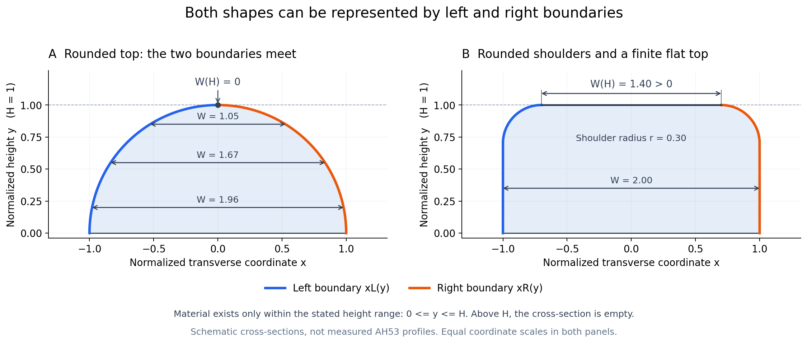

# AH53 不规则曲面三维几何表示与组合建模流程验证计划（V2）

日期：2026-10-24。

**本文件是交给 Codex 的实现任务书，不是新一轮已经执行完毕的结果报告。** 请以已确认的 AH53 名义版图为基础，生成具有曲壁、圆肩、顶面起伏和沿线边缘波动的三维形貌，并完成 **两层验证**：

- **实验 A：三种独立表示的保真与资源比较。** 参数化、直接构造的显式三角表面、直接体素化分别从同一合成参考和明确的观测输入构建，独立保存并评价。
- **实验 B：组合工程流程及误差传递。** 验证“参数化 → 三角表面”“参数化 → 体素”“参数化 → 三角表面 → 体素”“直接轮廓 → 三角表面 → 体素”等少量路径，区分拟合、三角化和体素化引入的误差。

两层验证都必须提供可操作的本地 3D View、实际模型、结果记录和面向初学者的详细中文说明文档（Markdown＋离线 HTML）。**参数化与三角表面可独立比较，也可作为同一流程的先后阶段；实验目的不同，不应混淆。**

用户的重点是材料区域的三维形状。当前不研究电磁计算网格，不运行 FDTD，不重新讨论 n/k 或材料拟合；小孔、airgap、桥接和拓扑变化不属于本轮范围。

## 1. 为什么需要这轮验证

上一轮原型已经包含弯曲侧壁和沿高度、长度的扰动，证明了三种数据结构能够运行。但它采用普通条纹排布，顶面保持平坦、顶角没有充分表达，并且参考形貌相对平滑，因此不能直接用它替实际 AH53 的复杂形貌选型。

本轮必须同时解决三个问题：

1. 名义版图符合 16 µm 母周期 AH53，而不是仅有 3.2 µm 间距的一般条纹阵列。
2. 几何包含非对称曲壁、圆钝顶角、非平顶，以及随高度和长度变化的相关边缘波动。
3. 用户能够打开实际输出模型，旋转、放大和切截面，直接核对这些特征；结果不能只有表格和静态截图。
4. 不仅比较表示格式本身，还要验证在软件中组合使用它们时，误差、信息与编辑能力怎样变化，并最终确定源几何的保存策略。

可以复用上一轮代码中可靠的存储、统计和计时部分。参考形貌、参数化几何定义、误差评价范围和 3D 查看需要按本文件调整。上一轮的误差数值不能作为本轮结果沿用。

已有原型：<https://github.com/ychen1213/ChatGPT-Discussions/tree/main/3D-Geometry/mark-geometry-validation>

## 2. 先固定 AH53 的名义版图

### 2.1 已有尺寸与坐标约定

| 项目 | 本轮使用的定义 | 来源或状态 |
|---|---|---|
| X | 条纹横向、母周期方向 | 沿用当前 AH53 模型坐标 |
| Y | 高度／厚度方向 | 沿用当前 AH53 模型坐标 |
| Z | 条纹长度方向 | 沿用当前 AH53 模型坐标 |
| 母周期 | 16 µm | 用户已确认 |
| 每母周期中的条纹区 | 8 µm | 用户已确认 |
| 条纹区之间的名义空白 | 8 µm | 用户已确认 |
| 每母周期条纹数 | 3 条完整条纹 | 沿用已确认 AH53 排布 |
| 子光栅中心间距 | 3.2 µm | 用户已确认 |
| 名义条宽 | 1.6 µm | 用户已确认 |
| 名义高度 | 300 nm | 用户已确认 |
| 真实完整 Mark 的 Z 长度与母周期数 | 优先读取已有工程或 GDS；当前文档不将其写成已知值 | 尚无确定实测值 |

为消除实现歧义，选择居中的坐标表示一个母周期。这是坐标原点的选择：

- 母单元：X ∈ [−8, 8] µm。
- 8 µm 名义条纹区：X ∈ [−4, 4] µm。
- 三条名义条纹中心：−3.2、0、+3.2 µm。

| 条纹 | 名义 X 区间，µm | 宽度 |
|---|---|---:|
| 左条纹 | [−4, −2.4] | 1.6 µm |
| 中条纹 | [−0.8, 0.8] | 1.6 µm |
| 右条纹 | [2.4, 4] | 1.6 µm |

三条条纹和内部两段间隙合计 8 µm。居中显示时，母单元两侧各有 4 µm 空白；相邻母单元连接后形成 8 µm 空白区。

先对理想版图做一次尺寸核对，确认条纹数、区间、宽度、空白区和母周期。不能将 3.2 µm 当作整个 AH53 的重复周期。

### 2.2 局部与完整尺寸场景

若工程中已有可靠完整尺寸，以工程为准，并在报告记录读取来源。否则使用以下可调整的工程默认值，明确标注“验证假设”：

| 场景 | X × Z 范围 | 含义 |
|---|---:|---|
| 局部精度场景 | 16 × 4 µm | 一个完整母周期、三条条纹、有限长度局部 |
| 完整尺寸场景 | 48 × 48 µm | 三个母周期、共九条条纹，用于几十微米规模验证 |

建议完整 X 范围为 [−24,24] µm，三个母单元中心为 −16、0、16 µm；局部场景裁取中间母单元 X ∈ [−8,8] µm、Z ∈ [−2,2] µm。

**局部场景必须是同一份全局参考形貌的裁片。** 使用全局坐标、稳定的母周期编号、条纹编号和随机种子生成形貌，不能因为条纹数或裁取长度改变而重新抽取整套随机场。不同母周期的名义图形重复，但其边缘扰动不能机械重复。

无实测端部形貌时，有限 Z 边界使用明确的封闭端面约定。局部裁切端面是计算窗口的封口，不把它当成实际条纹端头工艺形貌，也不纳入自由表面形貌误差。

## 3. 主体模型必须包含的形貌

建立一个包含下列变化的组合模型作为主验证对象。理想模型及只含基本曲率的模型可作为查看器中的说明参照，不额外展开大量完整参数扫描。

| 形貌 | 应生成什么 | 用户应怎样看出来 |
|---|---|---|
| 非对称截面 | 左右平均倾斜和截面形状不同 | 同一 XY 截面左右轮廓不互为镜像 |
| 弯曲侧壁 | 侧壁有鼓起、收腰及曲率变化 | 放大截面能看到弧线和局部变化 |
| 圆钝顶角 | 左右圆肩大小不同，且可随 Z 改变 | 放大顶角，轮廓连续转向顶面 |
| 非平顶 | 顶面横向有曲率，沿 Z 也有高度起伏 | 顶视颜色图与沿线剖面都有变化 |
| 中心线波动 | 左右边缘具有共同横向移动 | 沿线看两侧一起左右移动 |
| 线宽波动 | 左右边缘间距发生变化 | 沿线 CD 曲线不再恒定 |
| 高度相关扰动 | 下部、中部、上部的侧壁变化不同 | 改变 Y 截面后，边缘波动曲线改变 |
| 非均匀局部变化 | 某段波动更强，另有少量连续凸起／凹陷 | 局部特征不会在每条线、每个母周期重复出现 |

### 3.1 合成参数必须有清楚身份

目前没有实测三维轮廓，所有圆角、粗糙幅度、相关尺度等都属于工程验证假设。文件名、图题和说明写作“基于 AH53 名义版图的合成工艺形貌”，不得写作“实测 AH53 重建”。

下面是一组可直接启动实现的假设值，允许在配置中修改。它们不是文献给出的 AH53 工艺参数，也不是用户实测值。

| 参数 | 初始假设 | 通俗含义 |
|---|---:|---|
| 名义截面高度 | 300 nm | 来自已有模型 |
| 左／右平均侧壁角 | 80°／86°，相对水平衬底面 | 两边的平均倾斜不同，90°为竖直 |
| 左／右侧壁弯曲幅度 | 约 20／12 nm | 在平均倾斜轮廓上增加不同的平滑弯曲 |
| 左／右圆肩特征半径 | 40／70 nm | 顶角的圆钝尺度不同；一般曲面不强求处处为同一圆半径 |
| 圆肩尺度沿线变化 | 名义值的约 ±15% | 条纹沿 Z 不同位置的顶角不完全相同 |
| 顶面横向弯曲 | 高差约 10 nm | 同一截面的顶部有轻微拱起或倾斜 |
| 顶面沿 Z 起伏 | RMS 约 4 nm | 顶部高度沿条纹长度变化 |
| 参考高度处中心线波动 | RMS 约 6 nm | 左右边界的共同位移 |
| 参考高度处线宽波动 | 全线宽变化的 RMS 约 8 nm | 宽度增加或减少，不是单侧半宽的幅度 |
| 额外高度相关侧壁残差 | RMS 约 3 nm | 保留不同高度的差异 |
| 沿线主要相关尺度 | 示例 0.3 µm 与 2 µm 两档组成 | 同时具有短程和较长程变化 |
| 随机场最短保留波长 | 示例 160 nm | 控制本轮要保留的最短沿线波动 |
| 局部连续凸起／凹陷 | 高度或横向幅度约 10～20 nm，沿 Z 半高宽不少于 160 nm | 提供局部曲率较大的挑战位置 |

其中 RMS 是波动幅度的统计量，不是最大值；相关尺度不是条纹周期。配置中明确幅度、相关函数和最短波长的定义，避免同名参数在不同实现中含义不同。

把 1.6 µm 作为理想版图的设计 CD。加入倾斜后，建议以 Y=150 nm 作为控制中心线和线宽的共同参考高度，并在配置中写明。工艺变形后底部和顶部的实际宽度可以改变；不能为了保持名义 8 µm 条纹区而把外侧形貌硬裁平。

### 3.2 波动生成应遵守的约束

- 使用空间相关的连续随机场，记录种子、幅值定义、相关尺度和带宽。不要给每个顶点加独立白噪声；那样会让所谓粗糙度随采样密度改变。
- 先定义参考高度的中心 C(Z) 与宽度 W(Z)，再定义各侧壁随高度变化的残差。参考高度处的残差应受约束，或在最终几何中重新测量并报告实际 C、W，避免重复加入中心与宽度波动。
- 左右侧壁允许相关，也允许不同；同一条纹不同高度之间具有可控相关性。
- 不同条纹使用稳定且不同的扰动标识。使用可复现的种子派生方法，不能依赖每次进程可能变化的默认哈希。
- 至少将一处局部凸起／凹陷或高曲率变化放在用于精度比较的固定局部区域内，即 X ∈ [−8,8] µm、Z ∈ [−2,2] µm，并记录位置；不能让局部六组比较恰好避开这项形貌挑战。
- 圆肩、侧壁和顶面使用共同的连接边界。形貌生成后检查正厚度、条纹分离和材料归属，不能用隐藏的几何裁剪掩盖错误。
- 输出实际几何重新测得的 RMS、宽度和高度，不只复述输入参数。

## 4. 共同参考与三种独立表示（实验 A）

### 4.1 参考几何的角色

单独实现 `reference_geometry`。参考截面可由分段解析曲线、圆弧／椭圆弧、非多项式局部起伏组成，再叠加独立定义的沿线相关变化。

参考生成器不能调用待比较的样条拟合、三角表面或体素实现作为自身定义。尤其不能先生成一套目标样条系数，再直接复制给参数化分支并据此宣布参数化最好。

所有合成参考都有其先验。本轮通过真实名义版图、多个曲面区域、圆肩和局部特征来提高验证相关性，不宣称完全消除了合成偏置。

参考应支持按需取得轮廓观测点、材料归属及足够精细的独立评价边界。记录参考数值近似误差。在一个圆肩／高曲率局部加密一次，确认参考离散误差不会主导候选误差；这项检查合并进主流程，不另做大规模参考参数扫描。

### 4.2 参数化优先保留左右边界并明确材料存在域

**左右边界函数本身可以表达圆肩、圆顶和沿长度变化的顶部高度；本轮不强制更换成完整轮廓参数化。** 需要去掉的是旧实现额外施加的非零宽度平顶及不合适的高度截断条件。

优先检查每条条纹是否可表示为：

$$
x_L=f_L(Y,Z),\qquad x_R=f_R(Y,Z),
$$

并显式记录其材料存在域，例如本轮基底接触面为 Y=0 时的有效范围：

$$
0\le Y\le H(Z),\qquad Z_{min}\le Z\le Z_{max}.
$$

有效范围内，X 位于左右边界之间即属于条纹材料；范围之外没有该条纹材料。最高高度 H(Z) 可以沿长度变化。即使最高高度固定为 300 nm，左右边界也仍可在该高度相遇形成圆顶。

以一族上半椭圆截面作为数学例子：

$$
x_{L,R}(Y,Z)=c(Z)\mp a(Z)\sqrt{1-[Y/H(Z)]^2},\qquad 0\le Y\le H(Z).
$$

其宽度为：

$$
W(Y,Z)=x_R-x_L=2a(Z)\sqrt{1-[Y/H(Z)]^2}.
$$

接近最高点时 W 趋于零，左右坐标共同趋于顶点位置 c(Z)，不要求两个坐标分别趋于零。这只是说明表达能力的数学例子，不把 AH53 的真实截面默认设成半椭圆。

W 趋于零只表示两边在顶部相遇，并不自动保证圆滑。收拢方式应符合参考轮廓；例如简单的线性收缩可能产生尖顶，不能用它代替要求保留的圆顶。

如果最高处是一段有限宽平台，W(H,Z) 可以大于零，左右圆肩仍可通过边界函数表达。宽度也不必从底到顶始终单调减小，鼓起和收腰都允许。

图中使用归一化坐标，仅说明数学表达能力，不是 AH53 实测轮廓。左图的宽度在最高点归零；右图有圆肩及有限宽平顶。两者都可用左右边界和有效高度范围表示。

必须满足以下条件：

- 对每条条纹、每个固定的 Y、Z，横向材料集合是一个区间或空集。这是单对左右边界的实际适用条件，不能仅凭“表面是曲面”就判定不适用。
- 若目标顶面在某些高度形成两个分离的材料区间，例如两个局部峰之间有外界空气，记录这一具体限制；不得用最外侧左右边界把中间区域错误填满。这种情况不要求存在内部孔洞。
- 对需要多个区间的真实目标形貌，再考虑区间列表、附加顶面高度函数、分段曲面或完整轮廓；不能为维持简单表示而悄悄删掉目标特征，也不能在没有具体限制时强制复杂化。
- 超过 H(Z) 或离开有效域时明确返回无材料。不能把域外的两个边界都赋为零后继续参与材料判定或样条拟合。
- 几何内部保持正宽度；圆顶最高处允许左右边界相遇。显示或导出三角面时合并相遇节点，避免生成退化顶面，并正确处理闭合边界。
- 保存边界参数、有效域／高度函数和材料标识。重新读取后，查询与预览只能依赖保存数据。

**数值拟合问题与表达能力分开评价。** 上述圆顶写成 X(Y) 后，接近最高点时 dX/dY 的绝对值会变大，尽管几何本身仍然光滑。均匀高度节点上的普通样条可能需要更多节点或适合端点行为的处理。可以局部加密、改变参数、使用合适的解析端点形式，或仅对顶部采用另一块曲面；不能把某种插值实现的误差直接解释成左右边界无法表达圆顶。

若使用矩形采样网格的样条（例如 [SciPy RectBivariateSpline](https://docs.scipy.org/doc/scipy-1.17.0/reference/generated/scipy.interpolate.RectBivariateSpline.html)），可通过 t=Y/H(Z) 等方式组织变高度的有效域，或者选用支持有效域的拟合实现；不能让域外无意义的零值污染拟合。高度归一化本身不消除圆顶端点的数值特性，误差评价仍使用共同的真实物理坐标。

仅在形貌适用性或实际数值表现需要时，可选择沿 Z 变化的闭合截面族：

$$
C(u,Z)=(X(u,Z),Y(u,Z)),\qquad S(u,Z)=(X(u,Z),Y(u,Z),Z).
$$

这里 u 沿截面边界行走。采用该选项时，才需要管理左曲壁、圆肩、顶面、右曲壁和底边的对应关系及连接连续性。它是一种可选的数值组织方式，不是圆顶或圆肩的必要条件。

三种表示的正式比较仍保持参数化、显式表面和体素三类，不因该选择增加一套大规模比较矩阵。无论采用哪种参数化形式，都报告实际参数量、采样点数和分区误差。

### 4.3 直接显式三角表面分支（A 实验）

**显式三角表面可以不经过参数化拟合。** 从与参数化分支相同的有序轮廓观测点直接建立三维顶点、相邻 Z 截面的对应关系、三角连接和材料界面。可以在圆肩、高曲率位置增加共同输入点，但两者必须记录同一输入采样规则。不得调用参数化分支拟合后的曲面或系数；否则就不是独立表示对比。

保存实际三角连接，不让显示库根据点云重新做凸包或任意剖分。材料共享界面尽量只保存一份，并明确两侧材料及朝向。表面需要封闭，并检查退化三角形、错误连接和明显交叉等实际风险。

评价和查看只读取保存的面片，不回调参考函数。对结构化截面族可以利用已知连接进行查询；不得将这种查询性能包装成任意导入网格的通用性能。

### 4.4 体素分支

真实生成材料标签数组，至少包含空气、条纹、衬底。规则体素的原点、间距和数组索引已确定坐标，不逐格重复保存 X、Y、Z。

材料判定规则先固定为单元中心采样。**在实验 A 中**，从独立参考的材料归属直接生成标签体；不经过参数化曲面或三角面。报告真实分辨率、数组形状和标签字节数。大模型允许分块／磁盘映射，但仍须实际生成并完成查询，不能只计算一个内存估计数就称为已完成。

体素边界评价和原始边界预览从实际标签的切换与外露单元面取得。平滑等值面若用于辅助显示，必须独立标记，不能代替原始阶梯边界参加本轮比较。

### 4.5 两层实验之间的区别：来源、保存和查询都要独立

这个项目不能把“产生三角形的一种算法”误认为“三角表面本身只能来自参数化”。同一个 AH53 的三角面至少有两种来源：

- **直接轮廓路线：** SEM/TEM 或合成参考产生的有序轮廓点 → 建立跨 Z 位置的对应关系 → 三角化/放样 → 顶点与三角连接。此路线不需要先计算左右边界样条系数。
- **参数化路线：** 轮廓点 → 左右边界函数/样条或必要的分段轮廓拟合 → 从拟合曲面采样 → 三角化。此路线的三角面继承参数拟合误差。

从数学上，两条路线都能生成显式网格；从工程上，是否保留原始参数、轮廓、三角连接，决定了后续可编辑性和转换误差。

实验 A 的几何真值来源、模型实际输入、读回的数据必须分别记录。参数化与直接三角面使用同一批有序轮廓观测点、相同物理单位和曲率加密规则，不能让任意一方私有地读取更密的参考。独立体素分支可以直接查询连续参考，这测量的是“真值直接体素化的离散下限”，而不代表它只凭稀疏轮廓就能知道整个真实结构；比较图表必须明确这一信息量差异。如果要讨论同样稀疏观测条件下的端到端保真，必须在实验 B 中用相同观测输入另行比较，不可以把前者误标为公平的重建拟合排名。

在 A 实验中，保存后重新读取数据进行几何查询：参数化读取系数/轮廓表示，直接三角面读取顶点及面片连接，体素读取标签数组。**任何一条分支在查询阶段都不得访问参考函数或者别的分支。** 不允许只比较屏幕截图；显示所需的临时三角化与主数据格式要区分。

## 5. 两层验证的范围、路径与实验矩阵

### 5.1 实验 A：三种独立表示，保持原九组

| 场景 | 表示与密度 | 组数 |
|---|---|---:|
| 16 × 4 µm 复杂 AH53 局部 | 参数化、**直接**三角表面、**直接**体素，各粗／细两档 | 6 |
| 同一形貌的 48 × 48 µm 规模场景 | 三种表示，各一档 | 3 |

建议的初始构建设置如下。间距只是采样设置，不是同等形状误差承诺。

| 表示 | 局部粗档 | 局部细档 | 完整尺寸默认 |
|---|---|---|---|
| 参数化与直接三角表面 | 沿截面边界最大采样间隔约 20 nm，沿 Z 约 80 nm | 边界约 10 nm，沿 Z 约 40 nm | 先采用细档规则，按资源预算分块构建 |
| 体素 | 10 nm | 5 nm | 10 nm |

圆肩、高曲率及短波动处可按**两类边界方法共同可用**的规则加密；记录实际采样密度、点数、系数数和各段误差。体素直接参考分支没有轮廓拟合这一阶段，需要单列注明。

### 5.2 实验 B：组合流程，不再增加完整粗细矩阵

用**同一个局部复杂 AH53 细档数据**做四条定向路径。以下 P 为实验 A 保存并重读的参数化源，T_direct 为实验 A 由原始有序轮廓直接构建并重读的三角面，V 为各自实际生成的标签体：

| 编号 | 转换路径 | 这条路径主要验证什么 |
|---|---|---|
| B1 | P → T_from_P | 参数化转三角化增加多少表面近似误差；是否还能保留圆肩和短波动 |
| B2 | P → V_from_P | 从连续参数化材料区域直接体素化的误差 |
| B3 | P → T_from_P → V_from_T | 先三角化再体素化，是否比 B2 多损失边界信息 |
| B4 | 原始有序轮廓 → T_direct → V_from_Tdirect | 不经参数化拟合的路线是否更适合局部实测复杂轮廓 |

T_direct 已在 A 中生成，B4 主要多做一次从它到体素的转换。B2、B3、B4 使用相同空间范围、原点、轴顺序、材料编号及体素分辨率，保证可比较。所有转换必须**使用上游已保存、重新读回的数据**，不能偷偷回到共同参考重建，否则测不出误差传递。

无需把 B1～B4 再对每一种粗细采样、每一种随机种子分别跑九组。A 的九组属于独立表达能力评估，B 的四条属于转换链路评估，两者的组数、数据量和运行结果分别列示。

完整 48 × 48 µm 场景只选**一条**在局部表现较好的代表性组合路径，走一遍源数据→目标数据→重新读取→3D 预览，并与同尺寸的 A 输出记录容量和性能。资源不足时允许分块，但不得不注明就降低分辨率或宣称跑通。

### 5.3 比较方法：不仅看最终误差，还要区分新增误差

为每条路径保存来源关系（lineage）：参考编号、轮廓观测编号、随机种子、输入模型哈希、转换操作、输出模型哈希、几何精度设置、材料映射。

需要同时给出两种不同类型的误差：

1. **相对共同参考的总误差**：每条路径最终得到的侧壁、顶角、顶面相对独立真值偏离多少。
2. **相对自身上游的转换误差**：例如 T_from_P 相对 P 的界面偏离，V_from_T 相对 T_from_P 的材料分区差异。这用于定位是曲面拟合、三角化还是体素化增加了偏差。

重点对照以下关系：

- T_direct vs T_from_P：从同一原始轮廓直接放样，与先拟合参数再三角化，谁更能保留高曲率及非均匀波动？
- V_from_P vs V_from_T：三角化步骤对最终体素保真是否额外有害？
- V_from_Tdirect vs V_from_T：直接轮廓路线与参数化路线在**相同最终体素**下有什么差异？
- P、T_direct 各自在独立输出中的信息量、文件负载和编辑难度。

不能把 RMS、P95 等误差标量简单相加当作总误差；不同步骤的有向误差可能相互抵消。应在公共物理位置比较实际最终边界，分别报告参考误差与增量误差。局部使用高曲率/圆肩/短波动的放大图与 XY 截面叠加图支持表格结论。

### 5.4 做一次实际编辑能力检查

对同一条纹的同一位置进行**一次指定的物理编辑**，例如在一个 Z 区间把左侧圆肩向内移动 10 nm 或把局部 CD 改变 10 nm，并保持其他已知边界不变。优先在参数化源上执行，再重新生成三角面和体素；直接三角面分支则尝试对局部相应顶点进行编辑或根据原始轮廓重新构建。记录实际操作数、影响范围、是否需要重新连接面片、是否破坏非目标区域和保存重读结果。

这项对照意在比较**源模型维护成本**，不是要求开发复杂 CAD 编辑器。修改一次即可，不建立额外几十组跑分。若独立三角面精确局部编辑较复杂，如实记录成本，不能直接宣布“不支持编辑”。

### 5.5 评价边界与停止条件

两层实验均使用第 6 节的侧壁、圆肩、顶面、CD、中心线、粗糙波动及资源指标；新增的 B 路线还需单列每一步的**转换耗时、增量空间误差、是否发生不希望的材料归属变化、文件膨胀**。

每条路径只执行一次正式记录。若某方法未达到观察目标，报告原因及当前结果，不自动追加几十组参数扫描。必须保证观察区域覆盖圆肩及至少一处高曲率的局部起伏。保存重读、基本几何有效性检查及一次界面流程合并在正式验证中，遇到实际错误再做针对性修复验证。

## 6. 评价必须覆盖顶面与圆肩

### 6.1 主要几何指标

| 指标 | 含义 | 报告方式 |
|---|---|---|
| 分区边界距离 | 候选材料边界偏离参考边界多少 | 左壁、右壁、左右圆肩、顶面分别报告双向采样距离的 RMS、P95、采样最大值 |
| 独立 XY 截面轮廓误差 | 一个未用于构建的 Z 位置上，完整截面轮廓偏了多少 | 轮廓叠加图和弧长加权距离 |
| 顶面高度误差 | 顶部起伏是否被保留 | 在共同参考位置比较高度；说明适用区域 |
| CD 与几何中心误差 | 线宽和中心位置是否改变 | 在共同的 Y=30、150、270 nm 参考平面上比较，并记录缺失交点 |
| 边缘波动保持情况 | 长短尺度波动是否被抹掉或放大 | 边缘曲线、RMS、相关性，以及规定频段内的谱或带功率 |
| 材料区域错分 | 哪些地方被判成了错误材料 | 主要看界面附近的固定物理宽度带，另报告全域值 |
| 材料体积 | 总体数量是否一致 | 作为辅助指标，不能替代局部误差 |
| 资源 | 为达到当前误差付出了什么代价 | 数组负载、保存文件大小、构建时间、进程峰值内存分开记录 |

圆肩和顶面的方向不同，不能继续只用相同 Y、Z 处的 X 差评价所有表面。

主要边界距离采用两个方向：参考点到候选边界、候选点到参考边界。对参考和候选都采用独立的面上／轮廓上采样，按面积／弧长或明确分区权重统计，避免将密集顶点当作独立面积权重。大片平坦衬底和人工裁切端面不稀释主形貌指标。

不能把两个稀疏点云的最近邻距离直接当作曲面距离。可采用点到实际三角面／单元面的距离，或受控误差的评价用离散；说明评价离散误差，并使其明显小于观察目标。浏览器显示用的简化模型不能用来算这些指标。

P95 和采样最大值都属于指定采样集的统计量，不宣称精确全域 Hausdorff 上界。若实际计算的是截面距离，就写明截面指标，不能改名为全三维距离。

### 6.2 线宽和边缘指标的约定

对共同物理高度、同一个 Z 位置的左右交点 L、R：

$$
W=R-L,\qquad C=(R+L)/2.
$$

分别比较线宽 W、中心 C 和左右边缘。不能给每个模型都按自己的高度重新归一化后比较，从而隐藏高度误差。若某个参考平面没有成对交点，要记录不存在或几何失败，不得静默删掉这些点。

波动指标应从最终几何测量，并明确采用 RMS 还是 3σ、是否去除均值／趋势以及保留的波长范围。有限的 4 µm 局部只能评价其能够覆盖的频段；较长尺度变化用完整 48 µm 场景的边缘曲线检查。

原始体素表面的法向是轴对齐的，不用其逐面法向角与光滑曲面直接排名。几何中心误差也不等同于最终 Alignment/OVL 光学偏差。

实验 B 的每一条转换路径还要报告**总误差 vs 新增误差**，两者采用相同的几何度量定义；与上游不同表示比较时应在公共物理空间核对界面，而非直接比较“点的数量”或未对齐的索引。对高曲率圆肩、顶面高度起伏及短尺度边缘波动分别统计；不能因最终体素的体积误差很小就认为线中心误差很小。

### 6.3 用什么标准看结果

可以在图中增加“分区边界 P95 = 1 nm”的可配置观察线。这是便于比较的工程目标，尚不是用户的工艺合格标准或光学误差预算。

每个方法报告：当前达到多少误差、加密后是否改善、数据量是多少、哪些特征仍有偏差。达到目标与否如实填写，不为得到统一的通过结论而继续无限细化。

## 7. 完整尺寸与内存预算

构建前从实际包围范围计算数组规模。以下仅用于解释量级，假设总 Y 范围为 0.5 µm、每格保存 1 字节：

| 范围 | 体素边长 | 标签负载估计 |
|---|---:|---:|
| 16 × 4 × 0.5 µm | 10 nm | 32 MB |
| 16 × 4 × 0.5 µm | 5 nm | 256 MB |
| 48 × 48 × 0.5 µm | 10 nm | 1.152 GB |
| 48 × 48 × 0.5 µm | 5 nm | 9.216 GB，本轮默认不运行 |

MB、GB 均使用十进制。实际高度必须包含顶面起伏，不能为了满足这张表而裁掉高处。运行时还有临时数组、索引、读写缓存及语言运行时开销。

读取当前机器可用内存，设定明确的资源上限，例如不超过执行前可用内存的 60%。依次执行方法，必要时分块或采用磁盘映射。若分辨率超出预算，应明确记录“该档受资源限制未完成”；不能静默降分辨率后仍以原设置报告。

对于参数化和三角表面，同样统计实际系数、顶点、面片、连接索引与临时内存，不能只报保存文件的压缩大小。对实验 B 应区分**源模型大小、派生模型大小、全部同时保存大小、实际峰值内存**；不能把查看器生成的三角片重复算作源几何，也不能把独立三角面与“参数化导出的三角面”混为一类。

大体积标签保留在本地结果目录，采用 `.gitignore` 防止自动提交到源码仓库。报告保留小型可检查样例、模型标识和生成配置，使结果可复现。

## 8. 必须交付本地 3D 查看器

### 8.1 默认操作方式

用户不必先安装专业三维软件。默认提供：

1. `启动3D查看器.bat`。
2. 启动器调用项目已有的 Python 环境，在 `127.0.0.1` 启动本地服务并自动打开浏览器。
3. 页面和依赖全部来自本地交付目录，运行阶段不依赖 CDN、互联网或用户安装 Node.js。
4. 页面默认载入本轮已保存的 AH53 结果。

推荐 Three.js 负责浏览器显示，模型查询及截面计算复用 Python 后端。开发阶段由 Codex 完成依赖安装和打包。若已有项目具备合适的三维控件，也可以复用，但必须达到同样的交付要求。

普通 Three.js 页面涉及外部模型加载时，不保证双击 HTML 就能正常工作；官方安装文档说明了本地文件限制及本地服务方式。[Three.js 官方安装说明](https://threejs.org/manual/pages/installation.html)

启动器要处理路径含中文或空格、端口被占用和环境未找到的问题。缺少环境时应显示具体恢复步骤，不以闪退结束。若需要首次安装依赖，限定在项目环境／用户目录，并在入口说明中写清楚；不要将其宣传为完全没有运行依赖。

### 8.2 用户必须能完成的操作

| 功能 | 必须能做什么 |
|---|---|
| 基本观察 | 旋转、缩放、平移、重置相机 |
| 预设范围 | 整个 Mark、一个 16 µm 母周期、单条纹、局部圆肩 |
| 预设方向 | 俯视、XY 截面方向、沿条纹方向 |
| 投影 | 透视与正交切换，尺寸核对使用正交视图 |
| 表示切换 | 参考、参数化、直接三角面、直接体素；尽量保持相机与截面位置 |
| 转换路线 | 选择实验 A 独立表示或实验 B 的 B1～B4，显示实际来源／去向，支持相同位置观察 |
| 局部叠加比较 | 在圆肩、侧壁、顶面分别叠加参考、T_direct、T_from_P 等适用轮廓，以不同线型区分 |
| 材料 | 按材料着色，可隐藏衬底，查看被遮挡的边界 |
| 局部细节 | 三角线框／平面着色，局部体素阶梯边界 |
| 真实 XY 截面 | 沿 Z 滑动，在同一位置显示完整材料轮廓及参考叠加 |
| 真实 XZ 等高截面 | 沿 Y 改变高度，查看对应的边缘波动与材料分区 |
| 比例与单位 | 显示 X/Y/Z 轴及单位；默认真实比例，可选高度放大并持续标注倍数 |
| 保存视图 | 保存当前截图，说明截图对应的表示、范围和显示倍率 |

裁切预览只是把一部分表面隐藏，真实截面则是几何与平面的相交结果。Three.js 的 `clippingPlanes` 提供的是不渲染指定侧的能力，不会自动生成有正确材料分区的截面。[Three.js 材质文档](https://threejs.org/docs/pages/Material.html)

因此，本轮要求的 XY／XZ 截面应从各方法的实际数据计算。若为了速度使用预生成截面，只允许滑块选取实际存在的截面位置，显示位置和间隔，不能将其称为任意连续截面；正式交付优先实现按需计算。

### 8.3 三个模式必须显示各自的实际数据

| 查看模式 | 几何来源 |
|---|---|
| 参数化 | 重新读取已保存的曲面系数，再生成显示用三角片 |
| 显式表面 | 重新读取已保存的顶点和三角连接 |
| 体素 | 重新读取实际标签数组，提取局部外露单元面或材料切片 |

禁止几个选项都调用参考生成器画同一个光滑模型，再仅改变名称或颜色。**实验 B 的转换结果必须从各自保存的上游读取**，例如 T_from_P 与 T_direct 必须能选择为不同模式，V_from_P 与 V_from_T 也要可以核查。标注源数据标识、采样精细度、派生步骤，便于用户识别“参数化导出的三角表面”和“不经参数化直接构建的三角表面”。

参数化曲面为了显示也会离散成三角片，这属于屏幕绘制步骤。说明书必须解释：屏幕上都能用三角形绘制，并不意味着底层保存方式相同。

显示数据记录源模型、生成配置、真实几何分辨率和显示精细度。主界面使用易懂的文字，例如“体素，10 nm 单元，当前为局部原始边界”；技术标识放入详情，避免占满界面。

### 8.4 大模型的显示策略

不把十亿个体素逐个画成立方体，也不把整个原始标签数组强行发送给浏览器。

- 整个 Mark 使用轻量预览，明确标注“全域简化预览”。
- 选择条纹、圆肩或局部区域后，加载相应精细数据。
- 体素局部显示真实外露面，原始标签切片可按需读取。
- 线框默认在局部开启，避免满屏三角边遮挡形貌。
- 精度统计始终读取原始表示，不用简化预览替代。
- 显示用简化必须控制并记录误差。不能为流畅而把圆角、短尺度波动悄悄抹掉。
- 实际记录首屏加载情况和交互是否卡顿，不提前承诺未测得的帧率。

### 8.5 外部软件只是可选查看方式

可额外提供适合 ParaView 查看的小型表面和体素区域导出，附材料标签。ParaView 官方支持 Slice、Clip、Threshold 等科学可视化操作，但不要求用户安装它才能验收本项目。

- [ParaView 官方下载](https://www.paraview.org/download/)
- [ParaView 截面、裁切与筛选说明](https://docs.paraview.org/en/latest/UsersGuide/filteringData.html)

如果 Codex 附加一个极简的单文件 HTML 预览，Plotly 的 `include_plotlyjs=True` 可以将依赖包含在 HTML 内，以便离线查看。它可作为附加预览，但不能用旋转图替代上述截面与实际数据切换功能，也不必建设两套完整查看器。[Plotly 官方说明](https://plotly.com/python-api-reference/generated/plotly.io.to_html.html)

## 9. 详细中文说明文档是必须交付项

完成实现后，至少生成以下三份面向用户的入口文件：

- `先看这里.md`：一页操作入口。
- `AH53_三种几何表示验证_详细说明.md`：完整、可交给其他 AI 或继续归档的正文。
- `AH53_三种几何表示验证_详细说明.html`：内容与 Markdown 一致，双击可读的离线图文版本，不要求安装 Markdown 编辑器；图片使用本地相对路径或内嵌。

### 9.1 一页入口必须回答

1. 解压后先双击哪个文件。
2. 默认打开的是哪个 AH53 模型。
3. 怎样切换三种表示。
4. 怎样切出截面、放大顶角、看边缘波动，以及怎样在实验 A／B 之间切换。
5. 哪个文件记录结果，哪个文件修改参数。
6. 启动失败或空白页时，最常见的两三种原因如何处理。

### 9.2 完整说明的必备章节

| 章节 | 必须解释的内容 |
|---|---|
| 这次到底验证什么 | 区分名义 AH53、合成工艺形貌和实测重建 |
| 模型尺寸与坐标 | 16 µm 母周期、8+8 µm 排布、三个条纹区间、X/Y/Z |
| 从理想到不规则形貌 | 每一种曲率、圆肩、起伏和波动代表什么，配前后对照图 |
| 两层实验为什么不同 | 用同一 AH53 案例解释“独立表示 A”和“组合路线 B”分别回答什么 |
| 三种表示分别保存什么 | 参数化控制、直接三角连接、体素标签，用直观图说明 |
| 参数化和三角表面如何融合 | 画出直接轮廓→三角面、轮廓→参数化→三角面，以及两条体素化路径，解释它们并不冲突 |
| 结果的输入是否一样 | 说明 A 中参考真值、观测轮廓点与直接体素化之间的信息量差异，不假装所有分支获得完全相同输入 |
| 拟合和转换中的误差 | 用一个圆肩和一段边缘波动逐步解释原始轮廓、P、T_direct、T_from_P、各体素的偏差 |
| 怎样操作 3D View | 实际按钮和截图，按操作顺序说明 |
| 怎样看出几何问题 | 顶角是否变尖、曲壁是否被拉直、短波动是否消失、体素阶梯怎样影响截面 |
| 指标是什么意思 | 用 nm 和具体例子解释误差、P95、CD、中心线、RMS、相关尺度 |
| 本次实际结果 | A 的九组独立数据与 B 的四条组合链路分别给出实测表格、误差图、资源量；不把预期数字冒充结果 |
| 最终系统该保存什么 | 基于 A+B 的实际证据提出源几何与派生输出策略，区分适用条件，明确没有实测 SEM/TEM 的局限 |
| 完整 Mark 的规模 | 原始模型与轻量预览分别有多大，哪些数据采用分块 |
| 对课题的选择建议 | 结合本次 AH53 形貌和误差，说明推荐用途及尚未覆盖之处 |
| 怎样改参数 | 指向实际配置文件，并给一处修改示例 |
| 将来怎样替换成实测 | 截面坐标、沿线边缘、单位和位置的输入约定；单张截面不能唯一确定全三维形貌 |

每个主要结果图都要说明横纵轴、颜色、对应的几何区域，以及读者应观察什么。至少包括：名义布局图、理想／变形截面对照、不同 Z 截面、圆肩三种表示放大、边缘波动曲线、误差与数据量图、完整 Mark 视图。

这些图必须来自本次实际保存的模型和指标。不能用源码注释、几张曲线或自动参数列表代替说明文档。

文档需明确最终交付是独立验证项目，还是已经接入原 Modeler。只有实际完成并检查的入口才能写成可用功能。

## 10. 执行顺序与停止条件

### 第一步 读取已有工程并落实配置

查看现有代码和工程参数，确认可复用部分。将已知 AH53 名义尺寸、合成形貌假设、验证密度和资源上限分组写入配置。缺少实测值时按本文明确的默认假设继续实施，不重复询问用户已经确认的尺寸。

### 第二步 生成共同参考与独立表示（A）

先完成 AH53 名义布局核对，再生成组合形貌。构建三种**彼此独立**的数据表示，分别保存重读；检查坐标、材料、域定义、截面以及表面闭合规则。记录参考真值、轮廓观测数据及每种方法实际输入，不能把样条结果当作“直接三角网格”。

### 第三步 尽早打通可见的 3D 查看流程

先用局部模型完成启动、旋转、独立表示切换、顶角放大及真实截面，再增加实验 B 的来源／派生模式。之后接入完整尺寸轻量预览和局部精细数据。

### 第四步 执行两层验证

先按第 5.1 节运行实验 A 的九组。然后按第 5.2 节从已保存的数据执行 B1～B4 四条定向路径，输出参考误差、转换增量误差、编辑能力对照和来源记录。最后在完整尺寸上选一条组合路径做一次资源可行性验证，且不与 A 的资源重复计数。

### 第五步 走一遍界面与文档流程

执行一次连续人工或自动界面操作：启动 → 全域 AH53 → 单母周期 → 单条纹 → 实验 A 三种表示切换 → 实验 B 选择“直接三角面”与“参数化导出三角面” → 圆肩局部叠加 → 滑动 Z 截面 → 改变 Y 高度截面 → 切换直达／经三角面的体素路径 → 隐藏衬底 → 重置视角 → 保存截图 → 打开详细说明。

在这条流程中检查小窗口（例如约 950×680）下按钮或属性被挤出可视范围、滑块不更新、单位错误、切换后相机丢失、模型加载失败无提示等实际界面问题。不要为了界面验收另跑几十上百个无关测试。

若执行环境无法进行图形交互，应明确写出未完成的界面验收项目，不能仅凭 HTML 文件生成成功声称界面已通过。

### 第六步 完成交付和通俗说明

提供实际可运行入口、结果目录、小型样例和两种格式的详细说明。最终回复用户时讲清：做了什么、点击哪里、看到了哪些形貌、三种方法的实际差异、哪些结论仍依赖合成假设。

达到模型生成、保存重读、A 九组记录、B 四条转换记录、一次局部编辑比较、一条大范围组合可行性检查和一遍查看器流程之后结束本轮。后续真实数据接入或原 Modeler 大改属于下一阶段，不把本轮无期限扩展成通用 CAD 系统。

## 11. 建议交付结构

具体代码目录可服从已有项目，面向用户的入口名称应保持直观。

| 路径 | 用途 |
|---|---|
| `先看这里.md` | 一页操作入口 |
| `启动3D查看器.bat` | Windows 本地启动入口 |
| `AH53_三种几何表示验证_详细说明.md` | 完整中文说明与实际结论 |
| `AH53_三种几何表示验证_详细说明.html` | 可直接阅读的离线图文版本 |
| `configs/` | 名义版图、合成形貌、密度和资源配置 |
| `src/` | 参考几何与三个独立表示 |
| `viewer/` | 打包后的本地查看页与依赖 |
| `results/<运行编号>/models/` | 实际保存的模型与材料标签 |
| `results/<运行编号>/previews/` | 标有精细度的显示用数据 |
| `results/<运行编号>/figures/` | 来自实际模型的图和操作截图 |
| results/<运行编号>/metrics.csv | 实验 A 的九组指标（独立表示能力） |
| results/<运行编号>/conversions.csv | 实验 B 的每条转换路径的总误差、增量误差及资源 |
| results/<运行编号>/lineage.json | 源轮廓、曲面、直接三角面、派生面、标签体的来源与参数关系 |
| results/<运行编号>/edit_check.md | 一次局部形貌修改与维护成本对照 |
| `results/<运行编号>/manifest.json` | 配置、随机种子、坐标、模型标识与执行记录 |

材料先用区域标识表达，可沿用工程中的材料名称。本轮不要求额外填写 n/k，不把查看器的颜色当成材料光学性质。

## 12. 给 Codex 的完成要求

请实际完成本文件定义的 **实验 A 独立表示验证＋实验 B 组合转换验证**。实现、运行、查看与解释缺一不可。不要只返回研究建议或类定义；也不要用上一轮普通条纹的结果冒充这次 AH53 验证。最终应该能区分“显式三角面独立保存”和“参数化导出的三角面”，并用定量结果而不是预设偏好提出 Modeler 的源几何方案。

最终交付必须让我能回答五个问题：

1. 这个模型为什么确实是我的 16 µm 母周期 AH53？
2. 曲壁、圆钝顶角、顶面起伏和边缘波动具体在哪里？
3. 我切换三种表示时，看的分别是什么真实数据？
4. 哪些形貌保留得好，哪些被简化或离散误差改变了？
5. 到整个几十微米范围时，需要多少数据和内存，实际是否跑通？
6. 直接由实测／观测轮廓放样成三角表面，不经过参数拟合是否可行？
7. 参数化→三角面、参数化→体素与参数化→三角面→体素，哪个步骤增加了多少误差？可否在同一位置看到差异？
8. 最终软件应当保存“左右边界/完整轮廓参数”“直接三角面”中的哪些作为主数据，哪些只在查看和导出时生成？判断依据是什么？

## 参考资料与已有工作

- [既有 AH53 名义模型讨论](https://github.com/ychen1213/ChatGPT-Discussions/blob/main/AH53/2026-10-23_AH53_RCWA与FDTD仿真流程比较.md)：用于延续尺寸和坐标约定，不作为本轮未知工艺形貌的实测依据。
- [上一轮几何表示原型](https://github.com/ychen1213/ChatGPT-Discussions/tree/main/3D-Geometry/mark-geometry-validation)：可复用实现基础，但需按本方案更换验证主体和评价范围。
- [Three.js 本地开发与打包](https://threejs.org/manual/pages/installation.html)。
- [Three.js 裁切平面](https://threejs.org/docs/pages/Material.html)。
- [Plotly 离线 HTML 导出](https://plotly.com/python-api-reference/generated/plotly.io.to_html.html)。
- [ParaView 官方下载](https://www.paraview.org/download/)及[数据筛选与剖切](https://docs.paraview.org/en/latest/UsersGuide/filteringData.html)。
