# AH53 三维模型：从零开始读懂这次验证

**后续实验已完成：[只给体素，重新寻找轮廓并验证 P/T](AH53_从体素重建P与T_检查与测试.html)（[GitHub 文字版](AH53_从体素重建P与T_检查与测试.md)）。** 那轮不提供原有序轮廓点，比较精度、材料一致性及孔洞/合并，并附 [独立离线 3D 预览](AH53_体素重建_3D查看.html)。本篇下文仍记录原 `20261024_v2`，两轮输入和指标范围不同。

这份说明写给第一次接触三维几何建模的读者。你不需要先学 Python、样条或电磁仿真。先把它想成一个问题：**电脑怎样把一条不规则的小凸起记下来，保存后还能准确地查看、测量和修改？**

**想理解“P/T 到底怎样生成”，尤其是它们与你读到的“基准截面 + 空间变化场”有什么关系，请先看新加的 [P/T 生成原理图解](AH53_P与T生成原理_从截面到三维.html)（[GitHub 文字版](AH53_P与T生成原理_从截面到三维.md)），以及 [可拖动的四点教学演示](docs/PT生成原理_动手演示.html)。** 那篇用 4 张新图和可手算例子，从公式一步步讲到文件。

本次运行日期：2026-10-24，运行编号 `20261024_v2`。下面的数字、文件和图片对应这次已经完成的运行。原有的完整数值表保存在 [技术验证报告](AH53_三种几何表示验证_技术验证报告.html)（[Markdown 版](AH53_三种几何表示验证_技术验证报告.md)）。

> **先回答你最关心的问题：3D 文件在哪？**
>
> 本机文件夹：`D:\工作\ChatGPT-Discussions\3D-Geometry\ah53-geometry-validation\results\20261024_v2\models\`
>
> 复制这一整行到 Windows 文件资源管理器的地址栏，再按回车。里面每个子文件夹是一份模型或构建模型用的观测数据；不是所有文件都能单独双击查看。
>
> 想直接看立体图，请回项目根目录，双击 **`启动3D查看器.bat`**。想找到具体数据，请读下文“3D 模型到底是什么文件”，以及末尾的文件指南。

**建议按这个顺序读：** 第一次只读第 1～5 节，理解目的与三种方法；然后按第 11 节打开查看器，边操作边看图。需要判断结果时再读第 6～10 节；找文件时用后面的文件指南和 [可搜索的逐文件索引](文件用途索引.html)。本页较长，可以利用左侧目录或浏览器的 `Ctrl+F` 查“体素”“模型地址”“图05”等词。

## 1. 这次到底要解决什么问题？

### 1.1 从“画一条线”到“保存一个实体”

纸上可以把一条条纹画成矩形。但真正的三维条纹有宽度、长度和高度：侧壁可能倾斜，顶部拐角可能圆滑，沿着长度方向还会有轻微弯曲与起伏。如果电脑只记“宽 1.6 µm、高 300 nm”，就不能还原这些细节。

所以要选一种数据组织方式，告诉电脑：**哪些空间位置是条纹材料，哪些是空气，哪些是下面的衬底。** “衬底”就是承托条纹的底层材料，可以先把它想成放着几条凸起的底板。

保存方式选得不同，同一个形状占用的空间、能保留的细节、测量方式和修改难度也不同。比如你只想把左上角向外推一点，有些格式可以直接改一段曲线；另一些格式要移动许多顶点，或重新判定一批小方块。

### 1.2 我具体比较了什么

这次比较三种方式，后文用字母作简称：

| 简称 | 中文名 | 先用这个比喻理解 | 电脑真正记住的东西 |
|---|---|---|---|
| P | 参数化曲面 | 用可计算的曲线配方描述外形 | 样条系数、结点及坐标和材料说明 |
| T | 三角表面 | 用许多小三角形拼成一层外壳 | 每个顶点的位置，以及哪些顶点连接成三角形 |
| V | 体素 | 用三维小方格填满空间，给每格标材料 | 每个格子的材料编号，以及格子大小和摆放位置 |

需要回答四件事：它们保存后离原形状有多远？文件和内存有多大？相互转换会改变多少？局部修改是否方便、会不会影响远处？

这一步是为后续建模软件选择数据结构提供依据。本轮已经做出了独立的验证程序、实际模型和查看器；还没有把它接入原 MarkSimModeler，也没有计算电磁场、FDTD 或光学对准误差。**几何形状相近，并不自动等于光学计算结果相同。**

## 2. 我拿什么形状做实验？哪些是真实输入，哪些是假设？

### 2.1 AH53 在这里长什么样

在这次实验里，AH53 的基本布局是一组平行的三条凸起。单条名义宽度为 1.6 µm，名义高度为 300 nm。三条中心在 X = −3.2、0、3.2 µm。整组图案按 **16 µm 母周期**重复，而不是把每隔 3.2 µm 的小间距无限重复。

为什么要分清？三条所在区域宽 8 µm，下一组三条前还有 8 µm 的组间空白。如果只用 3.2 µm 重复，就会把这个较大的组间空白丢掉，得到另一种图案。

本轮做了两个尺寸的窗口：

| 窗口 | 俯视范围 | 条纹数 | 用它做什么 |
|---|---|---:|---|
| 局部 local | 16 × 4 µm | 3 | 用较细分辨率认真看圆肩、侧壁和转换误差 |
| 全域 full | 48 × 48 µm | 9 | 检查扩大尺寸后是否仍能保存、读取和显示 |

**48 × 48 µm 是本轮规模验证假设。** 本机 AH53 演示 GDS 只有三条多边形、约 8 × 2 µm 的包围范围，不能据此认定真实完整 Mark 就是 48 × 48 µm。名义版图告诉我们理想布局，不能告诉我们真实侧壁每处怎样弯曲。

### 2.2 三个方向和两个长度单位

本项目约定：**X 是横跨条纹的方向，Y 是向上的高度，Z 是沿条纹的长度。** 原 Modeler 使用另一种轴含义：版图在 XY，厚度沿 Z。交换数据时必须转换；不能仅凭字母相同就直接套用。

`nm` 是纳米，`µm` 是微米；**1 µm = 1000 nm**。因此 300 nm = 0.3 µm。完整模型宽 48 µm，只有约 0.3 µm 高，按真实比例看当然很扁。查看器可以放大高度帮助观察，但那只是显示手段，测量仍用原始数据。

### 新手图 1：先弄清“从哪里看”和“到底多大”

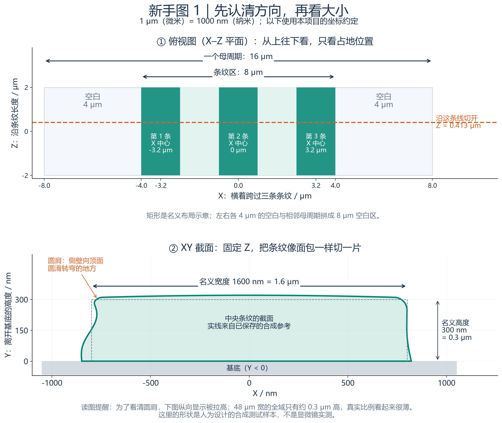

**这张图要解决的问题：同一个东西，为什么有时看起来是三条长方形，有时又是一条弯曲的轮廓？** 因为看的方向不同。

先看上半张。把眼睛放在样品上方往下看，就得到俯视图。X 是横着跨过条纹的方向，Z 是沿条纹延伸的方向；Y 是高度，在这张俯视图里看不出来。三条绿色长方形只是名义布局：它们的中心分别位于 X = −3.2、0、3.2 μm。每条名义宽度 1.6 μm，三个条纹所在区域宽 8 μm，一个重复母单元宽 16 μm。图中左右各 4 μm 的空白，会与相邻母单元的空白拼成 8 μm。

橙色虚线表示：在 Z = 0.413 μm 的位置把样品切开。下半张只拿中间那条条纹来展示切口，所以看到的是 X–Y 截面。想象把一根长面包切成片，切片外边缘就是这里的轮廓；换一个 Z 位置，就是切另一片。

下图绿色实线来自本项目**已保存的合成参考**，灰色虚线是名义矩形。名义矩形只有直壁和平顶；绿色实线则包含侧壁弯曲、顶面微小起伏、左右圆肩。橙色箭头指向左圆肩，也就是侧壁转向顶面的圆滑过渡。灰色底座是基底，Y = 0 是条纹与基底的接触面。

**尺度要特别留意：1 μm = 1000 nm，300 nm = 0.3 μm。** 一个 48 μm 宽的全域模型只有约 0.3 μm 高，真实比例自然显得很薄。此图为了说明圆肩拉高了截面的纵向显示比例，不能拿屏幕上的高度直接与宽度相除。300 nm 是名义高度；绿色轮廓的实际最高点会因合成起伏而改变。

读完这张图，只要能说出“X 是横向、Y 是高度、Z 是长度；截面就是固定一个 Z 切一片”，就已经掌握后面读图的基础。

### 2.3 不规则形貌是怎样来的

为了知道一个模型“错了多少”，必须有可以对照的答案。本轮先用独立的数学规则制造一个连续的参考形状，类似考试前先准备标准答案。它含有这些有意设置的特征：

- 左右侧壁倾角不同，侧壁本身还略弯；顶部与侧壁之间用圆滑过渡连接，这个转弯区域叫“圆肩”。
- 顶面横向略拱起，沿 Z 有高低起伏；条纹中心沿 Z 左右摆动，宽度也会变化。
- 中央条纹在 Z ≈ 400 nm 附近另有一个平滑的局部凸凹，用来检查方法能否保留局部特征。

这些变化使用固定随机种子和连续波形构造。可以想成把几条不同波长的小波浪叠起来：相邻位置彼此有关联，而不是每个点独立乱跳。最短随机波长为 160 nm；局部凸凹另有明确范围。

固定种子的作用是让同样的配置能够重建同样的参考形状；同一个全局坐标在局部窗口和全域窗口中也对应同一个形状。这样才不会一边换窗口、一边悄悄换了标准答案。

**这些圆肩、粗糙度和波动幅度是合成假设，未经实物测量确认。** 本轮验证的是“这三种表示能否保存这一类形状”，不是证明“真实 AH53 就长这样”。

## 3. 3D 模型到底是什么文件？

### 3.1 模型、图片、程序、预览分别是什么

一张 PNG 截图只记录某个视角看到的像素，不能从里面重新查任意位置的材料。3D 模型保存了足够的空间数据，程序可以换视角、切开、测宽度。Python 源代码负责产生或读取这些数据，配置文件则告诉程序用哪些设置。

查看器为了画得快，还会生成较轻的“预览”。这类似先用缩略图定位照片，再打开原图看细节。**预览是显示用的派生数据，误差评价读取的是原始模型。** 屏幕底层常用三角形绘图，即使看的是 P 或 V，也不能据此说三种模型实际都存成了 T。

### 3.2 直接去找这些子文件夹

以下路径都从前面给出的 `models` 文件夹继续往下找：

| 你想找的模型 | 子文件夹 | 核心数据 |
|---|---|---|
| 局部、较细的参数化模型 | `local_P_fine` | `splines.npz` 与 `metadata.json` |
| 局部、较细的直接三角表面 | `local_T_direct_fine` | `vertices.npy`、`faces.npy` 及配套文件 |
| 局部、5 nm 的直接体素模型 | `local_V_direct_fine` | `labels.npy` 与 `metadata.json` |
| 完整范围的参数化模型 | `full_P_fine` | 样条系数及说明 |
| 完整范围的直接三角表面 | `full_T_direct_fine` | 顶点、三角连接及说明 |
| 完整范围的 10 nm 体素模型 | `full_V_direct_10nm` | 约 1.152 GB 的标签数组及说明 |

`local` 是局部，`full` 是全域，`fine` 是细档，`coarse` 是粗档，`direct` 表示独立直接构建，`from_P` 表示由 P 转换而来。`edited` 是局部修改后另存的版本，普通查看器下拉列表没有列出这些编辑结果，它们仍实际保存在磁盘中。

这里使用 NumPy 的数值数组格式。`.npy` 通常装一张数值数组；`.npz` 能装多张数组；`.json` 装单位、坐标、材料等说明。它们不是 STL、OBJ 或 STEP，不能期待双击就由通用 CAD 打开。特别是 `vertices.npy` 只有点的位置，**缺少 `faces.npy` 就不知道哪三个点连成一个面**。移动模型时应保留整个子文件夹。

完整逐文件解释在末尾。只想拿小数据学习，可以先打开项目的 `samples` 文件夹：那里有从实际模型抽取的小样，不需要加载 1 GB 的完整体素体。

## 4. 三种方法的原理：同一个圆肩，三种记法

本节给出简要说明。需要看“相邻两张截面的四个点究竟如何变成曲面或两个三角形”，请配合 [P/T 生成原理专篇](AH53_P与T生成原理_从截面到三维.html) 阅读。

### 4.1 共同的输入：沿条纹切几刀，量出轮廓

先想象一条长面包。在不同 Z 位置切开，就能看到 XY 截面，也就是这一刀里横向与高度组成的外轮廓。本轮从连续参考形状取出一组有序的轮廓点，交给 P 和 T。点是沿轮廓排好顺序的，不是杂乱的点云。

局部粗档沿轮廓约每 20 nm 取点，沿长度每 80 nm 取一个截面；局部细档约为 10 nm 与 40 nm。**取点间距与最后的误差不是一回事**：两点之间用什么方式连接，决定中间能恢复多少弯曲。真实测量中的噪声本轮也没有模拟进去。

### 4.2 P：存一套连续曲线的计算方法

P 使用三次样条。你可以把它理解成：用一些控制量决定平滑曲线怎样走，在相邻截面之间也平滑过渡。电脑保存这些系数与分段位置；要查 Z = 413 nm 的截面时，就代入保存的函数计算。

为什么不是只保存“宽、高、圆角半径”几个数字？因为这里的形状会随位置变化。为了记下侧壁、圆肩和沿线波动，实际存了很多系数，局部细档数值负载约 2.118 MB。**“参数化”并不等于“只有少数尺寸参数”。**

还要区分两类参数：`configs/default.json` 中的参数用来设定合成实验；`splines.npz` 中的参数是观察参考轮廓后建立的 P 模型数据。修改配置不会自动修改磁盘上已经保存的 P。

这次按“沿截面轮廓走到哪里”和“沿 Z 走到哪里”组织样条。这样在圆顶转弯处比较容易保持数值稳定。左右边界函数也能描述许多圆肩，并不是只有这种组织方式才能表示圆肩。

P 的优点是连续、便于按部位调整；代价是需要选适合形状的函数和分区。本轮参考恰好平滑且分区对应，因此 P 很有利。遇到孔洞、断裂、多块分离材料或带噪声数据，不能直接沿用本轮结论。

### 4.3 T：把表面拼成许多小三角形

T 使用同一批观测点，把相邻截面的对应位置连接，再把连接带分成三角形。相当于用许多小平片拼出一层薄壳。每片本身是平的，足够小时整体看起来接近弯曲表面。

它保存两类核心信息：顶点的 XYZ 坐标；每个三角形由哪三个顶点组成。还需要一致的朝向、材料说明以及闭合连接，才能可靠判断壳内外。底面与 Z 两端也被封口；Z 端面只是截取窗口的人工封口，不代表真实工艺结构的末端。

查截面时，程序真的让平面去切保存的三角形，得到折线。它不是重新用 P 生成答案。本轮的 `T_direct` 从共同观测直接构建，**不经过 P**；另一个 `T_from_P` 才是由 P 导出的三角表面。

三角形越密通常越能描述弯曲，但顶点和连接也更多。它很适合通用表面显示与交换；要做“把某段左圆肩改圆一点”这样的语义修改，还需要记住哪些面属于哪个部位。

### 4.4 V：把空间分格，每格记材料

体素是三维的像素。把空间分成小立方体，每个格子记录一个整数：`0 = 空气`，`1 = 条纹`，`2 = 衬底`。本轮以格子中心的位置判断材料，再把这个编号赋给整个格子。因此弯曲边界会变成小台阶。

只保存编号还不够：还要说明第一个格子从哪里开始、每格边长多少、数组按什么顺序排列。本项目数组顺序是 **Z、Y、X**，与通常口头说 XYZ 不同；原点是第一个单元的角点，中心还要加半格。

局部细档边长 5 nm，数组形状是 `[800,100,3200]`：沿 Z 有 800 格、沿 Y 有 100 格、沿 X 有 3200 格。相乘得到 256,000,000 格；每格一个字节，所以原始标签负载是 256 MB。格子里也包含空气和衬底，不是只有条纹部分。

全域 10 nm 模型是 `[4800,50,4800]`，即 1,152,000,000 格，标签负载为 1.152 GB。若三个方向都把边长减半，同样空间的格子数会变为 8 倍。这解释了为什么不能无代价地一直缩小体素。

“5 nm 体素”只说格子边长，不承诺所有误差都恰好是 5 nm，也不说明光学仿真一定够用。本轮 `V_direct` 可以直接查询连续参考来判格子，拥有比 P/T 的有限观测更多的输入信息；它主要帮助了解体素离散本身的代价。

### 新手图 2：同一个圆肩，三种文件到底分别保存什么

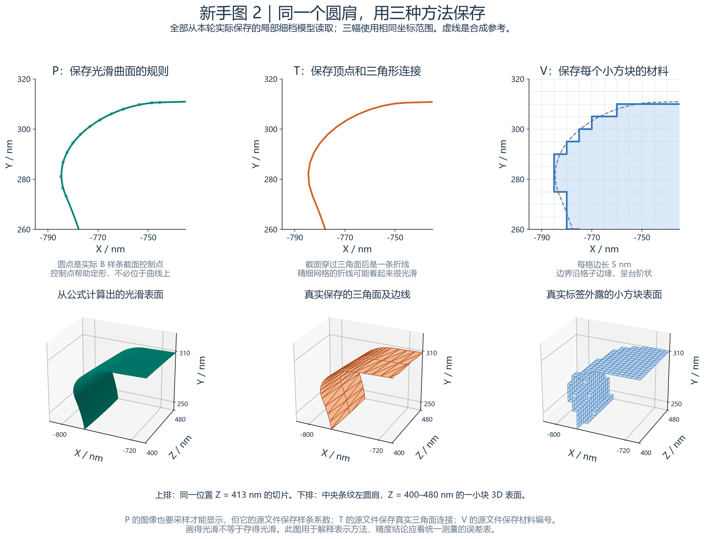

**这张图要解决的问题：既然看起来都是一个 3D 形状，P、T、V 有什么本质区别？** 区别在于文件里保存的内容，以及程序如何从这些内容恢复形状。

三列从左到右分别是 P 参数化、T 直接三角面、V 体素。这里没有另外编造三个形状：都读取本轮真实保存的局部细档模型，并取中央条纹左圆肩附近同一个区域。上排三图都是 Z = 413 nm 的 XY 切片，坐标范围相同；灰色虚线是共同的合成参考。P/T 与参考很接近，所以有些地方虚线会被彩色实线遮住。看不见虚线不意味着没有参考。

**左列 P：保存一套能算出曲线、曲面的规则。** 上排绿色曲线是从保存的 B 样条系数计算出来的截面。浅色小圆点是固定 Z 后得到的实际截面控制点；它们影响曲线怎么弯，通常不必落在曲线上。这些控制点与最初输入的观测点是不同概念。下排的光滑面是把保存的公式算得足够密之后画出来的；这一步只是显示，源文件保存的仍然是系数和节点，不是截图里那些像素。

**中列 T：保存很多点的位置，以及哪三个点组成一个三角形。** 上排橙色轮廓是用 XY 平面切过保存的三角面所得到的实际折线。网格足够细时，折线在屏幕上也会显得接近光滑。下排刻意画出三角面之间的边线：每个橙色小面都是实际保存的连接关系。它不是只有一批散点，也不是从 P 复制出来的显示效果；这里读的是 `local_T_direct_fine`。

**右列 V：把空间分成小方块，每块存一个材料编号。** 上排一个方格是 5 nm × 5 nm 的切片，浅蓝表示条纹材料，白色表示外部空气；蓝色轮廓沿格子边界行走。下排是真实 5 nm 立方体的外露表面，所以能看见台阶。这里没有对边界做平滑。源文件中的编号是 0 = 空气、1 = 条纹、2 = 基底；这个放大区域远离基底，因此图中看不到编号 2 的部分。

下排取 Z = 400–480 nm 的局部表面，并裁切到同一个观察盒子；图的外缘是观察范围的边缘，不能当作条纹本身突然断裂。3D 视图中竖直方向仍是 Y，高度轴没有换成 Z。

**这张图主要帮助理解“存储方式”，不是用肉眼选冠军。** 判断误差仍应看统一条件下的测量。尤其不要因为 P 和 T 的截图都很顺滑，就认为它们保存方式完全相同；也不要把 V 的台阶误认为查看器加载失败。

## 5. 我按什么顺序做了什么？

| 步骤 | 实际做的事 | 你可以从哪里核对 |
|---|---|---|
| 1 | 核对计划、版图与轴含义，记录哪些尺寸是假设 | `inputs/source_provenance.json`、`configs/default.json` |
| 2 | 构造独立的连续参考形貌，并取共同观测轮廓 | `reference_geometry.py`、`models/*observations*` |
| 3 | 分别建立 P、T_direct、V_direct，保存并重新读取 | `models` 各子文件夹 |
| 4 | 用未参与构建的截面位置评价，比较距离、线宽、材料和资源 | `metrics.csv`、`details`、`profiles` |
| 5 | 从已保存模型做四条转换路线，计算新增和总偏差 | `conversions.csv`、`lineage.json` |
| 6 | 改动局部圆肩，检查改动区域与远处是否符合预期 | `edit_check.md`、`models/*edited` |
| 7 | 检查模型闭合、保存后能独立查询，并做数值复核 | 各 `audit` 和 `saved_model_isolation.json` |
| 8 | 做离线查看器、示例小文件、图表和说明，实际操作验收 | `viewer`、`samples`、`figures`、`ui_validation.json` |

保存后再读回很关键：否则程序可能在评估时直接借用参考答案，画面虽对，模型文件本身却没真正保存那些信息。本轮对 14 个保存模型做了禁止参考生成器参与的隔离查询检查。

### 5.1 实验 A：独立建立三种表示

局部粗档 3 个、局部细档 3 个、全域 3 个，一共 **9 组**。P 与 T 使用同一批有序观测，V 从参考独立判定格子。局部细档让我们看几何细节，全域让我们检查规模扩大后的实际资源。

### 5.2 实验 B：已经有一种格式，再转成另一种

| 路线 | 从哪里来，到哪里去 | 要回答的问题 |
|---|---|---|
| B1 | P → T_from_P | 把连续函数铺成三角片，额外损失多少？ |
| B2 | P → V_from_P | 直接按 P 给体素判材料，会怎样？ |
| B3 | P → T_from_P → V_from_T | 先三角化再体素化，与直接体素化有多少差别？ |
| B4 | 共同观测 → T_direct → V_from_Tdirect | 以独立三角表面为源，也能走到体素吗？ |

三条最终体素路线使用相同的 5 nm 网格原点与间距，所以可以逐格比较。另做了一次全域 P → T，检查扩大尺寸后的转换。

为避免 P 导出的三角面恰好落在所有拟合结点、造成偶然的特殊结果，内部 Z 导出截面相对拟合截面移动了半步，即 20 nm；端部另行保留。这个设置记录在来源信息里。不同采样位置也会影响误差，所以不能从一次比较推断某条路线永远更好。

### 新手图 3：A 和 B 为什么要分开做

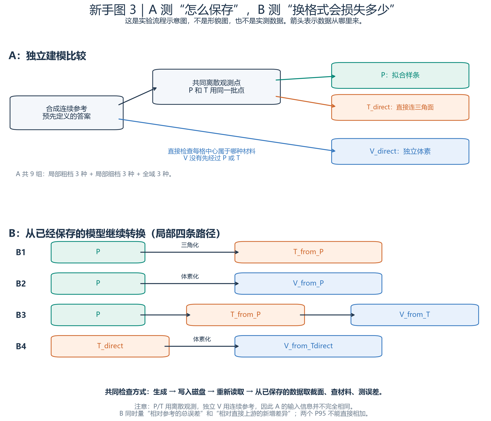

**这张图要解决的问题：计划书里的 A、B、direct、from 究竟分别在说什么？** 先按箭头方向从左往右读，箭头表示数据来源。

上半张 A 是独立建模比较。最左边先定义一个“已知答案”的合成连续参考。然后从参考取一批离散的观测点，把完全相同的一批点分别交给 P 和 T：P 用这些点拟合样条，T 直接将这些点连接成三角面。这里 `direct` 的意思是直接从共同观测建立，没有先经过另一个候选表示。

V_direct 走另一条箭头：在网格的每个小方块中心查询合成参考，判断该格属于空气、条纹还是基底，再保存材料编号。它没有先经过 P 或 T。**这也意味着，P/T 的输入是有限个观测点，而独立 V 能查询连续参考，三者输入信息并不完全相同。** A 可以研究本次设置下的表示差异，但不能据此声称已经完成了所有方法“输入完全相同”的比赛。

A 有 9 组，是因为：局部粗档做 P/T/V 三种，局部细档再做三种，全域再做三种。这里的数字表示实验组合数量，不是 9 种原理。

下半张 B 研究换一种表示时会增加什么差异。`from` 后面的词告诉你从谁转换而来：

- B1：P → T_from_P。把已经保存的 P 曲面重新读入，再采样并连接成三角面。
- B2：P → V_from_P。重新读入 P，根据小方块中心在 P 内还是外，给每格编号。
- B3：P → T_from_P → V_from_T。先转换成三角面，再根据已经保存的三角面生成体素。
- B4：T_direct → V_from_Tdirect。从 A 中直接建立的三角面出发生成体素，前面不经过 P。

四条路径的目标是把“原来的表示误差”和“后续转换造成的差异”分开观察。因此每个转换结果都要看两类比较：与最初参考相比，是整条路径的总误差；与直接上游相比，是这一步转换产生的差异。两次比较的 P95 不是可以直接相加的账单，不能用“上游 P95 + 转换 P95”代替实际测量的总 P95。

图下方“生成 → 写入磁盘 → 重新读取 → 测量”也很关键：它是在检查交付的文件本身能否恢复模型，而不只是检查程序内存里曾经存在过一个正确的形状。图中画的是局部四条转换路径；本项目另外保存了全域 P → T 的转换结果。

## 6. 怎样判断“像不像”？这些指标在说什么？

### 6.1 先切开，再量轮廓之间的距离

本次主指标是在若干 **XY 截面**上计算的。局部使用 Z = −1783、−1167、−443、137、413、677、1549 nm 等未用于建模的位置；程序比较保存模型的真实截面与参考截面。

具体说，从一条轮廓上取一点，到另一条轮廓上找最近的线段距离；再交换方向做一次。这叫“双向”。如果只单向检查，一条漏掉凸起的轮廓可能被低估。评价按轮廓弧长加权，可以理解为沿边界等距离地走，而不是让某处密集的采样点占更多票数。

它衡量的是本轮选定截面的边界距离，**并非把整个三维表面上每个位置都查遍，也不是严格的全三维 Hausdorff 距离**。底部接触面和人为 Z 封口不计入自由表面误差。左侧壁、左圆肩、顶部、右圆肩、右侧壁还分别统计，避免面积大的顶部掩盖小圆肩的问题。

### 6.2 RMS、P95、最大值怎样读

| 指标 | 白话解释 | 不能理解成什么 |
|---|---|---|
| RMS，均方根 | 把每个误差平方后加权平均，再开方；大偏差会受到更多重视 | 不是最大误差，也不是“所有点都差这么多” |
| P95，第 95 百分位 | 按规定权重看，95% 的采样距离不超过这个数 | 不是模型有 95% 的概率正确，也不是全域误差上界 |
| 本次采样最大值 | 这次查到的最大偏差 | 不是未经查询位置的保证 |

例如某条模型的 P95 为 2.37 nm，表示按这套截面与权重规则，约 95% 的距离不超过 2.37 nm。这里的 95% 来自距离的统计，并不是“模型的 95% 体积正确”。

另一个容易混淆的地方：配置里的“中心波动 RMS 6 nm”描述形状自身怎么摆动；结果表的“边界误差 RMS”描述模型与参考相差多少。即使形状摆动很多，只要保存得准确，误差仍可很小。

### 6.3 CD 和中心：宽度变了，还是整体挪了？

CD 在这里就是某个高度、某个 Z 位置的线宽：`右边缘 X − 左边缘 X`。中心是两边缘位置的平均值。需要在 Y = 30、150、270 nm 分别测，因为倾斜侧壁在不同高度宽度不同。

举一个**教学用的假想例子，不是本轮测量数据**：左边在 −800 nm，右边在 800 nm，则宽度 1600 nm、中心 0。两边都右移 10 nm，宽度仍是 1600 nm、中心变成 10 nm；左边向左 5 nm、右边向右 5 nm，则宽度变成 1610 nm、中心仍是 0。这两种变化的含义不同，所以必须分别测。

这里的中心是几何中心，并不是通过光学信号计算的对准偏差。沿 Z 的曲线还可以比较波动幅度、相关性和不同波长段的功率；新人先看它有没有丢掉局部起伏即可，频谱详细值放在技术报告和 `details` 里。

### 6.4 为什么还要看材料、体积与资源

材料检查会问：“同一个空间点，两个模型都说它是条纹吗？”边界附近最容易判错；如果把大片空气也算入分母，全局错分率可能显得非常小，因此同时统计边界附近 ±20 nm 区域。

体积表示条纹一共占多少空间。一个地方多一点、另一个地方少一点，体积可能抵消，所以体积相近不代表边界处处相近。

资源则有三个不同量：数值数组本身多少字节、文件在磁盘上占多少、程序运行时占多少内存。全域体素标签约 1.152 GB，构建峰值内存约 1.238 GB；二者不同，因为内存还有解释器、临时数组和驻留映射页。本报告的 MB、GB 用十进制换算。

### 6.5 小到 0.015 nm 的误差是不是“制造精度”？

不是。本轮细档 P 的 P95 约 0.015 nm，说明在这套无测量噪声、平滑、分区相匹配的数学参考上，保存的函数拟合得很接近。这个数字不能证明真实仪器能测这么准，也不能证明加工能达到这种精度。

评价自身也有离散近似。本轮把参考轮廓评价步长从 1 nm 加密到 0.25 nm，抽查差异最大约 0.00133 nm。因此对非常小的拟合误差，应该连同评价误差一起理解。计划中的 1 nm 是观察阈值，不是经过工艺确认的合格线。

### 新手图 4：同样叫“误差”，到底在量什么

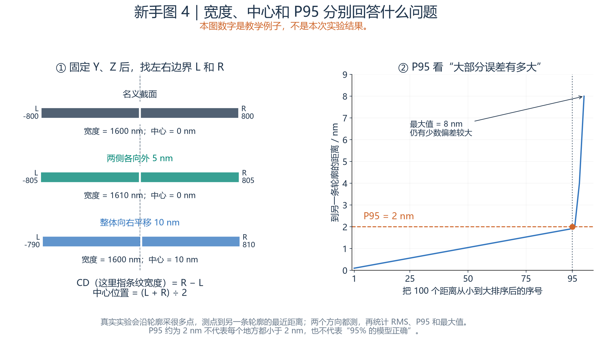

**这张图要解决的问题：宽度、中心、P95 这些指标为什么不能互相替代？** 图中数字是专门设计的教学例子，不是本轮实验结果。

左图固定同一个高度 Y 和长度位置 Z，找到左边界 L 与右边界 R。两边距离就是宽度，这里也叫 CD：`CD = R − L`。中间位置是：`中心 = (L + R) ÷ 2`。

灰条的左右边界为 −800 和 800 nm，宽度为 1600 nm，中心是 0。绿条把两边分别向外推 5 nm，宽度变成 1610 nm，但中心仍然是 0。蓝条则把整个形状向右平移 10 nm，宽度还是 1600 nm，中心变成了 10 nm。因此“条纹变粗”和“条纹横向跑偏”是两种不同问题，需要分别测量。图中长度变化很小，主要看标出的数字，不必靠肉眼判断 5 nm 的差别。

右图假设已经得到 100 个边界距离，把它们从小到大排序。横轴是排序后的序号，不是 X、Y 或 Z 的空间位置；纵轴才是距离，单位是 nm。橙色点与虚线说明这个教学例子的 P95 为 2 nm，可以理解为“大约 95% 的距离不超过这个量级”。最右边仍有少数较大距离，最大值达到 8 nm。所以 P95 好看，并不代表最糟的位置也同样好。

在本项目实际测量中，程序沿截面轮廓取点，测每个点到另一条轮廓的最近距离；然后反过来再测一次。这样才不会只照顾一条轮廓。得到距离后再统计 RMS、P95、最大值等指标。**P95 是误差距离的统计量，不是“模型正确率 95%”。** 实际报告也要同时看各区域与最大误差，不能只看一个总体 P95。

<!-- 维护说明：上述 4 图由 scripts/build_beginner_figures.py 生成，PNG 供网页阅读，SVG 供无损放大。图 1 的下半图、图 2 均使用 results/20261024_v2/models 中保存数据；图 3 是依据代码数据流绘制的示意；图 4 是明确标注的虚构教学例子。脚本只读原模型，不改变 results 或 src。 -->

## 7. 已经得到什么结果？如何合理使用这些结果？

先看局部细档这张最小表，完整九组结果在技术报告和 `metrics.csv`：

| 保存方法 | 本轮截面 P95 | 数值负载 | 读这行时应该记住 |
|---|---:|---:|---|
| P 参数化 | 约 0.015 nm | 约 2.118 MB | 平滑参考与本次样条方法很匹配 |
| T_direct 直接三角面 | 约 0.434 nm | 约 6.244 MB | 同样观测点之间使用平面连接 |
| V_direct，5 nm 格 | 约 2.367 nm | 256 MB | 台阶量化影响边界；直接参考输入更充分 |

加密有帮助：局部粗档的三个 P95 分别约为 0.489、1.296、4.626 nm。全域的三个 P95 约为 0.014、0.307、4.683 nm，其中全域体素使用 10 nm 格子，与局部细档的 5 nm 不同。

这些结果支持一个有条件的判断：**对于本轮这样的平滑、结构固定、需要按部位编辑的条纹，P 值得作为可编辑源，再按需要生成 T 或 V。** 同时保留原始观测，避免只剩拟合后的结果。若输入本来就是可靠三角网格，也允许 T 成为独立源数据，无需强行先转成 P。

本轮没有证明 P 对所有实物都最好，也没有用光学仿真证明某个误差足够小。进入真实应用前，还要面对测量噪声、更多形状类型和实际下游算法的要求。

## 8. 转换与修改：不是“换文件名”

### 8.1 一次转换会重新近似形状

把 P 转为 T，要决定在哪里取点、怎样连三角形；把任意源转成 V，要按格子中心重新判材料。输出是新的几何表示，因此可能偏离输入。

“总误差”比较输出和最初参考；“新增误差”比较输出和它直接的上游。比如 B1 的总 P95 约 0.235 nm，新增 P95 约 0.231 nm。它们不是同一组距离的统计，所以不能简单相减得到 P 的误差，也不能把所有路线的 P95 累加。

B2、B3、B4 的总 P95 分别约 2.367、2.377、2.385 nm；本轮 5 nm 体素格带来的量化效应较明显。B2 与 B3 的标签相差 20,327 格，占整个局部网格约 0.00794%，占两份条纹材料并集约 0.04442%。比例看似很小，也不能直接推出光学影响为零。

### 8.2 我还实际改了一次局部圆肩

目标是在中央条纹的一小段左圆肩区域沿 X 移动约 10 nm，并让改动在边缘平滑收回。P 通过修改局部系数实现，T 通过移动局部顶点实现；原文件保留，修改后另存为带 `edited` 的文件夹。

P 改了 130 个系数，实际最大 X 位移约 9.707 nm；T 改了 195 个顶点，实际最大 X 位移约 9.855 nm。由于窗口权重与离散位置，实际最大值不恰好等于请求的 10 nm。报告中的“最近轮廓距离”约 6.22/6.32 nm 是另一种度量，不应和 X 位移混为一谈。

远离修改区的检查差异约为浮点数舍入量级。P 的这次编辑保留了编辑前圆肩连接点的位置和该段端点切向；这不等于重新证明所有分段接头严格一阶连续。T 的局部面夹角仍会随顶点移动变化。这个实验说明两种格式都能编辑，也展示了以部位和连接条件为目标时需要关注什么；不能据此说三角表面不能修改。

## 9. 哪些检查使这些结果更可信？

程序有针对核心几何、距离统计与配置行为的 11 项测试，并检查了三角面的闭合连接、体积计算以及保存模型的独立读取。评价位置与构建位置分开，防止只在原采样点上得到过于乐观的答案。体积还改用独立积分点复核，避免把同一批结点重复当作独立验证。

这些检查提高的是“程序是否按约定工作”的可信度，不能把合成参考变成实测事实。当前范围包括固定拓扑的条纹、指定采样密度与本轮配置；没有覆盖所有可能形状。

查看器也经过实际浏览器操作：切换模型与路线、旋转缩放、截面、投影、高度倍率、截图和文档链接。详细记录在 `ui_validation.json`。加载大模型需要时间；某次浏览器帧间隔或加载耗时不代表所有电脑都达到同一速度。

## 10. 读图片前，先记住这四条

1. **先看图回答什么问题，再看线条。** 布局图回答“在哪里”，误差图回答“差多少”，截图回答“怎么操作”。
2. **看坐标单位与比例。** 一张图可能用 µm，另一张用 nm；高度放大后不能直接凭肉眼判断宽高比。
3. **分清参考、模型、预览。** 参考是合成标准答案，模型是保存后的数据，预览是为了显示而简化的版本。
4. **细线重合只能说明当前尺度难以分辨。** 定量判断要看误差表；去均值后的曲线还隐藏了整体偏移。

后面的“逐图讲解”会依次说明 8 张结果图和 3 张查看器截图：每张在问什么、横纵轴是什么、颜色是什么、先看哪里、能得出什么、不能得出什么。

## 11. 第一次打开查看器：照着做一遍

### 11.1 启动与看完整布局

在项目根目录双击 `启动3D查看器.bat`。启动窗口保持打开，浏览器会打开本机地址，一般是 `http://127.0.0.1:8765/`；若端口占用则以启动窗口给出的地址为准。这个地址只连接本机服务，不是把模型发布到互联网。

默认是“实验 A”“完整 Mark”“参数化模型”。先点 **“俯视 XZ”**，应能看见九条纹、每三条成一组。若第一次缓存尚未生成，等待页面完成加载；一直报错时看启动窗口，不要把空白当成模型没有高度。

左键拖动旋转，滚轮缩放，右键拖动平移；迷路时点“重置视角”。真实高度比例是 1×，扁平是尺寸决定的。可临时选 20× 辅助观察，但记得画面里的 **Y ×20** 提示。

### 11.2 看圆肩和三种表示

把“数据场景”改成 **“局部 · 16 × 4 µm”**，“观察范围”改成 **“局部圆肩 · 左上角”**。选择细档 P，点 **“沿条纹看 XY”**，投影选 **“正交 · 尺寸核对”**，高度倍率恢复 1×。

然后依次切换细档 T_direct 与 V_direct。T 开启“三角线框”可看连接；V 的局部显示能看到暴露的体素单元面。细节图中看到台阶是这种离散表示的特征，不能只用平滑着色把它掩盖掉。

“单条纹”与“局部圆肩”是局部观察窗口，不表示把完整 48 µm 长度的全部细节同时展开。全域画面也有简化，查看“来源、分辨率与显示精度”可了解当前从哪个模型生成、用了什么显示采样。

### 11.3 动手切一刀

在 **“XY 截面 · Z 位置”** 下方数字框输入 `410`，表示沿长度走到 Z = 410 nm，切出横向与高度组成的截面。再改为 `670`，观察同一条纹在另一处的轮廓。上方三维图用于定位，下面截面图用于读具体轮廓。

在 **“XZ 等高截面 · Y 高度”** 输入 `150`，相当于水平切开高度 150 nm 的位置，查看沿条纹长度的两条边缘。再改为 `270`，靠近顶部，线宽通常会不同。体素切片会提示落在哪一层；它不能在格子内部凭空恢复连续形状。

保持“截面叠加参考 / 直接面 / 参数导出面”勾选，可以在同一位置看轮廓差别。截面图横纵轴各有独立刻度，图形看起来的倾角不一定等于实际物理倾角，请读轴数值。

### 11.4 看转换与保存截图

把“实验 / 转换路线”选 B1、B2、B3 或 B4，查看该路线实际输出的模型。路线选择不是简单改标签，它会限制可选数据。细档转换均在已经保存的局部模型之间进行。

点“保存截图”，会在当前结果的 `figures/screenshots` 中保存 PNG 和来源 JSON。PNG 是当前画面，JSON 说明当时模型、截面与显示设置，**此按钮不导出 STL 或新的 3D 模型**。本轮截图也在逐图讲解里逐张解释。

### 11.5 为什么说明能双击，查看器不行？

这份 HTML 说明是静态页面，双击即可离线阅读，图片相对路径也都在项目目录里。查看器需要程序读取模型并计算截面，所以要用启动器；直接双击 `viewer/index.html` 不能代替启动服务。

如果把项目复制到别的电脑，`.venv` 不能当作通用便携环境照搬，需要按照 README 安装 Python 依赖。如果从 GitHub 下载，代码、文档、结果图、小样都在；**多 GB 的完整 `models` 和本机 Python 环境没有上传**，需要按 README 在本地重建，或从当前电脑复制模型文件夹。

## 12. 现在可以怎样继续学习？

第一步，先辨认一组里的三条条纹、X/Y/Z 和两个切面。第二步，在同一个圆肩位置切换 P、T、V，并说出它们保存了什么。第三步，打开 `samples/README.md`，对照文件指南看一次顶点、三角连接、样条与体素标签。最后再读误差图和完整技术报告。

如果未来要替换成真实样品，需要输入真实测量或可靠工艺模型，说明测量坐标、分辨率与噪声，再重新评价。单张俯视图或单张截面照片通常不能唯一确定完整三维形状。当前模型适合用来学习和检验数据结构，不能作为真实器件的测量结果引用。

## 13. 常见词速查

| 词 | 在本项目中的意思 |
|---|---|
| 几何表示 | 电脑保存空间形状的办法 |
| 参考形貌 | 独立数学规则生成的合成标准答案 |
| 观测轮廓 | 从参考取出的有序截面点，P/T 的共同输入 |
| 侧壁 / 圆肩 / 顶面 | 条纹的侧面 / 顶部转弯过渡 / 上表面 |
| 样条 / 系数 / 结点 | 分段平滑函数 / 决定形状的数值 / 分段位置 |
| 顶点 / 面片 / 连接 | 三维点 / 三角形 / 哪些点组成同一个三角形 |
| 体素 / 标签 | 三维小格 / 该格的材料编号 |
| 元数据 metadata | 单位、坐标、材料、来源等配套说明 |
| 裁片 / 截面 | 从空间范围取一部分 / 用平面切开得到的形状 |
| 粗档 / 细档 | 采样间隔较大 / 较小，本轮有明确数值 |
| 派生模型 / 来源链 lineage | 从另一模型转出的结果 / 记录由谁、按什么设置生成 |
| 闭合 / 拓扑 | 表面没有破洞且连接一致 / 各部分怎样相连 |
| 预览 / 渲染 | 用于显示的几何简化 / 把几何画成屏幕像素 |
| 哈希 SHA256 | 文件内容的指纹，可检查来源是否变化；不代表科学结论正确 |


---

## 逐图阅读指南：每张图到底在回答什么

这一部分按图片文件名的 01～08 顺序讲解，再解释三张查看器截图。图片不是装饰：01 告诉你物体怎样排列，02 告诉你我们要保存什么形状，03、04 检查局部形状是否保留下来，05 比较误差与数据量，06 展示完整规模，07 检查转换是否损失细节，08 检查长条纹上的波动。三张截图则告诉你在查看器里怎样亲自观察这些事情。

先记住坐标：**X 是左右方向，Y 是离开底面的高度，Z 是条纹延伸的方向。** 俯视图看 XZ；像切面包一样在固定 Z 位置切一刀，得到 XY 截面。1 µm（微米）等于 1000 nm（纳米），因此 1.6 µm 的宽度就是 1600 nm，300 nm 的高度就是 0.3 µm。图上的颜色只是用来区分曲线或对象，不代表真实材料的颜色，也不是光学模拟结果。不同图片的颜色含义可能不同，要重新看各图图例。

图例中的几个名称也可以先翻译成人话：P 是“用可计算的连续曲线参数保存形状”；T_direct 是“把共同观测到的轮廓点直接连成三角面”；T_from_P 是“先有 P，再从 P 生成三角面”；V_direct 是“直接把参考形状填进小方格”；V_from_T 是“先有 P，再生成三角面，最后填进小方格”。这里的 V 是体素，可以把它想成三维小积木，每块记录自己是空气、条纹还是衬底。

### 图 01：先认清三条纹怎样组成一个母单元

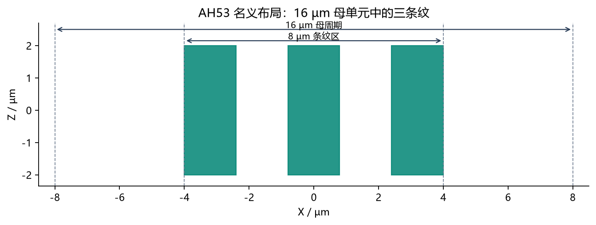

**这张图回答：“我们到底在建什么排列？”** 它是一张从上往下看的平面布局图，还没有画高度、圆肩或侧壁。

横轴是 X，纵轴是 Z，单位都为 µm。三个青绿色长方形是三条名义条纹，宽度各为 1.6 µm，中心在 X＝−3.2、0、3.2 µm。它们分别占据 X＝−4～−2.4、−0.8～0.8、2.4～4 µm。灰色虚线中，X＝−8、8 是母单元边界，X＝−4、4 是三条纹所占区域的外边界。上方长箭头的 16 µm 是整个母单元宽度，短箭头的 8 µm 是条纹区宽度。

按这个顺序看：先数出三条纹，再看条纹区两侧各有 4 µm 空白，最后想象把整个 16 µm 单元向右复制。两个母单元相接时，右侧 4 µm 空白和下一组左侧 4 µm 空白合起来，形成 8 µm 的组间空白。组内相邻条纹间的空隙只有 1.6 µm。

因此，**3.2 µm 是组内相邻条纹的中心间距，16 µm 才是整组重复的母周期。** 如果把 3.2 µm 当成整个图案的重复周期，组间的大空白就会丢失，得到另一个结构。

图中 Z 从 −2 到 2 µm，共 4 µm，是本次局部验证窗口的长度。它不能证明真实器件一定长 4 µm，也不能拿它推断完整 Mark 的实际尺寸。这张图的作用是核对布局；比较三种保存方法之前，首先必须保证大家建的是同一个物体。

### 图 02：为什么不能只保存一个理想长方体

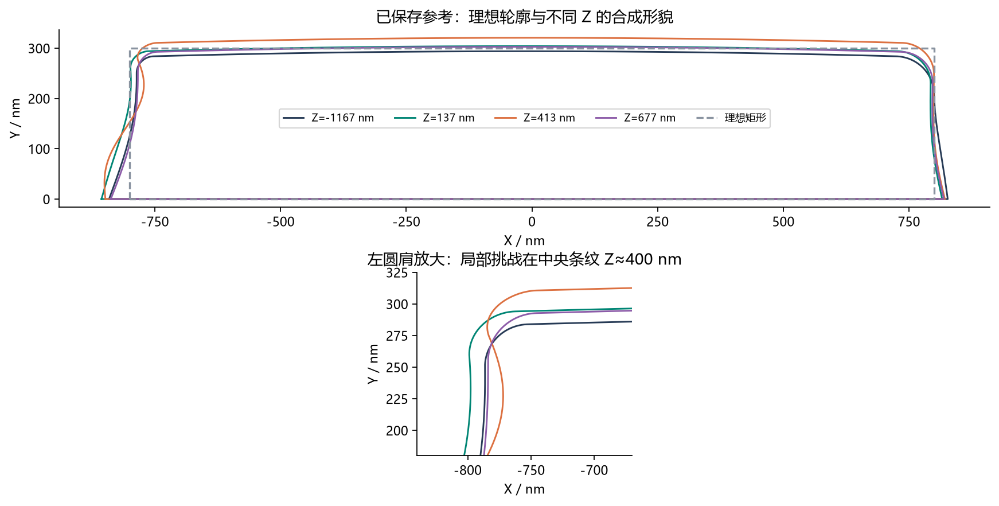

**这张图回答：“这次故意给几何保存方式出了什么题？”** 图里的彩色轮廓都来自本次人为设定的连续参考形状。“参考”是实验的标准答案，便于计算误差；它不代表显微镜测出来的真实 AH53。

上图横轴 X、纵轴 Y，单位都是 nm。画的是中间那条纹，所以中心恰好在 X＝0。灰色虚线长方形宽 1600 nm、高 300 nm，是理想状态：侧面竖直，顶部水平，角是直角。四条彩线表示沿同一条纹在不同 Z 位置切出的截面：深蓝是 −1167 nm，绿色是 137 nm，橙色是 413 nm，紫色是 677 nm。**这里颜色表示位置，不表示 P、T、V 三种方法。**

先沿灰色矩形走一圈，再沿彩色轮廓走一圈。你会看到侧壁有弯曲和倾斜，上角变成圆滑过渡，顶面不完全水平，左右两侧也不完全对称。接着比较四条彩线：同一条纹在不同长度位置，截面不是完全一样的，所以只用一个截面沿 Z 拉长也不够。

下图把左上角放大，横轴范围约为 −840～−670 nm，纵轴约为 180～325 nm。它没有产生一个新物体，只是把上图的一小块展开来看。左壁转向顶面的区域叫“左圆肩”，类似一张桌子被磨圆的桌角。橙色截面位于 Z＝413 nm，接近人为局部变化中心 Z＝400 nm，因此它的顶面更高，左壁附近也有明显变化。该局部变化用来测试保存方式能否保留局部细节，而不是只保留平均宽高。

这张图能说明实验对象比理想矩形复杂；它不能证明实际加工出来的 AH53 就有这些波动。后面所有“误差小”，都是相对这里的合成参考而言。

### 图 03：同一个圆肩，三种保存方式会留下什么形状

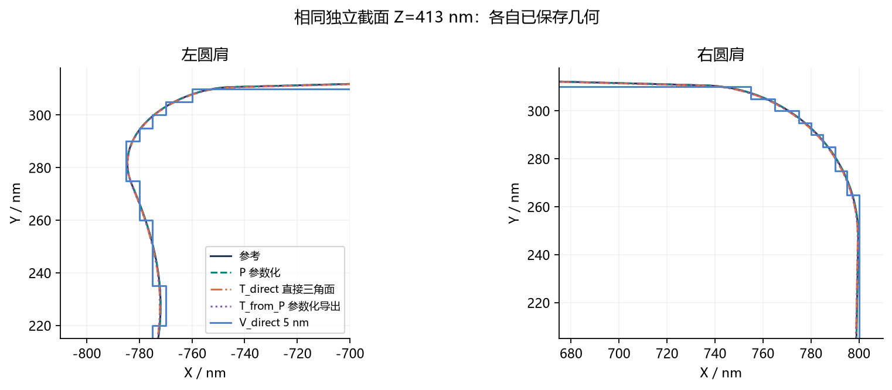

**这张图回答：“同一个细节存入不同格式，再读回来，还像不像原来？”** 两幅图都固定在 Z＝413 nm；左幅看左圆肩，右幅看右圆肩。横轴 X、纵轴 Y，单位都是 nm。左右两幅的坐标范围不同，但每幅内部的 X、Y 使用相同物理长度比例。

图例需要逐条认：深蓝实线是参考；绿色虚线是 P 参数化细档；橙色点划线是 T_direct 直接三角面细档；紫色点线是 T_from_P 参数化导出的三角面；蓝色实线是 V_direct 的 5 nm 原始体素边界。“5 nm”意味着每块小方格的边长为 5 nm，三维里则是 5×5×5 nm 的小方块。

先找最容易辨认的蓝色台阶线。圆弧不能用整齐的小方块完全填平，所以边界只能水平走一段、竖直走一段。这不是截图不清晰，而是原始体素数据本来就有这种几何台阶。再找深蓝参考线和绿色虚线，它们在这张图的显示尺度下几乎重合。橙色、紫色的三角面截线也很接近参考；三角面与一个平面相交，得到的是一段段直线，只是这里的线段已经足够小，未必能靠肉眼分辨。

Z＝413 nm 不在用于建模的 40 nm 或 80 nm 常规长度节点上，因此这次是在检查“两个已知切片之间的形状”，不只是在检查建模时用过的点。轮廓从各自保存的模型重新计算出来，三角面用实际面片求交，体素从实际标签读边界。

这张图给出一个典型位置的直观证据，不能代表所有位置。几条线肉眼重合，也不能当成误差为零；是否达到某个精度，要继续看图 05 的数字。它支持的直觉是：圆滑形状可以用连续曲线或细三角面很好地保存；体素边界会受到小方块尺寸的限制。

### 图 04：沿着条纹走，中心、宽度和高度是否一起保留下来

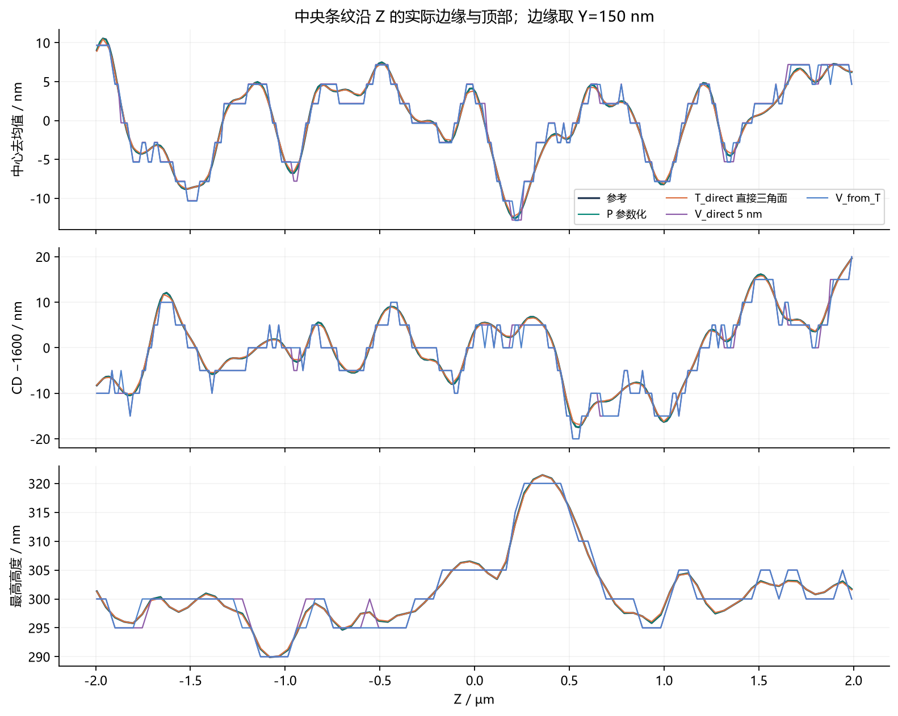

**这张图回答：“轮廓在一个切面上很像，沿整条线的变化也还在吗？”** 三个小图的共同横轴是 Z，从 −2 到 2 µm。纵轴都用 nm，但三幅图测量的是三件不同的事，不能把它们混成同一种误差。

上图是“中心去均值”。在 Y＝150 nm 的高度，找到左右边缘的 X 坐标，把两者加起来除以 2，得到该位置的线中心。再减去这条中心曲线自己的平均值，就得到图中曲线。高于 0 表示相对自己的平均中心偏右，低于 0 表示偏左。因此这是一张“左右摇摆”的图。**它不是模型与参考的误差曲线，也会消去恒定的整体中心偏移；两条去均值曲线重合，不能证明它们的绝对中心完全一致。**

中图是“CD−1600”。CD 在这里就是同一 Y＝150 nm、同一 Z 位置的左右边缘间距，也就是线宽。1600 nm 是名义宽度。纵轴 +10 nm 表示实际宽度为 1610 nm，−10 nm 表示宽度为 1590 nm。这样减去一个大基数，几纳米的宽度变化就容易看见了。

下图是该 Z 截面的最高点高度。这里画的是实际高度，例如 320 nm，不是相对 300 nm 的差，也不是固定 Y＝150 nm 的测量。Z≈0.4 µm 处明显的高峰，对应前面人为加入的局部顶部凸起。图里的最高点大约到 321 nm，是合成模型本身的一部分，不是保存误差。

这张图中深蓝为参考、绿色为 P、橙色为直接三角面、紫色为 5 nm 直接体素、蓝色为从三角面转换来的 5 nm 体素。注意：图 03 的蓝色代表直接体素，这张图的蓝色已经换成转换体素，必须以当前图例为准。

阅读时先选一处明显峰谷，例如 Z≈0.4 µm 的顶部峰，看各曲线是否在相同位置出现；再观察平滑曲线和台阶曲线的差别。P 和直接三角面保留了主要峰谷，两个体素结果也保留整体变化，但叠加了量化台阶。这里的“量化”就是把连续的任意数值限制到有限的网格位置。体素中心可能以半个单元的间隔变化，因为中心是两个网格边界的平均值；不能把中心的每次跳变都解释为一个完整单元。

正式统计还把这些候选曲线与参考相减，得到局部细档在 Y＝150 nm 的线宽 RMS 误差：P 约 0.011 nm、直接三角面约 0.215 nm、直接体素约 2.095 nm。RMS 可以理解为把整条曲线上偏差综合起来得到的一种典型大小，它不是最大误差。数值来自全部规定对象与采样的统计，不是对图上中央条纹肉眼估出来的数。

### 图 05：保留得越精细，要花多少数据量

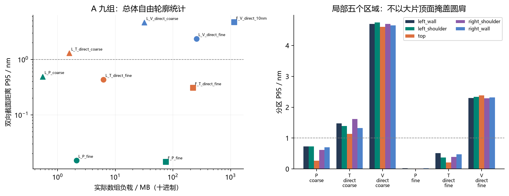

**这张图回答：“精度和数据量之间怎样取舍，局部圆肩有没有被平均数掩盖？”** 左右两幅图必须分开看。

左图一个点代表一组完整实验。横轴是“实际数组负载”，单位为十进制 MB，1 MB＝1,000,000 字节；它统计真正存坐标、连接或材料标签等数值数组用了多少数据。纵轴是双向 XY 截面距离的 P95，单位 nm。它把规定截面中“参考到候选”以及“候选到参考”的边界距离都纳入统计，按照代表的边界长度加权。P95＝2 nm 的含义是：本次这个统计口径中，95% 的加权距离不超过 2 nm，仍有一部分更大。它不是“整个三维物体的最大误差为 2 nm”。

横纵两个坐标都是**对数刻度**。横轴 10⁰、10¹、10²、10³ 分别是 1、10、100、1000 MB；相同横向距离表示乘以 10，不是增加相同 MB。纵轴 10⁰ 是 1 nm，10⁻¹ 是 0.1 nm。因此不能像普通等间隔坐标那样按距离做加减。向左表示数据更少，向下表示这个统计误差更小；在口径相同的条件下，左下方较省数据且较准。

颜色分别为绿色 P、橙色直接三角面、蓝色直接体素。三角形是局部粗档，圆点是局部细档，方形是完整规模；名字里的 L 是 local（局部），F 是 full（完整规模），coarse 是粗档，fine 是细档。灰色水平虚线在 1 nm，只是本次选定的观察目标，不是已经确认的工艺合格线。

建议先只比较三个局部细档圆点：P 约 2.118 MB、P95 约 0.015 nm；直接三角面约 6.244 MB、P95 约 0.434 nm；5 nm 体素约 256 MB、P95 约 2.367 nm。然后在同一颜色中比较粗档三角形与细档圆点，看加密后误差怎样下降、数组怎样增大。最后看完整规模的方形：它们覆盖更大范围，不能因为数据更多，就认为算法退步了。完整体素用的是 10 nm 单元，也不能拿它与局部 5 nm 单元当成同一分辨率比较。

右图只显示六组局部实验，横轴是方法与粗细档，纵轴是普通等间隔的分区 P95，单位 nm。每组五根柱分别代表：深蓝 left_wall＝左侧壁，绿色 left_shoulder＝左圆肩，橙色 top＝顶面，紫色 right_shoulder＝右圆肩，蓝色 right_wall＝右侧壁。底面和人为的长度端面不在这些自由表面指标里。

为什么还需要右图？因为顶部很宽，圆肩相对短。如果只把所有位置合并，大片顶面可以让整体指标很好看，而小圆肩的问题不明显。右图让每个区域单独交卷。比如直接三角面细档的顶面 P95 约 0.209 nm，左壁约 0.516 nm，左右圆肩约 0.369、0.386 nm；它们并不是所有区域都具有同一个精度。P 细档的五根柱很低，在这张纵轴范围里几乎看不见，不代表没有测量或者误差严格为零。

这里还要分清三个经常混淆的量：**数组负载是数值本体大小，文件字节是保存到磁盘的实际大小，峰值 RSS 是运行时进程曾占用的最大驻留内存。** RSS 包括 Python、计算临时数组和驻留的映射页。图 05 左图画的是第一种，不是峰值内存，也不是运行耗时；不能据它直接说“程序只占 2 MB 内存”。

P 的 0.015 nm 很小，但应读成“在这个合成数学对象、这些切片和这种计算方法下，表示误差很小”。参考的圆肩使用三次 Bézier 曲线，就是由四个控制点定义的一类平滑曲线；顶部也由简单光滑公式生成。P 又使用三次样条，就是把一小段一小段的低阶平滑曲线接起来保存形状。因此这是一道对 P 较有利的题。实际参考曲线本身也通过小线段计算距离：把参考离散步长从 1 nm 加密到 0.25 nm，在两个检查截面测得最大变化约 0.00133 nm。这给出了数值误差量级的线索，既不是所有位置的严格误差下限，也不是实物测量精度保证。

此外，P 与 T_direct 使用同一批有限观测轮廓；V_direct 可以直接访问连续参考来判断每个小格是什么材料，输入条件不完全相同。因此图 05 支持的是本轮保存方式、分辨率和资源之间的比较，不能据此宣布任何真实测量问题中 P 都最优秀。

### 图 06：完整规模中，九条纹是否真的建出来了

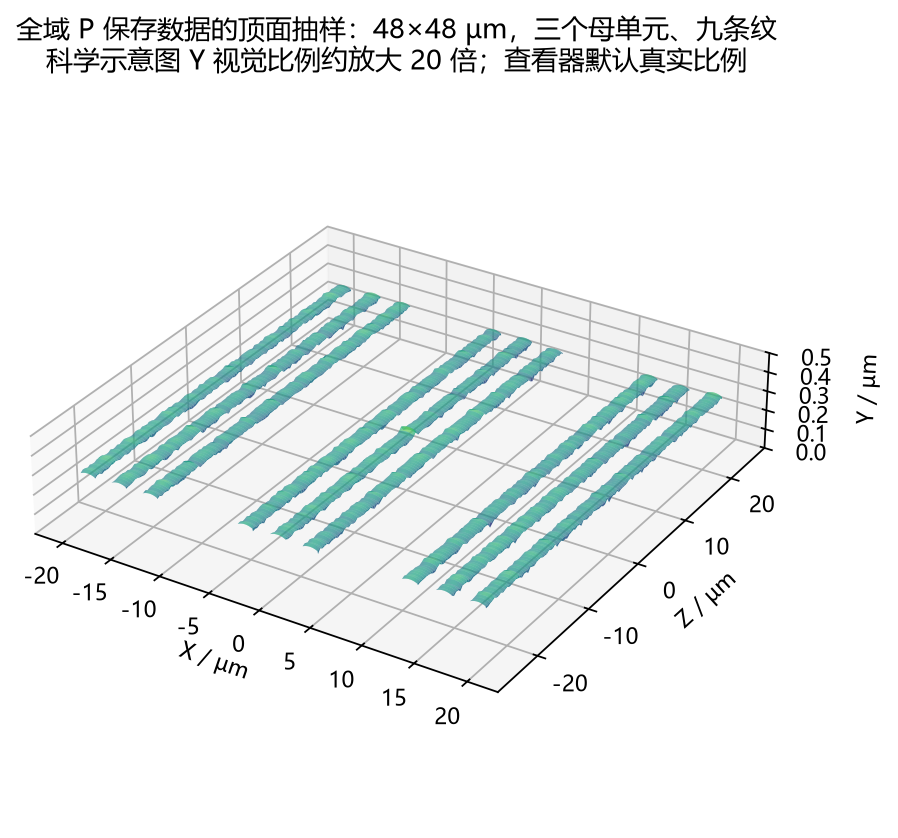

**这张图回答：“把局部例子扩展到更大场景后，整体怎样排列？”** 横向 X、沿线 Z 和竖直高度 Y 都用 µm。X、Z 覆盖约 −24～24 µm，也就是 48×48 µm 平面窗口；三个母单元各三条纹，总共九条纹。这一完整规模是本次验证采用的设置，不能据它宣称真实 AH53 的完整设计已经被测定为这个大小。

先数三组，再在每组中数三条；组间空白明显大于组内空白，和图 01 对应。沿每条的长度看，顶部有细微起伏。着色由高度映射产生，配合光照帮助看形状，不是材料类别、应力或光场强度；图中没有色条，不适合靠颜色读精确高度。

特别要看清标题：**这只是从已保存 P 数据抽样得到的顶面示意图，不是完整的三维实体渲染。** 绘图程序在每条纹中心左右各取约 750 nm 的横向范围，每条取 32 个横向点、121 个长度位置，画出这些位置的顶部。侧壁、完整圆肩、底面和衬底没有画在这张图里。它不能用来验收那些表面是否闭合，也不能替代真正的 3D 文件。

为让约 0.3 µm 的高度在 48 µm 的长宽旁边看得清，图中的 Y 视觉比例约放大了 20 倍；坐标数字仍然是原来的高度。因此图上看起来明显起伏，并不表示真实高度有好几微米。长度方向大约每 400 nm 取一个点，也不足以展示参考中最短 160 nm 波长的全部细节。

它证明“完整规模的数据可读出并能画出整体顶部”，更精细的保真检查应看正式截面指标、图 08 和查看器的局部原始边界。完整对象应在查看器里看，那里可以显示侧壁、衬底并旋转。

### 图 07：同一个物体换格式，新增了多少误差

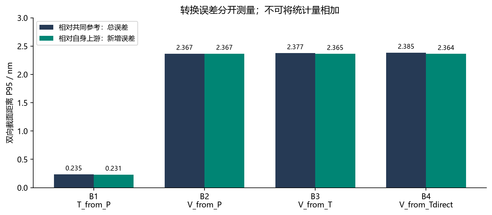

**这张图回答：“从可编辑数据转成展示或计算数据，细节会损失多少？”** 横轴是四条转换路径，纵轴是双向 XY 截面距离 P95，单位 nm，是普通等间隔刻度。每一组两根柱，深蓝比较最终输出与共同参考，叫“总误差”；绿色比较最终输出与它直接接收到的上游模型，叫“新增误差”。

四条路径可按下面的顺序理解：

| 路径 | 实际做了什么 | 绿色柱拿谁与谁比较 |
|---|---|---|
| B1：T_from_P | 从 P 生成三角面 | 新三角面与 P |
| B2：V_from_P | 从 P 直接生成 5 nm 体素 | 新体素与 P |
| B3：V_from_T | 先 P→三角面，再生成 5 nm 体素 | 最终体素与它上游的三角面 |
| B4：V_from_Tdirect | 从直接三角面生成 5 nm 体素 | 最终体素与直接三角面 |

先看 B1：深蓝约 0.235 nm，绿色约 0.231 nm，说明此次由 P 导出的三角面很接近共同参考，也很接近 P。再看 B2、B3、B4：总误差约为 2.367、2.377、2.385 nm，主要都处于 5 nm 体素量化对应的几纳米范围。在本轮设置中，是否经过三角面，对最终体素的总体 P95 差别较小。

**“新增误差”不是拿总误差减去上一步误差得来的。** 两根柱是两次独立距离测量。就像两次走路的方向可以相同也可以相反，局部偏移可能叠加或抵消；P95 又是分位数，不能将 B1 的绿色柱与 B3 的绿色柱相加，冒充 B3 的总误差。部分区域的相对上游误差略大于相对参考误差，也不违反这个定义。

柱子几乎一样高不等于最终体素逐格完全相同。保存结果另做过逐格比较：B2 与 B3 有 20,327 个格子标签不同，B3 与 B4 有 16,438 个不同。它们的总体统计接近，却可能在边缘不同位置作出不同取舍。

B1 此处的总 P95 低于图 05 中直接三角面的约 0.434 nm，也不能推导“先拟合再导出总是更准”。本次 P→T 的长度采样位置特意错开了原节点半步；对象又较平滑，这些都会影响结果。这张图为保留 P 作为编辑源、按需要生成 T 或 V 提供本轮证据，最终采用哪种源仍取决于原始数据和使用需求。

### 图 08：把长度从 4 微米扩到 48 微米之后，波动还能保留吗

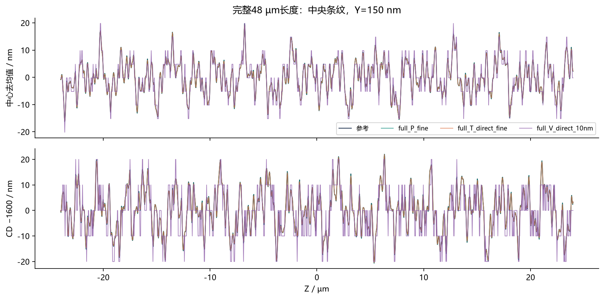

**这张图回答：“局部窗口看起来可以，完整长条纹上还成立吗？”** 横轴是 Z，范围约 −24～24 µm。上图纵轴是中心去均值，单位 nm；下图纵轴是线宽 CD 减去 1600 nm，单位 nm。含义与图 04 的前两幅相同，都是在 Y＝150 nm 高度看中央条纹，曲线沿 Z 约每 32 nm 取样。

深蓝是参考，绿色 full_P_fine 是完整规模的 P 细档，橙色 full_T_direct_fine 是完整规模直接三角面细档，紫色 full_V_direct_10nm 是完整规模的 10 nm 体素。请留意这里的体素是 10 nm，不是图 04 中的 5 nm。为控制完整规模的数据量，本轮用了更粗的体素，因此台阶也更大。

读法是先挑一个大峰或大谷，确认几条曲线出现在同一 Z 位置；再看紫色曲线怎样围绕平滑曲线跳动。下图的紫色线宽经常取 0、±10、±20 nm 等离散变化，因为左右边缘被限定在 10 nm 网格位置。P 与直接三角面的总体波动与参考接近，体素保留主要变化，但边缘的小幅变化会被网格化。

这张图放入了比局部图长 12 倍的范围，能看到更多峰谷，也包含局部 4 µm 窗口不易充分展示的长波动。曲线显得更密，是画面压缩了更长的物理范围，不表示同一条纹突然增加了 12 倍粗糙度。

它仍只画了九条纹中的中央一条、一个高度，不能代替全部条纹和全部高度的检查。上图又分别去除了各曲线自己的平均中心，所以适合看波动形状，不适合检验整体中心偏移。它支持的是“保存方式在更长场景中仍能保留主要边缘变化”，不证明光学对准误差为零；这次并未计算光学对准结果。

### 查看器截图一：整个 Mark 为什么看起来像平面

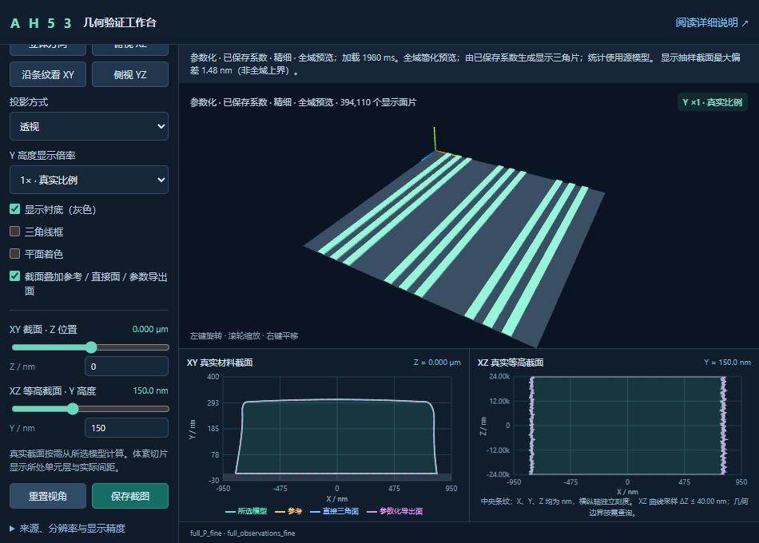

文件名是 `viewer_full.png`。它是一张历史操作截图，用来说明界面的区域，不是实时运行状态。上方大画面展示完整的参数化模型预览：薄荷绿色是条纹，灰色是衬底。可以数出三组三条纹。右上角 `Y ×1 · 真实比例` 表示高度没有人为放大。因为真实名义高度只有 0.3 µm，而平面长宽达 48 µm，所以从远处看几乎像贴在底板上的平面，这恰好是正常的尺寸比例。

想看厚度，先切换到单条纹或局部圆肩并放大。也可以提高“Y 高度显示倍率”，但必须记住那只改变观看比例，没有改动保存文件的真实尺寸。上方“394,110 个显示面片”说的是这次画面使用了多少三角片，不代表底层 P 源文件已变成三角面格式；连续参数曲面也需要临时变成三角片才能在屏幕上显示。

下方左框是固定 Z＝0 的 XY 截面，横轴 X、纵轴 Y，坐标刻度单位为 nm。下方右框是固定 Y＝150 nm 的 XZ 等高截面，横轴 X、纵轴 Z，刻度也以 nm 表示；`24.00k` 是 24,000 nm，也就是 24 µm。下方这里展示中央条纹的截面，并不是把上方九条纹挤进同一幅小图。

小图图例的青色是当前选择，黄色虚线是参考，蓝色是直接三角面，紫色是参数化导出三角面。它们帮助在同一物理位置核对边界。大画面中条纹的颜色只是显示色，不能按小图曲线图例反推它的源数据。

顶部提示“显示抽样截面最大偏差约 1.48 nm”，说的是为了流畅观看而简化的**全域显示预览**相对源模型的抽样误差，不是 P 源模型对参考的正式 P95。体素全域简化预览曾测得约 25 nm 的抽样偏差，道理相同；不能把 25 nm 当成原始 5 nm 或 10 nm 体素的真实边界误差。要看纳米细节，应选择局部原始边界，并以正式统计为准。

### 查看器截图二：为什么圆肩上有许多三角线

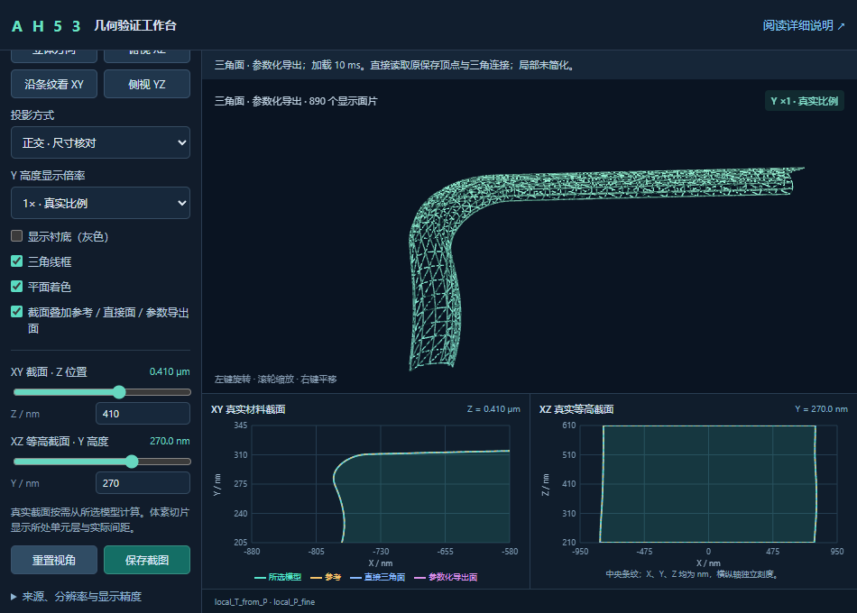

文件名是 `viewer_screenshot.png`。这张历史截图选择了“参数化导出的三角面”，放大左圆肩，同时打开三角线框、隐藏衬底，并采用正交投影。正交投影让远近的同样长度保持同样显示比例，适合核对尺寸；日常透视图则会近大远小。

上方许多细线是三角面连接边，显示了几何如何被小平面拼成。它们不是材料裂纹，也不表示真实器件表面刻了这些三角形。局部画面只取一小片圆肩，裁剪边缘形成的端头也不代表器件在那里断开。右上角仍显示高度倍率为 1。

左侧把 XY 截面的位置设为 Z＝410 nm，因此下方左框是在这个长度位置横切出来的轮廓；其横轴 X、纵轴 Y，单位 nm。截面窗口只看左肩附近，所以没有显示整条纹的完整矩形轮廓。XZ 等高截面设为 Y＝270 nm，下方右框则把高度固定在 270 nm，看这一高度上条纹沿 Z 的左右边界；横轴 X、纵轴 Z，刻度单位仍为 nm。

你可以按这张图练习：先选择实验 B 的 B1 输出，进入局部圆肩；再把 Z 输入为 410、Y 输入为 270；打开“截面叠加参考／直接面／参数导出面”；最后打开三角线框。拖动 Z 会换一张横切片，拖动 Y 会换一个高度的平面切片，两者不是同一个旋转控制。几条截线很接近时，靠颜色和局部放大辨认，精确差别仍要看统计。

### 查看器截图三：体素为什么也显示三角线

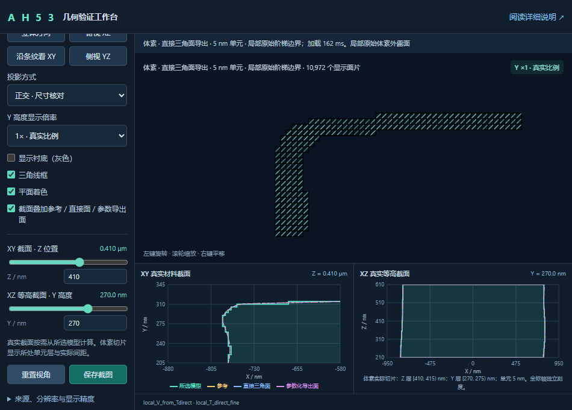

文件名是 `viewer_voxel.png`。它和上一张看同一个圆肩区域，Z＝410 nm、Y＝270 nm，高度倍率为 1；当前模型换成 B4：从直接三角面生成的 5 nm 体素。这样保持观察位置，才能把差异归因于保存方式，而不是相机换了角度。

上方边缘呈明显台阶，表示原始体素的外露单元面。一个方形面在浏览器绘图时往往拆成两个三角形，因此打开线框会看到方格里的斜线。**这些显示三角片不改变底层仍是材料标签小方块的事实。** 这也是为什么不能仅凭屏幕上出现三角形，就断定 P、T、V 已经变成同一种保存方式。

下方左框的当前轮廓也呈台阶，和光滑参考之间能看到局部差别。右框显示当前高度层里的左右边界。底部提示 Z 层为 [410,415) nm，Y 层为 [270,275) nm：对于这一体素模型，410～415 nm 这一小段长度处于同一层单元中，270～275 nm 这一小段高度也处于同一层中。方括号表示包含起点，圆括号表示不包含终点。因此滑动很小距离时，截面可能保持不变，到下一层才跳一下，这是体素表示的正常行为。

这三张截图共同告诉你：大范围先看排列，局部放大再看边缘；线框看面片组织，截面看同一位置的几何；状态提示看当前数据来源和是否简化。它们是操作说明和界面记录，不是三维模型文件本身，也不能独立证明全部数值结果。

### 把这些图连起来，最后应该理解什么

这些图支持本次的一个具体选择：对于这里这种固定结构、分段光滑、需要改宽度和圆肩的合成对象，P 保存得紧凑、细节误差小，适合作为可编辑源；需要通用曲面时生成三角面，需要按格子查询材料时生成体素。直接三角面已经可以独立从共同观测建立，所以若原始输入本来就是三角网格，也可以把它作为源，不必强制绕回 P。

这里没有证明 P 对所有真实形貌都最优，也没有完成实测 AH53 重建或光学仿真。图里的小误差首先说明“这套保存与转换程序在本轮测试题上做到了什么”。真实数据更复杂时，仍要用真实数据重新检验。


---

## 文件与模型指南：先找到 3D，再理解文件夹

这份指南只解决两个问题：**我的 3D 到底保存在哪里？这些文件分别有什么用？** 实验为什么这样设计、每张图怎么看，请阅读项目根目录的 `AH53_三种几何表示验证_详细说明.html`。想查某个具体文件，请打开同目录 `文件用途索引.html`，输入文件名或用途关键词。

### 1. 生成的 3D 文件在哪里？

你电脑上的项目根目录是：

```text
D:\工作\ChatGPT-Discussions\3D-Geometry\ah53-geometry-validation
```

**正式 3D 数据都在这个目录下面：**

```text
D:\工作\ChatGPT-Discussions\3D-Geometry\ah53-geometry-validation\results\20261024_v2\models
```

把上面的完整地址复制到 Windows 资源管理器的地址栏，按回车就能进入。`20261024_v2` 是这一次实验批次的名称，表示 2026 年 10 月 24 日的这一版结果。它不是格式名。

这里保存的是同一个合成结构的多种“存法”，所以没有一个包办全部情况的 `AH53.3d` 文件。P、T、V 各自是一份模型，每份放在自己的子目录里。**复制或备份一份模型时，最稳妥的办法是复制它的整个子目录。**

#### 1.1 先看局部的三份精细模型

局部场景含三条纹，计算窗口为 X 横向 16 μm × Z 长度 4 μm；高度方向窗口为 Y = −100～400 nm。这里的范围含周围空气与衬底，不能把整个计算窗口都理解成条纹材料。

| 想找什么 | 相对 `models` 的子目录 | 核心数据 | 需要一起保留什么 |
|---|---|---|---|
| P：用光滑数学曲面描述形状 | `local_P_fine` | `splines.npz` | `metadata.json` |
| T：直接用小三角形拼出的表面 | `local_T_direct_fine` | `vertices.npy` 和 `faces.npy` | `metadata.json`、`u.npy`、`z.npy` |
| V：5 nm 小方格的材料分布 | `local_V_direct_fine` | `labels.npy` | `metadata.json` |

例如，**局部直接三角面**的两个核心文件地址是：

```text
D:\工作\ChatGPT-Discussions\3D-Geometry\ah53-geometry-validation\results\20261024_v2\models\local_T_direct_fine\vertices.npy
D:\工作\ChatGPT-Discussions\3D-Geometry\ah53-geometry-validation\results\20261024_v2\models\local_T_direct_fine\faces.npy
```

`vertices.npy` 只有“点放在哪里”；`faces.npy` 才告诉程序“哪三个点连成一个三角形”。只拿走其中一个文件，不能恢复完整表面。本项目读取器还需要该目录内的其余配套文件。

#### 1.2 完整场景的三份模型

全域计算窗口为 X 48 μm × Z 48 μm，含三个母周期、共九条纹。它是本次验证采用的完整场景假设，不表示已经测得真实 AH53 的完整尺寸。

| 表示 | 完整绝对地址 |
|---|---|
| P 光滑参数化核心数据 | `D:\工作\ChatGPT-Discussions\3D-Geometry\ah53-geometry-validation\results\20261024_v2\models\full_P_fine\splines.npz` |
| T 直接三角面顶点 | `D:\工作\ChatGPT-Discussions\3D-Geometry\ah53-geometry-validation\results\20261024_v2\models\full_T_direct_fine\vertices.npy` |
| T 直接三角面连接表 | `D:\工作\ChatGPT-Discussions\3D-Geometry\ah53-geometry-validation\results\20261024_v2\models\full_T_direct_fine\faces.npy` |
| V 10 nm 材料标签 | `D:\工作\ChatGPT-Discussions\3D-Geometry\ah53-geometry-validation\results\20261024_v2\models\full_V_direct_10nm\labels.npy` |

完整 T 要同时保留顶点、连接表及目录中的配套文件；完整 P 和 V 也要保留自己的 `metadata.json`。完整 V 的标签文件约 **1.152 GB**，是实际保存的格子材料数据。全域 V 用 10 nm 格子，局部精细 V 用 5 nm 格子，二者精度和占用空间不能直接等同。

#### 1.3 为什么双击 `.npy` 不会出现 3D？

`.npy` 和 `.npz` 是 NumPy 数字数组文件，就像一种专门保存大量数值的盒子。它们不是图片，也不是 Windows 自带 3D 查看器通用的格式。本次生成的正式模型**尚未导出成 STL、OBJ、STEP 或 glTF**；改文件后缀也不会完成格式转换。

看现有模型最方便的方法是双击：

```text
D:\工作\ChatGPT-Discussions\3D-Geometry\ah53-geometry-validation\启动3D查看器.bat
```

程序通常打开 `http://127.0.0.1:8765/`。这个地址代表你自己电脑上的服务，不是模型的硬盘地址；端口被占用时启动器可能换一个端口。启动后保持服务窗口运行。页面里选择场景、P/T/V 和局部范围，就能观察已保存的形状。

如果需要交给某个 CAD、网格或光学仿真软件，下一步应按目标软件支持的格式做正式导出，并核对单位、坐标、材料与闭合性；目前这些文件本身不能被当作已经完成了通用 CAD 导出。

### 2. 文件名怎么读？

以 `local_T_direct_fine` 为例：

| 片段 | 普通话含义 |
|---|---|
| `local` | 局部场景，三条纹 |
| `full` | 完整验证场景，九条纹 |
| `P` | 参数化：由数学函数与系数描述光滑形状 |
| `T` | 三角面：由顶点和连接关系描述表面 |
| `V` | 体素：把空间分成小方格，记录每格是什么材料 |
| `direct` | 直接生成的该种表示；具体输入不同：T 从共同观测点连接，V 从连续参考判定材料 |
| `from_P` | 由已保存的 P 转换而来 |
| `from_T` | 这里指由 P 导出的 T 再转为 V，即 B3 |
| `from_Tdirect` | 由直接三角面转为 V，即 B4 |
| `coarse` / `fine` | 粗档 / 细档；表示构建采样或格子大小，不是不同物体 |
| `edited` | 局部编辑后另存的版本 |
| `observations` | 共同观测点，属于建模输入 |
| `reference` | 合成参考定义，即本次比较的“标准答案” |

注意：`direct` 不等于“真实仪器直接测量”。本次所有形貌都是按设置生成的合成形状。

### 3. `models` 下每个子目录各做什么？

#### 3.1 标准答案与共同输入

| 子目录 | 用途 | 是不是成品 P/T/V |
|---|---|---|
| `reference_local` | 保存局部合成参考的配置，由程序按同样规则计算参考形状 | 参考对象，不是三种待比较表示之一 |
| `reference_full` | 保存全域合成参考的配置 | 同上 |
| `local_observations_coarse` | 从局部参考抽出的粗档轮廓点 | P 与直接 T 的共同输入 |
| `local_observations_fine` | 从局部参考抽出的细档轮廓点 | P 与直接 T 的共同输入 |
| `full_observations_fine` | 从全域参考抽出的细档轮廓点 | 全域 P 与直接 T 的共同输入 |

参考目录只有 `metadata.json` 是正常的：参考由配置和 `reference_geometry.py` 中的规则定义，不需要再保存一份巨大的顶点表。观测目录中的 `points.npy` 则确实保存了抽样点，但“有点”不等于“已经有连续曲面”。

#### 3.2 实验 A 的九份结果

| 子目录 | 对应任务 |
|---|---|
| `local_P_coarse` | 局部粗档 P |
| `local_T_direct_coarse` | 局部粗档直接 T |
| `local_V_direct_coarse` | 局部粗档 V，10 nm 格子 |
| `local_P_fine` | 局部细档 P |
| `local_T_direct_fine` | 局部细档直接 T |
| `local_V_direct_fine` | 局部细档 V，5 nm 格子 |
| `full_P_fine` | 全域 P |
| `full_T_direct_fine` | 全域直接 T |
| `full_V_direct_10nm` | 全域 V，10 nm 格子 |

#### 3.3 实验 B 的转换结果

| 子目录 | 从哪里来 | 为什么另外保存 |
|---|---|---|
| `local_T_from_P` | B1：`local_P_fine` → T | 量化把光滑曲面换成三角面的损失；也是 B3 的中间文件 |
| `local_V_from_P` | B2：`local_P_fine` → V | 观察直接把光滑曲面变成格子后的误差 |
| `local_V_from_T` | B3：`local_P_fine` → `local_T_from_P` → V | 观察多一步中转是否增加误差 |
| `local_V_from_Tdirect` | B4：`local_T_direct_fine` → V | 观察直接三角面作为上游时的结果 |
| `full_T_from_P` | 全域 P → T | 验证转换放大到完整场景后是否还能完成 |

`local_T_direct_fine` 和 `local_T_from_P` 都是三角面，但来源不同，所以是两份不同实验结果，不能因为外观相似就删掉一份。

#### 3.4 局部编辑之后的结果

| 子目录 | 用途 |
|---|---|
| `local_P_edited` | 修改中央条纹局部左圆肩后的 P，其他区域保持不变是检查目标 |
| `local_T_direct_edited` | 在直接三角面的对应局部移动顶点后的结果 |
| `local_T_from_P_edited` | 从编辑后的 P 重新导出的 T |
| `local_V_from_P_edited` | 从编辑后的 P 重新导出的 V |

这些是保留原始模型后的另外保存版本。当前查看器的普通模型列表会跳过名称含 `edited` 的目录，不能因为下拉菜单没看见就认为文件没生成。修改范围、实际位移和范围外变化记录在 `edit_check.json` / `edit_check.md`。

### 4. 一份模型内部，每个文件是什么意思？

#### P：`splines.npz` + `metadata.json`

可以把 P 想成“画形状的规则和控制数字”。`splines.npz` 里装着六段轮廓的样条系数：左侧壁、左圆肩、顶部、右圆肩、右侧壁、底部。`c0`～`c5` 是系数，`u0`～`u5` 和 `z0`～`z5` 是安排这些系数如何起作用的结点。程序沿轮廓位置 u 和长度位置 Z 求值，得到表面上的 XY 坐标。

`u` 是沿截面走一圈时的位置参数，不是第四个物理空间方向。保存系数意味着可在许多位置计算光滑曲面，也可以局部调整系数。显示器最终仍需把曲面转成三角片绘制，因此屏幕上的 P 看起来也可能有三角形；它的正式来源仍是系数文件。

#### T：`vertices.npy` + `faces.npy` + `u.npy` + `z.npy` + `metadata.json`

`vertices.npy` 是坐标表，例如第 0 个点、1 个点、2 个点分别在哪里。`faces.npy` 某行若为 `[0, 7, 8]`，就表示把坐标表的第 0、7、8 个点连成一个三角形。编号从 0 开始。

`u.npy` 和 `z.npy` 记住轮廓及截面层的排列关系，使本项目能高效寻找某个截面上的真实三角形交线。对于其他通用网格软件，顶点和面是核心；对于本项目原有读取器，五个文件应一起保留。

这里的 T 保存条纹实体的闭合边界，包括底面以及截取窗口两端的封口。端部封口是为了让计算域闭合，不应误解为测得了真实物体在那里自然终止。

#### V：`labels.npy` + `metadata.json`

把空间想成很多小积木。`labels.npy` 只记录每个积木的材料编号：**0 是空气，1 是条纹，2 是衬底**。数组的存储顺序是 Z、Y、X；物理空间的坐标仍是 X、Y、Z，两个顺序的不同只是程序怎么排列数据。

格子边长、原点和数量放在 `metadata.json`。局部细档是 `800 × 100 × 3200` 个格子，共 2.56 亿个。每格一个字节，标签内容约 256 MB。它不是每格存一组三维坐标，所以体积很大时仍能以较规整的形式读取。

第一个体素的中心位于 `origin + 0.5 × spacing`；之后第 i 个格子的中心位于 `origin + (i + 0.5) × spacing`。这解释了为什么不能丢掉原点和步长：只有一堆 0、1、2 时，不知道它们在空间里的真实大小和位置。

#### 所有 `metadata.json`：模型的身份卡

| 常见字段 | 通俗含义 |
|---|---|
| `model_id` / `kind` | 这份模型叫什么、属于 P/T/V 哪类 |
| `units` | 长度单位，本项目为 nm |
| `bounds` | 空间边界，按 X 最小/最大、Y 最小/最大、Z 最小/最大排列 |
| `scene` | 局部或全域 |
| `source_model` / `operation` | 从哪份上游数据、经什么步骤得到 |
| `materials` | 0、1、2 分别代表什么 |
| `config` | 生成这份模型时的设置快照 |
| `spacing_nm` / `array_shape_zyx` | V 的格子尺寸和数量 |
| `vertex_count` / `face_count` | T 的顶点数和三角形数 |
| `sha256` 或带 `sha256` 的字段 | 文件指纹，用于确认文件是否被改变；不是密码 |

可以用文本编辑器打开身份卡学习内容，但不要随意改单位、范围或来源。只把 `units` 从 nm 改成 mm，并不会让数值自动缩放；反而会让读取者误解模型。

### 5. 根目录与每个文件夹是什么分工？

| 文件夹/文件 | 把它理解成 | 新人主要怎么用 |
|---|---|---|
| `启动3D查看器.bat` | 双击入口 | 看模型 |
| `启动3D查看器.ps1` | 入口背后的启动步骤 | 一般不用直接编辑 |
| `AH53_三种几何表示验证_详细说明.html` | 新手主说明 | 浏览器阅读 |
| `AH53_三种几何表示验证_详细说明.md` | 主说明的文字版 | 编辑器/Markdown 查看器阅读 |
| `AH53_三种几何表示验证_技术验证报告.html/.md` | 保留的原技术报告 | 需要详细数值与方法时查阅 |
| `AH53_P与T生成原理_从截面到三维.html/.md` | 新增原理专篇：左右边界公式、扫掠、样条与三角连接 | 从根本理解 P/T 生成过程时先读 |
| `docs/PT生成原理_动手演示.html` | 四点教学例，拖动 Z 比较 P/T 的中间位置 | 浏览器离线打开；不是完整实验模型 |
| `docs/PT生成原理正文.md`、`docs/PT原理图说明.md` | 原理专篇源文稿及四图解释 | 改说明时编辑，之后生成 HTML/Markdown |
| `scripts/build_pt_principles_guide.py`、`scripts/build_pt_principles_figures.py` | 原理专篇及其四幅图的生成程序 | 重生成说明/教学图，不修改正式模型 |
| `文件用途索引.html/.json` | 逐文件目录册 | HTML 搜索；JSON 给程序使用 |
| `先看这里.md` / `README.md` | 快速入口 / 新人和开发者共用说明 | 前者先读，后者查阅读路径与运行命令 |
| `configs/` | 实验配方 | 当前只有 `default.json`；可决定将来新一轮实验设置 |
| `inputs/` | 来源证据 | 当前 `source_provenance.json` 记录计划、示例版图及核对信息 |
| `src/ah53/` | 形状生成、保存、读取、比较的实现 | 学算法时阅读 `.py`，不是看图入口 |
| `run_validation.py` | 整轮实验的总开关 | 重新生成结果时运行，普通浏览不需要 |
| `scripts/` | 报告、核查、浏览器验收和索引的辅助工具 | 查每个脚本用途后再运行 |
| `tests/` | 自动检查题 | 开发者检验修改是否破坏关键功能 |
| `serve_viewer.py` | 本机网页服务 | 启动器自动调用 |
| `viewer/` | 网页、样式与交互程序 | 控制页面如何显示 |
| `viewer/vendor/` | 已带上的第三方三维绘图库 | 支持离线显示；保持文件完整 |
| `results/` | 每轮实验产物 | 当前主要看 `20261024_v2/` |
| `samples/` | 从实际保存模型截取的小样 | 轻量分享或检查格式 |
| `docs/` | 详细说明的素材和补充指南 | 理解目的、图表、文件 |
| `output/playwright/` | 浏览器验收时留下的截图和日志 | 排查显示/操作问题 |
| `.venv/` | 项目自己的 Python 和依赖库 | 不用阅读；启动依赖它 |
| `__pycache__/` | Python 自动生成的加速缓存 | 不用阅读；可自动再生成 |
| `.pytest_cache/` | 自动检查的运行缓存 | 不属于 3D 结果 |
| `.playwright-cli/` | 浏览器自动化过程的临时记录 | 正式证据另有保存 |
| `requirements.txt` / `requirements-dev.txt` | 安装运行库 / 测试库的清单 | 环境重装时用 |
| `.gitignore` | 告诉 Git 哪些文件不上传的规则 | 解释为何网上仓库不含全部本机文件 |

每一个具体 `.py`、`.js`、`.png`、`.json` 等文件的作用和大小，都在 `文件用途索引.html` 中按类别列出；这里提供地图，索引提供门牌。

### 6. `results/20261024_v2` 下为什么还有这么多东西？

#### 模型、数值、图、预览是四种不同产物

| 位置 | 内容 | 能不能当完整 3D 模型 |
|---|---|---|
| `models/` | 正式模型及输入观测 | P/T/V 模型目录可以；观测点单独不算成品曲面 |
| `details/` | 每份模型的详细评估数字 | 不能，是成绩单 |
| `profiles/` | 边缘、宽度、高度等沿 Z 变化的曲线数组 | 不能，只是一组测量曲线 |
| `figures/` | 报告中的图和查看器截图 | 不能，是二维图片 |
| `figures/screenshots/` | 用户保存的 PNG 截图及对应 JSON 状态 | 不能，是画面与拍摄设置 |
| `previews/` | 浏览器用的压缩显示网格与显示说明 | 不能当完整正式源；可能裁切、抽稀或简化 |

`previews` 的文件名中，`full` 表示看全域，`period` 表示看一个母周期，`stripe` 表示看单条纹，`shoulder` 表示看圆肩。数字是生成该显示时的 Z 位置，例如 `410` 对应 Z = 410 nm。`.json.gz` 是压缩后的显示数据，配套的 `_display.json` 说明显示网格怎么得到。

即使 P、T、V 在浏览器里都以三角形绘制，也不意味着它们原本都是同一种存储。浏览器需要显示表面；比较算法读取的则是各自正式模型。

#### 顶层统计文件逐个说明

| 文件 | 用它回答什么问题 |
|---|---|
| `manifest.json` | 这轮实验是否完成，使用哪些配置和软件环境？ |
| `preparation.json` | 参考和观测怎样准备，耗时和资源是多少？ |
| `lineage.json` | 这份结果从哪份上游模型转换来，文件有没有变化？ |
| `metrics.csv` | 各模型的精度、体积、耗时、存储整体如何？ |
| `conversions.csv` | B1～B4 转换新增多少误差，最后累计多少误差？ |
| `edit_check.json` | 局部编辑到底改了什么，范围之外有没有变化？ |
| `edit_check.md` | 上一项的简短文字摘要是什么？ |
| `core_geometry_audit.json` | 保存的网格闭合、朝向等关键性质是否通过核查？ |
| `saved_model_isolation.json` | 查询是否真的依赖保存文件，而不是另算一遍参考形状？ |
| `voxel_pairwise.json` | B2、B3、B4 最后落到格子上时，哪些格子不同？ |
| `volume_quadrature_audit.json` | 辅助体积指标如何重新核算，修正了什么？ |
| `post_run_audit.json` | 正式运行后又做了哪些补充核查？ |
| `ui_validation.json` | 在真实浏览器中怎样操作验收，实测速度如何？ |
| `viewer_backend_checks.json` | 路径、端口占用和缺失环境如何处理？ |
| `delivery_check.json` | 交付检查记录是否齐全？ |
| `beginner_guide_validation.json` | 新手说明的离线图片、目录和窄屏显示是否正常？这项检查的是文档，不是模型精度 |

`details/local_P_fine.json` 这类文件，把总表的一行展开成详细成绩单。`profiles/local_P_fine.npz` 则保存画曲线用的数列。两者名字相同是为了把“模型—评价—曲线”对应起来，不是重复文件。

### 7. 小样包里有什么？适合发给别人吗？

小样包的完整地址是：

```text
D:\工作\ChatGPT-Discussions\3D-Geometry\ah53-geometry-validation\samples\AH53_实际模型小样.zip
```

它约 1.06 MB，里面的数据确实从本轮已经保存的模型提取，不是另外画的示意图。解压后：

| 文件 | 实际内容 |
|---|---|
| `central_stripe_triangles.npz` | 中央一条纹的闭合三角面，Z = −2000～2000 nm；顶点、连接表和材料编号一起打包 |
| `central_stripe_splines.npz` | 同一条纹的六段样条系数和结点；Z 范围同上 |
| `central_stripe_voxels.npz` | 5 nm 体素的一个矩形裁片，X = −960～960、Y = −100～400、Z = −200～800 nm |
| `sample_manifest.json` | 单位、裁取范围、数组含义、来源文件指纹 |
| `README.md` | 小样阅读说明 |
| `inspect_samples.py` | 读取这些数组并打印结构的轻量脚本 |

体素小样的 Z 范围比另外两个短，因此不能拿三份文件的体积大小直接当成三种表示的全域存储比较。压缩大小还会受到重复数字多少的影响。

可以把小样包发给熟悉 NumPy/建模的开发者检查格式。它并不保证收件人双击就有一个通用 3D 窗口，也不包含全部多 GB 的完整结果。项目查看器主要自动发现 `results/.../models` 中按规定布局的正式模型；把单个样例 `.npz` 拖进去并不是当前提供的功能。

### 8. 各种扩展名怎么打开？哪些能改？

| 扩展名 | 是什么 | 通常怎么打开 | 修改建议 |
|---|---|---|---|
| `.html` | 已排版的网页说明/界面 | 浏览器 | 阅读用；要长期改文档，通常改源文字再生成 |
| `.md` | Markdown 文字 | 编辑器或 Markdown 阅读器 | 说明文档可以改；注意保留链接 |
| `.json` | 有名字的结构化记录 | 文本编辑器 | 配置可以另存修改；模型身份卡和结果记录保留原样 |
| `.csv` | 逗号分隔表格 | Excel / 表格软件 | 分析时另存副本，别覆盖原始成绩 |
| `.png` | 二维图片 | 照片查看器/浏览器 | 不会因为编辑图片而改变模型 |
| `.npy` | 一个数字数组 | NumPy / 本项目读取器 | 不要当文本改，也不要改后缀冒充 STL |
| `.npz` | 多个命名数组装在一起 | NumPy / 本项目读取器 | 与来源/单位说明一起保留 |
| `.gz` | gzip 压缩文件，这里包着 JSON | 查看器自动解压读取 | 普通使用无需手动处理 |
| `.zip` | 通用压缩包 | Windows 资源管理器 | 解压后按内部格式处理 |
| `.py` | Python 程序源码 | 编辑器；用 Python 执行 | 学原理时阅读，运行前看它会生成或更新什么 |
| `.js` | 网页交互/浏览器检查代码 | 编辑器；由浏览器/测试工具执行 | 不是模型本体 |
| `.css` | 网页外观规则 | 编辑器 | 改颜色或排版，不改变几何数据 |
| `.bat` | Windows 启动命令 | 双击 | 当前推荐的查看器启动入口 |
| `.ps1` | PowerShell 脚本 | PowerShell | 通常让 `.bat` 调用即可 |
| `.txt` | 普通文字 | 记事本 | 按内容判断是依赖清单、批次指针还是日志 |
| `.pyc` | Python 编译缓存 | 由 Python 自动使用 | 不用手动打开 |

### 9. 本机文件和 GitHub 上的文件为什么不完全一样？

本机正式模型、显示缓存和 Python 环境合计很大。GitHub 更新用于发布说明、源码、图表、轻量统计和小样，不会把多 GB 的 `models/`、`previews/` 和 `.venv/` 全部上传。因此：

1. 你现在这台电脑已经生成的完整 3D，在第 1 节所列的本地地址。
2. 从 GitHub 下载项目的人，可以阅读说明、结果图和样本，不能假设下载包里已经包含本机全部 3D。
3. 对方要完整结果，需要按 `README.md` 安装依赖并运行生成流程，或者另外取得完整模型目录。
4. 本文件索引反映本机生成时的文件快照；网页链接在 GitHub 或另一台电脑上若找不到大文件，通常是因为该文件没有随仓库发布。

如果只是你自己学习，现在先打开新手主说明、再启动查看器、最后按文件索引找感兴趣的数据即可，不需要先读完所有源码。
