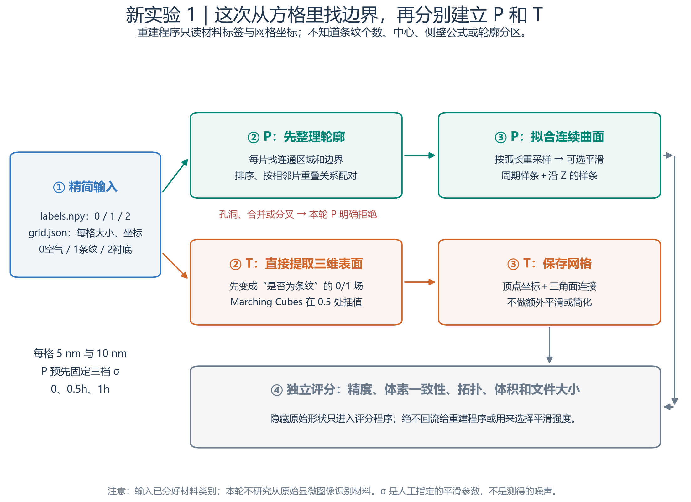
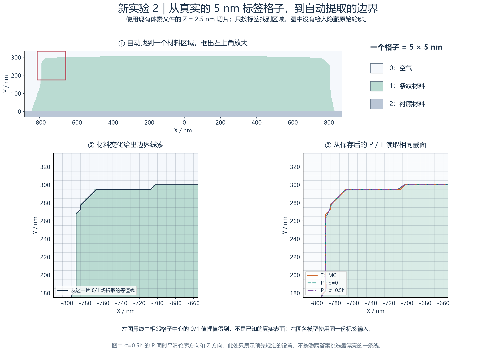
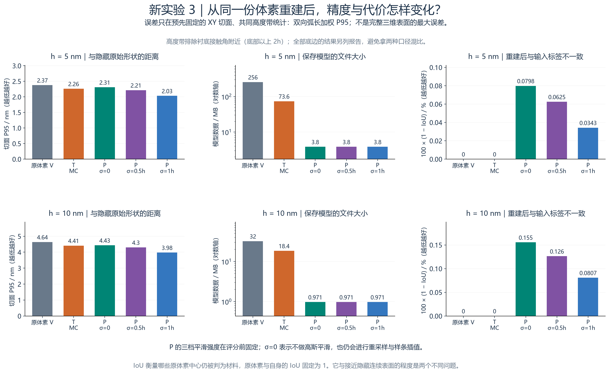
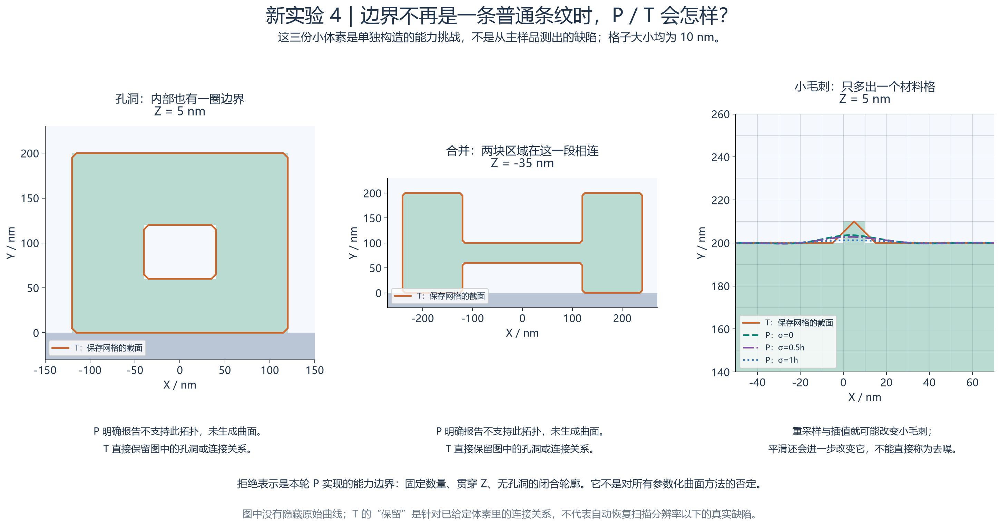

# 从体素出发重建 P 与 T：检查、测试和读图说明

**本轮已经完成。** 这次只把“每个小格子是什么材料”交给重建程序，让它自己寻找边界；不提供原始连续轮廓、条纹中心或六段分区。完成 8 次主模型重建、4 种小型挑战的 12 次尝试；其中孔洞和合并挑战的 P 明确拒绝，其余 18 次生成了模型并读回评分。

在 5 nm 输入上，图示默认的 P（σ＝0.5h）与 T 的真值截面 P95 分别为 **2.214 nm、2.260 nm**，几何文件为 **3.80 MB、73.58 MB**。完整参数结果、材料一致性和失败情况都在下文；不能只凭这一对数字宣布某个表示普遍最好。

三档 P 的 P95 范围为 **2.031～2.306 nm**，与 T 接近；本轮没有复现“P 在精度上远好于 T”的推断。P 的文件明显更小，T 则在所有输入格中心保持材料分类一致，并保留了挑战中的孔洞和合并连接。这些是不同维度的优缺点。

[返回 P/T 原理图解](AH53_P与T生成原理_从截面到三维.md) · [查看运行前方案](docs/体素重建验证_预注册方案.md) · [打开新模型 3D 预览](AH53_体素重建_3D查看.html) · [原实验新手教程](AH53_三种几何表示验证_详细说明.md)

## 1. 目的：把“轮廓从哪里来”放进测试

前一轮先有真实轮廓公式，再从上面取出有顺序的点，P/T 只负责连接和保存。这一轮从体素入手：程序只有三维材料编号数组，需要先判断边界在哪，再决定如何组织边界。

这更接近“已经拿到三维分割数据，接下来怎样建模”的任务。它仍是合成数据，0/1/2 的材料分类已经给定，**没有测试从显微灰度图中识别材料**。体素以下的精确信息也可能已经丢失，多个不同连续表面可能对应同一份标签。

## 2. 重建程序能看什么，怎样防止偷偷利用答案

输入只包含 `labels.npy` 和 `grid.json`。标签为 0＝空气、1＝条纹、2＝衬底；网格说明只有边角原点、格子尺寸、ZYX 轴顺序、nm 单位和材料编号。格子中心位置是“原点＋(索引＋0.5)×格子尺寸”。

旧体素的 metadata 中包含原始生成配置和条纹中心，因此没有直接传给新程序。新程序也没有调用旧 VoxelModel 的轮廓查询——那条查询会按已知中心裁窗口，无法用来验证未知轮廓的寻找。

每个模型在单独的 Python 隔离进程里建立，读取路径限定为净化输入、自身两份代码、运行库及输出。20 次运行各主动尝试读取 3 份禁止文件，共 **60 次全部被拦截**。没有通过 `ah53` 包初始化导入参考模型。源数据、输入、代码、参数及保存模型均记录 SHA-256；缓存不匹配会拒绝复用。

这些措施核查的是本程序有没有读取隐藏几何信息，不是操作系统安全沙箱，也不是研究者双盲：我们事先知道它是一类条纹。算法对条纹的适用假设仍要公开。完整连续参考只由独立评分程序读取，未用于调本轮参数。



**图 1 怎么看：** 从左侧的体素输入往后走，跟踪 P/T 各自处理路径；原始公式只能走到评分部分。图中分开的两条路径说明：这一轮比较的是两套完整重建办法，既含边界提取，也含表示方法。

## 3. 从格子到 P：这次实际做了什么

1. 每个原始 Z 切片都查找材料 1 的连通区域，不预先规定条数或中心。检查每个区域是否含孔，检查前后切片是否能一对一相交对应。未用于最终拟合的切片也检查，避免刚好跳过合并位置。
2. 在每个区域的二值图上提取 0.5 等值轮廓。统一为逆时针，从“最低 Y 处最左 X”的点开始。这些起点来自数据，而不是原圆肩或侧壁公式。
3. 沿每条轮廓计算累计长度，转成 0～1 的位置编号，重新均匀取点。前后截面用相同的归一化轮廓位置相对应。**这是一项建模假设，不等于追踪到了材料中的同一个物理点。**
4. 按预定量对轮廓 XY 坐标和沿 Z 的变化做 Gaussian 平滑。轮廓方向首尾相接，Z 方向使用端值延续；随后每隔 4h 选一个拟合截面，并保留末端截面。
5. 沿轮廓建立周期三次样条，再沿 Z 对系数建立三次样条，保存系数和结点。查询时只读取这些系数。

这轮 P 用的是**完整闭合轮廓的周期样条**，没有沿用上一轮人为已知的六个分区。它只支持沿整个窗口贯通、数量固定、每个截面无内部孔洞且对应关系明确的组件。出现本实现不支持的孔或合并，会报告拒绝，不能先把洞填掉再冒充成功。

## 4. 从格子到 T：这次实际做了什么

先计算“这个格子是不是材料 1”，得到二值指示场，再用 Marching Cubes 在 0.5 处提取三角表面。**0、1、2 是类别编号，不能把它们作为一种连续物理量直接混合插值。** 本轮没有对 T 额外平滑或删减三角形，保存的是提取出的全部顶点和面连接。

数组外补一层非目标材料，使扫描窗口两端形成封口。端口是计算窗口闭合，不是真实条纹端部，截面精度指标不评价这些 Z 端盖。保存前检查有向体积并统一朝外，评分时再检查每条网格边的连接。

T 直接从三维体素提面，不需要先把截面安排成六段，也不需要先建立 P。所用方法见 [scikit-image Marching Cubes 文档](https://scikit-image.org/docs/stable/api/skimage.measure.html#skimage.measure.marching_cubes)；二维轮廓提取见 [find_contours 文档](https://scikit-image.org/docs/stable/api/skimage.measure.html#skimage.measure.find_contours)。



**图 2 怎么看：** 小方格给出程序实际看到的材料信息；提取轮廓表示格子间的插值边界；P/T 曲线表示重新读回模型后计算出的截面。重点看圆肩及局部台阶附近：边界经过格子时采用了怎样的连接规则。放大图不是新增测量，也不能把屏幕上的像素当成 nm。

## 5. 测试参数在评分前固定，所有结果一起报告

主输入覆盖横向 16 μm、长度 4 μm，计算域高度共 500 nm（含衬底）。5 nm 数据有 256,000,000 个格子，10 nm 数据有 32,000,000 个格子；算法从它们中自行发现三条纹。

T 对每种分辨率都直接提面。P 在每种分辨率下都使用沿轮廓约 2h 的点间距、4h 的 Z 拟合间距，测试 σ＝0、0.5h、1h 三档平滑量。σ 是预先选择的平滑长度，不是测出的噪声标准差。轮廓方向换算为 `σ / (该组件最大观测周长 / 点数)` 个样本，Z 方向为 `σ / h` 层，因此实际沿轮廓物理平滑长度会随截面周长略变。

没有根据隐藏真值挑选平滑参数；下表八条路线都报告。图示默认采用 σ＝0.5h，仅为统一展示，不表示它总是最佳。

| 体素 h | 方法 | 真值距离 P95 / nm | 完整闭合轮廓 P95 / nm | 材料 IoU | 多出的材料格 / 漏掉的材料格 |
| --- | --- | --- | --- | --- | --- |
| 10 nm | T：直接三角表面 | 4.412 | 4.149 | 100.000000% | 0 / 0 |
| 10 nm | P：σ＝0 | 4.433 | 4.083 | 99.844579% | 4,339 / 4,557 |
| 10 nm | P：σ＝0.5h | 4.298 | 3.990 | 99.873755% | 3,528 / 3,697 |
| 10 nm | P：σ＝1h | 3.976 | 3.741 | 99.919263% | 1,577 / 3,042 |
| 5 nm | T：直接三角表面 | 2.260 | 2.133 | 100.000000% | 0 / 0 |
| 5 nm | P：σ＝0 | 2.306 | 2.091 | 99.920152% | 18,541 / 18,004 |
| 5 nm | P：σ＝0.5h | 2.214 | 2.016 | 99.937486% | 14,566 / 14,043 |
| 5 nm | P：σ＝1h | 2.031 | 1.853 | 99.965742% | 6,382 / 9,293 |

表中“真值距离 P95”使用下一节定义的共同高度范围。“完整闭合轮廓 P95”另外包含底面和底部圆角变化。IoU 越接近 100% 越符合输入体素；“多出”是把输入空气/衬底判成条纹，“漏掉”是把输入条纹判成外部。它们与真值距离回答不同问题。

## 6. 每个分数究竟在检查什么

**形状误差：** 在 7 个预定 Z 位置，再加各自偏移 0.37h 的位置，共 14 个截面。两条边界互相测距离，按边界长度加权。P95 表示这批长度加权距离中的 95% 不超过该值；它不是最大误差，也不是整个三维表面的 Hausdorff 上界。详细 JSON 同时保存 RMS、最大采样距离和每个截面的数值。

**共同高度范围：** 从输入标签验证衬底接触平面，再对 P/T/V/参考统一剪裁到 `Y ≥ 接触高度＋2h`。5 nm 数据从 Y＝10 nm 起，10 nm 数据从 Y＝20 nm 起；跨过阈值的线段也在同一位置截断。这样不会把 P 平滑后的底面与 T 的精确平底区别处理。另报完整闭合轮廓，保证底部变化没有被隐藏。因此，5/10 nm 两组的高度下界略有不同，本轮数值也不能直接与上一轮自由表面指标作差。

**材料一致性：** 每个模型都检查整份输入的全部格子中心，未用随机小样替代。P 曲线按 0.5 nm 步长离散为多边形进行分类，T 使用实际保存三角面与截面的交线。洞按奇偶规则保留；同时记录衬底误侵入、开放/无效截面、材料体积和离散化口径。

**连接关系：** 检查 P 各体素中心截面的闭合、自交及不同轮廓互相穿越；检查 T 保存网格的边连接、方向、组件数量、Euler 数及体积。这里的检查不构成所有连续 Z 上曲面不自交的数学证明，T 的边流形检查也不等于已穷尽所有三角面自交问题。

把“原体素自身已经有的误差”与重建误差分开看：

| 输入 | 保留原阶梯边界的真值 P95 | P σ＝0.5h 真值 P95 | T 真值 P95 |
| --- | --- | --- | --- |
| 5 nm | 2.375 | 2.214 | 2.260 |
| 10 nm | 4.637 | 4.298 | 4.412 |

这三列都相对隐藏参考评分。P/T 比原始阶梯边界更接近参考时，说明所选插值/平滑对这个样例有效；它不证明从任意体素都能找回丢失的细节。



**图 3 怎么看：** 误差轴越低越好，IoU 越接近 100% 越好，文件越小越节省空间。不要只看一个轴：较小的 P 文件可能同时带来细节平滑；T 文件较大，但可在不设置轮廓对应关系的情况下保留体素中的复杂连接。

## 7. 孔洞、合并和一个小毛刺，结果如何

四种挑战独立用小标签数组构造，不调用 AH53 原公式。直条检验基础坐标与材料处理；贯通孔检验能否保留内边界；中段连接桥检验组件数量随 Z 改变；单格毛刺检验微小特征会不会丢失。它们不是统计意义上的真实缺陷数据集。

| 输入 | 方法 | 结果 | IoU | 多出 / 漏掉材料格 | 切片孔数 / 材料区数量 |
| --- | --- | --- | --- | --- | --- |
| 直条控制 | T：直接三角表面 | 已生成并评分 | 100.000000% | 0 / 0 | [0] / [1] |
| 直条控制 | P：σ＝0 | 已生成并评分 | 100.000000% | 0 / 0 | [0] / [1] |
| 直条控制 | P：σ＝0.5h | 已生成并评分 | 100.000000% | 0 / 0 | [0] / [1] |
| 直条控制 | P：σ＝1h | 已生成并评分 | 100.000000% | 0 / 0 | [0] / [1] |
| 沿 Z 贯通孔 | T：直接三角表面 | 已生成并评分 | 100.000000% | 0 / 0 | [1] / [1] |
| 沿 Z 贯通孔 | P：σ＝0.5h | 明确拒绝：当前 P 不支持 | — | — | — |
| 中段连接桥 | T：直接三角表面 | 已生成并评分 | 100.000000% | 0 / 0 | [0] / [1, 2] |
| 中段连接桥 | P：σ＝0.5h | 明确拒绝：当前 P 不支持 | — | — | — |
| 一个格子的毛刺 | T：直接三角表面 | 已生成并评分 | 100.000000% | 0 / 0 | [0] / [1] |
| 一个格子的毛刺 | P：σ＝0 | 已生成并评分 | 99.993490% | 0 / 1 | [0] / [1] |
| 一个格子的毛刺 | P：σ＝0.5h | 已生成并评分 | 99.993490% | 0 / 1 | [0] / [1] |
| 一个格子的毛刺 | P：σ＝1h | 已生成并评分 | 99.993490% | 0 / 1 | [0] / [1] |

P 对孔和合并的“明确拒绝”是有用结果：它说明当前这套轮廓参数化有适用边界，程序没有偷偷填洞。这**不等于所有参数化方法都不能表达孔洞**；多区域或更一般的曲面结构可能扩展能力，但本轮没有实现。

单格毛刺既可能代表真实小缺陷，也可能代表分割噪声。本实验只知道它在输入中确实存在，因此把丢失格数如实报告；不能自行把所有被平滑掉的东西称为“去噪成功”。



**图 4 怎么看：** 先看输入里有没有洞或连接，再看重建有没有保留；出现 P 拒绝说明时，那里没有生成可评分的 P，不能把空白当作误差为零。毛刺局部应结合上表的漏格数阅读。

## 8. 文件大小、耗时和结论的适用范围

| 体素 h | 方法 | 几何文件 / MB | 构建 / 秒 | 进程峰值工作集 / MB | 评分 / 秒 |
| --- | --- | --- | --- | --- | --- |
| 10 nm | T：直接三角表面 | 18.370 | 1.91 | 372.2 | 11.5 |
| 10 nm | P：σ＝0 | 0.971 | 3.11 | 128.5 | 17.4 |
| 10 nm | P：σ＝0.5h | 0.971 | 2.77 | 129.8 | 17.1 |
| 10 nm | P：σ＝1h | 0.971 | 2.89 | 130.0 | 16.5 |
| 5 nm | T：直接三角表面 | 73.583 | 11.54 | 2015.6 | 23.1 |
| 5 nm | P：σ＝0 | 3.804 | 14.87 | 392.2 | 27.0 |
| 5 nm | P：σ＝0.5h | 3.804 | 16.08 | 391.7 | 26.3 |
| 5 nm | P：σ＝1h | 3.804 | 15.99 | 392.7 | 26.6 |

MB 按 1,000,000 字节计算。几何文件大小包含 NPY/NPZ 容器头，排除 metadata、日志及显示网格；P 的三档平滑不改变系数数量，所以文件大小相同。构建时间是各独立进程中的提取、拟合/连面、保存及算法内检查时间；评分时间另列。峰值是该 Python 进程的峰值工作集，包含运行库，不是单纯模型数组大小。每项只测一次，会受本机负载和缓存影响，不作为跨机器速度保证。

本轮 P 的优势主要是用较小文件表达平滑条纹；代价包括轮廓起点及对应规则、平滑/采样设置和固定拓扑限制。T 的入口更直接，能处理本轮的孔和合并；代价是更多顶点与三角面。两条路线的提取与拟合规则都不同，因此不能把所有数值差异只归因于“P 文件格式”和“T 文件格式”。

如果任务重视保留已分割数据里的小缺陷，应先看输入一致性和拓扑结果；如果任务重视紧凑平滑的可计算模型，可以看 P 的精度与容量折中。本轮没有验证真实灰度分割、全 Mark 的资源开销、任意拓扑 P、完整编辑界面，也没有根据评分重新调整参数。

## 9. 生成的 3D 文件在哪里，分别怎样用

本机结果目录：

```text
D:/工作/ChatGPT-Discussions/3D-Geometry/ah53-geometry-validation/results/20261024_voxel_reconstruction/
```

| 文件/目录 | 内容与用法 |
|---|---|
| `models/local_5nm__P_sigma05/P/coefficients.npz` | 从 5 nm 体素重建的 P 样条；配套 metadata，需程序求值，不是 STL |
| `models/local_5nm__T_MC/T/vertices.npy`、`faces.npy` | 从相同体素提取的实际 T；配套 metadata |
| `models/local_10nm__…` | 10 nm 输入的全部路线；其余 P_sigma0/P_sigma1 命名同理 |
| `models/through_hole__P_sigma05/P/metadata.json` 等 | 拒绝记录及原因；不会伪造 coefficients.npz |
| `exports/` | 可供普通三维软件打开的 PLY；P 的 PLY 是由系数采样的派生网格，T 的 PLY 保留保存的三角面 |
| `export_manifest.json` | PLY 来源、采样规则、字节数及网格检查 |
| `inputs/` | 本机净化体素与精简网格说明；大数组不上传 GitHub |
| `challenge_inputs/*.npz` | 四个可下载的小挑战标签数组，含原点和格子尺寸 |
| `protocol.json` | 正式冻结的参数、输入摘要与运行库版本 |
| `protocol_preflight_draft.json` | 尚未构建/评分主模型时的草案，保留评分范围澄清前的记录；正式规则以 protocol.json 为准 |
| `input_manifest.json` | 原体素与净化输入的哈希、形状及来源，用来证明输入没有被改写 |
| `build_records/*.json` | 每次构建的状态、输入与代码指纹、文件大小、时间和访问拦截证据 |
| `metrics/*.json` | 每个模型完整的距离、材料一致性、拓扑及缓存指纹；baseline 为原体素基线 |
| `summary.json` | 本报告各数值表的汇总数据 |
| `independent_audit.json` | 独立检查分类规则、曲线离散化收敛和输入隔离记录 |
| `execution_logs/` | 独立进程的标准输出、错误及返回码 |
| `workers/` | 本机执行用的两份独立代码副本，不上传；其哈希在构建记录中 |

项目层面的代码入口：`run_voxel_reconstruction_validation.py` 管准备、重建、评分；`src/ah53/voxel_reconstruction.py` 只接触净化输入；`voxel_reconstruction_metrics.py` 负责独立评分；`scripts/voxel_reconstruction_worker.py` 设置访问检查。图、报告、PLY 和独立复核分别由 `scripts` 中同名 build/export/audit 脚本产生。

GitHub 包含源代码、冻结方案、全部小型记录、图解、挑战小数据及轻量预览；完整输入、P/T 大模型和 PLY 留在本机，可按下一节复现。[打开 3D 预览](AH53_体素重建_3D查看.html) 时请留意其显示窗口与采样说明，屏幕预览不替代正式模型的评分几何。

## 10. 怎样复现，怎样确认不是只画了图

先按项目 README 安装依赖并生成原始 `20261024_v2` 的体素数据，再在项目目录运行：

```powershell
.venv/Scripts/python.exe run_voxel_reconstruction_validation.py --output results/my_voxel_test
.venv/Scripts/python.exe -m pytest tests
```

也可分阶段加 `--phase prepare`、`--phase reconstruct`、`--phase evaluate`。同一结果目录会检查冻结配置和输入/代码哈希；改了重建算法请使用新目录。若只修正评分实现，需显式 `--recompute-metrics`，重新产生评分并记录新的指纹，不会改已保存模型。

本次评分读取了磁盘中的 P 系数和 T 顶点/面；每个主模型都检查所有输入格中心，而非只在图上取几个点。独立复核另外比较 P 的 0.5/0.25 nm 轮廓离散化，并用另一种多边形判断方法检查固定样本的分类结果。具体检查及实际值见 [独立核查记录](results/20261024_voxel_reconstruction/independent_audit.json)。

本页可离线阅读；请保留 `docs/figures/vr_*.png`。报告中的数据对应本次固定运行，后续运行应重新生成报告，不能直接沿用这些数字。
