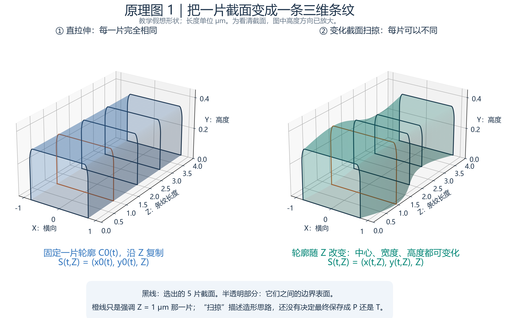
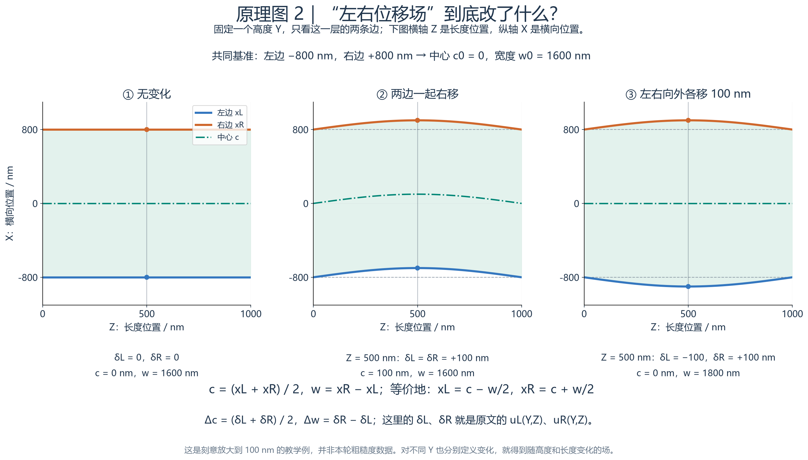
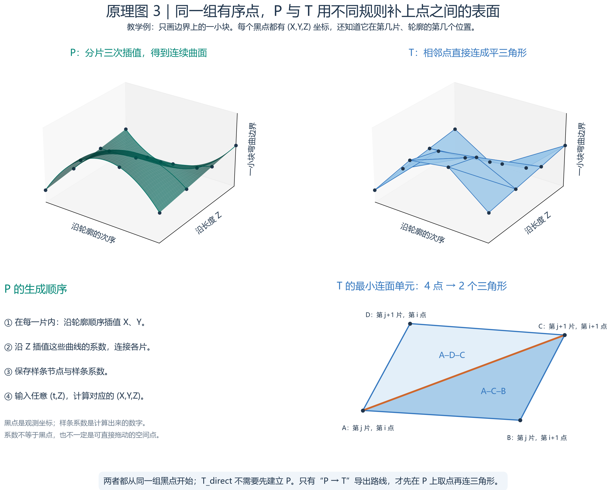
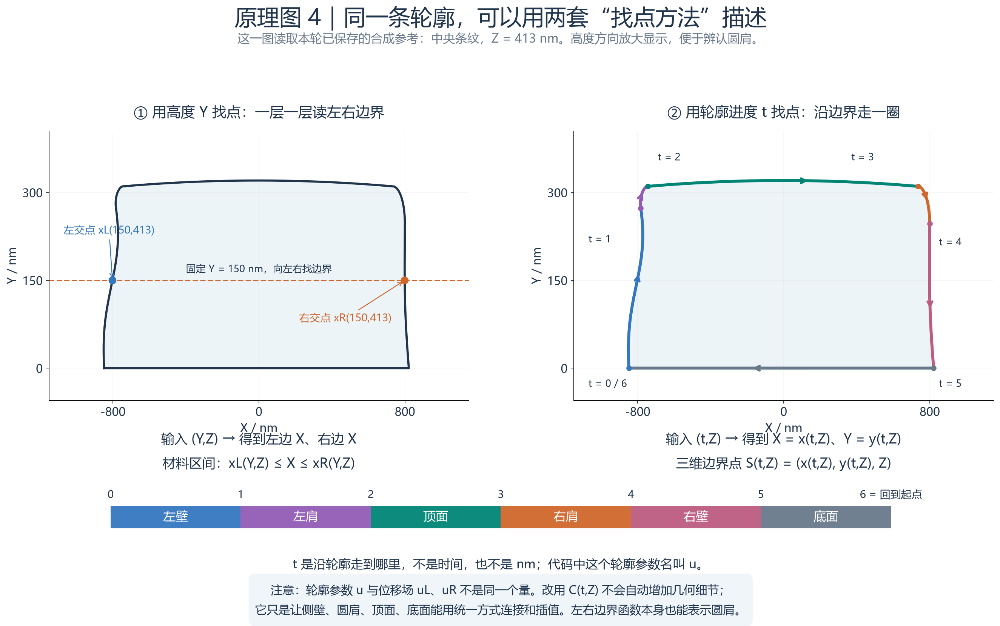

# P 与 T 原理图：按这个顺序看

这四张图回答的是“从截面到三维模型，中间到底做了什么”。图 1—3 是为了讲原理而设计的教学例，不是实验结果。图 4 才读取本轮保存的合成参考模型。每张图另有同名 SVG，可放大查看。

## 原理图 1：直拉伸与变化截面扫掠



先看左边。黑线是沿长度方向选择的五片截面，它们宽度、高度、横向位置完全相同。如果把同一张截面连续复制到每个 Z 位置，就得到最简单的拉伸体。这里形状依赖“沿轮廓走到哪里”，但不依赖 Z：在 Z = 0 和 Z = 1 μm 切出的轮廓一模一样。

再看右边。五片截面不再完全相同：有的向右移，有的变宽，有的变高。给每一个长度位置 Z 规定一片轮廓，并把片与片之间连接起来，就可以形成三维起伏。半透明表面表示连接后的边界。为了看清三维变化，本图把高度方向放大了。

“扫掠”是生成形状的思路；“P 或 T”是保存、补全和查询这个形状的方式。同一种变化截面形状，可以用 P 连续曲面保存，也可以用 T 三角面近似。因此，扫掠与三角面不是互斥的两类形状。

## 原理图 2：左右位移场与中心、宽度



这张图不是完整的 XY 截面，而是**固定一个高度 Y**以后，只追踪这一层的左右边界如何随 Z 改变。横轴是 Z，纵轴是横向位置 X；蓝线是左边，橙线是右边，绿色点划线是中心，浅色区域是材料。灰色虚线是没有扰动时的基准位置。

左图的基准左边在 −800 nm，右边在 +800 nm，所以宽度为 1600 nm，中心在 0。中图在 Z = 500 nm 处让两边都加 100 nm，得到左边 −700、右边 +900：整条线向右移，但宽度仍是 1600 nm。右图让左边减 100、右边加 100，得到 −900 和 +900：宽度变为 1800 nm，中心仍是 0。

所以，原文中的 uL(Y,Z)、uR(Y,Z) 不是另外一种神秘模型，而是“在这个高度、这个长度位置，左边和右边分别从基准移动多少”。图中用 δL、δR 表示它们，是为了避免与代码里的轮廓参数 u 混淆。

左右位置和中心、宽度可以互相换算：

```text
c = (xL + xR)/2       w = xR − xL
xL = c − w/2         xR = c + w/2
Δc = (δL + δR)/2     Δw = δR − δL
```

这也解释了为什么“中心起伏”和“宽度起伏”能产生不同形貌。在其他高度 Y 重复定义这样的变化，就有了同时依赖 Y、Z 的空间变化场。本图用 100 nm 变化来让差异容易看清，不能把它当成本轮实验的粗糙度数值。

## 原理图 3：同一组点怎样分别生成 P 和 T



两幅上图使用完全相同的 16 个黑点。它们不是任意散乱的点，而是有两层顺序：先知道点属于哪一片 Z 截面，再知道它在这一片轮廓上的先后位置。图只画一小块弯曲边界，便于观察点之间如何连接。

**P 的做法：建立能回答中间位置的连续函数。** 本项目在每片截面内分别对 X、Y 做分片三次样条插值，再沿 Z 对这些曲线的系数做三次插值。最终保存样条节点与系数。要找两片之间某个位置的形状，就把位置代入这套样条函数。绿色面展示了“点之间可以弯曲”的意思。插值穿过输入点，只是保证模型符合这些点；点之间的真实形状依然需要验证，不能因为画面光滑就认定正确。

黑点是观测点，样条系数是由观测点求出的数字，两者不能直接等同。样条系数可以组织成控制坐标，但一般不落在曲面上，也不等于“又测到了这么多个点”。本项目保存的是 B 样条节点和系数，并不是把每个微小表面点都存下来。

**T 的做法：规定相邻观测点用哪几块平三角形连接。** 看右下角：A、B 是第 j 片中相邻的两个点；D、C 是下一片中对应的两个点。连接 A–D、B–C，再补对角线 A–C，就得到两个三角形 A–D–C 和 A–C–B。对所有相邻截面、所有相邻轮廓点重复这个动作，再处理端部封口，就形成完整三角表面。

T 需要同时保存“顶点坐标”和“三角形使用哪些顶点”。只有一堆顶点而没有连接关系，仍然只是点，不能确定表面。一个三角形内部用平面填满，不再经过一层样条拟合。

这幅图也解释了两条容易混淆的路线：T_direct 从观测点直接连面，不经过 P；P → T 则先读取已经保存的 P，在它的曲面上选点，然后才连三角形。两条路线都得到三角面文件，但输入来源不同。

## 原理图 4：左右边界函数与轮廓参数，其实在描述同一条边界



这一图使用本轮中央条纹在 Z = 413 nm 的真实合成参考截面。左右两幅是同一条边界，并没有生成两种不同的物体。为了看清圆肩，图中高度方向放大了。

左图是原文 xL(Y,Z)、xR(Y,Z) 的找点方法：先指定高度 Y，再看水平线与轮廓左右两边的交点。在图中的 Y = 150 nm，左蓝点给出 xL，右橙点给出 xR。只要这一层的材料是一个连续区间，这两个数就足以描述该层的左右范围。

右图换了一种找点方法：从左下角出发，沿左壁向上，绕过左肩，经过顶面，再沿右肩、右壁返回底面。用 t 表示沿轮廓走到哪里。本项目把一圈分成六段，所以 t 从 0 走到 6；6 又回到 0 的起点。t 没有长度单位，也不是时间：它是查找轮廓位置的参数。

输入一个 t，函数同时给出 X、Y；再加上截面位置 Z，就得到三维点 `(x(t,Z), y(t,Z), Z)`。代码把这个轮廓参数命名为 u，教程写 t 是为了与位移场 uL、uR 区分。

这两种找点方法可以在适用的形状上互相换算。要从轮廓函数得到 xL(Y,Z)，可以寻找轮廓中高度等于 Y 的左交点；反过来，有了合适的左右边界函数，也可以按顺序沿它们走一圈。改用轮廓参数不意味着原来的左右边界写法不能描述圆肩。

本项目这样换写，主要是数值计算上的选择：在平滑拱顶最高处附近，Y 的很小变化可能对应较明显的 X 变化，以 Y 为自变量插值 X 容易受到影响；沿轮廓走动则能够把侧壁、肩部、顶面、底面用同一套方式组织。它也没有自动解决孔洞或分叉：要描述更复杂连接关系，仍需增加轮廓环、区域及相应的拓扑处理。
