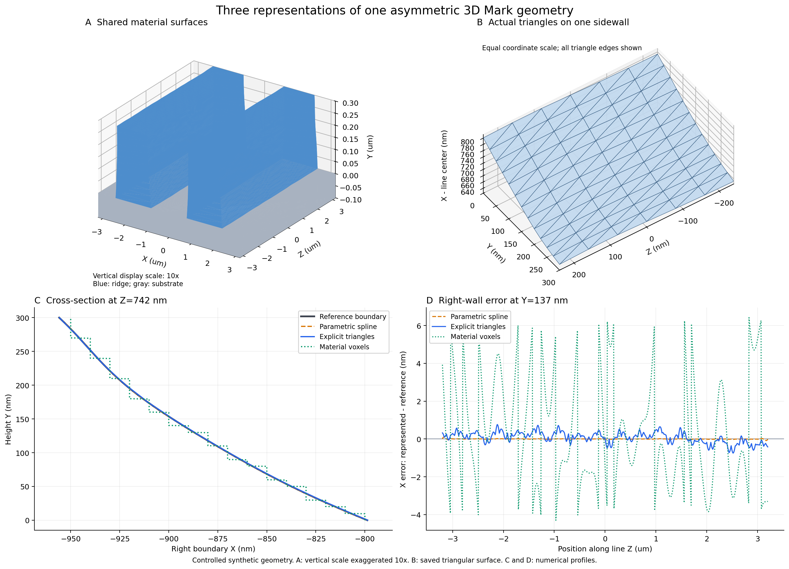
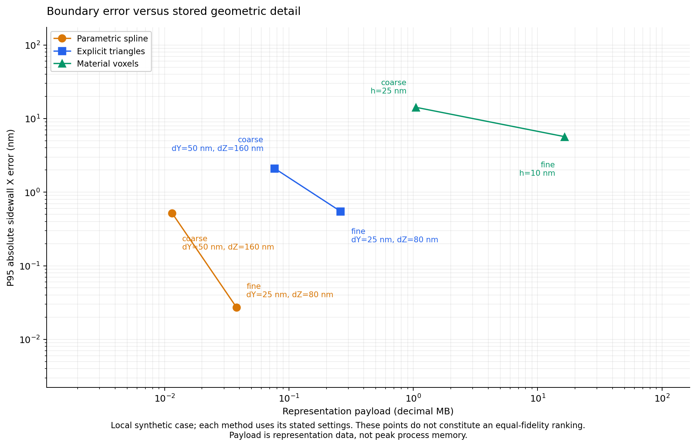

# 非对称 Mark 侧壁的三种几何表示：第一轮工程验证

日期：2026-10-24。范围：**真实非对称截面，以及沿高度、长度变化的侧壁**。这次把参数化、显式三角表面和体素各做成了可运行的独立原型，并实际完成了 9 组几何对比。

**结论：三种表示都能在本次 50 × 50 µm 示例上运行。对于本轮平滑、连续变化的条纹侧壁，二维样条参数化适合优先作为可编辑的源几何；显式三角表面适合保留为边界表达；体素适合在需要时生成。** 这项结论来自下面的合成几何实验，仍需用实测侧壁确认参数化的表达偏差。

本原型是独立研究代码，尚未接入原 Modeler GUI，也没有运行 Lumerical 导入或电磁求解。这里的三角面用于表达材料界面；体素用于表达空间材料标签。两者都不是本次要讨论的电磁计算网格。

## 1. 为什么缩小验证范围

用户已明确，当前 Mark 工艺的主要变化是左右不对称截面、侧壁弯曲，以及侧壁随高度和沿线方向的变化。因此本次不把小孔、airgap、桥接、封口等拓扑变化作为选型条件。

这使问题可以首先写成每条线的两个边界函数：

$$
x_L=f_L(y,z),\qquad x_R=f_R(y,z).
$$

其中 X 为横向、Y 为高度、Z 为条纹长度方向。在给定的 Y、Z 位置，只要 X 位于左右边界之间，该点就属于条纹材料。函数可以弯曲、左右不同，也可以同时随 Y 和 Z 变化，因而不要求截面是矩形或理想梯形。

这里的约束是：每条条纹在同一个 Y、Z 位置有一个连续的横向材料区间，且不同条纹保持分离。本轮侧壁模型符合这个条件。

### 三种原型实际保存什么

| 表示 | 本轮实现 | 直接保存的数据 | 如何确定材料 |
|---|---|---|---|
| 参数化 | 每条线左右各一张二维三次 B 样条曲面 | 样条节点、系数、坐标范围、材料约定 | 计算左右边界，判断 X 是否位于区间内 |
| 显式表面 | 连通三角面构成的材料界面 | 三维顶点、三角形顶点索引、界面两侧材料、查询索引 | 在保存的侧壁三角片上插值，并使用闭合区域约定 |
| 体素 | 规则立方单元中的 `uint8` 材料标签 | 三维标签数组、原点、间距、尺寸 | 直接读取对应单元的标签 |

**参数化在这里是有许多系数的自由曲面表达，并非只输入 CD、侧壁角等几个参数。** 完整示例有 244,140 个样条系数。本文结果不能直接归给只有少量工艺参数的模型。

**显式三角表面就是把材料边界拼成互相连接的三角形。** 三角面围出实体的边界，内部材料由区域及界面两侧的标签确定，不必给实体内部每个位置存储一个点。一般的显式边界也可以使用其他类型的面；本原型选择三角形。

体素也不需要逐个保存 X、Y、Z 三个坐标。规则数组的索引、原点和间距已经确定了坐标。本轮每个单元只用 1 字节保存材料 ID，属于较节省的稠密体素基线。

## 2. 共同参考几何与输入

目前没有实测 SEM/TEM 三维侧壁数据，因此先使用可以完整复现的合成参考。**合成结构用于验证表示和程序流程，不能代替对真实工艺形貌的验证。**

| 项目 | 局部示例 | 完整尺寸示例 |
|---|---:|---:|
| X × Z 范围 | 6.4 × 6.4 µm | 50 × 50 µm |
| 条纹数 | 2 | 15 |
| 条纹周期 | 3.2 µm | 3.2 µm |
| 条纹高度 | 300 nm | 300 nm |
| 示例衬底厚度 | 100 nm | 100 nm |
| 总 Y 范围 | −100～300 nm | −100～300 nm |
| 材料 | 空气、条纹、衬底 | 空气、条纹、衬底 |

令 `t=Y/300 nm`，未叠加沿线扰动时，左右轮廓相对线中心分别为：

$$
x_L=-800+60t+120t(1-t),\quad
x_R=800-160t-60t(1-t)\quad\mathrm{nm}.
$$

两边的倾斜、曲率不同。再叠加线中心变化、半宽变化、左右各自的独立变化。每个扰动都同时依赖 Y 和 Z；沿 Z 的组成波长为 400～9,110 nm，各条线的幅值、相位不同。沿 Y 的最高频率是跨 300 nm 高度的 1.5 个周期，而非 3 个周期。

这不是将一个小单元周期复制到整个 Mark。局部与完整尺寸示例属于同一形貌族，但因为随机数批量生成方式不同，二者不是同一个局部片段的简单放大。两种尺寸间的误差差别不能全部归因于尺寸变化。

完整的参考定义和随机系数见 [reference_definition.json](results/reference_definition.json)，生成逻辑见 [reference.py](reference.py)。种子固定为 `20261024`。

### 保证比较含义明确

参数化和三角表面从**完全相同的侧壁采样点**构建。参数化进行二维三次样条插值，三角表面用这些点拼成平面三角片。构建后，两者都不保留参考函数作为查询捷径。

体素按单元中心处的材料生成实际三维数组。评价边界时，从真实数组中找到材料标签切换的位置；没有以“对真实边界坐标四舍五入”替代实际体素生成，也没有对提取边界进行平滑。

参数化采用 SciPy `RectBivariateSpline(kx=3, ky=3, s=0)`。官方文档说明它支持矩形采样点上的二维样条插值及平滑，`s=0` 对应插值。[SciPy 官方说明](https://docs.scipy.org/doc/scipy-1.17.0/reference/generated/scipy.interpolate.RectBivariateSpline.html)

## 3. 实际执行的验证

正式对比共 9 组，每组构建一次，没有增加全套 Modeler 回归测试或重复计时：

- 局部参数化、三角表面：各两档侧壁采样，`ΔY/ΔZ=50/160 nm` 与 `25/80 nm`，共 4 组。
- 局部体素：`25 nm` 与 `10 nm`，共 2 组。
- 完整 50 × 50 µm：参数化和三角表面用 `25/80 nm`，体素用 `10 nm`，共 3 组。

每个方法使用相同的独立评价点，评价点不与构建采样点重合。每条线抽取 6,000 个 Y、Z 位置，同时评价左右侧壁；局部共 24,000 个侧壁位置，完整示例共 180,000 个。

主要指标定义如下：

$$
e_L=x_L^{model}-x_L^{ref},\quad e_R=x_R^{model}-x_R^{ref},
$$

$$
e_{CD}=e_R-e_L,\qquad e_{center}=(e_L+e_R)/2.
$$

- **边界误差**：在相同 Y、Z 处的 X 位移，不是一般曲面之间的 Hausdorff 距离。
- **P95 绝对误差**：本轮采样误差的第 95 百分位；表中的最大误差也是采样最大值，不是数学上的全域上界。
- **CD 与线中心误差**：分别检查宽度和中心位置，避免两侧误差互相抵消。
- **材料判定**：在全域随机取 20,000 点；另在真实侧壁前后 20 nm 的带状区域取 20,000 点，观察边界附近的错分。
- **条纹体积**：参考值用高阶数值积分，参数化用样条积分，三角表面用定向三角面体积，体素用实际标签计数。
- **数据量**：持久模型数组及必要元数据的未压缩负载，不是文件压缩率，也不是进程占用内存。
- **时间、内存**：各方法在独立进程中执行；时间只计一次构建（包含从参考函数采样），峰值 RSS 包括 Python、依赖库、模型、评价和临时数组。

针对局部精细三角表面，还实际检查了一次非零三角面积、索引有效、每种实体材料边界闭合和面朝向一致。条纹—衬底的公共界面只保存一次，用相反朝向供两个材料区域使用。检查通过。这项检查没有宣称完成通用网格自交检查。

## 4. 局部结果：加密以后有没有改善

以下均为实际结果，MB 使用十进制 `1 MB=1,000,000 bytes`。

| 方法 | 设置 | 数据量 MB | 边界 P95 nm | 边界采样最大值 nm | CD P95 nm | 线中心 P95 nm |
|---|---|---:|---:|---:|---:|---:|
| 参数化 | 50/160 nm | 0.011480 | 0.520 | 1.716 | 0.535 | 0.433 |
| 参数化 | 25/80 nm | 0.037832 | 0.027 | 0.172 | 0.020 | 0.025 |
| 三角表面 | 50/160 nm | 0.076402 | 2.110 | 4.746 | 2.453 | 1.684 |
| 三角表面 | 25/80 nm | 0.258913 | 0.551 | 1.251 | 0.627 | 0.444 |
| 体素 | 25 nm | 1.048720 | 14.228 | 22.867 | 22.668 | 9.924 |
| 体素 | 10 nm | 16.384144 | 5.687 | 9.797 | 9.099 | 4.080 |

三个方法加密后，边界、CD 和线中心误差均减小。对于这组平滑函数形貌，三次样条能用曲面插值更好地保留节点之间的弯曲；三角形使用分片平面；体素使用分段常数材料区域，因此产生不同的误差。

**0.027 nm 这样的数值只是相对于已知合成参考的表示误差，并不表示 SEM/TEM 或实际工艺重建具备这个精度。** 本次结果还没有包含测量噪声、分割误差、欠采样和形貌先验不匹配。



图 A 显示保存的三角表面，Y 显示比例放大 10 倍以便观察，坐标仍为真实数值；图 B 显示一小块侧壁上的实际三角片；图 C 比较未用于构建的截面；图 D 比较未用于构建的高度处沿长度方向的边界误差。图中采用英文坐标以保证字体显示一致。



图中的各点采用表中指定的采样密度。它展示本轮实现的实际取舍，不构成“所有方法在同一精度下”的普遍排名。本轮没有加入自适应三角剖分、稀疏体素、占据比例体素等其他实现。

## 5. 完整 50 × 50 µm：真实运行结果

本表对应相同的 50 × 50 × 0.4 µm 几何范围。

| 方法 | 数据量 MB | 边界 P95 nm | 边界采样最大值 nm | CD P95 nm | 线中心 P95 nm |
|---|---:|---:|---:|---:|---:|
| 参数化，25/80 nm | 2.114 | 0.022 | 0.189 | 0.023 | 0.019 |
| 三角表面，25/80 nm | 14.073 | 0.554 | 1.439 | 0.698 | 0.426 |
| 体素，10 nm | 1,000.000 | 5.689 | 9.454 | 9.047 | 4.037 |

模型实际规模：

- 参数化：30 张侧壁曲面，每张的输入采样为 13 × 626 点，共 244,140 个系数。
- 三角表面：246,705 个顶点，512,156 个三角形；其中 18,750 个为条纹—衬底共享接触三角形。
- 体素：数组形状为 `[Y,Z,X]=[40,5000,5000]`，确实生成了 **1,000,000,000 个 `uint8` 标签**，并读取其材料转换位置完成边界评价。

### 一次性运行资源记录

| 方法 | 构建时间 s | 构建阶段峰值 RSS MB | 整个进程峰值 RSS MB |
|---|---:|---:|---:|
| 参数化 | 0.107 | 68.477 | 82.903 |
| 三角表面 | 0.309 | 78.389 | 78.389 |
| 体素 | 5.072 | 1,101.672 | 1,101.672 |

环境：Python 3.12.14、NumPy 2.3.5、SciPy 1.17.0，Linux x86_64；数值库工作线程设为 1。运行时间为 2026-10-24 04:01 UTC。这些数值证明本次构建能运行；它们是一次采样，不应解释为跨机器、跨实现的稳定速度排序。参数化进程加载了 SciPy，因此不能用其峰值 RSS 与纯 NumPy 实现的差异直接推断模型自身开销。

### 总体积不能代替侧壁精度

完整示例中，10 nm 体素的条纹体积误差只有约 **−0.00156%**，但 CD P95 误差仍约 **9.05 nm**，几何线中心 P95 误差约 **4.04 nm**。这是局部增减可能在总体积中抵消的实际例子。

完整示例三角表面的条纹体积误差约 **+0.01427%**，却有更小的局部边界和 CD 误差。因此本课题不宜以“体积差很小”或“预览看起来差不多”单独验收几何。

**几何线中心误差也不能直接等同于最终 Alignment/OVL 光学偏差。** 本次还没有计算从几何到电磁响应及读出信号的传播关系。

### 更高分辨率时的体素规模

对上述 50 × 50 × 0.4 µm 范围，若每格只存一个 `uint8` 标签，则：

$$
N=\frac{50,000}{h}\frac{50,000}{h}\frac{400}{h},\qquad B=N\ \mathrm{bytes}.
$$

| 立方体素边长 h | 标签数据量 | 本轮状态 |
|---|---:|---|
| 10 nm | 1 GB | 实际构建并评价 |
| 5 nm | 8 GB | 仅按尺寸计算，未执行 |
| 2 nm | 125 GB | 仅按尺寸计算，未执行 |

这些是标签本身，不含运行时临时数组。本例衬底只保留 100 nm；如果把更深的均匀衬底也放入同一稠密数组，数据量会随总高度线性增加。

参数化和三角表面的细节主要分配在边界上。本例侧壁数据规模主要跟 `条纹数 × 高度采样数 × 长度采样数` 相关。只要大体积内部材料均匀，就不需要因为内部“占了很大空间”而逐格增加数据；但边界细节越密，曲面系数或三角片仍然会增加。

## 6. 对本课题的工程选择

### 优先路线：侧壁参数化作为源几何

根据这轮结果，下一步可以优先采用 `x_L(Y,Z)`、`x_R(Y,Z)` 作为每条线的可编辑几何。左右独立表达、允许沿高度弯曲，并沿长度保留变化。可以将可解释部分与残差分开：基础非对称截面，加上沿 Z 变化的宽度/中心，以及局部侧壁残差。

这样用户可以修改有物理含义的形貌参数，也可以导入一组实际轮廓点。不能只用一个“平均侧壁角”替代真实非对称截面。若真实轮廓有明显折点，应该分段保留折点或增加局部控制，避免用一张过度平滑的曲面把它抹掉。

### 显式三角表面保留为独立可检查的边界

本轮证明显式三角界面在完整范围只需要约 14 MB。它可以作为清楚可见、可检查的材料边界，也便于接入后续更一般的几何处理。

本原型的点查询利用了已知的结构化 Y–Z 三角片索引；没有实现任意导入三角网格的通用点内外判定，也没有完成几何编辑器。通用三角网格还需要管理连接关系、方向和几何有效性；可参考 [CGAL Polygon Mesh Processing](https://doc.cgal.org/latest/Polygon_mesh_processing/)。

本轮从共同采样点分别构建三种表示，用于对比。后续把参数化作为唯一可编辑源，再派生三角表面和体素，是基于结果的建议；本次没有把“三者互相转换”当作已完成的软件功能。

### 体素按需要生成

10 nm 体素在本次完整范围能够运行，因此不应说“几十微米一定做不了体素”。不过，如果想保留几纳米级的侧壁位置和宽度变化，继续均匀细化整个体积的代价会快速增加。可以让体素作为自研程序需要时生成的输出，而不要求日常编辑、保存、预览都依赖一份细密的全域数组。

本轮只比较稠密、硬材料标签的体素；结论不排除分块、稀疏或局部细化体素以后具有价值。

## 7. 下一轮只做一个实测小片段

现在最有价值的下一步是替换参考形貌，而不是继续扩大合成测试数量。

建议输入一小段实际或人工描出的左右非对称截面，以及沿 Z 不同位置的轮廓变化；保留坐标单位、测量位置和分割不确定度。对同一批输入点分别生成参数化和三角边界，再按指定分辨率生成体素，沿用本次边界、CD、线中心及材料判定指标。

单张截面只给出一个 Z 位置的轮廓，不能唯一确定整条侧壁沿 Z 的变化。未测到的部分可以按明确的规则或统计模型生成，但应保留“测得”和“假设”的区分。

验收阈值目前尚未由课题确定。可以先提出几何目标，例如关心的局部边界位移、CD 或线中心误差应控制在哪个量级，再看需要多少曲面系数或三角片。**不能凭本轮合成曲面得到的极小样条误差，预先承诺真实器件达到同样精度。**

## 8. 文件与复现

| 文件 | 作用 |
|---|---|
| [reference.py](reference.py) | 独立合成参考和材料查询 |
| [parametric.py](parametric.py) | 二维三次样条侧壁 |
| [explicit_surface.py](explicit_surface.py) | 顶点、三角形、材料界面及闭合检查 |
| [voxel.py](voxel.py) | 实际稠密材料数组及标签转换边界 |
| [benchmark.py](benchmark.py) | 按同一协议执行 9 个实例并输出记录 |
| [plot_results.py](plot_results.py) | 只读取已生成的结果和三角模型绘图 |
| [metrics.csv](results/metrics.csv) | 可直接查看的指标表 |
| [summary.json](results/summary.json) | 全部指标、误差、资源记录和绘图截面 |
| [reference_definition.json](results/reference_definition.json) | 完整参考形貌定义 |
| [local_surface_fine.npz](results/local_surface_fine.npz) | 实际生成的局部三角表面，支持无 pickle 读取 |

在此目录安装依赖并运行：

```bash
python -m pip install -r requirements.txt
python benchmark.py --output results
python plot_results.py --results results
```

只复现单个局部实例：

```bash
python benchmark.py --output results --case-id local_surface_fine
```

完整命令会实际分配约 1 GB 的体素标签，另有临时数组及 Python 运行时开销。脚本设置了 12 亿单元的演示上限，避免误改分辨率后生成过大的数组。本轮没有保存或上传 1 GB 的标签文件；代码会重新构建并验证该数组。保存了小型的实际三角模型，可直接从仓库中的 `summary.json` 和该模型重新绘图而不重跑基准。

所有材料以几何标签 `0=air, 1=ridge, 2=substrate` 表示。本轮不引入 n/k 设置或材料光学模型。把这些区域绑定到现有材料名称是后续软件接入层的事情。

## 9. 证据与结论边界

- 数值结论来源于本目录公开的源码、[原始指标](results/metrics.csv)和[完整记录](results/summary.json)。
- 样条接口依据 [SciPy 1.17 官方文档](https://docs.scipy.org/doc/scipy-1.17.0/reference/generated/scipy.interpolate.RectBivariateSpline.html)。
- 显式表面、连接关系及几何有效性背景可查阅 [CGAL 官方手册](https://doc.cgal.org/latest/Polygon_mesh_processing/)。
- 本轮没有用真实测量数据，没有测试含噪拟合、亚 400 nm 的沿线形貌细节、多层薄膜厚度保持、任意网格导入或图形界面交互；这些范围没有被本次结果自动覆盖。
- 正式选型应由真实形貌、关注的最小变化尺度以及可接受的几何误差共同决定。当前结果足以支持优先推进侧壁参数化，并保留显式三角边界和按需体素输出这条实现路线。
