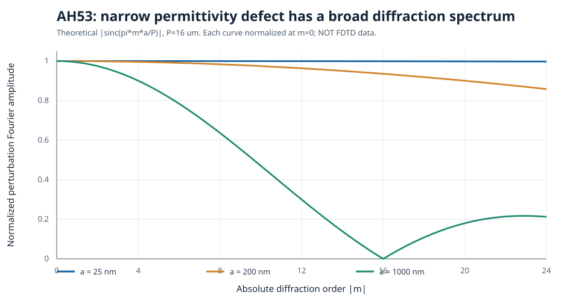
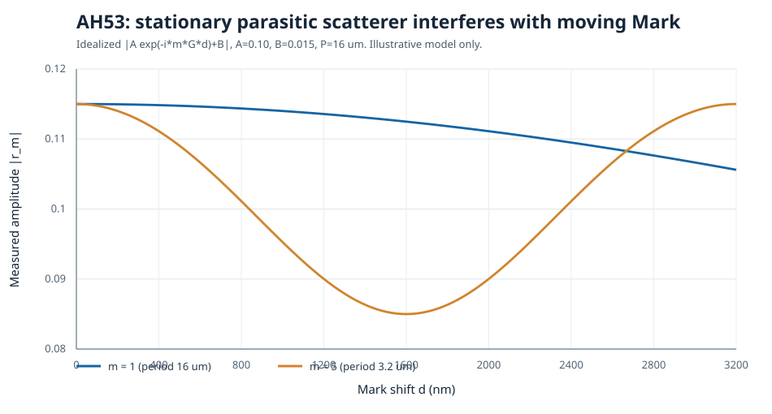
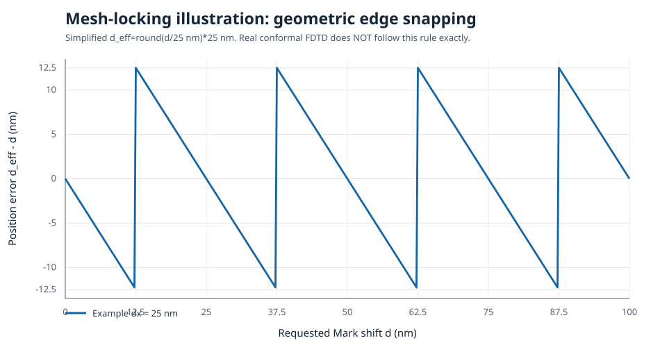

# AH53：局部介电常数误差如何产生各阶衍射振幅振荡——连续理论推导、曲线与可执行LSF

> 对话归档 2/2；2026-10-26。保留用户提问与新一轮理论分析，包含实际上传的理论SVG与8个独立LSF文件。配套上一轮讨论：[超薄膜、周期边界与Conformal伪散射](2026-10-26_超薄膜周期边界Conformal数值振荡_问答与验证方案.md)。
>
> **物理条件**：AH53单层Alignment Mark；母周期 $P=16\,\mu\mathrm m$，子周期 $p=3.2\,\mu\mathrm m$，三条Si条纹；入射 $\lambda=643\,\mathrm{nm}$、向−Y正入射Plane Wave；X周期边界、Y PML；上方有横向均匀的多层膜，其中存在7.9 nm超薄层；扫描光栅X位移 $d$。下列所有理论模型都**不代表已运行的真实FDTD结果**。
>
> **脚本兼容声明**：尽可能选用2023 R2.1已经存在的LSF命令，依据Ansys官方语法逐项核查；由于无法访问你本机的FSP对象树和Lumerical程序，**未在2023 R2.1或2025 R2实际运行，不宣称已经实测兼容**。脚本使用实际工程时必须在副本中先改对象名称，并验证膜层、材料、光源方向与监视器配置。

## 用户提问（原文）

> 考虑第  阶散射。对于较弱的局部扰动，可以用一个简化的傅里叶散射模型表示：这部分以下的推导用公式和曲线连续得说明 要详细 然后下面说的测试或者解决办法都标注可执行的lsf代码 结束后把这两段对话上传github

## 一、判据先行：理论上刚性平移不改变任何级次的模

若整个周期性材料分布只横向平移 $d$，包括任何随Mark起伏的覆盖层，横向均匀的平坦层本身无需移动：

$$
\epsilon_\mathrm{ideal}(x,y;d)=\epsilon_\mathrm{ideal}(x-d,y;0).
$$

从平面波模态的空间平移对称性得到：

$$
\boxed{r_m^\mathrm{ideal}(d)=r_m^\mathrm{ideal}(0)e^{-imGd}},\quad
G=\frac{2\pi}{P}.
$$

因此 $|r_m(d)|=|r_m(0)|$，相位以斜率 $-mG$ 变化；此结论对于$s,p$分别成立。不同偏振的初始复反射系数可不同。符号取决于傅里叶及级次约定，程序设有可切换的 phase_sign。

但数值仿真会离散电磁场、材料界面及周期边界，从而可能违反这个**连续方程的平移对称性**。下文研究其可能的数值机制。

## 二、从介电常数局部误差到复反射级次误差

令：

$$
\epsilon_\mathrm{num}(x,y;d)=\epsilon_\mathrm{ideal}(x,y;d)+\delta\epsilon(x,y;d).
$$

对小扰动，麦克斯韦方程的一阶散射/互易表达式具有下述结构：

$$
\delta r_m(d)\propto\iint
\delta\epsilon(x,y;d)
\mathbf E_\mathrm{bg}(x,y;d)\cdot
\mathbf E_{\mathrm{adj},m}(x,y;d)\,dxdy.
$$

其中 $\mathbf E_\mathrm{bg}$ 是未扰动的场，$\mathbf E_{\mathrm{adj},m}$ 是与指定出射通道相关的伴随场。这是**局部扰动极限的一阶理论形式**；对于Si/空气高折射率对比、网格单元重建等较大误差，只能作为诊断启发，不能视为严格强散射计算结果。

如果只是解释水平空间频谱，暂且把Y方向积分、背景场、极化和相位约定吸收到一个系数 $C_m(d)$，就得到近似：

$$
\boxed{
\delta r_m(d)\approx C_m(d)\widehat{\delta\epsilon}_m(d),\quad
\widehat{\delta\epsilon}_m(d)=\frac1P\int_0^P
\delta\epsilon(x;d)e^{-imGx}\,dx.
}
$$

**特别说明**：$C_m$一般依赖$m$与$d$。忽略这一事实得到的“所有衍射级次数值误差完全相同”是不正确的。

## 三、一个窄介电异常的傅里叶变换：从积分算到sinc

设周期内一个矩形伪缺陷中心$x_b$、宽度$a$、介电常数偏差$\delta\epsilon_0$：

$$
\delta\epsilon(x)=
\begin{cases}
\delta\epsilon_0,&x_b-\frac a2\le x\le x_b+\frac a2,\\
0,&\text{其余}.
\end{cases}
$$

依次代入并换元$u=x-x_b$：

$$
\begin{aligned}
\widehat{\delta\epsilon}_m
&=\frac{\delta\epsilon_0}{P}
\int_{x_b-a/2}^{x_b+a/2}e^{-imGx}\,dx\\
&=\frac{\delta\epsilon_0}{P}e^{-imGx_b}
\int_{-a/2}^{a/2}e^{-imGu}\,du\\
&=\frac{\delta\epsilon_0}{P}e^{-imGx_b}
\left[\frac{e^{-imGu}}{-imG}\right]_{-a/2}^{a/2}\\
&=\frac{\delta\epsilon_0}{P}e^{-imGx_b}
\frac{2\sin(mGa/2)}{mG}\\
&=\boxed{\frac{\delta\epsilon_0a}{P}
\operatorname{sinc}\left(\frac{\pi ma}{P}\right)e^{-imGx_b}}.
\end{aligned}
$$

$\operatorname{sinc}(z)=\sin z/z$；当$m=0$时连续极限为1。

从这里**连续**解释三个因素：

1. **面积因子**：$|\delta\epsilon_0|a/P$。异常越宽或对比越大，几何傅里叶系数的绝对量级越大。
2. **宽度因子**：$\mathrm{sinc}(\pi ma/P)$。当异常宽度远小于 $P/|m|$，该级次几乎分辨不出这么窄的特征，因此所有低阶系数接近。
3. **位置因子**：$e^{-imGx_b}$。只改变异常中心位置，不改变其几何傅里叶幅值，只线性改变各阶复相位。

### 图1：不同缺陷宽度的连续傅里叶谱

图中每条曲线按自身 $m=0$ 值归一化，纵轴是 $|\mathrm{sinc}|$；**曲线比较的是频谱形状，并非不同宽度异常的绝对散射强度**。真实的25nm异常总贡献通常比1µm异常小，因为前面的面积因子也不同。

| $|m|$ | $a=25\,\mathrm{nm}$ | $a=200\,\mathrm{nm}$ | $a=1000\,\mathrm{nm}$ |
|---:|---:|---:|---:|
| 0 | 1 | 1 | 1 |
| 1 | 0.999996 | 0.999743 | 0.993587 |
| 5 | 0.999900 | 0.993587 | 0.846928 |
| 8 | 0.999743 | 0.983632 | 0.636620 |
| 16 | 0.998972 | 0.935489 | 0 |
| 24 | 0.997688 | 0.858394 | 0.212207 |

对 $P=16\,\mu m$ 的AH53，一个横向宽25nm的伪缺陷对$m=0$至$m=24$的**归一化几何傅里叶幅度**只减少约0.23%。因此多阶**复散射误差的模**可能接近；但并不证明多阶**实测反射振幅模的变化量**一定相同。

### 图中“窄缺陷”可以代表什么？

- 周期边界附近原本连续的7.9nm膜被数值错误截断后形成的局部异常；
- 某个薄膜/Si/覆盖层交会处，Conformal退回Staircase形成的一小段错误介质区域；
- 光栅侧壁从一个Yee单元穿越到另一个时产生的局部几何差异；
- 不正确的材料优先级、对象重叠或数值网格变化导致的一小片异常材料。

这些机制**可能**产生类似的宽空间频谱，所以傅里叶曲线本身不能定位根因。

## 四、为什么复散射误差相近，会变成模值振荡？

定义理想复级次：

$$
r_m^\mathrm{ideal}(d)=A_m e^{i\phi_m-imGd},
$$

其中 $A_m=|r_m(0)|$。

假设在该级次中另有一个固定的非物理复散射：

$$
b_m=B_m e^{i\psi_m}.
$$

仿真读出的复系数：

$$
r_m^\mathrm{num}(d)=A_me^{i(\phi_m-mGd)}+B_me^{i\psi_m}.
$$

取模平方：

$$
\begin{aligned}
|r_m^\mathrm{num}(d)|^2
&=(A_me^{i\alpha_m}+B_me^{i\psi_m})
  (A_me^{-i\alpha_m}+B_me^{-i\psi_m})\\
&=A_m^2+B_m^2+A_mB_m
  (e^{i(\alpha_m-\psi_m)}+e^{-i(\alpha_m-\psi_m)})\\
&=\boxed{A_m^2+B_m^2+2A_mB_m
\cos[\phi_m-mGd-\psi_m]}.
\end{aligned}
$$

若 $B_m\ll A_m$，可展开平方根：

$$
\boxed{
|r_m^\mathrm{num}(d)|\approx
A_m+B_m\cos(\phi_m-mGd-\psi_m).
}
$$

因此 $\Delta|r_m|$ 近似由 $B_m$ 和相对相位决定，可以在不同$A_m$的级次中具有**类似绝对振荡尺度**。不过，在幅度极弱的级次 ($A_m\lesssim B_m$) 展开无效；真实振荡形状还会随$A_m/B_m$变化。

更精确地区分两种测量指标：

$$
D_m(d)=r_m^\mathrm{num}(d)-r_m^\mathrm{ideal}(d)
\quad\Rightarrow\quad |D_m|=B_m
$$

但：

$$
\Delta |r_m|=|r_m^\mathrm{num}|-|r_m^\mathrm{ideal}|
\ne |D_m|
$$

一般成立。**请优先提取复数残差，而不仅是模值振荡。**

### 图2：固定伪散射与移动Mark相干

图中使用演示参数$A=0.10,B=0.015$。图1解释“各阶额外散射为什么可能差不多强”；图2解释“额外散射为什么把原本不变的模值变成随位移起伏”。

**但是：**如果缺陷复幅度确实固定，那么其干涉位移周期是：

$$
\boxed{T_m=\frac{P}{|m|}.}
$$

| $m$ | 固定伪缺陷理论干涉周期 |
|---:|---:|
| 1 | 16 μm |
| 5 | 3.2 μm |
| 8 | 2 μm |

因此在0–100nm的位移范围内，m=1的相位变化只有2.25°，m=5只有11.25°，**不应出现许多周期的振幅快速震荡**。如观察到25nm左右的振荡，需要附加误差本身随位移发生变化，不能只由固定接缝导致。

## 五、随位移变化的数值缺陷：网格锁定

用极简Staircase边缘吸附来说明：

$$
x_e^\mathrm{num}(d)=
\Delta x\,\mathrm{round}\!\left(\frac{x_e+d}{\Delta x}\right),
\qquad
\delta x_e(d)=x_e^\mathrm{num}(d)-(x_e+d).
$$

$\delta x_e$ 的理想化周期为 $\Delta x$，在相邻网格锁定位置产生锯齿型误差。

**重要反例：**若全部材料几何在同一个统一周期网格上仅被整体吸附移动，没有改变条宽、层间形状或其他材料属性，模值仍可能严格不变。仅有有效平移位置的跳变并不必然产生振幅振荡。

要让$|r_m|$变化，通常需要**局部形貌或有效介电常数分布**发生变化。假设某个边缘的数值位置相对真实位置额外偏移$\delta x_e$，等同于增加或减少一小条材料：

$$
\delta\widehat B_m=
\pm\frac1P\int_{x_e}^{x_e+\delta x_e}e^{-imGx}\,dx
\approx\boxed{\pm\frac{\delta x_e}{P}e^{-imGx_e}},
\quad |mG\delta x_e|\ll1.
$$

**单个侧壁的离散变化也会具有近似平坦的低阶傅里叶谱。** 所以“多个级次绝对模值变化相近”支持“局部数值误差”，但不足以单独证明“周期接缝”。

你的AH53还有一个非常实用的数值特征：理想条宽1.6µm恰好等于25nm的64倍，子周期3.2µm等于25nm的128倍，母周期16µm等于25nm的640倍。如果几何真的是理想矩形、严格固定25nm均匀X网格、边界和其他横向非均匀层均正确，位移25nm的整数倍应使离散结构接近格点平移副本。因此**25nm整数倍处结果仍不重复**，是排查重网格、周期边界、材料重叠、横向非均匀覆盖层或归一化的重要迹象；这是带前提的诊断，不是一般严格定理。

## 六、周期边界、7.9nm薄膜、三材料单元的具体联系

官方《Is the boundary condition region important...》说明：周期/Bloch边界的外侧处理带总是厚一个网格单元，材料应从计算单元内延伸到边界处理区域，使其与另一端的周期对应材料一致。[原文](https://optics.ansys.com/hc/en-us/articles/4412965790611-Is-the-boundary-condition-region-important-for-simulations-with-Bloch-periodic-boundary-conditions)

官方《Optical Metrology – S-Matrix Methodology》指出，弱散射可能被**人为破坏周期性**的数值伪影污染；建议在整个周期单元平面采用统一网格，避免仅对局部缺陷加密，并延伸结构穿过周期边界处理区。[原文](https://optics.ansys.com/hc/en-us/articles/360042238733-Optical-Metrology-S-Matrix-Methodology)

官方《Selecting the best mesh refinement option》指出，当一个Yee单元出现多于两种材料时，共形处理会对该单元回退为Staircase；Variant 0对金属与PEC界面有特别的处理限制。[原文](https://optics.ansys.com/hc/en-us/articles/360034382614-Selecting-the-best-mesh-refinement-option-in-the-FDTD-simulation-object)

因此对你的7.9nm层要区分：

1. **横向均匀薄膜的固定厚度表示错误**：可能改变各阶绝对数值，但不必然破坏平移不变性。
2. **位于光栅侧壁/顶角的薄膜，且Yee单元内同时跨过三种材料**：Conformal可能回退，随X平移产生的局部几何离散误差可改变各阶复系数。
3. **薄膜恰好截断于X周期边界处理区**：可能制造真正非物理的固定边界接缝，是否随位移振荡取决于其与Mark的电磁耦合、网格调整及散射场相位。

**不能把所有介电常数的不连续点都叫“错误”。** 真实材料界面本来不连续；异常的是**在连续薄膜中产生了不该有的断裂或材质错配**。

## 七、周期边界接缝的额外相位指纹

若伪缺陷位于 $x_b=P/2$，几何相位为：

$$
e^{-imGx_b}=e^{-im\pi}=(-1)^m.
$$

因此相邻奇偶级次的**局部缺陷傅里叶贡献**会有相反符号。不过真实光栅存在多次电磁散射，且复场参考原点与出射偏振基影响相位，这仅是可检验的**候选模式**，不满足它也不能排除接缝故障。

周期边界的左右蓝色处理带实际上对应同一个周期拼接位置，不应把两侧当作两个必然独立的物理缺陷相加。

## 八、把理论转成最少仿真的定位实验（全部给出LSF）

下列8个文件**已作为完整UTF-8 LSF上传，而不只是不可运行的伪代码**。运行前根据真实FSP修改对象名（特别是7.9nm层、三条ridge、源和R Monitor），在**工程副本**执行。若真实对象是structure group生成的，须更改其上游参数，不能只改生成后的child。

| 文件 | 可执行任务 | 判据 |
|---|---|---|
| [00_local_defect_theory.lsf](scripts/2026-10-26_00_local_defect_theory.lsf) | 不打开FSP，画sinc谱、固定伪散射干涉和网格锁定理论曲线 | 理论曲线可复现 |
| [01_extend_periodic_layers.lsf](scripts/2026-10-26_01_extend_periodic_layers.lsf) | 将横向均匀薄膜与衬底跨周期边界外延、保存独立FSP | 比较外延前后 $|D_m|$ |
| [02_uniform_x_and_thinfilm_y_mesh.lsf](scripts/2026-10-26_02_uniform_x_and_thinfilm_y_mesh.lsf) | 整个16µm周期设置X步长上限，薄膜邻近设置Y步长上限 | 比较dx/dy收敛 |
| [03_index_and_mesh_inspection.lsf](scripts/2026-10-26_03_index_and_mesh_inspection.lsf) | 导出实际xmesh/ymesh并建立二维Index检查监视器 | 查薄膜实际Y网格、材料分布 |
| [04_shift_sweep_complex_orders.lsf](scripts/2026-10-26_04_shift_sweep_complex_orders.lsf) | 10个位移点实际运行FDTD，保存0、±1、±5级复向量与理论平移残差 | 区分 $|D_m|$、$\Delta|a_m|$、Rtotal |
| [05_shift_periodic_window.lsf](scripts/2026-10-26_05_shift_periodic_window.lsf) | 仅平移16µm求解窗口、光源/监视器窗口，而不动真实Mark | 比较窗口位置依赖，确认几何延拓 |
| [06_remove_thinfilm_control.lsf](scripts/2026-10-26_06_remove_thinfilm_control.lsf) | 在副本里移除7.9nm层，保存对照工程 | 比较**平移不变性误差**而非原始r差值 |
| [07_mesh_refinement_comparison.lsf](scripts/2026-10-26_07_mesh_refinement_comparison.lsf) | 创建Conformal 0/1及Staircase三个FSP工程 | 同网格设置下比较结果和稳定性 |

### 8.1 第一优先级：检查、修复周期边界外延

从 [01_extend_periodic_layers.lsf](scripts/2026-10-26_01_extend_periodic_layers.lsf) 开始，在文件最上面修改实际膜层对象名：

~~~lsf
switchtolayout;
P=getnamed("FDTD","x span");
xc=getnamed("FDTD","x");
film="film_7p9nm"; # 替换成实际对象名称
if (getnamednumber(film)==1) {
  setnamed(film,"x",xc);
  setnamed(film,"x span",3*P);
}
save("AH53_BC_layers_extended.fsp");
~~~

核心是**X方向连续材料外延**；保持FDTD X Span仍为16µm。上面的最简片段只操作7.9nm层；完整LSF同时列出了其他连续膜与衬底，并检查对象名称。不要把这个操作直接套到不应横向均匀延伸的三条光栅：周期图案跨接缝时应复制正确的相邻周期，而不是强行把ridge拉宽。

建议首次对照取 $d=0,10,20,25,30\,\mathrm{nm}$。若外延后复数残差大幅下降，且实际边界材料也更接近严格的周期对应关系，才有证据将根因归到边界材料处理。

### 8.2 第二优先级：固定横向网格，单独细化7.9nm薄膜

[02_uniform_x_and_thinfilm_y_mesh.lsf](scripts/2026-10-26_02_uniform_x_and_thinfilm_y_mesh.lsf) 首次配置建议 $dx_{\max}=10$nm、$dy_{\max}=2$nm。复测取 $dx_{\max}=5$nm；然后在同一X网格下把 $dy_{\max}=2$nm改为1nm做收敛，而不是盲目增大Mesh Accuracy。

核心LSF语句：

~~~lsf
switchtolayout;
addmesh;
set("name","uniform_x_for_AH53");
set("x",getnamed("FDTD","x"));
set("x span",getnamed("FDTD","x span"));
set("y",getnamed("FDTD","y"));
set("y span",getnamed("FDTD","y span"));
set("override x mesh",1);
set("override y mesh",0);
set("set maximum mesh step",1);
set("dx",10e-9);
~~~

**注意**：Mesh Override定义步长上限，不保证所有平移case的mesh节点一致；实际节点坐标必须保存并比较。另外，对完整16µm周期沿X使用2.5nm全局细网格时，数值规模会明显扩大，先用10nm和5nm判断是否值得进一步加密。

### 8.3 第三优先级：确认实际网格及材料分布

[03_index_and_mesh_inspection.lsf](scripts/2026-10-26_03_index_and_mesh_inspection.lsf) 调用：

~~~lsf
xmesh=getresult("FDTD","x");
ymesh=getresult("FDTD","y");
savedata("AH53_actual_mesh",xmesh,ymesh);
~~~

并在7.9nm膜附近创建二维XY Index Monitor（2D z-normal）。优先看实际网格和Index Monitor；**Index Preview并不完整表达Conformal处理后的全部Yee系数**。此外，常规内部Monitor并不总能直接采到周期边界**外侧的ghost cell**；即使预览图没看到错误，也不能仅凭此排除接缝问题，必须结合外延对照和窗口位置实验。

### 8.4 第四优先级：记录复数残差，而非只看振幅

[04_shift_sweep_complex_orders.lsf](scripts/2026-10-26_04_shift_sweep_complex_orders.lsf) 会执行：

$$
d=\{0,5,10,15,20,25,30,50,75,100\}\ \mathrm{nm}.
$$

记录：

$$
D_m(d)=a_m^\mathrm{num}(d)-
a_m^\mathrm{num}(0)e^{-imGd}.
$$

$a_m$ 是官方 **gratingvector** 的指定复笛卡尔分量乘$\sqrt{R_{\mathrm{total}}}$得到的**相对通量归一化复量**；这足以用于同一配置下的平移一致性诊断，但**不是已经完成入射复场归一化和参考面校正的最终Jones r_ss/r_pp**。程序默认component=3适合s(Ez)，若p入射可改component=1观察Ex分量，但Ex不等于完整p基的反射幅度。方向、监视器位置、投影介质及相位符号需要严格保持一致。

**关键指标**：

$$
A_m(d)=|a_m(d)|,\qquad
\eta_m=\frac{\max_d A_m(d)-\min_d A_m(d)}{\mathrm{mean}_d A_m(d)}
$$

以及：

$$
D_m(d),\quad |D_m(d)|,\quad
\arg[D_m(d)]\quad\text{（只在残差非零时定义）}.
$$

强/弱级次应分开考虑，特别在$a_m(0)\approx0$时不要计算不可靠的归一化相位。可把总反射率$R_\mathrm{total}(d)$和每阶归一化功率份额$G_m(d)$拆开，辨认是不是共同归一化引起的相关波动。

### 8.5 第五优先级：移动计算窗口，但不移动Mark

[05_shift_periodic_window.lsf](scripts/2026-10-26_05_shift_periodic_window.lsf) 把FDTD窗口中心沿X移动1.5µm，并同步移动Plane Wave/Monitor采样窗口；**保持所有物理条纹和膜层位置不动**，预先确保新窗口两端材料分布仍然是同一个物理周期的延续。

若在不同计算窗口下仍模拟同一无限周期实体，则相应各阶**功率和幅度**应相同。复相位会受到投影窗口原点/傅里叶基约定影响，不得直接逐点比较未校准相位。

### 8.6 第六优先级：单独移除膜层和更换Conformal

运行[06_remove_thinfilm_control.lsf](scripts/2026-10-26_06_remove_thinfilm_control.lsf)，在复制工程中移除7.9nm层，再以**同样的位移扫描**计算相同的平移残差指标。注意原始反射系数理应由于真实膜层改变而变化，不能要求两个模型的绝对$r_m$相同。

运行[07_mesh_refinement_comparison.lsf](scripts/2026-10-26_07_mesh_refinement_comparison.lsf)，分别保存Conformal 0/1、Staircase三个求解配置。比较需要固定网格与几何；Variant 1对金属/高吸收薄膜不一定更好，必须观察实际材料色散和收敛表现。

## 九、推荐最小仿真矩阵与故障判断

由于你已经做过Global Mesh 25×30nm以及Auto Accuracy=4的对照，下一轮建议不要一次扫太多变量：

| 组别 | 几何外延 | X网格 | 薄膜Y网格 | 优先回答 |
|---|---|---|---|---|
| A | 原模型 | Auto Accuracy4 | Auto | 当前基准 |
| B | 全部连续层外延 | 与A相同 | 与A相同 | 接缝是否主因？ |
| C | 与B相同 | 整周期dx≤10nm | dy≤2nm | 固定横向网格/薄层分辨率有效吗？ |
| D | 与B相同 | 整周期dx≤5nm | dy≤2nm | 是否呈X网格收敛？ |
| E | 与B相同 | 与C相同 | dy≤1nm | 是否呈薄层Y网格收敛？ |

额外仅对A/B做一次 **窗口中心移动1.5µm** 的对照，有助于区分接缝依赖性。每组至少保存实际X/Y网格向量、材料index以及多个级次的复场、Rtotal、源/监视器固定位置。

### 如何判读

- **B相较A振荡明显减弱**：很支持周期边界材料外延不足，但仍核对两组实际网格是否发生变化。
- **B变化很小，C/D持续改善**：更支持横向网格锁定、侧壁或多材料单元离散。
- **C→E中只细化Y明显改善**：薄膜及其上下材料界面在网格中未被充分解析。
- **振荡位移周期随dx大致成比例改变**：支持离散网格相位锁定。
- **固定一个窗口下各阶复残差$|D_m|$接近且存在可解释的局部相位特征**：增强“局部伪缺陷”证据，但仍不能单独判断它在接缝还是侧壁。
- **各阶绝对振幅的差异只发生在一次统一的Rtotal因子上**：需先检查gratingvector/grating/T的归一化定义，不应立即修改物理几何。

## 十、官方参考资料与脚本接口

物理和数值依据：

1. [Bloch/Periodic Boundary Region](https://optics.ansys.com/hc/en-us/articles/4412965790611-Is-the-boundary-condition-region-important-for-simulations-with-Bloch-periodic-boundary-conditions)
2. [Optical Metrology – S-Matrix Methodology](https://optics.ansys.com/hc/en-us/articles/360042238733-Optical-Metrology-S-Matrix-Methodology)
3. [Selecting the best mesh refinement option](https://optics.ansys.com/hc/en-us/articles/360034382614-Selecting-the-best-mesh-refinement-option-in-the-FDTD-simulation-object)
4. [FDTD solver mesh settings](https://optics.ansys.com/hc/en-us/articles/360034382534-FDTD-solver-Simulation-Object)
5. [Tips for getting actual mesh size](https://optics.ansys.com/hc/en-us/articles/360034382574-Tips-for-getting-the-actual-mesh-size-in-FDTD)
6. [Frequency-domain monitor](https://optics.ansys.com/hc/en-us/articles/360034902393-Frequency-domain-monitor-Simulation-object)
7. [Index monitor](https://optics.ansys.com/hc/en-us/articles/360034404474-addindex-Script-command)
8. [gratingvector](https://optics.ansys.com/hc/en-us/articles/360034407054-gratingvector-Script-command)
9. [grating](https://optics.ansys.com/hc/en-us/articles/360034927213-grating-Script-command)
10. [addmesh](https://optics.ansys.com/hc/en-us/articles/360034924253-addmesh-Script-command)
11. [getnamed/setnamed](https://optics.ansys.com/hc/en-us/articles/360034928793-setnamed-Script-command)
12. [savedata](https://optics.ansys.com/hc/en-us/articles/360034411174-savedata-Script-command)

公式推导及连续曲线为基于电磁微扰与傅里叶性质的理论分析，不是上述Ansys文档直接给出的AH53特定实测结果。

## 最后结论

你的绝对振幅振荡接近这一事实，让**局部材料离散异常**成为值得重点验证的假设。25nm宽异常在16µm周期中具有很平坦的低阶傅里叶谱；但同样的频谱现象既可能来自周期接缝，也可能来自Si侧壁及7.9nm薄膜的多材料网格单元。

如果振荡发生在约25nm的位移尺度，除了固定伪散射与真实衍射场干涉以外，还需要解释数值异常为什么随位移而变化。应以**扩展边界、统一X网格、细化薄膜Y网格、平移计算窗口以及复数残差**的受控实验作出结论，而非仅凭一个Index预览点或一张振幅曲线判断Conformal Mesh已经出错。
