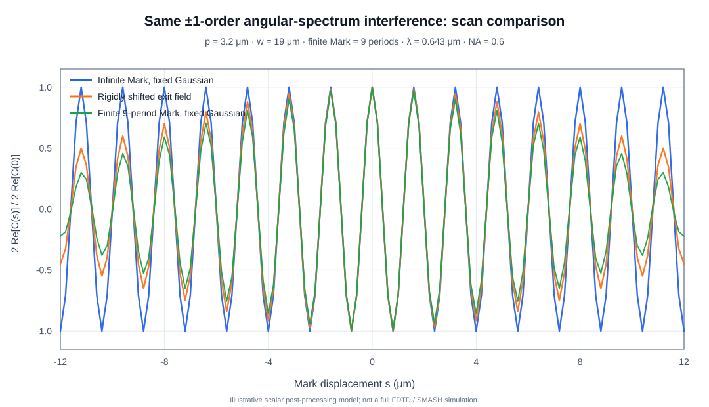
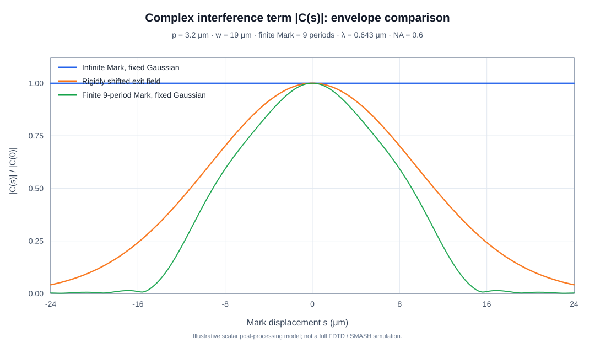

# 非周期 FDTD 高斯照明：角谱 ±k 干涉、扫描曲线和高斯包络问题——完整问答

> 归档日期：2026-10-30  
> 主题：非周期边界有限 Mark；高斯光束；FDTD 近场 FFT；零级挡板/NA；±k 相干干涉；扫描曲线快速重建  
> 形式：保留本轮问题与技术答复的推导、参数、限制和实现建议。相同问题在原对话中重复发送，以下合并记录一次。附带可复现实验代码和可直接浏览的矢量图。  
> 性质：理论解释和标量数值演示；不是已认证的 ASML SMASH 光路模型，也不是新的 Maxwell/FDTD 求解结果。

## 用户问题

> 想问一下我通过FDTD仿真 非周期边界条件 高斯光 得到的近场E分布 然后通过fft得到角谱分布A(k)的分布 然后通过0级光挡板和NA截断进行一定修改 得到Ak的新的分布 我们需要用它-k +k干涉 然后整体积分得到最终的I  我想问的是 对于扫描的过程 我除了真的每个点仿真一次 还有什么方法可以得到扫描曲线 用公式可以得到近似的曲线吗 不知道为什么用解析公式总是得到的都是高斯包络 错误在哪

## 回答：先识别扫描操作

**最先要检查的是：是否把一次 FDTD 的整个复近场平移，直接用傅里叶平移定理生成扫描位置的角谱。** 在固定高斯照明下，这通常不是实际 Mark 相对光斑扫描。

令高斯入射复振幅为 $g(x)$，Mark 的局部有效复反射响应为 $r(x)$，位移为 $s$。局部模型下真实想模拟的是

$$
\boxed{E_{\rm Mark}(x;s)=g(x)\,r(x-s).}
$$

而将整张出射近场刚性平移会得到

$$
\boxed{E_{\rm rigid}(x;s)=g(x-s)\,r(x-s).}
$$

第二种操作使光斑和 Mark 一起移动。它与实验中固定照明、Mark 扫描不等价。二者在无限光栅或有限 Mark 的 ±k 干涉积分中可能呈现完全不同的包络。这里 $r(x)$ 只是近似的局部反射响应，不能未经验证当成 FDTD 的严格局部散射算符。

### 1. 从 FDTD 近场到探测器干涉信号

在二维 XY 模型中定义 $A_s(k)=\mathcal F[E_s(x)]$。将零级光挡板、NA 和其他瞳孔响应写成 $P(k)$：

$$
\widetilde A_s(k)=P(k)A_s(k).
$$

若光路把相反横向波矢 $+k$ 和 $-k$ 映射到一对相干的、可积分的匹配模式，标量检测信号可表示为

$$
\boxed{I(s)=I_{\rm bg}(s)+2\operatorname{Re}\Gamma(s),}
$$

$$
\boxed{
\Gamma(s)=\int_{0}^{k_{\max}}
W(k)\widetilde A_s(+k)\widetilde A_s^*(-k)
e^{i\phi_{\rm opt}(k)}\,dk,
\qquad
k_{\max}=\frac{2\pi\,{\rm NA}}{\lambda}.
}
$$

其中 $W(k)$ 为角度、检测模式等权重，$\phi_{\rm opt}(k)$ 为光路相位差，$I_{\rm bg}$ 是两个干涉臂各自的强度积分。在实际矢量模型中应将标量复振幅替换为经过 Jones 光学变换的向量场内积；若探测器存在单模耦合或其他模式混合，积分和取模平方的顺序必须按真实光路重新确定。

**不能在形成干涉交叉项之前将 $A_s(k)$ 全部改为强度 $|A_s(k)|^2$，否则扫描相位就丢失了。**

### 2. 为什么无限周期光栅的扫描应当产生周期相位

令 Mark 周期为 $p$，$K=2\pi/p$。局部复反射响应展开为

$$
r(x)=\sum_{m=-\infty}^{\infty}r_m e^{imKx}.
$$

固定照明、移动 Mark：

$$
E_s(x)=g(x)\sum_m r_m e^{imKx}e^{-imKs}.
$$

记 $G(k)=\mathcal F[g(x)]$，则

$$
\boxed{
A_s(k)=\sum_m r_m G(k-mK)e^{-imKs}.
}
$$

这里高斯束的角谱决定每个衍射级在 $k$ 空间的峰宽，而 Mark 的位移为第 $m$ 级引入相位 $-mKs$。

如果不同衍射阶在角谱中足够分离，

$$
A_s(+mK+\delta)\simeq r_mG(\delta)e^{-imKs},
$$

$$
A_s(-mK-\delta)\simeq r_{-m}G(-\delta)e^{+imKs}.
$$

因此对应的复干涉项随位移变化为

$$
\Gamma_m(s)=C_m e^{-i2mKs}.
$$

各阶相加后，

$$
\boxed{
I(s)\simeq I_{\rm bg}(s)
+2\sum_{m>0}|C_m|\cos(2mKs+\phi_m).
}
$$

这里 $C_m$ 包含复衍射系数、光学传输、偏振和积分权重。对于理想、无限周期结构和分离衍射阶，固定高斯照明不应**仅仅因为采用高斯束**就出现随着 Mark 位移单调衰减的高斯包络。

例如 $p=6\,\mu{\rm m}$，$s=100\,{\rm nm}$：

$$
\Delta\phi_{+1}=-6^\circ,\quad
\Delta\phi_{-1}=+6^\circ,\quad
\Delta(\phi_{+1}-\phi_{-1})=-12^\circ.
$$

这与之前讨论的 ±1 阶平移相位规律一致。注意：真实有限尺寸结构、衍射阶谱重叠、偏振和非理想瞳孔会改变这一简单图像。

### 3. 为什么把整个高斯出射场平移，会算出高斯包络

选择一维示意：

$$
g(x)=e^{-x^2/w^2},\qquad r(x)=\cos(Kx).
$$

其中 $w$ 是入射束 $1/e^2$ **强度**半径。

真实 Mark 扫描的局部模型：

$$
E_{\rm Mark}(x;s)=g(x)\cos[K(x-s)].
$$

整体刚性平移：

$$
E_{\rm rigid}(x;s)=g(x-s)\cos[K(x-s)].
$$

假设只对分离的 ±1 级角谱峰进行匹配干涉并积分，可以得到

$$
\boxed{\Delta I_{\rm Mark}(s)\propto\cos(2Ks)}
$$

以及

$$
\boxed{\Delta I_{\rm rigid}(s)\propto e^{-2s^2/w^2}\cos(2Ks).}
$$

这个高斯因子不是无限 Mark 在固定光斑下扫描所必然产生的物理包络，而是来自**把已产生的整个高斯出射场刚性平移**：其角谱中的不同 $k$ 分量被赋予不同的 $e^{-iks}$ 相位，±k 配对积分后出现角谱去相干。

因此解析公式总是得到高斯包络时，要先检查你使用的是 $E(x-s)$ 还是 $g(x)r(x-s)$。

**示意图：**

两幅 SVG 用与下述 Python 演示相同的标量模型参数重新数值计算，方便直接在 GitHub 查看。完整代码可在本目录运行并生成对应的高分辨率 PNG 文件。

### 4. 有限 9 周期 Mark 的近似扫描模型

对于有限 Mark，需要将结构边缘引入计算。定义 $w_L(x)$ 为有效有限窗口，$r_{\rm bg}$ 为均匀背景反射，$c_m$ 为相对背景的周期调制系数：

$$
r_s(x)=r_{\rm bg}
+w_L(x-s)\sum_m c_m e^{imK(x-s)}.
$$

局部响应近似下，

$$
\boxed{
\begin{aligned}
A_s(k)=&\,r_{\rm bg}G(k)\\
&+\sum_m c_m e^{-imKs}
\int g(x)w_L(x-s)e^{-i(k-mK)x}dx.
\end{aligned}
}
$$

这个公式可直接随 $s$ 扫描并快速重新计算角谱，不需要每个点重跑电磁仿真。

若窗口是长度为 $L$ 的矩形，忽略有限宽角谱峰内部的变化并只关注一个阶峰的加权振幅：

$$
\begin{aligned}
F(s)&=\int_{s-L/2}^{s+L/2}e^{-x^2/w^2}dx\\
&=\frac{w\sqrt{\pi}}{2}
\left[
{\rm erf}\left(\frac{s+L/2}{w}\right)
-{\rm erf}\left(\frac{s-L/2}{w}\right)
\right].
\end{aligned}
$$

于是一个更粗略的包络化表达式是

$$
I(s)\approx I_{\rm bg}(s)
+\sum_m B_m F(s)^2\cos(2mKs+\phi_m).
$$

**限制：** $F(s)^2$ 只是分离衍射峰、有限窗口、特定光学模式的简化近似，不能取代有限 Mark 的完整 $A_s(+k)A_s^*(-k)$ 瞳孔积分。真正的有限 Mark 在固定光斑下扫描同样可以产生包络；关键是不能将物理上的有限长度包络与错误整体平移导致的包络混为一谈。

### 5. 如何减少需要重新计算的 FDTD 扫描点

| 方法 | 需要的电磁求解 | 主要用途与限制 |
| --- | --- | --- |
| 单次近场提取有效局部反射响应 | 一个基准照明位置 | 快速近似；需要验证空间非局域耦合是否可忽略 |
| 入射角基底/复散射矩阵 | 若干不同入射 $k_{\rm in}$ 的完整复场 | 更一般，基底充分时可系统逼近 Maxwell 刚性平移扫描 |
| 少量位移点的真实 FDTD | 若干代表性扫描位置 | 校准前两种方法的幅度、相位、偏振与最终信号 |

**方法 A：从已有一次复近场构造局部响应。**

在已分离目标出射波、明确监视器参考面的前提下，尝试

$$
r_{\rm eff}(x)\approx \frac{E_0(x)}{g(x)},\qquad
E_{\rm pred}(x;s)=g(x)r_{\rm eff}(x-s).
$$

高斯尾部应正则化除法，避免 $\lvert g(x)\rvert$ 很小带来的噪声。若监视器远离 Mark，可先用复角谱反向传播至参考平面。

**此方法并不严格：** Maxwell 电磁散射通常是非局域的（横向耦合、多层传播、共振、近场相互作用）。直接将 FDTD 的 $E_0/g$ 解释为局部反射系数未必成立，必须用真实位移点的 FDTD 验证。

**方法 B：用入射角基底构造有限 Mark 的散射算符。**

设高斯入射光的角谱为 $G(k_{\rm in})$，固定 Mark 的复散射核为 $S_0(k_{\rm out},k_{\rm in})$。对于在横向均匀背景内刚性平移的结构，平移后的散射算符满足

$$
S_s(k_{\rm out},k_{\rm in})
=S_0(k_{\rm out},k_{\rm in})e^{-i(k_{\rm out}-k_{\rm in})s}.
$$

从而

$$
\boxed{
A_s(k_{\rm out})=
\int S_0(k_{\rm out},k_{\rm in})G(k_{\rm in})
e^{-i(k_{\rm out}-k_{\rm in})s}dk_{\rm in}.
}
$$

它将昂贵的电磁求解集中在入射角基底的预计算中；随后扫描位置只涉及复数加权和数值积分。它比对一次高斯出射场施加整体平移相位更严格。

单次高斯 FDTD 只给出

$$
A_0(k_{\rm out})=\int S_0(k_{\rm out},k_{\rm in})G(k_{\rm in})dk_{\rm in},
$$

一般不能从中唯一恢复二维散射核 $S_0$。精确实现还要求：不同入射角计算使用统一的相位参考；入射/反射背景的定义一致；分辨率、入射角采样和 NA 内响应充分收敛。

### 6. 当前程序的优先排查项

1. **扫描相位：** 验证 $\arg A_{+1}$ 与 $\arg A_{-1}$ 的位移斜率是否分别近似 $-K$、$+K$，两者相位差是否约为 $-2K$；有限 Mark 的阶峰选取与谱重叠可能使这些关系不再严格。
2. **保持复数交叉项：** 分别输出 $I_{\rm bg}(s)$、$\operatorname{Re}\Gamma(s)$、$\operatorname{Im}\Gamma(s)$、$|\Gamma(s)|$、$\arg\Gamma(s)$。不要在干涉相乘之前只保存 $|A|^2$。
3. **分离目标出射场：** 判断 FDTD 监视器是否还包含入射光及背景镜面反射；必要时进行一致的参考仿真扣除，并保持复相位、监视器位置与传播参考面一致。
4. **先只使用 ±1 级：** 暂不叠加所有高阶、不拟合三角波；首先使单阶周期、相位和相干可见度与基准吻合，再逐步增加阶次与真实瞳孔。
5. **确认瞳孔和模式匹配：** NA/零级挡板负责筛选复角谱，不负责自动生成位移相位；从 ±k 配对到探测器积分的公式必须依据实际光路确定。
6. **真实 FDTD 交叉验证：** 用少数 Mark 位移位置检查预测的复振幅和 $\Gamma(s)$，不能只比较归一化后的曲线形状。

## 数值示例与复现实验

附带文件：

- [fft_mark_scan_comparison.py](./fft_mark_scan_comparison.py)：Python + NumPy + Matplotlib 的独立标量后处理示例；运行后生成两个 PNG 图和验证输出。
- [fft_mark_scan_signals.svg](./fft_mark_scan_signals.svg)：三种模型的扫描干涉调制项。
- [fft_mark_scan_envelopes.svg](./fft_mark_scan_envelopes.svg)：三种模型的复干涉项模长包络。

本数值模型设置为：

- 光栅周期 $p=3.2\,\mu{\rm m}$；
- 高斯光斑直径假设 $38\,\mu{\rm m}$ 指 $1/e^2$ **强度**直径，所以 $w=19\,\mu{\rm m}$；
- 有限 Mark 为 9 个周期（长度 $L=28.8\,\mu{\rm m}$）；
- 波长 $\lambda=0.643\,\mu{\rm m}$、NA=0.6；
- 使用 $\pm1$ 级角谱带宽，并按照相反 $k$ 的复振幅作简化干涉匹配；
- 只用于说明扫描位移、有限窗口和高斯包络的区别，未纳入真实 Mark 层叠、Jones 矩阵、3D 光路、探测器非理想及 Maxwell 级非局域响应。

代码运行后应打印：

~~~text
PASS: ideal model = cos(2K s); rigid-field model = exp[-2(s/w)^2] cos(2K s).
Finite-mark data is obtained from FFT for each scan point (no FDTD resimulation).
~~~

## 本轮结论

短期采用**固定高斯照明 + 有限 Mark 平移 + 快速复角谱 FFT**的局部响应模型；用少量位移点真实 FDTD 做幅度与相位校准。若局部模型精度不足，进一步采用入射角散射算符法。判断扫描曲线正确与否，不是检查它有没有高斯包络，而是同时核验有限尺寸的包络、±m 级相对位移相位 $2mKs$、瞳孔复权重和最终干涉交叉项。
