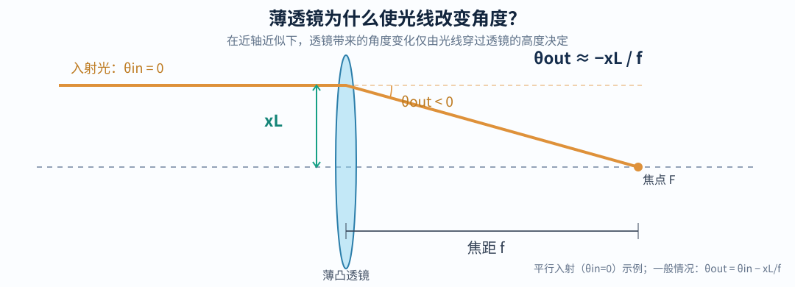
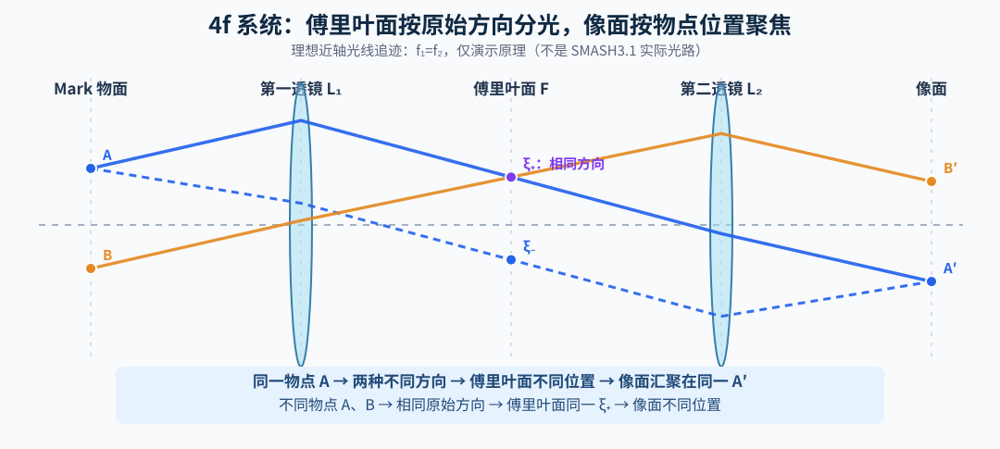
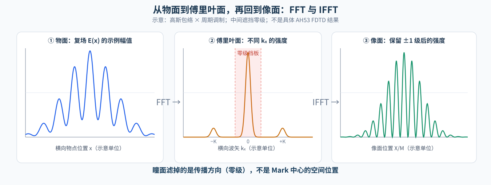
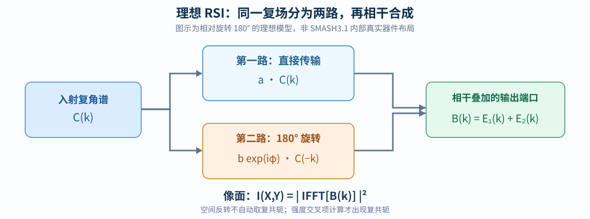

# 从薄透镜到瞳面、相干成像与 RSI：SMASH3.1 Mark 光学计算入门

> **整理日期**：2026-10-31  
> **内容范围**：本轮关于 SMASH3.1 成像、物面/傅里叶面/瞳面、不同物点相干性、薄透镜光线公式、RSI 复场干涉，以及从 Lumerical FDTD 复近场计算像面强度的连续问答。  
> **整理方式**：不是按聊天时间逐条拼接，而是按“先学透镜 → 分清两个观察平面 → 理解相干 → 建立 RSI 模型 → FDTD 后处理”的学习顺序重新组织；保留核心推导、例子、限制及问题解答。  
> **范围声明**：双透镜采用理想 **4f 近轴相干成像系统**。RSI 采用两份波前相对旋转 180° 的简化模型；这**不是**声称复现了 ASML SMASH3.1 的全部实际内部光路、偏振器件及探测端口。文中示意图、示例数据均不是来自新的真实 FDTD 仿真。

## 目录

1. [先分清坐标与研究目标](#1-先分清坐标与研究目标)
2. [薄透镜为什么会改变光线方向](#2-薄透镜为什么会改变光线方向)
3. [为什么同一物点的光经第一透镜后会平行](#3-为什么同一物点的光经第一透镜后会平行)
4. [物面、傅里叶面（瞳面）与像面有什么区别](#4-物面傅里叶面瞳面与像面有什么区别)
5. [Mark 上不同位置的散射光是否相干](#5-mark-上不同位置的散射光是否相干)
6. [从 FDTD 的 E(x) 看懂 FFT、衍射峰、NA 和零级挡板](#6-从-fdtd-的-ex-看懂-fft衍射峰na-和零级挡板)
7. [RSI 使正负波矢怎样相干叠加](#7-rsi-使正负波矢怎样相干叠加)
8. [屏幕一个像素来自 Mark 的哪个位置](#8-屏幕一个像素来自-mark-的哪个位置)
9. [如何从 FDTD 复近场算出屏幕强度 I(X,Y)](#9-如何从-fdtd-复近场算出屏幕强度-ixy)
10. [圆形屏幕、总强度与之前 ±k 积分的联系](#10-圆形屏幕总强度与之前-k-积分的联系)
11. [现有二维 Lumerical 能做什么，不能做什么](#11-现有二维-lumerical-能做什么不能做什么)
12. [常见混淆与最后的公式总结](#12-常见混淆与最后的公式总结)

---

## 1. 先分清坐标与研究目标

在本课题中，Lumerical 二维 FDTD 采用：

| 量 | 解释 |
|---|---|
| $x$ | AH53 条纹的周期方向，也是 Mark 扫描方向 |
| $y$ | FDTD 中的厚度／传播方向；反射光向 $+y$ 传播 |
| $z$ | 条纹延伸方向，在 2D XY 模型中假设无限均匀 |
| $X,Y$ | **屏幕／相机平面**上的两个横向坐标，注意 $Y$ **不是** FDTD 的高度 $y$ |
| $k_x,k_z$ | 出射光横向波矢，也称角谱坐标 |
| $s$ | Mark 相对于固定照明光斑和光轴的扫描位移 |

此前研究的量是每个扫描位置的**一个总强度数字** $I_{\rm total}(s)$。现在进一步想求每个屏幕像素的强度：

$$
\boxed{I_{\rm image}(X,Y;s).}
$$

得到整张图像以后，再对有效屏幕区域积分，就可以回到一个总强度数字。要做到这一点，必须从一开始保留**复振幅**，不能仅保留远场强度 $|A(k)|^2$。

**本文件最重要的两个映射（仅对理想 4f 近轴模型成立）：**

$$
\boxed{\text{傅里叶面位置}\quad \xi \simeq f_1\theta \simeq f_1\frac{k_x}{k_0},}
$$

$$
\boxed{\text{像面位置}\quad X=-\frac{f_2}{f_1}x.}
$$

第一个按照**原始传播方向**归类，第二个按照**原始物点位置**成像。

## 2. 薄透镜为什么会改变光线方向？

### 2.1 几何光学：从凸透镜焦点的性质出发

凸透镜有一个熟悉的性质：与光轴平行入射的近轴光线，在折射后会经过后焦点。

取光轴方向为传播轴。假设平行光在透镜处的横向高度为 $x_L$，薄透镜焦距为 $f>0$。折射后的方向朝向后焦点，近轴下：

$$
\tan\theta_{\rm out}\simeq \theta_{\rm out}=-\frac{x_L}{f}.
$$

**注意负号：**若入射点在光轴上方（$x_L>0$），出射方向向下偏折。

若入射光线原本就与光轴成角 $\theta_{\rm in}$，薄透镜给它增加的偏折角仍为 $-x_L/f$，因此

$$
\boxed{\theta_{\rm out}=\theta_{\rm in}-\frac{x_L}{f}.}
\tag{2.1}
$$

所有角度都按弧度处理；这是**近轴薄透镜公式**，不能不加检查地用于很大的角度。

### 2.2 为什么也可以用电磁场解释？

在相位约定 $e^{-i\omega t}$ 下，一个理想薄透镜施加的近轴相位因子可以写为

$$
t(x_L)=\exp\left(-i\frac{k_0x_L^2}{2f}\right).
$$

透镜产生的位置相关相位

$$
\phi_L(x_L)=-\frac{k_0x_L^2}{2f}
$$

会改变局部的横向波矢：

$$
\Delta k_x=\frac{\partial\phi_L}{\partial x_L}=-\frac{k_0x_L}{f}.
$$

因为近轴下 $k_x\simeq k_0\theta$，得到

$$
\boxed{\Delta\theta=-\frac{x_L}{f}.}
$$

因此，**几何光学的光线偏折**，与**波动光学的二次相位梯度**给出的结果是一致的。后续用 FFT 或角谱方法模拟透镜时，正是利用这个波动光学观点，而不必把真实透镜画进 FDTD 计算域。

## 3. 为什么同一物点的光经第一透镜后会平行？

### 3.1 这是物面放在前焦面时的特殊结果

将 Mark 的一个物点放在第一透镜的**前焦面**，物点横向坐标为 $x$，原始出射角为 $\theta$，物面到透镜的距离是 $f_1$。

光线到达透镜时的高度为

$$
x_L=x+f_1\theta.
$$

将其代入式 (2.1)：

$$
\begin{aligned}
\theta_{\rm out}
&=\theta-\frac{x_L}{f_1}\\
&=\theta-\frac{x+f_1\theta}{f_1}\\
&=\boxed{-\frac{x}{f_1}}.
\end{aligned}
$$

**$\theta$ 被消掉了！**

解释：同一个物点（相同 $x$）发出的不同角度光线，通过第一透镜后具有相同方向；不同物点（不同 $x$）的出射平行光束具有不同方向。

这不是所有物距都能得到的结果，而是“物面在第一透镜前焦面”这一条件的结果。

### 3.2 一张光线图同时说明两个现象

图中蓝色实线和蓝色虚线来自**同一物点 A**，原来角度不同；通过第一透镜后方向相同，经过第二透镜后共同汇聚成 A′。

蓝色实线和橙色线来自**不同物点 A、B**，但最初传播角度相同；它们在中间傅里叶面经过**同一个位置**，而最终抵达不同的像点。

先接受这两个结果，下一节用公式同时证明它们。

## 4. 物面、傅里叶面（瞳面）与像面有什么区别？

### 4.1 傅里叶面为什么只与出射角有关？

取理想 4f 布置：

- Mark 物面 → 第一透镜：距离 $f_1$；
- 第一透镜 → 中间傅里叶面：距离 $f_1$；
- 傅里叶面 → 第二透镜：距离 $f_2$；
- 第二透镜 → 最终像面：距离 $f_2$。

因此第一、第二透镜的间距为 $f_1+f_2$。

光线通过第一透镜后以角度 $-x/f_1$ 再传播距离 $f_1$，中间傅里叶面的位置为

$$
\begin{aligned}
\xi
&=x_L+f_1\theta_{\rm out}\\
&=x+f_1\theta+f_1\left(-\frac{x}{f_1}\right)\\
&=\boxed{f_1\theta}.
\end{aligned}
$$

**物点位置 $x$ 消掉了！** 傅里叶面的位置取决于光在到达第一透镜前的传播角 $\theta$，而不是原始物点的位置。

### 4.2 第二透镜为什么重新按物点成像？

由傅里叶面再传播 $f_2$ 到第二透镜，透镜高度为

$$
x_{L2}=\xi+f_2\left(-\frac{x}{f_1}\right)
=f_1\theta-\frac{f_2}{f_1}x.
$$

经过第二透镜：

$$
\theta_2=-\frac{x}{f_1}-\frac{x_{L2}}{f_2}
=-\frac{f_1}{f_2}\theta.
$$

再传播 $f_2$ 到像面：

$$
\begin{aligned}
X&=x_{L2}+f_2\theta_2\\
&=f_1\theta-\frac{f_2}{f_1}x-f_1\theta\\
&=\boxed{-\frac{f_2}{f_1}x}.
\end{aligned}
$$

**原始角度 $\theta$ 又消掉了！** 相同物点的不同光线重新聚焦到相同的像点。

### 4.3 一眼看懂二者区别

| 观察面 | 横向坐标与什么有关 | 你看到什么 |
|---|---|---|
| 物面（Mark 所在面） | 物点坐标 $x$ | 被照明的 Mark 结构与出射复场 |
| 中间傅里叶面 | 入射原始方向 $\theta$，或 $k_x$ | 零级与正负各阶衍射峰、连续角谱 |
| 最终像面 | 物点位置 $x$，经放大率映射 | 相干叠加形成的空间图像 |

更准确的术语提醒：**“傅里叶面”描述角谱的聚焦关系，“瞳面”指孔径光阑或其光学共轭面。** 在这里采用的理想 4f 教学布置中可以把傅里叶面作为角谱筛选的瞳面来处理；真实仪器中二者并非必然是同一实际器件平面。

### 4.4 具体数值例子

仅作教学假设，若 $f_1=20\,\mathrm{mm}$、$f_2=40\,\mathrm{mm}$：

- 放大率大小 $M=f_2/f_1=2$；
- Mark 上 $x=+5\,\mu\mathrm m$ 的物点，理想成像位置是 $X=-10\,\mu\mathrm m$；
- 来自不同物点但同一初始角度的光线，会在傅里叶面相遇。

在此位置与角度的对应关系下，透镜并没有使“每束光都去同一个位置”，而是连续完成了一次按角度分类和一次按位置归类。

## 5. Mark 上不同位置的散射光是否相干？

### 5.1 不同位置不意味着互不相干

对当前 Lumerical 中的**单频、相干高斯入射光**，Mark 各位置的散射复场通常有确定的相位关系。是否相干取决于源和场的统计相干性，而不是两个位置是否相同。

设来自两个不同位置的复振幅为

$$
E_1=A_1e^{i\phi_1},\qquad E_2=A_2e^{i\phi_2}.
$$

若它们在同一探测模式中重叠：

$$
\begin{aligned}
I&=|E_1+E_2|^2\\
&=|E_1|^2+|E_2|^2+2\operatorname{Re}(E_1E_2^*).
\end{aligned}
$$

最后一项是干涉项。如果两束场各自强度为 $I_0$：

| 稳定相对相位 | 总强度 |
|---|---|
| $0^\circ$ | $4I_0$（相长） |
| $90^\circ$ | $2I_0$ |
| $180^\circ$ | $0$（相消） |
| 完全互不相干，探测时间平均 | $2I_0$（交叉项平均为零） |

不同物点在像面形成的理想点像可以相互分离，因此未必在每个像素产生可见干涉；但有限 NA 带来非零宽度的**复振幅点扩散函数**，不同点像重叠时仍会有干涉。

### 5.2 相干成像与不相干成像的根本区别

定义物方复场 $E_{\rm obj}(x)$，像面复振幅点扩散函数为 $h$，带符号放大率 $M_s=-f_2/f_1$。

**相干照明：**

$$
\boxed{I_{\rm coh}(X)=
\left|\int E_{\rm obj}(x)\,h(X-M_sx)\,dx\right|^2.}
$$

**物点间完全不相干：**

$$
\boxed{I_{\rm incoh}(X)=
\int I_{\rm obj}(x)\,|h(X-M_sx)|^2\,dx.}
$$

前者是“先加复振幅，再取模平方”，后者是“对强度加权求和”。真实部分相干光源还需互相干函数；但你当前单频高斯 FDTD 属于前者。

### 5.3 为什么不同物点对同一角谱峰都可能有贡献？

因为一个传播方向的复振幅是所有物点的叠加：

$$
\boxed{A(k_x)=\int E(x)e^{-ik_xx}\,dx.}
$$

即使瞳面只有一个 $+1$ 级亮点，也不代表它只来自一根条纹。它是整个被照明 Mark 的多个位置在这个散射方向上的**相干求和**。

## 6. 从 FDTD 的 E(x) 看懂 FFT、衍射峰、NA 和零级挡板

### 6.1 光学中的 FFT 就是计算横向角谱

在固定的空气参考平面上得到复场 $E(x)$：

$$
A(k_x)=\int E(x)e^{-ik_xx}\,dx.
$$

横向波矢与传播方向关系为

$$
k_x=k_0\sin\theta,\qquad k_0=\frac{2\pi}{\lambda}.
$$

因此，近轴条件下傅里叶面场与角谱对应：

$$
\boxed{E_F(\xi)\propto
A\left(\frac{k_0\xi}{f_1}\right),\qquad
\xi\simeq f_1\theta.}
$$

前式省略整体传播相位和比例常数，是理想傅里叶光学映射；对于大角度或高 NA，必须采用真实的角度映射和矢量光学模型。

这张图展示的是**教学用简单高斯调制光栅**，不是你 9 个母周期 AH53 的数值仿真结果。

### 6.2 为什么瞳面出现 0、±1 等衍射峰？

对无限周期光栅，设周期为 $p$，$K=2\pi/p$，可在角谱中出现靠近 $k_x=mK$ 的衍射级次。

正入射时

$$
\sin\theta_m=\frac{m\lambda}{p}.
$$

举例采用 AH53 的**母周期** $p=16\,\mu\mathrm m$ 与 $\lambda=0.643\,\mu\mathrm m$：

$$
\sin\theta_{\pm1}=\pm 0.0401875,\qquad
\theta_{\pm1}\approx\pm 2.30^\circ.
$$

若 $f_1=20\,\mathrm{mm}$，近轴傅里叶面坐标约为

$$
\xi_{\pm1}\approx\pm(20\,\mathrm{mm})(0.0401875)
=\boxed{\pm0.804\,\mathrm{mm}}.
$$

这是假设透镜参数的计算例子，不是 SMASH3.1 的已知尺寸。真实 AH53 还存在内部 3.2 μm 条纹节距、有限长度、角谱峰展宽和组合结构，因此不能把全部衍射峰简单理解为只有上述三个点。

### 6.3 NA 和零级挡板“挡”的是什么？

把接收数值孔径写成复振幅瞳孔函数的一部分，二维横向角谱中

$$
P_{\rm NA}(k_x,k_z)=
\begin{cases}
1,&\sqrt{k_x^2+k_z^2}\leq k_0\,\mathrm{NA},\\
0,&\text{其他}.
\end{cases}
$$

令零级挡板响应为 $P_0(k_x,k_z)$（其真实尺寸、形状未知时必须明确写为示意参数），总的角谱筛选为

$$
\boxed{C(k_x,k_z)=
P_{\rm NA}(k_x,k_z)P_0(k_x,k_z)A(k_x,k_z).}
$$

零级挡板**过滤中心传播方向**，不是遮住 Mark 中心的那一块空间区域。因此，“零级挡板在瞳面中央有黑块”并不意味着“像面中央一定是黑的”。

对应的一维表达式就是 $C(k_x)=P(k_x)A(k_x)$。

## 7. RSI 使正负波矢怎样相干叠加？

### 7.1 RSI 并不是让原本不相干的光变相干

**不经 RSI，整个 Mark 的衍射场已经发生相干叠加。** RSI 的简化作用是在后续光学系统中把两份相对旋转的波前进行特定模式的重合和相干叠加，将位置引起的复相位差转成探测信号。

把 RSI 在一个输出端口上理想化为

$$
\boxed{B(k_x,k_z)=
aC(k_x,k_z)+
b e^{i\phi}\,C(-k_x,-k_z).}
$$

这里 $a,b$ 是复振幅传输系数，$\phi$ 是路径相位；两路还必须在探测偏振上可干涉。

**注意不是** $C^*(-k_x,-k_z)$。仅仅把一份波前旋转 180° 不会自动对复场取共轭。复共轭出现在计算强度交叉项时。

真实的 RSI 还可能有偏振投影、不同端口、角度相关相位、像差和空间传递函数。本文仅采用上式作为可计算的教学模型，不等同于已标定的 SMASH3.1 光学算子。

### 7.2 RSI 对像面图像有什么影响？

设进入 RSI 前物方等效复场为 $U(x,z)$。利用逆傅里叶变换的反演性质：

$$
\mathcal F^{-1}\{C(-k_x,-k_z)\}(x,z)=U(-x,-z).
$$

所以在该理想模型中，输出复场可以理解为两份关于光轴中心对称的图像相干叠加：

$$
\boxed{E_{\rm out}(x,z)=aU(x,z)+b e^{i\phi}U(-x,-z).}
$$

在忽略有限 NA 模糊的几何图像下，屏幕一点主要收到对应**一对相反物方坐标**的场，而不是一个物点的普通照片。

### 7.3 单谐波例子：条纹可能不平移，只改变亮度

假设（仅作解析示例）光轴固定，高斯包络 $g(x)$ 是偶函数，Mark 扫描位置为 $s$：

$$
U_s(x)=g(x)\cos[q(x-s)].
$$

两臂等幅、同相叠加：

$$
\begin{aligned}
E_{\rm out}(x;s)
&=U_s(x)+U_s(-x)\\
&=2g(x)\cos(qx)\cos(qs).
\end{aligned}
$$

因此

$$
\boxed{
I_{\rm out}(x;s)=4|g(x)|^2\cos^2(qx)\cos^2(qs).
}
$$

在这个理想模型里，空间明暗条纹的位置由 $\cos^2(qx)$ 决定，而随扫描变化的整体亮度由 $\cos^2(qs)$ 决定。因此加入 RSI 后，屏幕图像**不一定只是原来 Mark 照片随位移横向移动**。

对于真实 AH53 的多阶、有限尺寸结构，必须计算实际复角谱而不是只套这个单谐波解析例子。

## 8. 屏幕一个像素来自 Mark 的哪个位置？

### 8.1 不加 RSI、无限 NA 的几何近似

带符号横向放大率为

$$
M_s=-\frac{f_2}{f_1}.
$$

普通像面的点满足

$$
X=M_s x,\qquad Y=M_s z.
$$

例如放大率大小 $|M_s|=10$，屏幕 $(X,Y)=(100\,\mu\mathrm m,0)$ 对应物方 $(-10\,\mu\mathrm m,0)$，假设坐标反转沿用前述定义。

### 8.2 理想 180° RSI 后

若一臂成像坐标采用 $X=M_sx$，另一臂旋转 180° 后，屏幕同一坐标还与相反物方位置有关：

$$
\boxed{(x,z)=\left(-\frac{X}{|M_s|},-\frac{Y}{|M_s|}\right)
\quad\text{与}\quad
\left(+\frac{X}{|M_s|},+\frac{Y}{|M_s|}\right).}
$$

两份场在屏幕上以复振幅形式叠加，**不是**把两块独立的强度直接加起来。

### 8.3 实际有限 NA 下：没有严格的单点对应

瞳孔有限意味着每个点像具有复振幅 PSF $h$：

$$
U(\mathbf r)=\int h(\mathbf r-\mathbf r')E_{\rm obj}(\mathbf r')\,d^2\mathbf r'.
$$

所以屏幕一个像素可以同时收到多个物点的相干贡献。前述“对应两个对称点”只是点像足够窄时的几何直觉。

## 9. 如何从 FDTD 复近场算出屏幕强度 I(X,Y)？

这是你接下来可以直接让 Codex 在 **Lumerical + Python** 流程里实现的部分；不需要在 FDTD 中建立透镜模型。

### 9.1 输入：空气监视面上的复反射场

在 $y=y_m$ 的空气参考监视面，取得向上出射的复场 $E_m(x,z)$。必须确认不包含未分离的入射波；但不应无理由扣除平坦 Si 衬底的真实背景反射，否则改变了原始出射场的零级分量。

计算

$$
A_m(k_x,k_z)=\iint E_m(x,z)e^{-i(k_xx+k_zz)}dx\,dz.
$$

如果要重建更靠近结构的均匀空气参考面 $y=y_0<y_m$，采用时间依赖 $e^{-i\omega t}$，对向上传播的传播波分量：

$$
k_y=+\sqrt{k_0^2-k_x^2-k_z^2},
$$

$$
\boxed{A_0(k_x,k_z)=A_m(k_x,k_z)e^{-ik_y(y_m-y_0)}.}
$$

**限制：**只在参考面之间为空气的情况下使用；不能把这个因子直接用来穿过真实 Si 层和复杂 Mark；高空间频率倏逝分量的回传可能数值不稳定，也不会被有限 NA 的远场镜头直接接收。

### 9.2 加入瞳孔与零级挡板

$$
C(k_x,k_z)=P(k_x,k_z)A_0(k_x,k_z),
$$

$$
P=P_{\rm NA}P_0.
$$

如果还有像差、偏振、透镜透过率，可在后续拓展为复传递函数或 Jones 算子；现在先不引入不必要的复杂性。

### 9.3 加入简化 RSI，仍保留复数

$$
B(k_x,k_z)=aC(k_x,k_z)+b e^{i\phi}C(-k_x,-k_z).
$$

此步发生的是**复振幅的相干相加**，不能提前变成 $|C|^2$。

### 9.4 逆傅里叶变换恢复空间复场

在物方等效横向坐标 $\mathbf u=(u,v)$ 上：

$$
\boxed{\psi(u,v)=
\frac{1}{(2\pi)^2}
\iint B(k_x,k_z)e^{i(k_xu+k_zv)}dk_x\,dk_z.}
$$

再将像面坐标换算为 $u=-X/M$、$v=-Y/M$，其中 $M=f_2/f_1>0$：

$$
\boxed{
E_{\rm image}(X,Y)=C_{\rm sys}\,
\psi\left(-\frac XM,-\frac YM\right).
}
$$

这里 $C_{\rm sys}$ 表示整体相位、透镜传输与幅值归一化因子；若要计算绝对光功率，必须正确做电磁场到探测功率的标定。

最后，像面强度：

$$
\boxed{I_{\rm image}(X,Y)=|E_{\rm image}(X,Y)|^2.}
$$

**正确的计算顺序是**

$$
\boxed{I_{\rm image}=\big|\mathcal F^{-1}\{B\}\big|^2,}
$$

而**不是** $\mathcal F^{-1}\{|B|^2\}$。

### 9.5 和之前 ±k 干涉公式的联系

将像面总场拆成两臂 $E_1,E_2$：

$$
I=|E_1+E_2|^2
=|E_1|^2+|E_2|^2+2\operatorname{Re}(E_1E_2^*).
$$

在整个像面收集且采用统一功率归一化的理想模式匹配模型中，Parseval 定理说明像面完整积分与角谱域的完整积分成比例。

之前写的

$$
\Gamma(s)=\int_{k>0} C_s(+k)C_s^*(-k)W(k)\,dk
$$

本质上是在指定匹配的正负模式之后，直接计算复干涉交叉项。**只有当它与当前像面成像使用的模式匹配、通道权重、积分范围及偏振约定一致时，两种算得的“总强度”才能直接比较。**

## 10. 圆形屏幕、总强度与之前 ±k 积分的联系

假设像面相机的有效圆形感光区域半径为 $R_D$：

$$
D(X,Y)=
\begin{cases}
1,&X^2+Y^2\leq R_D^2,\\
0,&\text{其他}.
\end{cases}
$$

那么每个扫描位移 $s$ 的**圆形屏幕强度分布**为

$$
\boxed{I_{\rm screen}(X,Y;s)=D(X,Y)I_{\rm image}(X,Y;s).}
$$

对全屏积分后：

$$
\boxed{I_{\rm total}(s)=
\iint D(X,Y)I_{\rm image}(X,Y;s)\,dX\,dY.}
$$

这就是“之前每个位置一个 $I$”与“现在每个位置一张 $I(X,Y)$ 图”的关系。

**不要混淆两种圆形区域：**

- **瞳面 NA 圆盘**：决定哪些散射方向进入光路。
- **像面圆形感光区域**：决定最终像面有多少空间区域被探测器收集。

圆形屏幕本身不能告诉你它是瞳面还是像面；必须看它在光学系统中与 Mark 及透镜的共轭关系。若屏幕实际放在傅里叶面，应算 $|B(k_x,k_z)|^2$（按真实瞳面坐标映射），而不是算出 $I_{\rm image}(X,Y)$。

对于有限屏幕，图像外部的光被裁掉。于是完整像面的 Parseval 对应关系不能不加调整地直接用到有限 ROI 上。

## 11. 现有二维 Lumerical 能做什么，不能做什么？

你现在的模型为真正的 2D XY 截面，$x$ 是周期方向，$y$ 是传播方向，$z$ 条纹无限均匀。对于 s 偏振，常用主场分量是 $E_z(x,y)$。

**必须注意：$E_z(x,y)$ 是沿高度的纵截面场，不是横向屏幕上的 $E(X,Y)$。**

在固定监视器高度 $y_m$ 取一条线：

$$
E_z(x,y_m)
\ \xrightarrow{\mathrm{FFT}_x}\ 
A(k_x)
\ \xrightarrow{P,\mathrm{RSI}}\
B(k_x)
\ \xrightarrow{\mathrm{IFFT}_x}\ 
E_{\rm image}(X)
\ \xrightarrow{|\cdot|^2}\
I_{\rm image}(X).
$$

所以你已经能够**用当前的 Lumerical 二维 FDTD 输出计算像面的一维强度截线**。这足以研究零级挡板、NA、理想 RSI 与扫描相位对屏幕横截面的影响。

要预测**真正二维**圆形相机的 $I(X,Y)$，原则上需要同一横向参考面上的 $E(x,z)$，例如三维 FDTD 监视面或其他经过验证的三维散射模型。如果为了教学先设

$$
E_{\rm approx}(x,z)=E_{\rm 2D}(x)\exp(-z^2/w_z^2),
$$

也能构造一个可视化二维示意，但那是**额外假设的可分离近似**，不能将其声称为二维 FDTD 已计算的完整二维图像。

另外，由于接收 NA=0.6，空气中最大角约 $\arcsin(0.6)\approx36.9^\circ$，边缘光线不一定满足严格近轴条件。上述 $\xi=f_1\theta$ 和理想二次透镜相位属于基础理论演示，今后需要高精度成像时应使用非近轴传播、矢量 Debye／瞳孔模型等更完整的描述。

## 12. 常见混淆与最后的公式总结

### 12.1 五个最容易混淆的问题

**问：不同 Mark 位置出来的光不是互不相干吗？**  
答：不是。单频相干高斯光照射的不同物点，其散射场可以有确定的复相位关系。在同一模式中空间重叠便可能干涉。

**问：第一透镜让同一物点的所有光线都去同一个傅里叶面位置吗？**  
答：不是。同一物点的不同原始方向，在傅里叶面去的是不同位置；它们在经过第二透镜后才会重新聚焦到同一像点。

**问：傅里叶面上的一颗 +1 级亮点，来自 Mark 上的一根条纹吗？**  
答：不是。它由整个被照明 Mark 的散射场在对应方向的复振幅相干叠加形成。

**问：零级挡板为什么不会把最终图像的中心遮黑？**  
答：因为它筛选传播方向，不直接屏蔽物方空间的中心位置。

**问：屏幕上一个像素是否来自 Mark 上唯一位置？**  
答：无限 NA 的理想几何成像才有点对点映射；有限 NA 产生 PSF。在理想 RSI 双像叠加后，还混合了一对对称位置附近的复场；真实系统的偏振/相位/光阑会进一步影响来源权重。

### 12.2 一条清晰的学习与计算主线

| 阶段 | 数学对象 | 物理含义 |
|---|---|---|
| 物面或 FDTD 参考面 | $E(x)$ 或 $E(x,z)$ | 已知空间复电场 |
| 第一透镜傅里叶变换 | $A(k_x)$ 或 $A(k_x,k_z)$ | 按传播方向分类 |
| 角谱筛选 | $C=P A$ | NA 接受与零级挡板 |
| 理想 RSI | $B(k)=aC(k)+b e^{i\phi}C(-k)$ | 旋转波前、复场相干叠加 |
| 第二透镜重建像面 | $E_{\rm image}\propto\mathcal F^{-1}[B]$ | 复角谱重新叠加为空间场 |
| 屏幕逐点强度 | $I_{\rm image}=|E_{\rm image}|^2$ | 一维截线或完整二维图像 |
| 屏幕积分 | $I_{\rm total}=\int_D I_{\rm image}$ | 对应之前的整体检测量（需同一检测模式约定） |

要记住的核心逻辑是：

$$
\boxed{
\underbrace{E(x)}_{\text{按位置描述}}
\xrightarrow[\text{第一透镜}]{\rm FFT}
\underbrace{A(k_x)}_{\text{按方向描述}}
\xrightarrow[\text{NA／挡板／RSI}]{\text{复场处理}}
B(k_x)
\xrightarrow[\text{第二透镜}]{\rm IFFT}
\underbrace{E_{\rm image}(X)}_{\text{重建空间复场}}
\xrightarrow{\text{取模平方}}
I_{\rm image}(X).
}
$$

至此也可以把最初那两句光学解释完全连起来：

> **同一物点发出的不同角度光线**经过第一透镜变成一组平行光线，在傅里叶面依据其原始方向分散，经过第二透镜又重新聚焦到同一个像点。**不同物点发出的、原始方向相同的光线**则可以在傅里叶面经过同一位置。它们可以彼此相干，最后像面的强度必须通过复场叠加后取模平方计算。

---

## 相关阅读与后续实验

- [本仓库上一轮讨论：有限 Mark 高斯 FDTD、角谱 ±k 干涉、快速扫描方法](2026-10-30_FDTD_Gaussian_FiniteMark_FFT_Scan_完整问答.md)。本文重点讲透镜、瞳面与像面；前文重点讲**如何在扫描位移变化时产生新的复角谱**。两者可以结合为 $I_{\rm image}(X,Y;s)$。
- [Ansys Lumerical：Simplified microscopic imaging](https://optics.ansys.com/hc/en-us/articles/360042260213-Simplified-microscopic-imaging)
- [Ansys Lumerical：Phase contrast microscope](https://optics.ansys.com/hc/en-us/articles/360041787414-Phase-contrast-microscope)

**实际动手建议**：先不引入真实 RSI，使用现有 2D Lumerical 复场 $E_z(x,y_m)$ 生成 $A(k_x)$，画出有／无零级挡板两种情况下的 $I_{\rm image}(X)$；再加入理想的 $B(k_x)=C(k_x)+e^{i\phi}C(-k_x)$，对比两臂复场、总复场以及最终一维强度截线。所有光学运算先保持一致坐标、复数及 FFT 归一化。之后再研究随 Mark 位移 $s$ 的一维像面演化。
