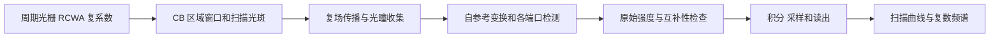
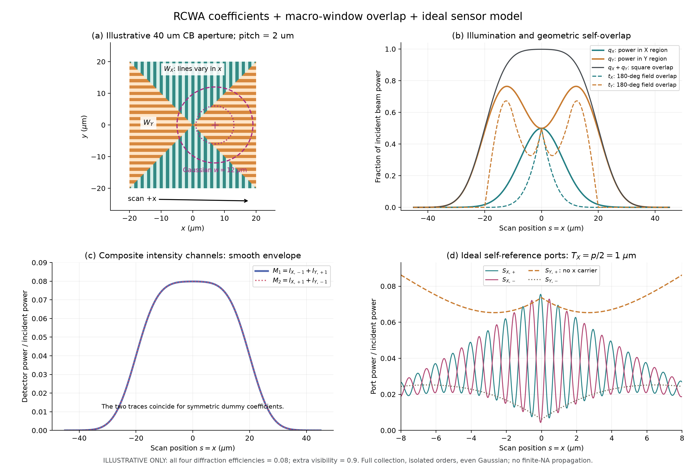

# CB mark 的 RCWA 后处理与 D4C 半周期尖峰诊断

本目录归档了 2026-11-10 关于 **CB mark 扫描曲线如何由简单周期光栅的 RCWA 结果构造，以及 D4C 的 `Isum + Idiff` 半周期尖峰如何诊断**的讨论。已知设定为光栅周期 $p=2\,\mu\mathrm m$、占空比 50%。用户希望沿用简单周期结构的 RCWA 结果，在后处理中加入 CB 几何、光斑和检测效应，而不直接重新求解整个实际 mark。

**当前状态：理论推导、机制假设与合成示例。** 用户的实际 D4C 数据在公司电脑中，本次未获得实际反射系数矩阵 $R$、扫描曲线、检测光路参数或软件内部实现。因此，本目录没有验证 D4C 尖峰的实际成因；示例图不代表实测或 D4C 结果，也没有通过拟合得到约 0.005 的高次峰。

## 阅读导航

| 文件 | 内容和使用方式 |
|---|---|
| [完整讨论原文](discussion.md) | 按问答顺序保留原始讨论，包括早期推测、用户澄清和后续限定；理解最新判断时请结合本页 |
| [包络模型说明](examples/envelope/README.txt) | 理想孤立一级、全收集条件下的功率包络 $q$ 与干涉重叠包络 $t$ |
| [包络模型脚本](examples/envelope/cb_mark_postprocess.py) | 用示意复系数计算 CB 区域重叠、混合强度及互补干涉曲线 |
| [包络模型检查记录](examples/envelope/validation.txt) | 分区、非负性、互补输出等数学一致性检查 |
| [二维光瞳模型说明](examples/pupil_fft/README.txt) | 标量等效场、有限光瞳、空间分区及 180°自参考的假设与限制 |
| [二维光瞳脚本](examples/pupil_fft/pupil_fft_demo.py) | 用周期结构的复系数构造有限场，再经过 FFT 和检测积分 |
| [二维光瞳检查记录](examples/pupil_fft/validation.txt) | Parseval 一致性、无限光栅极限、互补输出等检查 |
| [专利 Fig. 6 提取图](figures/patent_figure6.png) | 用于理解讨论中的 X/Y 区域组合；不是实际 D4C mark 的结构文件 |

讨论引用的原始专利是 [WO2022258371A1](https://patents.google.com/patent/WO2022258371A1/en)。图 6 的区域组织用于建立宏观窗口近似；窗口边界附近的真实电磁耦合没有在该近似中重新求解。

## 1. 从 RCWA 到扫描曲线：场与功率的层次

RCWA 提供的电场反射系数、功率归一化的模式系数和衍射效率是不同的量。若使用原始电场系数，不能不加条件地令 $\eta_m=|r_m|^2$；需要遵循求解器的模式能流、介质及角度归一化。效率只有幅值信息，无法恢复干涉所需的相位。X/Y 光栅方向改变时，还要保持全局偏振与局部 TE/TM 基底的一致性。

简化模型将正方形 CB 区域分成上/下的 X 光栅区域和左/右的 Y 光栅区域。记区域指示函数为 $W_j$，归一化照明振幅为 $A(\mathbf u)$，扫描中心为 $\mathbf r_s=(s,y_0)$，则两种不同的包络是：

$$
q_j(s)=\int |A(\mathbf u)|^2W_j(\mathbf u+\mathbf r_s)\,d^2u,
$$

$$
t_j(s)=\int |A(\mathbf u)|^2W_j(\mathbf u+\mathbf r_s)
W_j(-\mathbf u+\mathbf r_s)\,d^2u.
$$

$q_j$ 是照明功率落在该区域的比例；$t_j$ 是理想 180°自参考下原像与旋转像的重叠量。在实数偶对称照明、全收集、孤立级次的条件下，有 $0\le t_j\le q_j\le1$。二者在边缘一般不同，不能把扫描中的干涉振幅始终写成 $q_j$ 乘一个固定可见度。

下图使用的是示意参数 $L=40\,\mu\mathrm m$、Gaussian 强度 $1/e^2$ 半径 $w=12\,\mu\mathrm m$，并令四个一级功率归一化复系数均为 $\sqrt{0.08}$。读图时重点看右上角：实线 $q$ 与虚线 $t$ 不重合，说明功率包络与干涉重叠包络需要分开；右下角的 X 通道振荡来自明确假设的正负一级干涉。它说明模型关系，不验证 D4C 的尖峰。

对于有限 NA、检测分区和级次重叠，应升级为复场传播：

$$
E_s(\mathbf u)=A(\mathbf u)
\left[\sum_{j=X,Y}W_j(\mathbf u+\mathbf r_s)
\sum_m r_{jm}e^{im\mathbf G_j\cdot(\mathbf u+\mathbf r_s)}
+E_{\mathrm{bg}}(\mathbf u;s)\right].
$$

先传播该复场，再取模平方并在实际检测区域积分。此时窗口重叠与扫描相位已经包含在场中，不能在最后再乘同一组 $q/t$ 或重复添加平移相位。附带的二维光瞳示例采用标量等效场和示意检测区域，尚不包含完整的中间像面 field stop—再传播—实际检测器链。

## 2. 实际观察与判断的修正

用户逐步明确了以下观察：

- `Isum + Idiff` 沿 x 的扫描曲线每 $p/2=1\,\mu\mathrm m$ 出现一个很尖的峰。
- FFT 中高次峰的峰高近似为 0.005，峰形呈三角形。
- 峰的位置已按照 RCWA 衍射级次对应；这不是只按任意 FFT bin 编号描述。
- 当前可用的数据类型是 RCWA 反射矩阵 $R$ 与最终扫描曲线；实际文件本次没有提供。

早期回答曾优先猜测 field stop、有限检测区域或通道失配；后来又指出窄脉冲列及 FFT 加窗/绘图能产生近似等高、三角形的谱峰。**这些都是相容解释，均未被实证。** 用户确认了级次对应后，分析重点转向多阶复场和检测中的交叉项，但这也不等于已经确认跨阶相干。

近似恒定的高次幅值与窄脉冲列相容；若多个谐波相位在同一位置对齐，它们可在 $p/2$ 间隔处叠加成尖峰。三角形谱峰也可能受窗口、频率采样和折线显示影响。没有原始复数频谱、窗函数和归一化定义，不能仅从“0.005、三角形”确定物理来源。

## 3. 用频率和互补性约束候选机制

令 $G=2\pi/p$，选择平移相位约定 $r_m(s)=r_me^{imGs}$；反向扫描会改变相位符号，但不改变频率大小。正负第 $m$ 级的相对相位变化为 $2mGs$，所以：

$$
f_m=\frac{2m}{p}.
$$

当 $p=2\,\mu\mathrm m$ 时，$f_m=m$ cycles/$\mu\mathrm m$。如果用 $\ell/p$ 表示一般扫描谐波，这些正负级对对应的是 $\ell=2m$。一般跨阶项的频率则由阶差 $m-n$ 决定；同一个频率可能包含多个阶次对，不能把峰高直接当作某一级的衍射效率。

若 SUM、DIFF 真的是相同两个场 $a,b$ 的互补输出，并具有相同的检测权重：

$$
I_{\mathrm{SUM}}=\frac12\|a+b\|^2,
\qquad
I_{\mathrm{DIFF}}=\frac12\|a-b\|^2,
$$

则必有：

$$
I_{\mathrm{SUM}}+I_{\mathrm{DIFF}}=\|a\|^2+\|b\|^2.
$$

该恒等式消掉两臂之间的交叉项，但每一臂内部仍可能包含不同级次之间的相干项。增加 RCWA 阶数本身不会破坏互补恒等式；只把每个独立 $\pm m$ 组的理想互补曲线相加，也不能解释为什么高次载波留在和信号中。

将固定线性光路及平方律探测写成：

$$
I(s)=\mathbf r(s)^\dagger K\mathbf r(s),
\qquad
C_\ell=\sum_n r_n^*K_{n,n+\ell}r_{n+\ell}.
$$

$K$ 是检测重叠矩阵，包含各阶经过光路后的模式重叠和积分权重。非对角 $K$ 可以保留跨阶拍频；两端口检测算子不同也能使互补项残留。它们是待区分的机制。

如果只有可收集的 $0,\pm1$ 三个离散阶次，且窗口、系数及检测矩阵都不随扫描位置变化，阶差最多为 2。这种模型不能产生任意高的扫描谐波。该频率上限不直接适用于具有移动有限边界、位置相关重叠或后续非线性处理的完整 CB 扫描模型。

## 4. 现有 R 与曲线能做什么

先确认 $R$ 的模式索引、偏振、入射条件和能流约定。若 $R$ 是输入模式到反射输出模式的矩阵，实际输出为：

$$
\mathbf r=R\mathbf a,
$$

其中 $\mathbf a$ 是实际照明的输入模式系数。单个平面波通常选取对应入射列；多个不相干照明模式需要分别计算检测强度再相加。

**R 的非对角元素表示结构的入射—反射模式耦合，不是探测器中的跨阶干涉。** 不应通过把 $R$ 的非对角元素置零来“去掉相干”，否则可能直接删掉要研究的衍射输出。

扫描数据至少要保留每个已知频率上的复系数 $C_\ell$，包括幅值和相位。若 FFT 峰偏离离散频点，可以在已知频率上联合拟合正弦、余弦，并处理慢包络和有限窗口。用原始复系数重构高频残差，确认它们重构了真实尖峰；不要将 $|\mathrm{FFT}|$ 直接 IFFT，因为丢弃相位可能人为制造对齐尖峰。

随后列出每个峰的候选阶次对 $(n,n+\ell)$，检查这些阶是否真实可传播、可被光路收集，并查看 $r_n^*r_{n+\ell}$。不存在相应阶次对可以排除上述固定矩阵模型；存在阶次对只能证明“有可能”，不能反推出实际 $K$。单份 $R$ 加单条曲线通常不足以唯一识别检测重叠矩阵，更不能定位到某个具体光阑。

## 5. 在原前向程序中确认跨阶相干

最有辨别力的对照是保持原光学与检测链不变，在 RCWA 输出复系数接口处按 $g_0=\{0\}$、$g_1=\{-1,+1\}$、$g_2=\{-2,+2\}$ 等分组。CB 的二维阶次和偏振需要按照程序实际模式标签明确分组，不能把不同方向的索引混用。

先计算全阶输出 $I_{\mathrm{all}}(s)$，再逐组单独通过同一计算链得到 $I_g(s)$，最后计算：

$$
\Delta I_{\mathrm{cross}}(s)=I_{\mathrm{all}}(s)-\sum_g I_g(s).
$$

在固定线性光学和原始强度检测条件下，差值就是不同组之间的相干交叉项。执行时必须固定输入功率、增益、孔径、检测权重和采样；筛掉阶次后不重新放大到相同总功率，不对每条曲线分别归一化。固定背景须正确扣除，不能随分组被重复相加。

| 对照结果 | 可以支持的判断 |
|---|---|
| 全阶有尖峰，逐组功率和没有，差值重现尖峰及其复数谐波 | 在该前向模型中确认组间相干贡献是尖峰来源 |
| 某个单独 $\pm m$ 组已出现目标尖峰 | 组间相干不是产生该尖峰的必要条件，需查组内、窗口和通道处理 |
| 差值很小或不含目标尖峰 | 组间相干不足以解释主要尖峰 |

独立的相位对照可保持每组内部关系不变，只给组间添加相位：

$$
r_{+m}'=e^{i\theta_m}r_{+m},
\qquad r_{-m}'=e^{i\theta_m}r_{-m}.
$$

各阶功率及同组 $+m/-m$ 相对相位均不变。若原程序中的尖峰随这些组相位变化，说明它依赖组间相位；对各组独立相位循环或随机平均，会抑制组间交叉项。平均结果应与逐组功率和一致到数值误差及有限平均误差允许的程度。此实验必须通过产生原始扫描结果的同一条计算链；在另搭模型中看到相似现象，不能证明 D4C 的内部机制。

## 6. 区分通道失配，以及 field stop 的进一步归因

若能分别导出原始 SUM、DIFF，对齐扫描坐标后，提取两路复数谐波并计算：

$$
q_\ell=-\frac{C_{\mathrm{SUM},\ell}}{C_{\mathrm{DIFF},\ell}}.
$$

若多个高次峰的 $q_\ell$ 接近同一正实数 $\alpha$，则单一增益比可能使 $I_{\mathrm{SUM}}+\alpha I_{\mathrm{DIFF}}$ 同时消除残留。比值的相位随频率线性变化还可能来自两路固定位置/采样延迟，需要先对齐。只有最终和曲线时，这项检查无法完成。

即使已证实跨阶项产生尖峰，也还没有证明它由 field stop 引起。要定位该器件，须单独改变中间像面 field stop 的尺寸或边缘形状，保持其他参数不变，再比较交叉项、峰宽及复数频谱。讨论引用的 [US7564534B2](https://patents.google.com/patent/US7564534B2/en) 提供了扫描过程中 field stop 及级次串扰的相关设计背景，但不能替代对当前 D4C 模型的受控验证。

数值方面还应改变扫描步长、空间网格和有效谐波截断数，确认尖峰宽度、面积与高次谱收敛。需要区分 RCWA 内部用于收敛的谐波数量，与真正进入探测光路的传播阶次数量；50% 占空比也不能在一般矢量 RCWA 情况下直接当作“所有偶数阶严格为零”的保证。

**当前可交付的结论是诊断路径，而不是已确定的成因。** 优先做同链的“全阶减逐组功率和”，再用组共同相位实验交叉验证；有原始 SUM、DIFF 时检查增益与延迟；最后用光阑受控改动定位具体器件。完整问答中的较早推测应按这一证据顺序理解。
