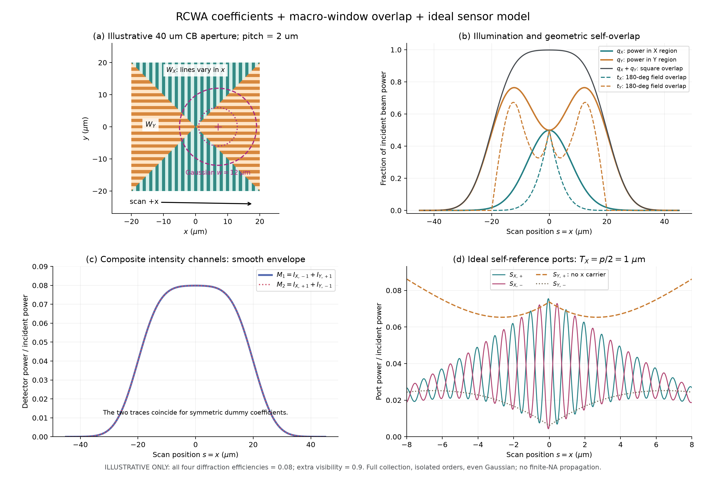

# CB mark 的 RCWA 后处理与 D4C 半周期尖峰：完整问答记录

> 归档日期：2026-11-10（Asia/Hong_Kong）。讨论范围：从用户提供 WO2022258371A1.pdf、要求以简单周期 RCWA 结果合成 CB mark 扫描曲线，到使用反射矩阵 R 和最终扫描曲线诊断尖峰成因。
>
> **阅读时先看 [最新结论与验证路线](README.md)。** 本文保留了早期推测、用户澄清和后续修正；原文中对 field stop、数值脉冲等机制的优先级判断均不是对 D4C 内部实现的实证结论。
>
> 用户明确说明实际 D4C 数据在公司电脑中。本次没有读取或上传公司的 R 矩阵、扫描曲线或 D4C 工程；配套程序和曲线均为助手构造的示意例。
>
> 原始附件：[WO2022258371A1 公共专利](https://patents.google.com/patent/WO2022258371A1/en)，并保留本次提取的 [Fig. 6](figures/patent_figure6.png)。原 PDF 未重复收录。
>
> **转写规则：** 正文按对话顺序保留用户问题、表单补充和五次完整回答，不以摘要替换；仅将公式定界符转换为 GitHub 支持的 `$` / `$$`，将已有附件链接改为仓库相对路径，并去掉本地文件行号。代码块中的原始命令保留。工具调用、内部推理、子代理消息及归档过程的进度消息不属于问答正文。

## 阅读导航

- [01 初始需求：CB mark 与 RCWA 后处理](#qa-01)
- [02 回答：窗口、包络、干涉和 FFT 前向模型](#qa-02)
- [03 追问：Isum+Idiff 每半周期出现尖峰](#qa-03)
- [04 补充：无本地数据，间隔为 p/2](#qa-04)
- [05 回答：光学收集与检测候选机制](#qa-05)
- [06 追问：高次 FFT 峰近似等高 0.005](#qa-06)
- [07 澄清：三角形是频谱中的峰形](#qa-07)
- [08 回答：窄脉冲列与窗函数解释](#qa-08)
- [09 澄清：FFT 峰已按 RCWA 衍射级次对应](#qa-09)
- [10 回答：多阶相干、检测算子与互补约束](#qa-10)
- [11 追问：只有 R 和扫描曲线，如何确定原因](#qa-11)
- [12 回答：可辨识性与逐阶受控验证步骤](#qa-12)

<a id="qa-01"></a>

## 01 用户：初始需求：CB mark 与 RCWA 后处理

你知道CB mark这种alignment mark吗 根据这个pdf的信息可cb mark的图像 对于一个pitch=2um的CB mark 给我一个如何从RCWA的结果（简单的2umpithch 50%占空比的mark）考虑各种因素 得到cbmark延x方向的扫描曲线吗 注意 要求的不是仿真实际mark而是如何通过RCWA在后面附加各种效应 达到复现扫描曲线的效果

---

<a id="qa-02"></a>

## 02 助手：回答：窗口、包络、干涉和 FFT 前向模型

知道。你这份专利里的 **CB 是 combined bidirectional alignment mark，组合双向对准标记**。针对你要做的事，可以采用一套明确的前向模型：

$$
\boxed{
\text{简单周期光栅的 RCWA 复系数}
\;\longrightarrow\;
\text{CB 区域窗口与扫描光斑}
\;\longrightarrow\;
\text{光瞳收集与干涉检测}
\;\longrightarrow\;
\text{积分、采样和噪声}
}
$$

**这条路线可行，RCWA 仍然只计算 $p=2\,\mu\mathrm m$、50% 占空比的周期结构。** CB 的有限尺寸、区域组合和传感器效应都在后处理中加入。下面给出能直接计算的公式；我也写好了两个可运行的示例脚本。

先明确专利中两种曲线的区别。Fig. 7A 的 702 是较平滑的 **intensity trace**，704 是带振荡的 **phase-channel trace**。后者虽然叫“phase”，图中画的仍是干涉通道的强度读数，并非直接画相位角。Fig. 6 中，上下区域 604A/B 是 X 光栅，左右区域 606A/B 是 Y 光栅；你可以打开我从 PDF 中提取的 [Fig. 6 清晰图](figures/patent_figure6.png) 对照。专利还给出了 180°自参考干涉和两路混合强度的关系。[专利原文，段落 0037、0040、0106–0114](https://patents.google.com/patent/WO2022258371A1/en)

以下公式是依据这些结构构造的**等效后处理模型**，并非专利直接提供的一套 RCWA 算法。

**第一步，从 RCWA 保留复振幅和衍射效率。** 对 X/Y 两种方向，至少需要：

$$
r_{j,-1},\quad r_{j,0},\quad r_{j,+1},
\qquad j=X,Y.
$$

其中 $r$ 包含振幅与相位。若传感器只收集一级，后处理可以主要使用 $\pm1$ 级；RCWA 内部仍需足够的傅里叶谐波来保证求解收敛。

对于下面的简化功率模型，可以定义功率归一化系数：

$$
c_{j,\pm}=\sqrt{\eta_{j,\pm}}\,e^{i\phi_{j,\pm}}.
$$

这里 $\eta$ 是相对入射功率的衍射效率。**原始电场系数的平方模一般不能直接当作效率**，需要遵循求解器的模式能流归一化。例如 S4 将原始模式振幅和逐阶 Poynting 能流分别输出。[S4 官方 API 文档](https://web.stanford.edu/group/fan/S4/python_api.html)

还有两个接入时需要处理的细节：

- X/Y 光栅相差 90°。对于同一全局线偏振，两者相对于光栅的 TE/TM 关系会改变，因此不一定能直接复制同一套系数。
- 50% 占空比的影响已经包含在 RCWA 结果里，后面无需再乘一次 0.5。

如果你目前只有 $\eta_{\pm1}$，可以先得到强度包络；干涉曲线中的相位就需要明确作为假设或标定参数。

**第二步，用两个宏观窗口表示 CB 的区域分布。** 从 Fig. 6 出发，一个实用近似是把边长为 $L$ 的正方形沿两条对角线划分：

$$
W_{\square}(x,y)
=
\mathbf 1_{\{|x|\le L/2,\ |y|\le L/2\}},
$$

$$
W_X(x,y)
=
W_{\square}(x,y)\,\mathbf 1_{\{|y|\ge |x|\}},
\qquad
W_Y=W_{\square}-W_X.
$$

这样，上下两个三角区域使用沿 x 周期变化的光栅，左右两个区域使用沿 y 周期变化的光栅：

$$
\mathbf G_X=\left(\frac{2\pi}{p},0\right),
\qquad
\mathbf G_Y=\left(0,\frac{2\pi}{p}\right).
$$

这是宏观区域的窗口近似，交界处的局部电磁耦合没有重新求解。若上下两部分存在不同的栅线起始相位，可以进一步拆成四个窗口，分别指定相位。

设 $\mathbf u=(u_x,u_y)$ 是固定在光斑上的坐标，光斑中心在 mark 坐标中的位置为：

$$
\mathbf r_s=(s,y_0).
$$

这就是你要求的沿 x 扫描，$y_0$ 表示扫描线偏离 mark 中心的距离。取归一化 Gaussian 振幅：

$$
A(\mathbf u)
=
\sqrt{\frac{2}{\pi w_xw_y}}\,
\exp\!\left(
-\frac{u_x^2}{w_x^2}-\frac{u_y^2}{w_y^2}
\right),
\qquad
\int |A|^2\,d^2u=1.
$$

注意，$w_x,w_y$ 是**强度的 $1/e^2$ 半径**。振幅和强度的 Gaussian 指数相差一个 2。

**第三步，先算不发生干涉的强度扫描曲线。** 定义光斑落在每类光栅区域内的功率比例：

$$
\boxed{
q_j(s)=
\int |A(\mathbf u)|^2
W_j(\mathbf u+\mathbf r_s)\,d^2u
}
$$

在一级衍射基本完整收集、不同衍射斑互不重叠的近似下：

$$
I_j^\pm(s)
=
P_{\rm in}\,\eta_j^\pm q_j(s).
$$

专利两路混合强度对应：

$$
\boxed{
I_{\rm mix,1}=I_X^-+I_Y^+,
\qquad
I_{\rm mix,2}=I_X^++I_Y^-.
}
$$

这个简单模型就能解释主要形态：沿中心线扫描时，$q_X$ 通常在中心较大；$q_Y$ 可以出现两侧较高、中心较低的双肩形。两者相加则满足：

$$
q_X(s)+q_Y(s)
=
\int |A(\mathbf u)|^2
W_{\square}(\mathbf u+\mathbf r_s)\,d^2u.
$$

因此，当 X/Y 的收集权重接近时，**两个变化明显的子信号相加，可以得到相当平坦的总强度平台**。专利曲线中的这种形态，可以通过区域窗口和光斑重叠产生。

**第四步，加入 180°自参考干涉，得到振荡扫描曲线。** 这里有一个关键：干涉振幅还取决于原像与旋转像之间的重合程度。

对于上面的实数、偶对称 Gaussian，在完整收集、孤立一级的近似下，定义：

$$
\boxed{
t_j(s)=
\int |A(\mathbf u)|^2
W_j(\mathbf u+\mathbf r_s)
W_j(-\mathbf u+\mathbf r_s)\,d^2u.
}
$$

$q_j$ 衡量“照到了多少区域”，$t_j$ 衡量“该区域与其 180°旋转像重合了多少”。一般有：

$$
0\le t_j(s)\le q_j(s).
$$

可以用下面两个互补输出，作为干涉通道的等效模型：

$$
\boxed{
S_{j,\pm}(s)=P_{\rm in}
\left[
\frac{\eta_j^++\eta_j^-}{2}\,q_j(s)
\ \pm\
V_{j,\rm extra}
\sqrt{\eta_j^+\eta_j^-}\,
t_j(s)\cos\Phi_j(s)
\right]
}
$$

$$
\Phi_j(s)
=
2\mathbf G_j\cdot\mathbf r_s
+
\arg\!\left(c_j^+c_j^{-*}\right)
+
\delta_j.
$$

其中，$V_{\rm extra}$ 表示偏振失配、相干性等额外损失，$\delta_j$ 是传感器的固定相位偏置。这里 $S$ 的正负号表示两个输出端口，$I$ 的正负号表示衍射级次。

这个模型满足：

$$
S_{j,+}+S_{j,-}
=
P_{\rm in}(\eta_j^++\eta_j^-)\,q_j.
$$

因此，两个干涉输出相加会消除载波，留下强度包络。这也能解释专利中利用干涉通道组合信号构造强度模板的思路。

**不建议一开始就用“$q_j(s)\times[1+V\cos(\cdots)]$”并把 $V$ 固定。** 扫到边缘时 $t_j/q_j$ 会变化，固定可见度容易把干涉包络画错。

对你的 $p=2\,\mu\mathrm m$，严格沿 x 扫描时：

$$
\Phi_X(s)=\frac{4\pi s}{p}+\phi_{X,0},
\qquad
\Phi_Y(s)=\frac{4\pi y_0}{p}+\phi_{Y,0}.
$$

所以：

$$
\boxed{\text{X 的 }\pm1\text{ 级干涉载波周期}=p/2=1\,\mu\mathrm m.}
$$

Y 光栅的相位载波沿 x 不变化，但它的 $q_Y$ 和 $t_Y$ 仍会变化。**因此不要给 Y 通道也人为添加一个 1 µm 的 x 方向载波。** 同样，纯 x 扫描时，不能依赖两个不同的非零载频自动分离 X/Y。

我已经按这套简化公式计算了一个示例。图中取 $L=40\,\mu\mathrm m$、$w=12\,\mu\mathrm m$，四个一级效率均设为 0.08；这些都是**示意输入，没有使用你的真实 RCWA 数据，也没有拟合专利曲线**：



右上角的实线 $q$ 和虚线 $t$ 展示了两种包络的区别；右下角 X 通道有 1 µm 振荡，Y 通道呈慢变化。

**第五步，要考虑有限 NA、光瞳截断和串扰时，升级为复场 FFT 后处理。** 这仍然沿用简单周期 RCWA 的结果，只在外部构造有限场：

$$
\boxed{
E_s(\mathbf u)=A(\mathbf u)
\left[
\sum_{j=X,Y}
W_j(\mathbf u+\mathbf r_s)
\sum_m r_{jm}
e^{im\mathbf G_j\cdot(\mathbf u+\mathbf r_s)}
+
r_{\rm bg}\bigl(1-W_{\square}(\mathbf u+\mathbf r_s)\bigr)
\right].
}
$$

其中 $r_{\rm bg}$ 表示 mark 外部表面的反射。随后计算：

$$
U_s(\mathbf k)=\mathcal F_{\mathbf u}\{E_s(\mathbf u)\}.
$$

这个表达式一次性包含了有限光斑、有限区域、扫描相位和衍射斑展宽。坐标 $\mathbf u$ 固定在传感器上尤其重要，否则容易漏掉或重复加入平移相位。

非干涉通道在对应光瞳区域内积分：

$$
I_d(s)\propto
\int_{\Omega_d}
|P_d(\mathbf k)U_s(\mathbf k)|^2\,d^2k.
$$

180°自参考的两个分支可以写为：

$$
U_1(\mathbf k;s)=P_1(\mathbf k)U_s(\mathbf k),
\qquad
U_2(\mathbf k;s)=P_2(\mathbf k)U_s(-\mathbf k).
$$

然后形成：

$$
\boxed{
S_{d,\pm}(s)\propto
\frac12
\int_{\Omega_d}
\left|
U_1(\mathbf k;s)
\pm e^{i\delta_d}U_2(\mathbf k;s)
\right|^2d^2k.
}
$$

这里使用的是 $U_s(-\mathbf k)$；复共轭在计算干涉交叉项时产生。偏振模型需要把上述标量场扩展为矢量场，并加入两臂的 Jones 变换。若输入的是 RCWA 原始电场系数，检测积分还需要一致的模式能流和光瞳归一化。

**采用这一级模型后，$q$、几何重叠损失和扫描相位已经在复场中，不能再乘一次 $q$ 或补一次 $4\pi s/p$。** 有限 NA 下，直接算上述干涉积分，也比继续使用简化的 $t_j$ 更可靠。

各种因素建议放在下面这些位置：

| 因素 | 在哪里加入 | 主要改变什么 |
|---|---|---|
| mark 尺寸、中心间隙、区域边界 | $W_X,W_Y$ | 总包络宽度、中心峰与双肩形态 |
| 光斑大小、椭圆度、扫描偏心 | $A(\mathbf u)$、$\mathbf r_s$ | X/Y 权重、左右对称性、边缘斜率 |
| 波长、偏振、结构深度和膜堆栈 | RCWA 复系数 $r_{jm}$ | 各级振幅和相位 |
| 有限 NA、零级挡光、光瞳分区 | $P_d,\Omega_d$ | 收集损失、包络变化、级次串扰 |
| 波前与两臂差分像差 | 照明复场或 $P_1,P_2$ 的相位 | 可见度、干涉相位和包络 |
| 部分相干、多波长 | 每个相干模式分别算检测信号，再加权求和 | 条纹对比度、通道权重 |
| 运动积分、电子带宽 | 光学检测信号生成后滤波 | 高频振荡衰减、信号延迟 |
| 位置抖动、增益、背景、噪声 | 最后的采样与读出层 | 条纹减弱、基线与随机起伏 |

这里有两点值得特别处理。首先，聚焦 Gaussian 本身可以是相干角谱；不能把其中所有平面波方向都随意当成不相干光源平均。其次，理想自参考系统中的共同偶对称光瞳相位会在 $\phi(\mathbf k)-\phi(-\mathbf k)$ 中抵消，因而共同离焦、球差与两臂差分像差需要分别建模。

运动积分和抖动则适合在最后处理。例如沿 x 匀速扫描，积分时间为 $T$、速度为 $v$，对 X 的 1 µm 载波，运动积分的调制度因子是：

$$
M_{\rm int}
=
\operatorname{sinc}\!\left(\frac{2\pi vT}{p}\right),
\qquad \operatorname{sinc}(z)=\frac{\sin z}{z}.
$$

Gaussian 位置抖动标准差为 $\sigma_x$ 时：

$$
M_{\rm jitter}
=
\exp\!\left[-\frac12
\left(\frac{4\pi\sigma_x}{p}\right)^2\right].
$$

我已把上述两种层级分别实现：

- [简化包络与干涉模型](examples/envelope/cb_mark_postprocess.py)：替换四个功率归一化复系数，即可生成 $q/t$、两路混合强度和互补干涉曲线。附有 [参数说明](examples/envelope/README.txt) 和 [纯 x 扫描数据](examples/envelope/scan_x_alpha0.csv)。
- [二维光瞳 FFT 后处理模型](examples/pupil_fft/pupil_fft_demo.py)：X/Y 分别提供 $r_{-1},r_0,r_{+1}$ 的输入位置，包含有限窗口、Gaussian 光斑、NA、零级挡光、光瞳分区及 180°自参考。附有 [模型说明](examples/pupil_fft/README.txt) 和 [扫描曲线图](examples/pupil_fft/cb_scan_curves.png)。该示例采用标量归一化信号，接入真实数据时需处理上面提到的能流和偏振映射。

运行 FFT 示例：

```powershell
uv run --with numpy --with matplotlib 'examples/pupil_fft/pupil_fft_demo.py'
```

示例已通过包络分区、非负性、互补输出和 Fourier 能量一致性检查；无限 X 光栅的载波周期为 1 µm，无限 Y 光栅沿 x 扫描保持恒定。这些检查验证了计算关系，实际传感器的定量精度仍需参数标定。

对于复现实测曲线，我建议固定已有 RCWA 系数，先用平滑强度通道确定窗口尺寸、光斑大小和扫描偏心，再用干涉通道确定模式重叠、相位偏置和差分像差，最后加入已知的积分时间、带宽与噪声。对称单元的 RCWA 解通常不能预测制造不对称造成的真实一级不平衡；若需要后加振幅不平衡或相位偏置，应将它们明确保留为标定参数。这样每一个用于改善曲线匹配的参数，都能对应到具体的光学或检测过程。

---

<a id="qa-03"></a>

## 03 用户：追问：Isum+Idiff 每半周期出现尖峰

D4C的扫描结果发现 Isum+Idiff 在每半个周期处存在一个很尖的峰 用正常的方式拟合无法得到这个结果 你知道它是考虑了什么情况得到的吗

---

<a id="qa-04"></a>

## 04 用户：补充：无本地数据，间隔为 p/2

（以下为用户通过交互表单提交的补充，问题与回答文字按原文转写。）

**表单问题：** 尖峰对应哪一个 D4C 结果文件（本地路径或文件名即可）？我会先检查工作区里的现有结果；这个信息能帮助确认是否是同一组曲线。

**用户回答：** 我没有文件 在公司电脑中 我只是想让你推测一下

**表单问题：** 你说的“每半个周期”具体是哪一种间隔？

**用户回答：** 每 p/2，即 p=2 µm 时每 1 µm

---

<a id="qa-05"></a>

## 05 助手：回答：光学收集与检测候选机制

**有几种合理推测。其中我会优先怀疑：D4C 的扫描模型包含了中间像面光阑（field stop）、后续探测区域和两路各自的收集过程，使信号保留了简化模型里被消掉的周期成分。** 不过，“每 $p/2=1\,\mu\mathrm m$ 一个很尖的峰”还不足以确定它内部用了哪一种机制，尤其不能直接归结为“考虑了高阶衍射”。

你这个现象需要把**“为什么和信号还在振荡”**与**“为什么振荡会变成尖峰”**分开看。

先看一个严格约束。若 Isum、Idiff 确实是同一对光场 $a,b$ 的互补强度，并且两路使用相同的检测区域、权重和增益：

$$
I_{\rm sum}=\frac12\int D(\rho)|a+b|^2\,d\rho,
\qquad
I_{\rm diff}=\frac12\int D(\rho)|a-b|^2\,d\rho,
$$

那么一定有：

$$
\boxed{
I_{\rm sum}+I_{\rm diff}
=
\int D(\rho)\bigl(|a|^2+|b|^2\bigr)\,d\rho.
}
$$

**两臂之间的干涉项会严格抵消。增加 RCWA 阶数、加入共同的有限 NA 或共同像差，都不会破坏这个恒等式。** 所以，若各衍射级独立收集、各级功率只随慢包络变化，和信号中就不该出现每 1 µm 一个的干涉尖峰。

但这个恒等式只消掉了“两臂之间”的干涉，并不保证每个臂自身的检测功率一定平滑。这就是我会往下推测的入口。

**最值得检查的光学情况，是像面截断引起的衍射级串扰。** 我前面给你的 FFT 示例包含了收集光瞳，但没有加入完整的：

$$
\text{SRI 输出}
\rightarrow
\text{中间像面}
\rightarrow
\text{field stop}
\rightarrow
\text{再传播到探测光瞳}
\rightarrow
\text{有限区域收集}.
$$

当扫描中的 mark 像经过 field stop 的硬边缘时，光场被截断，随后传播会使衍射级展宽、向相邻检测区域泄漏。这是对准传感器里明确存在的一类效应：ASML 的公开专利直接讨论了扫描时 field stop 硬边造成级次串扰，并用柔化边缘来抑制；同一专利也允许两个输出分支使用不同大小的 aperture stop。[US7564534B2，field stop 与检测部分](https://patents.google.com/patent/US7564534B2/en)

因此，如果 D4C 模拟的是这种完整传感器过程，而你拟合的是：

$$
\text{Gaussian 包络}\times\text{一个正弦载波},
$$

两者确实可能对不上。**这里我推测的是“空间截断及实际收集”，目前没有证据确认你的 D4C 配置一定包含它。**

从数学上看，可以把检测信号写成：

$$
I(s)=
\sum_{m,n}
r_mr_n^*K_{mn}(s)\,
e^{i(m-n)Gs},
\qquad G=\frac{2\pi}{p}.
$$

其中 $K_{mn}$ 描述不同衍射级经过光路后，在检测区域内的重叠关系。

- 各级在检测中保持正交时，主要留下 $m=n$ 项，即功率包络。
- 若空间截断、再成像或有限探测区域使 $K_{mn}\ne0$，就能保留不同级之间的相干项。
- $m-n=2$ 对应 $p/2$ 周期；多个更高频率成分若相位合适，可以叠加成间隔 $p/2$ 的窄峰。

不过，**“每半周期重复”和“很尖”是两个不同要求。** 只有一个 $p/2$ 正弦项，峰仍然是圆滑的；很窄的峰意味着还存在更高的扫描空间频率，或某种非线性处理。

这又带来一个重要限制：高阶衍射必须真的能进入探测光路。正入射、空气中大致需要满足：

$$
\frac{|m|\lambda}{p}\le \mathrm{NA}.
$$

例如，仅作为说明，若 $p=2\,\mu\mathrm m$、$\lambda=633\,\mathrm{nm}$、NA = 0.6，则只有 $\pm1$ 级落在物镜收集范围内，$\pm2$ 已超出。**RCWA 内部用了很多傅里叶谐波，不等于探测器收到了很多衍射级。**

更严格地说，若输入只有 $0,\pm1$ 三个级次，系数不随扫描位置变化，后续又全是固定的线性光学操作，那么强度最高只含 $2G$，很难产生显著窄于 1 µm 周期的尖峰。固定孔径或固定像差本身也不能凭空增加这个频率上限。

另一类很实际的可能，是 **Isum 与 Idiff 在最终读出时已经不是完全匹配的互补通道**：

$$
I_{\rm sum}=\frac12\|H_{\rm sum}(a+b)\|^2,
\qquad
I_{\rm diff}=\frac12\|H_{\rm diff}(a-b)\|^2.
$$

两路若有不同的孔径、遮挡、偏振透过率或探测权重，便会有 $H_{\rm sum}\ne H_{\rm diff}$，干涉项不能完全抵消。公开传感器设计中确实有 sum、difference 各自经过光导、遮挡和探测器的配置。[US11086240B2](https://patents.google.com/patent/US11086240B2/en)

但这里也要保留一个判断：**只调整两个通道的增益，通常只会留下正弦残差，仍不足以解释很尖的峰。** 尖锐度还需要额外谐波、随扫描位置变化的收集作用，或者非线性。

如果你说的峰特别窄，甚至只占几个扫描采样点，我会把下面两种情况的优先级提高：

- **导出量经过了归一化或其他非线性运算。** 例如除以一个接近零的信号、相位解包裹、相位求导、阈值切换等。它们容易在相消位置附近产生很尖的特征。此时应检查原始 Isum、Idiff，确认“相加”发生在什么处理步骤之后。
- **数值重建造成尖峰。** 例如硬边界的 Fourier 截断振铃、扫描平移插值、网格对齐或周期边界处理。如果峰宽、峰高随网格和谐波截断数明显变化，就不能先把它当作真实光学效应。

你之后回公司，可以用几项小改动快速区分：

| 改动或观察 | 能检验什么 |
|---|---|
| 将中间像面 field stop 放大，再将硬边改为软边 | 尖峰是否与空间截断、级次串扰有关 |
| 统一 SUM/DIFF 的孔径、增益和检测权重后求和 | 是否来自互补通道不匹配 |
| 在实际 NA 允许范围内，比较只保留一级与保留全部级次 | 是否确实需要多阶相干成分 |
| 比较原始功率与归一化、解调后的输出 | 是否由非线性处理产生 |
| 加密扫描步长、空间网格，改变 Fourier 截断数 | 尖峰是否数值收敛 |
| 看尖峰是否始终对齐某一路的暗点 | 有助于定位相消附近的读出或归一化问题 |

**针对你接下来要做的 RCWA 后处理，我会先补“中间像面 field stop → 再传播 → 两路实际检测区域”这一层，并同时保留原始两路功率。** 如果在实际只收 $\pm1$ 级的条件下，仍需要极窄的周期尖峰才能匹配 D4C，就应优先核查输出定义和数值处理；单靠光斑尺寸、常数可见度或通道增益，解释不了这种尖锐度。

---

<a id="qa-06"></a>

## 06 用户：追问：高次 FFT 峰近似等高 0.005

把D4C的扫描曲线进行FFT会发现m=2以上都会有大小几乎恒定是0.005的三角峰

---

<a id="qa-07"></a>

## 07 用户：澄清：三角形是频谱中的峰形

频谱中的峰形

---

<a id="qa-08"></a>

## 08 助手：回答：窄脉冲列与窗函数解释

明白，是**频谱中各个高次峰呈三角形，而且峰高几乎都在 0.005**。

**结合你前面看到的“扫描曲线每 $p/2$ 出现一个很窄的尖峰”，现在我会优先推测：正常扫描信号上叠加了一个近似周期性的窄脉冲列；频谱中的三角峰形，则可能来自 FFT 的离散采样、连线显示或加窗。** 这个解释比“D4C 考虑了很多高阶衍射”更直接。但窄脉冲本身来自光学过程、数值重建还是后处理，目前仍不能确定。

这里最有辨识力的，其实是**高次峰几乎不衰减**。

假设尖峰间隔为：

$$
T=\frac p2=1\,\mu\mathrm m,
$$

把扫描曲线写成：

$$
S(x)=S_{\rm normal}(x)
+a\sum_j g(x-x_0-jT),
$$

其中 $g$ 是一个很窄的脉冲。这个脉冲列在第 $k$ 个谐波上的系数为：

$$
\boxed{
C_k=\frac aT\,
\widehat g\!\left(\frac{k}{T}\right)
e^{-i2\pi kx_0/T}.
}
$$

如果脉冲窄到在你观察的频率范围内满足：

$$
\left|\widehat g(k/T)\right|\approx\text{常数},
$$

就会出现你描述的：**很多高次谐波近似等高。**

这与普通连续曲线的特征有区别：

| 扫描曲线中的局部特征 | 高频谐波的一般趋势 |
|---|---|
| 平滑的有限宽度峰 | 随频率升高而衰减 |
| 三角波一类的斜率突变 | 通常约按 $1/k^2$ 衰减 |
| 跳变 | 通常约按 $1/k$ 衰减 |
| 很窄、尚未被采样充分分辨的脉冲 | 在一段频率范围内近似不衰减 |
| 理想冲激列 | 各谐波幅度相同 |

所以，**“高次峰近似恒定”更像冲激型残差的频谱，而非几个普通正弦谐波组成的波形。** 结合扫描域已经看到的尖峰，这个判断比只看 FFT 幅度更有依据；单看幅度谱而没有相位，仍不能唯一重建波形。

至于**为什么频谱峰形是三角形**，有一个很简单、也很容易误判的原因：一个频点很高、左右相邻频点很低，用折线画出来就已经是三角形了。它未必代表某种特殊的光学谱线形状。

Hann 加窗也能形成非常相似的结果。在谐波恰好落在 FFT 频点上、采用周期 Hann 窗且各谱峰充分分离时，每条谱线会分布到中心及相邻两个频点；幅度比例为：

$$
\frac12,\quad 1,\quad \frac12.
$$

连同外侧接近零的点，折线就是一个三角峰。Hann 窗用于频谱分析时有专门的周期形式，窗函数本身也会改变谱峰主瓣形状。[SciPy Hann 窗文档](https://docs.scipy.org/doc/scipy/reference/generated/scipy.signal.windows.hann.html)、[频谱分析与加窗说明](https://docs.scipy.org/doc/scipy/tutorial/signal.html#spectral-analysis)

我刚做了一个**纯数学构造例子，没有使用 D4C 数据**：

- 总共 1000 个采样点；
- 每隔 20 个点出现一个高度为 0.05 的单点脉冲；
- 使用单边幅度归一化 $2|\mathrm{FFT}|/N$。

它在各个非直流、非 Nyquist 谐波上的幅度，恰好都是：

$$
\frac{2\times0.05}{20}=\boxed{0.005}.
$$

再乘周期 Hann 窗，并补偿窗增益，每个谐波附近五个频点的幅度都是：

| 相对中心频点的位置 | $-2$ | $-1$ | $0$ | $+1$ | $+2$ |
|---|---:|---:|---:|---:|---:|
| 幅度 | 0 | 0.0025 | **0.005** | 0.0025 | 0 |

**这就同时产生了“各次近似等高”和“三角峰形”。** 数值是特意选来说明这种可能性，不能据此认定 D4C 加了 0.005 的固定项；若你画的是功率谱或 dB 谱，也需要使用相应的归一化关系。

这条新信息会让我调整上一条回答中的排查顺序：

1. **先查扫描曲线中的尖峰是否只占一个或少数采样点。** 如果是，它在目前采样下就近似一个离散冲激，天然会产生很平的高次谐波。
2. **再查 FFT 的窗函数、归一化和绘图方式。** 窗函数可以解释每个谱峰的相似形状；它通常不能把一个纯正弦凭空变成一整排等高谐波，后者仍需要脉冲型残差等来源。
3. **然后判断窄脉冲的来源。** 周期性插值错误、网格对齐、分段计算的连接点、相消位置附近的归一化，都值得优先检查。完整光学收集过程仍是候选，但现在不能仅凭这些峰把原因指向 field stop 或高阶衍射。

另外，**FFT 中的谐波序号 $m$，不等同于 RCWA 的衍射级次 $m$**。看到 FFT 的高次峰，不能直接解释为探测到了对应阶数的衍射光。

你回公司后，下面几项就很有区分力：

| 检查 | 观察重点 |
|---|---|
| 把频谱改成散点或 stem 图，查看峰附近的原始 FFT 数值 | “三角形”是否只是少量频点连线形成 |
| 对同一份数据补零后画更密的频谱 | 看清峰的实际主瓣形状；补零只加密频率采样，不增加真实分辨能力 |
| 改变 FFT 窗函数 | 谱峰形状是否随窗口一起变化 |
| 在相同扫描范围内，减小 D4C 的扫描步长重新计算 | 尖峰的物理宽度、面积和高频谱是否收敛 |
| 只为诊断，用邻点插值替换尖峰处的少数采样点后再做 FFT | 那一排近似 0.005 的高次峰是否随之消失 |

如果最后一项让高次峰基本消失，而主载波和慢包络几乎不变，就能把问题定位为：**正常信号上额外叠加的周期尖脉冲分量。** 接下来应解释这个分量怎样产生，而不是继续用更多自由正弦项去拟合整条曲线。

---

<a id="qa-09"></a>

## 09 用户：澄清：FFT 峰已按 RCWA 衍射级次对应

确实是在RCWA 的衍射级次 $m$下出现的那些FFT峰

---

<a id="qa-10"></a>

## 10 助手：回答：多阶相干、检测算子与互补约束

明白，**你说的是：FFT 峰的位置已经按 RCWA 的衍射级次对应好了，在 $m=2,3,\ldots$ 对应的位置，峰高都接近 0.005。** 我上一条过早把重点转到了通用的 FFT 采样问题；按你这个前提，应重点分析**多阶复光场怎样经过传感器变成扫描信号**。

在这个前提下，我最值得优先考虑的情况是：

> **D4C 保留了不同衍射级之间的相干交叉项，或者 SUM、DIFF 两路对各阶的检测权重并不完全互补。**

这与“多保留几个衍射效率，然后把功率加起来”有本质区别。

对于周期 $p$，令 $G=2\pi/p$。mark 平移 $s$ 时，第 $m$ 级的复振幅带有平移相位：

$$
r_m(s)=r_m(0)e^{imGs}.
$$

因此，$+m$ 和 $-m$ 发生自参考干涉时，扫描频率对应：

$$
e^{i2mGs}
\quad\Longrightarrow\quad
f_m=\frac{2m}{p}.
$$

对于 $p=2\,\mu\mathrm m$，这些频率就是 $m$ cycles/µm。**按这个对应关系标记 FFT 峰是合理的。**

但还有一个重要约束：如果每个阶次独立检测，并且 SUM、DIFF 完全互补，那么该阶可以写成：

$$
I_{{\rm sum},m}
=
B_m+C_m\cos(2mGs+\phi_m),
$$

$$
I_{{\rm diff},m}
=
B_m-C_m\cos(2mGs+\phi_m).
$$

相加仍然得到：

$$
I_{{\rm sum},m}+I_{{\rm diff},m}=2B_m.
$$

**所以，仅仅加入 $m=2,3,\ldots$ 的同阶正负级干涉，仍然不能解释这些峰为什么留在 $I_{\rm sum}+I_{\rm diff}$ 中。** 还需要有一项超出这个独立阶次模型的作用。

最直接的一种就是：**不同阶次在同一检测区域内先相干叠加，再取强度。** 例如某一臂的检测光场为：

$$
E_A(\rho;s)
=
\sum_m r_m\,\psi_{A,m}(\rho)e^{imGs}.
$$

它的检测功率包含：

$$
\boxed{
I_A(s)=
\sum_{m,n}
r_mr_n^*K^A_{mn}\,e^{i(m-n)Gs},
}
$$

其中：

$$
K^A_{mn}
=
\int_{\Omega}
\psi_{A,m}(\rho)\psi_{A,n}^*(\rho)\,d\rho.
$$

如果各阶在检测中保持正交，$K_{mn}=0\;(m\ne n)$，就只剩逐阶功率；如果经过空间截断、再成像和有限区域收集后，出现 $K_{mn}\ne0$，则会留下跨阶拍频。

**SUM 与 DIFF 相加消掉的是两臂之间的交叉项，并不会自动消掉每个臂内部的这些跨阶项。**

像面 field stop 造成的级次泄漏，正是一种能够引入这种重叠的过程。公开的对准系统专利明确描述了扫描时硬边光阑使一个衍射级向相邻级泄漏，并采用柔化边缘降低串扰。[US7564534B2](https://patents.google.com/patent/US7564534B2/en)

另一种情况是两路检测算子不同：

$$
I_{\rm sum}=\frac12\|H_{\rm sum}(E_A+E_B)\|^2,
\qquad
I_{\rm diff}=\frac12\|H_{\rm diff}(E_A-E_B)\|^2.
$$

只要 $H_{\rm sum}\ne H_{\rm diff}$，各阶的周期项就可能在相加后残留。若这种残留覆盖很多阶，就能形成你看到的高次谱峰。

这里也能解释，为什么**峰的位置可以对应 RCWA 阶次，但峰高不直接等于该阶的衍射效率 $\eta_m$**：同一个扫描频率上，可能叠加了多个阶次对的拍频贡献，还乘上了检测重叠、通道权重及归一化系数。

你观察到的“高次峰都约为 0.005”，对尖峰形态则有一个很直接的解释。假设它们是单边幅度谱中的幅值，并且各阶相位大致满足共同的尖峰位置 $s_0$，残差信号可近似写成：

$$
\boxed{
R(s)\approx
0.005\sum_{m=2}^{M}
\cos\!\left[\frac{4\pi m}{p}(s-s_0)\right].
}
$$

在：

$$
s=s_0+j\frac p2
$$

处，所有这些项同时达到最大值，于是形成每 $p/2$ 重复的尖峰。参与的阶数越多，峰就越窄：

$$
\text{峰高约}\ \propto 0.005(M-1),
\qquad
\text{峰宽量级}\ \sim \frac{p}{2M}.
$$

这正是普通“慢包络＋一个主正弦”拟合不出来的部分。**不过，等高还不够；各阶相位也必须合适。** 如果相位杂乱，相同的幅度谱不会叠加成整齐的尖峰列。

因此，你这个补充使我更倾向于检查 D4C 是否做了下面这种处理：

$$
\boxed{
\text{RCWA 多阶复振幅}
\rightarrow
\text{完整空间传播与检测}
\rightarrow
\text{保留跨阶相干项或通道残留项}
\rightarrow
\text{扫描曲线}.
}
$$

要在你自己的 RCWA 后处理中复现它，重点应是加入**各阶复场、检测重叠矩阵 $K_{mn}$，以及 SUM/DIFF 各自的传递算子**。如果仍采用“每阶衍射效率乘包络，再把功率相加”的方式，即使把所有高阶都加进去，也会漏掉这类尖峰。

---

<a id="qa-11"></a>

## 11 用户：追问：只有 R 和扫描曲线，如何确定原因

我有的数据是RCWA得到的反射系数矩阵R和最后的扫描曲线 你告诉我判断是不是这个问题 我应该对数据做什么能确定就是这个原因

---

<a id="qa-12"></a>

## 12 助手：回答：可辨识性与逐阶受控验证步骤

**只有一份 RCWA 的 $R$ 和一条最终扫描曲线，还不能唯一确定原因。** 你可以先用现有数据做排除检验；要确认是跨阶相干，最有说服力的办法是在**产生原扫描曲线的同一个前向程序里，做逐阶分组对照**。

我前面提出的跨阶相干是一个候选机制。下面这套操作能把它从“看起来合理”推进到“有直接证据”，也能区分一部分通道失配问题。

**1. 先从 $R$ 提取当前照明实际激发出的各阶复振幅。**

如果你的 $R$ 是输入模式到反射模式的散射矩阵：

$$
\mathbf r=R\mathbf a,
$$

其中 $\mathbf a$ 是实际入射光的模式系数。单个平面波照明通常对应选取相应入射列；偏振也需要包含在索引中。RCWA 的模式系数、场系数和功率之间需遵循求解器的定义。[RCWA 模式与散射矩阵说明](https://github.com/edmundsj/RCWA/blob/master/docs/source/mathematics.rst)、[S4 逐阶功率接口](https://web.stanford.edu/group/fan/S4/python_api.html)

这一步有两个容易误操作的地方：

- **不要把 $R$ 的非对角元素直接解释成探测端的“跨阶干涉项”。** 它们表示光栅把某个入射模式耦合到其他反射模式，属于结构的衍射响应。
- **不要通过“把 $R$ 的非对角元置零”来去掉干涉。** 对单平面波照明，这很可能直接把需要的衍射级删掉了。

后续用的是各输出阶的复数 $r_m$，包括其振幅和相位。还需要记录阶次标签、波长、入射角、偏振、能流归一化，以及实际可传播、可收集的阶次。

**2. 从扫描曲线提取“复数谐波系数”，不要只保存 0.005 这些峰高。**

令扫描位置为 $s$，把曲线表示为：

$$
I(s)=B(s)+2\operatorname{Re}
\sum_{\ell>0}C_\ell e^{i2\pi\ell s/p}.
$$

你按 $\pm m$ 自参考干涉标记的频率 $2m/p$，在这里对应 $\ell=2m$。

每个峰需要保留：

$$
|C_\ell|,\qquad \arg C_\ell.
$$

具体建议是：

- 优先选取慢包络变化较小、包含多个周期的一段扫描数据。
- 若频率没有正好落在 FFT 频点上，可以在已知频率处联合拟合正弦和余弦，得到复系数，而不是只取最近一个 FFT bin 的峰高。
- 先不要除以拟合包络，包络很小时的除法会放大误差。
- 用这些**原始复系数**重构高频残差，确认它们确实重构出了原曲线中的尖峰。

尤其要避免：

$$
\operatorname{IFFT}\bigl(|\operatorname{FFT}(I)|\bigr).
$$

这个操作丢弃了原始相位，可能人为把不同阶的贡献对齐，生成尖峰。

**3. 用 $r_m$ 做一个必要条件检查：这些高频能否由可收集的阶次对产生？**

对于“周期结构纯平移、其余光路固定且线性”的模型，令：

$$
r_m(s)=r_m e^{imGs},\qquad G=\frac{2\pi}{p}.
$$

若检测可写成二次型：

$$
I(s)=\mathbf r(s)^\dagger K\mathbf r(s),
$$

则：

$$
\boxed{
C_\ell
=
\sum_n r_n^*K_{n,n+\ell}r_{n+\ell}.
}
$$

这给你一个能直接排除候选模型的检查：

> 对某个实际存在的 FFT 峰 $\ell$，列出所有可传播、可收集的阶次对 $(n,n+\ell)$，检查它们的 $r_n^*r_{n+\ell}$。

如果这些阶次对根本不存在，或者全部对应严格为零的振幅，那么这个峰就不能由上述固定线性跨阶模型产生。

例如，实际只有 $0,\pm1$ 时，阶差最多为 2，不能靠这三个固定阶次产生持续很多阶的高频峰。此时应检查有限 mark 的位置相关效应、输出处理或其他模型条件。

**有可用的阶次对，只能说明跨阶相干“有可能”；仍不能证明探测器真的保留了它们。** 未知的检测重叠矩阵 $K$ 正是现有数据缺少的部分。一个 FFT 峰只约束若干阶次对贡献的和，不能把各项唯一拆开。

**4. 真正有辨别力的对照：全阶曲线，与“逐个 $\pm m$ 组计算后再相加”的曲线比较。**

如果扫描程序允许你将 RCWA 输出的复系数送入后续光路，就不需要重新求解结构，只需要在该接口处筛选阶次。

按组保留：

$$
g_0=\{0\},\quad
g_1=\{-1,+1\},\quad
g_2=\{-2,+2\},\ldots
$$

分别计算：

- $I_{\rm all}(s)$：所有阶同时进入原来的光学与检测链；
- $I_g(s)$：每次只让一组进入同一条链。

然后计算：

$$
\boxed{
\Delta I_{\rm cross}(s)
=
I_{\rm all}(s)-\sum_g I_g(s).
}
$$

在**固定线性光路、原始强度输出**的条件下，这个差严格就是不同组之间的相干交叉项。

这一步必须保持：

- 入射功率、检测增益和所有光学参数相同；
- 筛掉部分阶次后，不把剩余光重新放大到相同总功率；
- 不对每条输出曲线分别做峰值归一化或包络归一化；
- 固定背景先正确扣除，避免重复相加。

对应的判据很清楚：

| 结果 | 可以得到的结论 |
|---|---|
| $I_{\rm all}$ 有尖峰，$\sum_g I_g$ 没有，而 $\Delta I_{\rm cross}$ 独自含有这些尖峰 | **证明该模型中的尖峰来自不同 $|m|$ 组之间的相干交叉项** |
| 单独某一组 $I_g$ 已经有相同尖峰 | 组间相干不是解释该尖峰的必要条件，应继续查该组内部及通道处理 |
| 两者之差只有小幅变化，没有目标尖峰 | 组间相干不足以解释你看到的主要尖峰 |

比较时要同时检查高次 FFT 峰的**幅度和相位**，不要只看峰高都接近 0.005。

**5. 再做一个独立的相位对照，排除“只是删阶改变了功率”的影响。**

对每一组 $\{+m,-m\}$ 施加一个共同相位：

$$
\boxed{
r_{+m}'=e^{i\theta_m}r_{+m},
\qquad
r_{-m}'=e^{i\theta_m}r_{-m}.
}
$$

这样：

$$
|r_{\pm m}'|^2=|r_{\pm m}|^2,
\qquad
r_{+m}'r_{-m}'^*=r_{+m}r_{-m}^*.
$$

也就是说，**各阶功率不变，同一组 $\pm m$ 的相对相位也不变，只改变不同组之间的相对相位。**

把这些修改后的系数送进**原来的扫描前向程序**：

- 如果尖峰随 $\theta_m$ 明显改变，说明尖峰依赖组间的相位关系。
- 如果对各组独立相位进行循环或随机平均后，尖峰消失，而且平均结果接近 $\sum_g I_g$，就与第 4 步形成相互支持的证据。
- 如果没有变化，只能说明没有检测到明显的组间相干作用，不能据此排除同组 $+m/-m$ 的作用或 SUM/DIFF 失配。

这里不能只在自己临时搭的简化模型里改相位，然后把结果当作 D4C 的证据；必须通过产生原曲线的那条计算链。

**如果还能拿到分别保存的原始 SUM、DIFF，另做一个很便宜的失配检查。**

提取两路在各高频处的复系数，计算：

$$
q_\ell=
-\frac{C_{{\rm SUM},\ell}}
{C_{{\rm DIFF},\ell}}.
$$

如果多个高次峰的 $q_\ell$ 都接近**同一个正实数 $\alpha$**，那么：

$$
I_{\rm SUM}(s)+\alpha I_{\rm DIFF}(s)
$$

就可能同时消除这些残留项。这说明单一的通道增益比足以解释它们，无需先引入复杂的跨阶模型。两路扫描坐标需要先对齐；固定采样延迟也会使该比值的相位随频率变化。只有最终和曲线时，这项检查做不了。

对你目前的数据，建议先完成第 1–3 步，得到“各阶复振幅—各频率复系数—允许阶次对”的表。**要把原因确认下来，优先争取第 4 步的逐组对照，或导出实际检测面按阶分解的复场。** 如果证实交叉项独自包含尖峰，便能确认跨阶相干；要进一步断定是 field stop 导致，再单独改变 field stop、保持其余参数不变，检查这些交叉项是否随之消失或减弱。

---

## 独立归档说明

原文中的数值例和程序验证仅检验示意模型的公式、归一化与解析极限，没有验证实际 D4C 尖峰的物理成因。第 12 节是本轮最终的数据诊断建议；若要将原因进一步归为 field stop，仍需在同一前向计算链中单独改变该元件。

配套内容见 [归档导航](README.md)；[简化包络示例](examples/envelope/README.txt) 与 [二维光瞳示例](examples/pupil_fft/README.txt) 保留其原有假设和占位系数说明。
