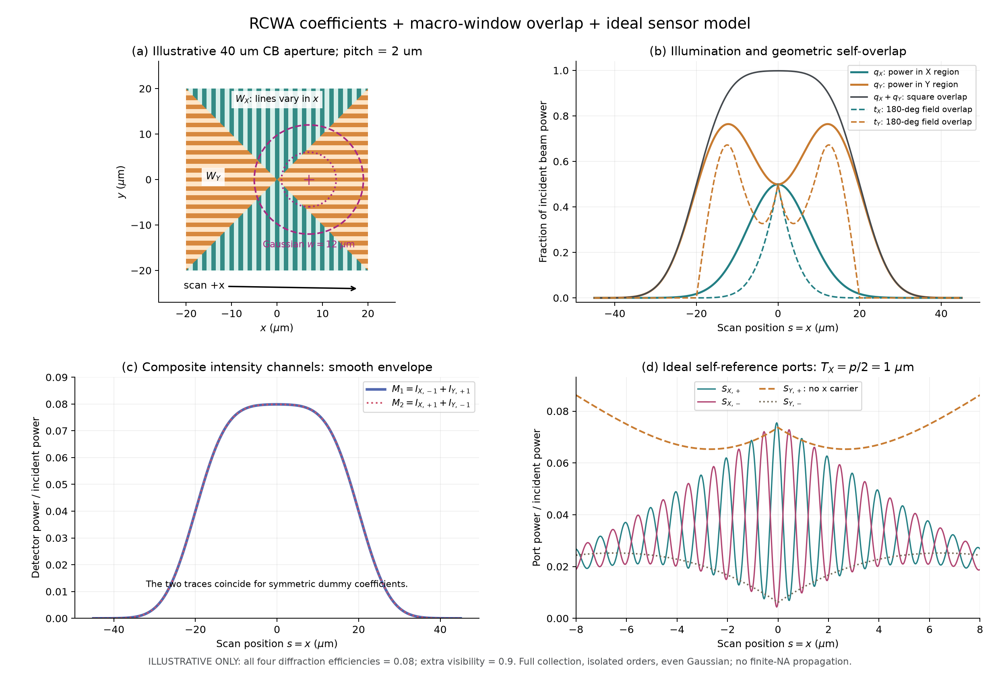
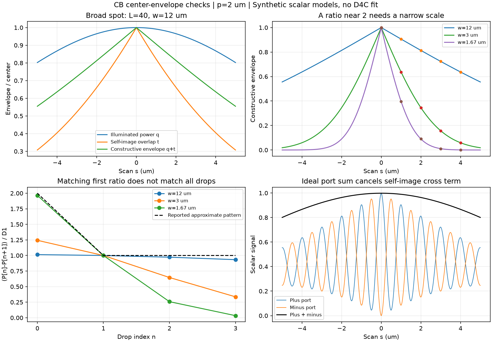
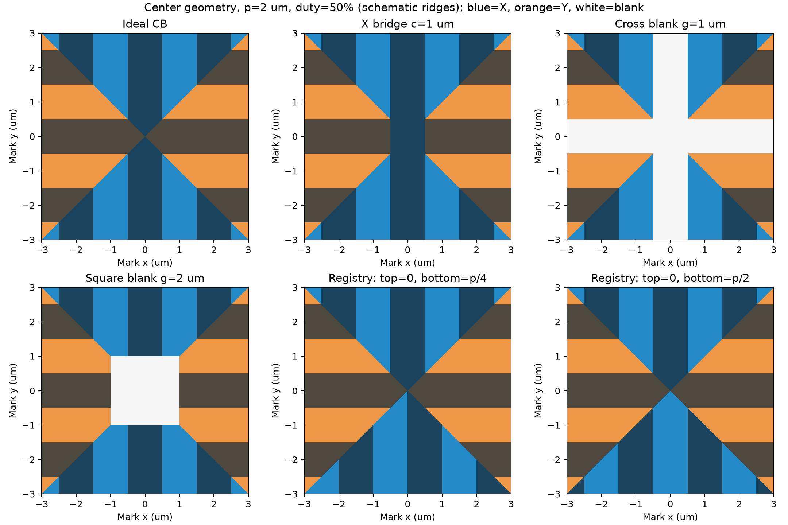
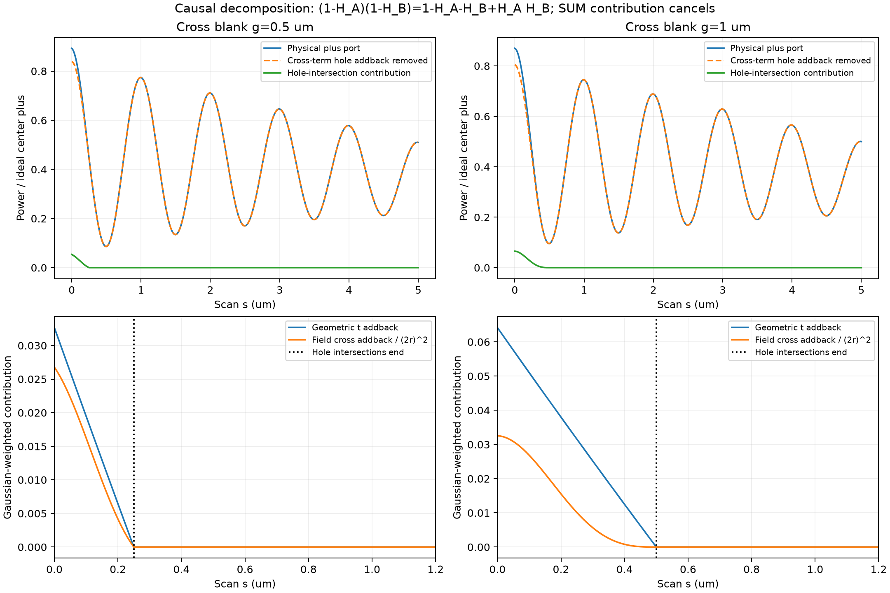
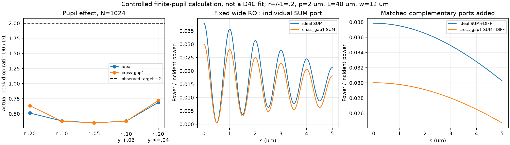
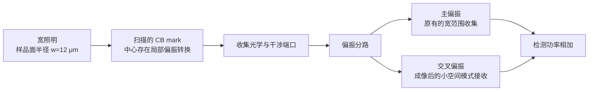

# CB mark / RCWA / D4C：截至 2026-11-11 的完整对话

> **先读 [后续更正与当前结论](2026-11-11_更正说明.md)。** 对话保留较早推测、数学示例和后来明确撤回的实际归因；不能把中途的假设模型结果当作最终结论。
>
> 用户说明：数值伪影的问题已解决；随后另问中心峰到第一侧峰的绝对下降量约为后续下降的两倍。没有实际 D4C 数据或精确光路，因此这一现象的现实原因仍未确定。
>
> 本文保留本次对话用户可见提问、表单回答及全部完成的助手回答，包括此前上传请求及其回复；本次上传请求记在末尾，上传完成的答复在本快照之后产生。工具调用、环境注入和进度消息未收录。对内容只做 GitHub 数学定界符、附件相对路径与表单格式转换；历史判断及其纠正均保持顺序。
>
> 原始文件为公开专利 [WO2022258371A1](https://patents.google.com/patent/WO2022258371A1/en)，图 6 的提取见 [示意图](../2026-11-10_CBmark_D4C尖峰诊断/figures/patent_figure6.png)。真实公司 R 矩阵和扫描曲线未提供，归档内计算数据均为合成示例。

<a id="dialogue-01"></a>

## 01 用户（2026-11-10 12:04:52 +0800）

你知道CB mark这种alignment mark吗 根据这个pdf的信息可cb mark的图像 对于一个pitch=2um的CB mark 给我一个如何从RCWA的结果（简单的2umpithch 50%占空比的mark）考虑各种因素 得到cbmark延x方向的扫描曲线吗 注意 要求的不是仿真实际mark而是如何通过RCWA在后面附加各种效应 达到复现扫描曲线的效果

---

<a id="dialogue-02"></a>

## 02 助手（2026-11-10 12:21:26 +0800）

知道。你这份专利里的 **CB 是 combined bidirectional alignment mark，组合双向对准标记**。针对你要做的事，可以采用一套明确的前向模型：

$$
\boxed{
\text{简单周期光栅的 RCWA 复系数}
\;\longrightarrow\;
\text{CB 区域窗口与扫描光斑}
\;\longrightarrow\;
\text{光瞳收集与干涉检测}
\;\longrightarrow\;
\text{积分、采样和噪声}
}
$$

**这条路线可行，RCWA 仍然只计算 $p=2\,\mu\mathrm m$、50% 占空比的周期结构。** CB 的有限尺寸、区域组合和传感器效应都在后处理中加入。下面给出能直接计算的公式；我也写好了两个可运行的示例脚本。

先明确专利中两种曲线的区别。Fig. 7A 的 702 是较平滑的 **intensity trace**，704 是带振荡的 **phase-channel trace**。后者虽然叫“phase”，图中画的仍是干涉通道的强度读数，并非直接画相位角。Fig. 6 中，上下区域 604A/B 是 X 光栅，左右区域 606A/B 是 Y 光栅；你可以打开我从 PDF 中提取的 [Fig. 6 清晰图](../2026-11-10_CBmark_D4C尖峰诊断/figures/patent_figure6.png) 对照。专利还给出了 180°自参考干涉和两路混合强度的关系。[专利原文，段落 0037、0040、0106–0114](https://patents.google.com/patent/WO2022258371A1/en)

以下公式是依据这些结构构造的**等效后处理模型**，并非专利直接提供的一套 RCWA 算法。

**第一步，从 RCWA 保留复振幅和衍射效率。** 对 X/Y 两种方向，至少需要：

$$
r_{j,-1},\quad r_{j,0},\quad r_{j,+1},
\qquad j=X,Y.
$$

其中 $r$ 包含振幅与相位。若传感器只收集一级，后处理可以主要使用 $\pm1$ 级；RCWA 内部仍需足够的傅里叶谐波来保证求解收敛。

对于下面的简化功率模型，可以定义功率归一化系数：

$$
c_{j,\pm}=\sqrt{\eta_{j,\pm}}\,e^{i\phi_{j,\pm}}.
$$

这里 $\eta$ 是相对入射功率的衍射效率。**原始电场系数的平方模一般不能直接当作效率**，需要遵循求解器的模式能流归一化。例如 S4 将原始模式振幅和逐阶 Poynting 能流分别输出。[S4 官方 API 文档](https://web.stanford.edu/group/fan/S4/python_api.html)

还有两个接入时需要处理的细节：

- X/Y 光栅相差 90°。对于同一全局线偏振，两者相对于光栅的 TE/TM 关系会改变，因此不一定能直接复制同一套系数。
- 50% 占空比的影响已经包含在 RCWA 结果里，后面无需再乘一次 0.5。

如果你目前只有 $\eta_{\pm1}$，可以先得到强度包络；干涉曲线中的相位就需要明确作为假设或标定参数。

**第二步，用两个宏观窗口表示 CB 的区域分布。** 从 Fig. 6 出发，一个实用近似是把边长为 $L$ 的正方形沿两条对角线划分：

$$
W_{\square}(x,y)
=
\mathbf 1_{\{|x|\le L/2,\ |y|\le L/2\}},
$$

$$
W_X(x,y)
=
W_{\square}(x,y)\,\mathbf 1_{\{|y|\ge |x|\}},
\qquad
W_Y=W_{\square}-W_X.
$$

这样，上下两个三角区域使用沿 x 周期变化的光栅，左右两个区域使用沿 y 周期变化的光栅：

$$
\mathbf G_X=\left(\frac{2\pi}{p},0\right),
\qquad
\mathbf G_Y=\left(0,\frac{2\pi}{p}\right).
$$

这是宏观区域的窗口近似，交界处的局部电磁耦合没有重新求解。若上下两部分存在不同的栅线起始相位，可以进一步拆成四个窗口，分别指定相位。

设 $\mathbf u=(u_x,u_y)$ 是固定在光斑上的坐标，光斑中心在 mark 坐标中的位置为：

$$
\mathbf r_s=(s,y_0).
$$

这就是你要求的沿 x 扫描，$y_0$ 表示扫描线偏离 mark 中心的距离。取归一化 Gaussian 振幅：

$$
A(\mathbf u)
=
\sqrt{\frac{2}{\pi w_xw_y}}\,
\exp\!\left(
-\frac{u_x^2}{w_x^2}-\frac{u_y^2}{w_y^2}
\right),
\qquad
\int |A|^2\,d^2u=1.
$$

注意，$w_x,w_y$ 是**强度的 $1/e^2$ 半径**。振幅和强度的 Gaussian 指数相差一个 2。

**第三步，先算不发生干涉的强度扫描曲线。** 定义光斑落在每类光栅区域内的功率比例：

$$
\boxed{
q_j(s)=
\int |A(\mathbf u)|^2
W_j(\mathbf u+\mathbf r_s)\,d^2u
}
$$

在一级衍射基本完整收集、不同衍射斑互不重叠的近似下：

$$
I_j^\pm(s)
=
P_{\rm in}\,\eta_j^\pm q_j(s).
$$

专利两路混合强度对应：

$$
\boxed{
I_{\rm mix,1}=I_X^-+I_Y^+,
\qquad
I_{\rm mix,2}=I_X^++I_Y^-.
}
$$

这个简单模型就能解释主要形态：沿中心线扫描时，$q_X$ 通常在中心较大；$q_Y$ 可以出现两侧较高、中心较低的双肩形。两者相加则满足：

$$
q_X(s)+q_Y(s)
=
\int |A(\mathbf u)|^2
W_{\square}(\mathbf u+\mathbf r_s)\,d^2u.
$$

因此，当 X/Y 的收集权重接近时，**两个变化明显的子信号相加，可以得到相当平坦的总强度平台**。专利曲线中的这种形态，可以通过区域窗口和光斑重叠产生。

**第四步，加入 180°自参考干涉，得到振荡扫描曲线。** 这里有一个关键：干涉振幅还取决于原像与旋转像之间的重合程度。

对于上面的实数、偶对称 Gaussian，在完整收集、孤立一级的近似下，定义：

$$
\boxed{
t_j(s)=
\int |A(\mathbf u)|^2
W_j(\mathbf u+\mathbf r_s)
W_j(-\mathbf u+\mathbf r_s)\,d^2u.
}
$$

$q_j$ 衡量“照到了多少区域”，$t_j$ 衡量“该区域与其 180°旋转像重合了多少”。一般有：

$$
0\le t_j(s)\le q_j(s).
$$

可以用下面两个互补输出，作为干涉通道的等效模型：

$$
\boxed{
S_{j,\pm}(s)=P_{\rm in}
\left[
\frac{\eta_j^++\eta_j^-}{2}\,q_j(s)
\ \pm\
V_{j,\rm extra}
\sqrt{\eta_j^+\eta_j^-}\,
t_j(s)\cos\Phi_j(s)
\right]
}
$$

$$
\Phi_j(s)
=
2\mathbf G_j\cdot\mathbf r_s
+
\arg\!\left(c_j^+c_j^{-*}\right)
+
\delta_j.
$$

其中，$V_{\rm extra}$ 表示偏振失配、相干性等额外损失，$\delta_j$ 是传感器的固定相位偏置。这里 $S$ 的正负号表示两个输出端口，$I$ 的正负号表示衍射级次。

这个模型满足：

$$
S_{j,+}+S_{j,-}
=
P_{\rm in}(\eta_j^++\eta_j^-)\,q_j.
$$

因此，两个干涉输出相加会消除载波，留下强度包络。这也能解释专利中利用干涉通道组合信号构造强度模板的思路。

**不建议一开始就用“$q_j(s)\times[1+V\cos(\cdots)]$”并把 $V$ 固定。** 扫到边缘时 $t_j/q_j$ 会变化，固定可见度容易把干涉包络画错。

对你的 $p=2\,\mu\mathrm m$，严格沿 x 扫描时：

$$
\Phi_X(s)=\frac{4\pi s}{p}+\phi_{X,0},
\qquad
\Phi_Y(s)=\frac{4\pi y_0}{p}+\phi_{Y,0}.
$$

所以：

$$
\boxed{\text{X 的 }\pm1\text{ 级干涉载波周期}=p/2=1\,\mu\mathrm m.}
$$

Y 光栅的相位载波沿 x 不变化，但它的 $q_Y$ 和 $t_Y$ 仍会变化。**因此不要给 Y 通道也人为添加一个 1 µm 的 x 方向载波。** 同样，纯 x 扫描时，不能依赖两个不同的非零载频自动分离 X/Y。

我已经按这套简化公式计算了一个示例。图中取 $L=40\,\mu\mathrm m$、$w=12\,\mu\mathrm m$，四个一级效率均设为 0.08；这些都是**示意输入，没有使用你的真实 RCWA 数据，也没有拟合专利曲线**：



右上角的实线 $q$ 和虚线 $t$ 展示了两种包络的区别；右下角 X 通道有 1 µm 振荡，Y 通道呈慢变化。

**第五步，要考虑有限 NA、光瞳截断和串扰时，升级为复场 FFT 后处理。** 这仍然沿用简单周期 RCWA 的结果，只在外部构造有限场：

$$
\boxed{
E_s(\mathbf u)=A(\mathbf u)
\left[
\sum_{j=X,Y}
W_j(\mathbf u+\mathbf r_s)
\sum_m r_{jm}
e^{im\mathbf G_j\cdot(\mathbf u+\mathbf r_s)}
+
r_{\rm bg}\bigl(1-W_{\square}(\mathbf u+\mathbf r_s)\bigr)
\right].
}
$$

其中 $r_{\rm bg}$ 表示 mark 外部表面的反射。随后计算：

$$
U_s(\mathbf k)=\mathcal F_{\mathbf u}\{E_s(\mathbf u)\}.
$$

这个表达式一次性包含了有限光斑、有限区域、扫描相位和衍射斑展宽。坐标 $\mathbf u$ 固定在传感器上尤其重要，否则容易漏掉或重复加入平移相位。

非干涉通道在对应光瞳区域内积分：

$$
I_d(s)\propto
\int_{\Omega_d}
|P_d(\mathbf k)U_s(\mathbf k)|^2\,d^2k.
$$

180°自参考的两个分支可以写为：

$$
U_1(\mathbf k;s)=P_1(\mathbf k)U_s(\mathbf k),
\qquad
U_2(\mathbf k;s)=P_2(\mathbf k)U_s(-\mathbf k).
$$

然后形成：

$$
\boxed{
S_{d,\pm}(s)\propto
\frac12
\int_{\Omega_d}
\left|
U_1(\mathbf k;s)
\pm e^{i\delta_d}U_2(\mathbf k;s)
\right|^2d^2k.
}
$$

这里使用的是 $U_s(-\mathbf k)$；复共轭在计算干涉交叉项时产生。偏振模型需要把上述标量场扩展为矢量场，并加入两臂的 Jones 变换。若输入的是 RCWA 原始电场系数，检测积分还需要一致的模式能流和光瞳归一化。

**采用这一级模型后，$q$、几何重叠损失和扫描相位已经在复场中，不能再乘一次 $q$ 或补一次 $4\pi s/p$。** 有限 NA 下，直接算上述干涉积分，也比继续使用简化的 $t_j$ 更可靠。

各种因素建议放在下面这些位置：

| 因素 | 在哪里加入 | 主要改变什么 |
|---|---|---|
| mark 尺寸、中心间隙、区域边界 | $W_X,W_Y$ | 总包络宽度、中心峰与双肩形态 |
| 光斑大小、椭圆度、扫描偏心 | $A(\mathbf u)$、$\mathbf r_s$ | X/Y 权重、左右对称性、边缘斜率 |
| 波长、偏振、结构深度和膜堆栈 | RCWA 复系数 $r_{jm}$ | 各级振幅和相位 |
| 有限 NA、零级挡光、光瞳分区 | $P_d,\Omega_d$ | 收集损失、包络变化、级次串扰 |
| 波前与两臂差分像差 | 照明复场或 $P_1,P_2$ 的相位 | 可见度、干涉相位和包络 |
| 部分相干、多波长 | 每个相干模式分别算检测信号，再加权求和 | 条纹对比度、通道权重 |
| 运动积分、电子带宽 | 光学检测信号生成后滤波 | 高频振荡衰减、信号延迟 |
| 位置抖动、增益、背景、噪声 | 最后的采样与读出层 | 条纹减弱、基线与随机起伏 |

这里有两点值得特别处理。首先，聚焦 Gaussian 本身可以是相干角谱；不能把其中所有平面波方向都随意当成不相干光源平均。其次，理想自参考系统中的共同偶对称光瞳相位会在 $\phi(\mathbf k)-\phi(-\mathbf k)$ 中抵消，因而共同离焦、球差与两臂差分像差需要分别建模。

运动积分和抖动则适合在最后处理。例如沿 x 匀速扫描，积分时间为 $T$、速度为 $v$，对 X 的 1 µm 载波，运动积分的调制度因子是：

$$
M_{\rm int}
=
\operatorname{sinc}\!\left(\frac{2\pi vT}{p}\right),
\qquad \operatorname{sinc}(z)=\frac{\sin z}{z}.
$$

Gaussian 位置抖动标准差为 $\sigma_x$ 时：

$$
M_{\rm jitter}
=
\exp\!\left[-\frac12
\left(\frac{4\pi\sigma_x}{p}\right)^2\right].
$$

我已把上述两种层级分别实现：

- [简化包络与干涉模型](../2026-11-10_CBmark_D4C尖峰诊断/examples/envelope/cb_mark_postprocess.py)：替换四个功率归一化复系数，即可生成 $q/t$、两路混合强度和互补干涉曲线。附有 [参数说明](../2026-11-10_CBmark_D4C尖峰诊断/examples/envelope/README.txt) 和 [纯 x 扫描数据](../2026-11-10_CBmark_D4C尖峰诊断/examples/envelope/scan_x_alpha0.csv)。
- [二维光瞳 FFT 后处理模型](../2026-11-10_CBmark_D4C尖峰诊断/examples/pupil_fft/pupil_fft_demo.py)：X/Y 分别提供 $r_{-1},r_0,r_{+1}$ 的输入位置，包含有限窗口、Gaussian 光斑、NA、零级挡光、光瞳分区及 180°自参考。附有 [模型说明](../2026-11-10_CBmark_D4C尖峰诊断/examples/pupil_fft/README.txt) 和 [扫描曲线图](../2026-11-10_CBmark_D4C尖峰诊断/examples/pupil_fft/cb_scan_curves.png)。该示例采用标量归一化信号，接入真实数据时需处理上面提到的能流和偏振映射。

运行 FFT 示例：

```powershell
uv run --with numpy --with matplotlib '../2026-11-10_CBmark_D4C尖峰诊断/examples/pupil_fft\pupil_fft_demo.py'
```

示例已通过包络分区、非负性、互补输出和 Fourier 能量一致性检查；无限 X 光栅的载波周期为 1 µm，无限 Y 光栅沿 x 扫描保持恒定。这些检查验证了计算关系，实际传感器的定量精度仍需参数标定。

对于复现实测曲线，我建议固定已有 RCWA 系数，先用平滑强度通道确定窗口尺寸、光斑大小和扫描偏心，再用干涉通道确定模式重叠、相位偏置和差分像差，最后加入已知的积分时间、带宽与噪声。对称单元的 RCWA 解通常不能预测制造不对称造成的真实一级不平衡；若需要后加振幅不平衡或相位偏置，应将它们明确保留为标定参数。这样每一个用于改善曲线匹配的参数，都能对应到具体的光学或检测过程。

---

<a id="dialogue-03"></a>

## 03 用户（2026-11-10 18:08:49 +0800）

D4C的扫描结果发现 Isum+Idiff 在每半个周期处存在一个很尖的峰 用正常的方式拟合无法得到这个结果 你知道它是考虑了什么情况得到的吗

---

<a id="dialogue-04"></a>

## 04 用户（2026-11-10 18:11:43 +0800）

（以下为用户通过交互表单提交的补充，问题与回答文字按原文转写。）

**表单问题：** 尖峰对应哪一个 D4C 结果文件（本地路径或文件名即可）？我会先检查工作区里的现有结果；这个信息能帮助确认是否是同一组曲线。

**用户回答：** 我没有文件 在公司电脑中 我只是想让你推测一下

**表单问题：** 你说的“每半个周期”具体是哪一种间隔？

**用户回答：** 每 p/2，即 p=2 µm 时每 1 µm

---

<a id="dialogue-05"></a>

## 05 助手（2026-11-10 18:17:11 +0800）

**有几种合理推测。其中我会优先怀疑：D4C 的扫描模型包含了中间像面光阑（field stop）、后续探测区域和两路各自的收集过程，使信号保留了简化模型里被消掉的周期成分。** 不过，“每 $p/2=1\,\mu\mathrm m$ 一个很尖的峰”还不足以确定它内部用了哪一种机制，尤其不能直接归结为“考虑了高阶衍射”。

你这个现象需要把**“为什么和信号还在振荡”**与**“为什么振荡会变成尖峰”**分开看。

先看一个严格约束。若 Isum、Idiff 确实是同一对光场 $a,b$ 的互补强度，并且两路使用相同的检测区域、权重和增益：

$$
I_{\rm sum}=\frac12\int D(\rho)|a+b|^2\,d\rho,
\qquad
I_{\rm diff}=\frac12\int D(\rho)|a-b|^2\,d\rho,
$$

那么一定有：

$$
\boxed{
I_{\rm sum}+I_{\rm diff}
=
\int D(\rho)\bigl(|a|^2+|b|^2\bigr)\,d\rho.
}
$$

**两臂之间的干涉项会严格抵消。增加 RCWA 阶数、加入共同的有限 NA 或共同像差，都不会破坏这个恒等式。** 所以，若各衍射级独立收集、各级功率只随慢包络变化，和信号中就不该出现每 1 µm 一个的干涉尖峰。

但这个恒等式只消掉了“两臂之间”的干涉，并不保证每个臂自身的检测功率一定平滑。这就是我会往下推测的入口。

**最值得检查的光学情况，是像面截断引起的衍射级串扰。** 我前面给你的 FFT 示例包含了收集光瞳，但没有加入完整的：

$$
\text{SRI 输出}
\rightarrow
\text{中间像面}
\rightarrow
\text{field stop}
\rightarrow
\text{再传播到探测光瞳}
\rightarrow
\text{有限区域收集}.
$$

当扫描中的 mark 像经过 field stop 的硬边缘时，光场被截断，随后传播会使衍射级展宽、向相邻检测区域泄漏。这是对准传感器里明确存在的一类效应：ASML 的公开专利直接讨论了扫描时 field stop 硬边造成级次串扰，并用柔化边缘来抑制；同一专利也允许两个输出分支使用不同大小的 aperture stop。[US7564534B2，field stop 与检测部分](https://patents.google.com/patent/US7564534B2/en)

因此，如果 D4C 模拟的是这种完整传感器过程，而你拟合的是：

$$
\text{Gaussian 包络}\times\text{一个正弦载波},
$$

两者确实可能对不上。**这里我推测的是“空间截断及实际收集”，目前没有证据确认你的 D4C 配置一定包含它。**

从数学上看，可以把检测信号写成：

$$
I(s)=
\sum_{m,n}
r_mr_n^*K_{mn}(s)\,
e^{i(m-n)Gs},
\qquad G=\frac{2\pi}{p}.
$$

其中 $K_{mn}$ 描述不同衍射级经过光路后，在检测区域内的重叠关系。

- 各级在检测中保持正交时，主要留下 $m=n$ 项，即功率包络。
- 若空间截断、再成像或有限探测区域使 $K_{mn}\ne0$，就能保留不同级之间的相干项。
- $m-n=2$ 对应 $p/2$ 周期；多个更高频率成分若相位合适，可以叠加成间隔 $p/2$ 的窄峰。

不过，**“每半周期重复”和“很尖”是两个不同要求。** 只有一个 $p/2$ 正弦项，峰仍然是圆滑的；很窄的峰意味着还存在更高的扫描空间频率，或某种非线性处理。

这又带来一个重要限制：高阶衍射必须真的能进入探测光路。正入射、空气中大致需要满足：

$$
\frac{|m|\lambda}{p}\le \mathrm{NA}.
$$

例如，仅作为说明，若 $p=2\,\mu\mathrm m$、$\lambda=633\,\mathrm{nm}$、NA = 0.6，则只有 $\pm1$ 级落在物镜收集范围内，$\pm2$ 已超出。**RCWA 内部用了很多傅里叶谐波，不等于探测器收到了很多衍射级。**

更严格地说，若输入只有 $0,\pm1$ 三个级次，系数不随扫描位置变化，后续又全是固定的线性光学操作，那么强度最高只含 $2G$，很难产生显著窄于 1 µm 周期的尖峰。固定孔径或固定像差本身也不能凭空增加这个频率上限。

另一类很实际的可能，是 **Isum 与 Idiff 在最终读出时已经不是完全匹配的互补通道**：

$$
I_{\rm sum}=\frac12\|H_{\rm sum}(a+b)\|^2,
\qquad
I_{\rm diff}=\frac12\|H_{\rm diff}(a-b)\|^2.
$$

两路若有不同的孔径、遮挡、偏振透过率或探测权重，便会有 $H_{\rm sum}\ne H_{\rm diff}$，干涉项不能完全抵消。公开传感器设计中确实有 sum、difference 各自经过光导、遮挡和探测器的配置。[US11086240B2](https://patents.google.com/patent/US11086240B2/en)

但这里也要保留一个判断：**只调整两个通道的增益，通常只会留下正弦残差，仍不足以解释很尖的峰。** 尖锐度还需要额外谐波、随扫描位置变化的收集作用，或者非线性。

如果你说的峰特别窄，甚至只占几个扫描采样点，我会把下面两种情况的优先级提高：

- **导出量经过了归一化或其他非线性运算。** 例如除以一个接近零的信号、相位解包裹、相位求导、阈值切换等。它们容易在相消位置附近产生很尖的特征。此时应检查原始 Isum、Idiff，确认“相加”发生在什么处理步骤之后。
- **数值重建造成尖峰。** 例如硬边界的 Fourier 截断振铃、扫描平移插值、网格对齐或周期边界处理。如果峰宽、峰高随网格和谐波截断数明显变化，就不能先把它当作真实光学效应。

你之后回公司，可以用几项小改动快速区分：

| 改动或观察 | 能检验什么 |
|---|---|
| 将中间像面 field stop 放大，再将硬边改为软边 | 尖峰是否与空间截断、级次串扰有关 |
| 统一 SUM/DIFF 的孔径、增益和检测权重后求和 | 是否来自互补通道不匹配 |
| 在实际 NA 允许范围内，比较只保留一级与保留全部级次 | 是否确实需要多阶相干成分 |
| 比较原始功率与归一化、解调后的输出 | 是否由非线性处理产生 |
| 加密扫描步长、空间网格，改变 Fourier 截断数 | 尖峰是否数值收敛 |
| 看尖峰是否始终对齐某一路的暗点 | 有助于定位相消附近的读出或归一化问题 |

**针对你接下来要做的 RCWA 后处理，我会先补“中间像面 field stop → 再传播 → 两路实际检测区域”这一层，并同时保留原始两路功率。** 如果在实际只收 $\pm1$ 级的条件下，仍需要极窄的周期尖峰才能匹配 D4C，就应优先核查输出定义和数值处理；单靠光斑尺寸、常数可见度或通道增益，解释不了这种尖锐度。

---

<a id="dialogue-06"></a>

## 06 用户（2026-11-10 18:22:52 +0800）

把D4C的扫描曲线进行FFT会发现m=2以上都会有大小几乎恒定是0.005的三角峰

---

<a id="dialogue-07"></a>

## 07 用户（2026-11-10 18:23:48 +0800）

频谱中的峰形

---

<a id="dialogue-08"></a>

## 08 助手（2026-11-10 18:27:20 +0800）

明白，是**频谱中各个高次峰呈三角形，而且峰高几乎都在 0.005**。

**结合你前面看到的“扫描曲线每 $p/2$ 出现一个很窄的尖峰”，现在我会优先推测：正常扫描信号上叠加了一个近似周期性的窄脉冲列；频谱中的三角峰形，则可能来自 FFT 的离散采样、连线显示或加窗。** 这个解释比“D4C 考虑了很多高阶衍射”更直接。但窄脉冲本身来自光学过程、数值重建还是后处理，目前仍不能确定。

这里最有辨识力的，其实是**高次峰几乎不衰减**。

假设尖峰间隔为：

$$
T=\frac p2=1\,\mu\mathrm m,
$$

把扫描曲线写成：

$$
S(x)=S_{\rm normal}(x)
+a\sum_j g(x-x_0-jT),
$$

其中 $g$ 是一个很窄的脉冲。这个脉冲列在第 $k$ 个谐波上的系数为：

$$
\boxed{
C_k=\frac aT\,
\widehat g\!\left(\frac{k}{T}\right)
e^{-i2\pi kx_0/T}.
}
$$

如果脉冲窄到在你观察的频率范围内满足：

$$
\left|\widehat g(k/T)\right|\approx\text{常数},
$$

就会出现你描述的：**很多高次谐波近似等高。**

这与普通连续曲线的特征有区别：

| 扫描曲线中的局部特征 | 高频谐波的一般趋势 |
|---|---|
| 平滑的有限宽度峰 | 随频率升高而衰减 |
| 三角波一类的斜率突变 | 通常约按 $1/k^2$ 衰减 |
| 跳变 | 通常约按 $1/k$ 衰减 |
| 很窄、尚未被采样充分分辨的脉冲 | 在一段频率范围内近似不衰减 |
| 理想冲激列 | 各谐波幅度相同 |

所以，**“高次峰近似恒定”更像冲激型残差的频谱，而非几个普通正弦谐波组成的波形。** 结合扫描域已经看到的尖峰，这个判断比只看 FFT 幅度更有依据；单看幅度谱而没有相位，仍不能唯一重建波形。

至于**为什么频谱峰形是三角形**，有一个很简单、也很容易误判的原因：一个频点很高、左右相邻频点很低，用折线画出来就已经是三角形了。它未必代表某种特殊的光学谱线形状。

Hann 加窗也能形成非常相似的结果。在谐波恰好落在 FFT 频点上、采用周期 Hann 窗且各谱峰充分分离时，每条谱线会分布到中心及相邻两个频点；幅度比例为：

$$
\frac12,\quad 1,\quad \frac12.
$$

连同外侧接近零的点，折线就是一个三角峰。Hann 窗用于频谱分析时有专门的周期形式，窗函数本身也会改变谱峰主瓣形状。[SciPy Hann 窗文档](https://docs.scipy.org/doc/scipy/reference/generated/scipy.signal.windows.hann.html)、[频谱分析与加窗说明](https://docs.scipy.org/doc/scipy/tutorial/signal.html#spectral-analysis)

我刚做了一个**纯数学构造例子，没有使用 D4C 数据**：

- 总共 1000 个采样点；
- 每隔 20 个点出现一个高度为 0.05 的单点脉冲；
- 使用单边幅度归一化 $2|\mathrm{FFT}|/N$。

它在各个非直流、非 Nyquist 谐波上的幅度，恰好都是：

$$
\frac{2\times0.05}{20}=\boxed{0.005}.
$$

再乘周期 Hann 窗，并补偿窗增益，每个谐波附近五个频点的幅度都是：

| 相对中心频点的位置 | $-2$ | $-1$ | $0$ | $+1$ | $+2$ |
|---|---:|---:|---:|---:|---:|
| 幅度 | 0 | 0.0025 | **0.005** | 0.0025 | 0 |

**这就同时产生了“各次近似等高”和“三角峰形”。** 数值是特意选来说明这种可能性，不能据此认定 D4C 加了 0.005 的固定项；若你画的是功率谱或 dB 谱，也需要使用相应的归一化关系。

这条新信息会让我调整上一条回答中的排查顺序：

1. **先查扫描曲线中的尖峰是否只占一个或少数采样点。** 如果是，它在目前采样下就近似一个离散冲激，天然会产生很平的高次谐波。
2. **再查 FFT 的窗函数、归一化和绘图方式。** 窗函数可以解释每个谱峰的相似形状；它通常不能把一个纯正弦凭空变成一整排等高谐波，后者仍需要脉冲型残差等来源。
3. **然后判断窄脉冲的来源。** 周期性插值错误、网格对齐、分段计算的连接点、相消位置附近的归一化，都值得优先检查。完整光学收集过程仍是候选，但现在不能仅凭这些峰把原因指向 field stop 或高阶衍射。

另外，**FFT 中的谐波序号 $m$，不等同于 RCWA 的衍射级次 $m$**。看到 FFT 的高次峰，不能直接解释为探测到了对应阶数的衍射光。

你回公司后，下面几项就很有区分力：

| 检查 | 观察重点 |
|---|---|
| 把频谱改成散点或 stem 图，查看峰附近的原始 FFT 数值 | “三角形”是否只是少量频点连线形成 |
| 对同一份数据补零后画更密的频谱 | 看清峰的实际主瓣形状；补零只加密频率采样，不增加真实分辨能力 |
| 改变 FFT 窗函数 | 谱峰形状是否随窗口一起变化 |
| 在相同扫描范围内，减小 D4C 的扫描步长重新计算 | 尖峰的物理宽度、面积和高频谱是否收敛 |
| 只为诊断，用邻点插值替换尖峰处的少数采样点后再做 FFT | 那一排近似 0.005 的高次峰是否随之消失 |

如果最后一项让高次峰基本消失，而主载波和慢包络几乎不变，就能把问题定位为：**正常信号上额外叠加的周期尖脉冲分量。** 接下来应解释这个分量怎样产生，而不是继续用更多自由正弦项去拟合整条曲线。

---

<a id="dialogue-09"></a>

## 09 用户（2026-11-10 18:28:32 +0800）

确实是在RCWA 的衍射级次 $m$下出现的那些FFT峰

---

<a id="dialogue-10"></a>

## 10 助手（2026-11-10 18:32:23 +0800）

明白，**你说的是：FFT 峰的位置已经按 RCWA 的衍射级次对应好了，在 $m=2,3,\ldots$ 对应的位置，峰高都接近 0.005。** 我上一条过早把重点转到了通用的 FFT 采样问题；按你这个前提，应重点分析**多阶复光场怎样经过传感器变成扫描信号**。

在这个前提下，我最值得优先考虑的情况是：

> **D4C 保留了不同衍射级之间的相干交叉项，或者 SUM、DIFF 两路对各阶的检测权重并不完全互补。**

这与“多保留几个衍射效率，然后把功率加起来”有本质区别。

对于周期 $p$，令 $G=2\pi/p$。mark 平移 $s$ 时，第 $m$ 级的复振幅带有平移相位：

$$
r_m(s)=r_m(0)e^{imGs}.
$$

因此，$+m$ 和 $-m$ 发生自参考干涉时，扫描频率对应：

$$
e^{i2mGs}
\quad\Longrightarrow\quad
f_m=\frac{2m}{p}.
$$

对于 $p=2\,\mu\mathrm m$，这些频率就是 $m$ cycles/µm。**按这个对应关系标记 FFT 峰是合理的。**

但还有一个重要约束：如果每个阶次独立检测，并且 SUM、DIFF 完全互补，那么该阶可以写成：

$$
I_{{\rm sum},m}
=
B_m+C_m\cos(2mGs+\phi_m),
$$

$$
I_{{\rm diff},m}
=
B_m-C_m\cos(2mGs+\phi_m).
$$

相加仍然得到：

$$
I_{{\rm sum},m}+I_{{\rm diff},m}=2B_m.
$$

**所以，仅仅加入 $m=2,3,\ldots$ 的同阶正负级干涉，仍然不能解释这些峰为什么留在 $I_{\rm sum}+I_{\rm diff}$ 中。** 还需要有一项超出这个独立阶次模型的作用。

最直接的一种就是：**不同阶次在同一检测区域内先相干叠加，再取强度。** 例如某一臂的检测光场为：

$$
E_A(\rho;s)
=
\sum_m r_m\,\psi_{A,m}(\rho)e^{imGs}.
$$

它的检测功率包含：

$$
\boxed{
I_A(s)=
\sum_{m,n}
r_mr_n^*K^A_{mn}\,e^{i(m-n)Gs},
}
$$

其中：

$$
K^A_{mn}
=
\int_{\Omega}
\psi_{A,m}(\rho)\psi_{A,n}^*(\rho)\,d\rho.
$$

如果各阶在检测中保持正交，$K_{mn}=0\;(m\ne n)$，就只剩逐阶功率；如果经过空间截断、再成像和有限区域收集后，出现 $K_{mn}\ne0$，则会留下跨阶拍频。

**SUM 与 DIFF 相加消掉的是两臂之间的交叉项，并不会自动消掉每个臂内部的这些跨阶项。**

像面 field stop 造成的级次泄漏，正是一种能够引入这种重叠的过程。公开的对准系统专利明确描述了扫描时硬边光阑使一个衍射级向相邻级泄漏，并采用柔化边缘降低串扰。[US7564534B2](https://patents.google.com/patent/US7564534B2/en)

另一种情况是两路检测算子不同：

$$
I_{\rm sum}=\frac12\|H_{\rm sum}(E_A+E_B)\|^2,
\qquad
I_{\rm diff}=\frac12\|H_{\rm diff}(E_A-E_B)\|^2.
$$

只要 $H_{\rm sum}\ne H_{\rm diff}$，各阶的周期项就可能在相加后残留。若这种残留覆盖很多阶，就能形成你看到的高次谱峰。

这里也能解释，为什么**峰的位置可以对应 RCWA 阶次，但峰高不直接等于该阶的衍射效率 $\eta_m$**：同一个扫描频率上，可能叠加了多个阶次对的拍频贡献，还乘上了检测重叠、通道权重及归一化系数。

你观察到的“高次峰都约为 0.005”，对尖峰形态则有一个很直接的解释。假设它们是单边幅度谱中的幅值，并且各阶相位大致满足共同的尖峰位置 $s_0$，残差信号可近似写成：

$$
\boxed{
R(s)\approx
0.005\sum_{m=2}^{M}
\cos\!\left[\frac{4\pi m}{p}(s-s_0)\right].
}
$$

在：

$$
s=s_0+j\frac p2
$$

处，所有这些项同时达到最大值，于是形成每 $p/2$ 重复的尖峰。参与的阶数越多，峰就越窄：

$$
\text{峰高约}\ \propto 0.005(M-1),
\qquad
\text{峰宽量级}\ \sim \frac{p}{2M}.
$$

这正是普通“慢包络＋一个主正弦”拟合不出来的部分。**不过，等高还不够；各阶相位也必须合适。** 如果相位杂乱，相同的幅度谱不会叠加成整齐的尖峰列。

因此，你这个补充使我更倾向于检查 D4C 是否做了下面这种处理：

$$
\boxed{
\text{RCWA 多阶复振幅}
\rightarrow
\text{完整空间传播与检测}
\rightarrow
\text{保留跨阶相干项或通道残留项}
\rightarrow
\text{扫描曲线}.
}
$$

要在你自己的 RCWA 后处理中复现它，重点应是加入**各阶复场、检测重叠矩阵 $K_{mn}$，以及 SUM/DIFF 各自的传递算子**。如果仍采用“每阶衍射效率乘包络，再把功率相加”的方式，即使把所有高阶都加进去，也会漏掉这类尖峰。

---

<a id="dialogue-11"></a>

## 11 用户（2026-11-10 18:39:13 +0800）

我有的数据是RCWA得到的反射系数矩阵R和最后的扫描曲线 你告诉我判断是不是这个问题 我应该对数据做什么能确定就是这个原因

---

<a id="dialogue-12"></a>

## 12 助手（2026-11-10 18:46:15 +0800）

**只有一份 RCWA 的 $R$ 和一条最终扫描曲线，还不能唯一确定原因。** 你可以先用现有数据做排除检验；要确认是跨阶相干，最有说服力的办法是在**产生原扫描曲线的同一个前向程序里，做逐阶分组对照**。

我前面提出的跨阶相干是一个候选机制。下面这套操作能把它从“看起来合理”推进到“有直接证据”，也能区分一部分通道失配问题。

**1. 先从 $R$ 提取当前照明实际激发出的各阶复振幅。**

如果你的 $R$ 是输入模式到反射模式的散射矩阵：

$$
\mathbf r=R\mathbf a,
$$

其中 $\mathbf a$ 是实际入射光的模式系数。单个平面波照明通常对应选取相应入射列；偏振也需要包含在索引中。RCWA 的模式系数、场系数和功率之间需遵循求解器的定义。[RCWA 模式与散射矩阵说明](https://github.com/edmundsj/RCWA/blob/master/docs/source/mathematics.rst)、[S4 逐阶功率接口](https://web.stanford.edu/group/fan/S4/python_api.html)

这一步有两个容易误操作的地方：

- **不要把 $R$ 的非对角元素直接解释成探测端的“跨阶干涉项”。** 它们表示光栅把某个入射模式耦合到其他反射模式，属于结构的衍射响应。
- **不要通过“把 $R$ 的非对角元置零”来去掉干涉。** 对单平面波照明，这很可能直接把需要的衍射级删掉了。

后续用的是各输出阶的复数 $r_m$，包括其振幅和相位。还需要记录阶次标签、波长、入射角、偏振、能流归一化，以及实际可传播、可收集的阶次。

**2. 从扫描曲线提取“复数谐波系数”，不要只保存 0.005 这些峰高。**

令扫描位置为 $s$，把曲线表示为：

$$
I(s)=B(s)+2\operatorname{Re}
\sum_{\ell>0}C_\ell e^{i2\pi\ell s/p}.
$$

你按 $\pm m$ 自参考干涉标记的频率 $2m/p$，在这里对应 $\ell=2m$。

每个峰需要保留：

$$
|C_\ell|,\qquad \arg C_\ell.
$$

具体建议是：

- 优先选取慢包络变化较小、包含多个周期的一段扫描数据。
- 若频率没有正好落在 FFT 频点上，可以在已知频率处联合拟合正弦和余弦，得到复系数，而不是只取最近一个 FFT bin 的峰高。
- 先不要除以拟合包络，包络很小时的除法会放大误差。
- 用这些**原始复系数**重构高频残差，确认它们确实重构出了原曲线中的尖峰。

尤其要避免：

$$
\operatorname{IFFT}\bigl(|\operatorname{FFT}(I)|\bigr).
$$

这个操作丢弃了原始相位，可能人为把不同阶的贡献对齐，生成尖峰。

**3. 用 $r_m$ 做一个必要条件检查：这些高频能否由可收集的阶次对产生？**

对于“周期结构纯平移、其余光路固定且线性”的模型，令：

$$
r_m(s)=r_m e^{imGs},\qquad G=\frac{2\pi}{p}.
$$

若检测可写成二次型：

$$
I(s)=\mathbf r(s)^\dagger K\mathbf r(s),
$$

则：

$$
\boxed{
C_\ell
=
\sum_n r_n^*K_{n,n+\ell}r_{n+\ell}.
}
$$

这给你一个能直接排除候选模型的检查：

> 对某个实际存在的 FFT 峰 $\ell$，列出所有可传播、可收集的阶次对 $(n,n+\ell)$，检查它们的 $r_n^*r_{n+\ell}$。

如果这些阶次对根本不存在，或者全部对应严格为零的振幅，那么这个峰就不能由上述固定线性跨阶模型产生。

例如，实际只有 $0,\pm1$ 时，阶差最多为 2，不能靠这三个固定阶次产生持续很多阶的高频峰。此时应检查有限 mark 的位置相关效应、输出处理或其他模型条件。

**有可用的阶次对，只能说明跨阶相干“有可能”；仍不能证明探测器真的保留了它们。** 未知的检测重叠矩阵 $K$ 正是现有数据缺少的部分。一个 FFT 峰只约束若干阶次对贡献的和，不能把各项唯一拆开。

**4. 真正有辨别力的对照：全阶曲线，与“逐个 $\pm m$ 组计算后再相加”的曲线比较。**

如果扫描程序允许你将 RCWA 输出的复系数送入后续光路，就不需要重新求解结构，只需要在该接口处筛选阶次。

按组保留：

$$
g_0=\{0\},\quad
g_1=\{-1,+1\},\quad
g_2=\{-2,+2\},\ldots
$$

分别计算：

- $I_{\rm all}(s)$：所有阶同时进入原来的光学与检测链；
- $I_g(s)$：每次只让一组进入同一条链。

然后计算：

$$
\boxed{
\Delta I_{\rm cross}(s)
=
I_{\rm all}(s)-\sum_g I_g(s).
}
$$

在**固定线性光路、原始强度输出**的条件下，这个差严格就是不同组之间的相干交叉项。

这一步必须保持：

- 入射功率、检测增益和所有光学参数相同；
- 筛掉部分阶次后，不把剩余光重新放大到相同总功率；
- 不对每条输出曲线分别做峰值归一化或包络归一化；
- 固定背景先正确扣除，避免重复相加。

对应的判据很清楚：

| 结果 | 可以得到的结论 |
|---|---|
| $I_{\rm all}$ 有尖峰，$\sum_g I_g$ 没有，而 $\Delta I_{\rm cross}$ 独自含有这些尖峰 | **证明该模型中的尖峰来自不同 $|m|$ 组之间的相干交叉项** |
| 单独某一组 $I_g$ 已经有相同尖峰 | 组间相干不是解释该尖峰的必要条件，应继续查该组内部及通道处理 |
| 两者之差只有小幅变化，没有目标尖峰 | 组间相干不足以解释你看到的主要尖峰 |

比较时要同时检查高次 FFT 峰的**幅度和相位**，不要只看峰高都接近 0.005。

**5. 再做一个独立的相位对照，排除“只是删阶改变了功率”的影响。**

对每一组 $\{+m,-m\}$ 施加一个共同相位：

$$
\boxed{
r_{+m}'=e^{i\theta_m}r_{+m},
\qquad
r_{-m}'=e^{i\theta_m}r_{-m}.
}
$$

这样：

$$
|r_{\pm m}'|^2=|r_{\pm m}|^2,
\qquad
r_{+m}'r_{-m}'^*=r_{+m}r_{-m}^*.
$$

也就是说，**各阶功率不变，同一组 $\pm m$ 的相对相位也不变，只改变不同组之间的相对相位。**

把这些修改后的系数送进**原来的扫描前向程序**：

- 如果尖峰随 $\theta_m$ 明显改变，说明尖峰依赖组间的相位关系。
- 如果对各组独立相位进行循环或随机平均后，尖峰消失，而且平均结果接近 $\sum_g I_g$，就与第 4 步形成相互支持的证据。
- 如果没有变化，只能说明没有检测到明显的组间相干作用，不能据此排除同组 $+m/-m$ 的作用或 SUM/DIFF 失配。

这里不能只在自己临时搭的简化模型里改相位，然后把结果当作 D4C 的证据；必须通过产生原曲线的那条计算链。

**如果还能拿到分别保存的原始 SUM、DIFF，另做一个很便宜的失配检查。**

提取两路在各高频处的复系数，计算：

$$
q_\ell=
-\frac{C_{{\rm SUM},\ell}}
{C_{{\rm DIFF},\ell}}.
$$

如果多个高次峰的 $q_\ell$ 都接近**同一个正实数 $\alpha$**，那么：

$$
I_{\rm SUM}(s)+\alpha I_{\rm DIFF}(s)
$$

就可能同时消除这些残留项。这说明单一的通道增益比足以解释它们，无需先引入复杂的跨阶模型。两路扫描坐标需要先对齐；固定采样延迟也会使该比值的相位随频率变化。只有最终和曲线时，这项检查做不了。

对你目前的数据，建议先完成第 1–3 步，得到“各阶复振幅—各频率复系数—允许阶次对”的表。**要把原因确认下来，优先争取第 4 步的逐组对照，或导出实际检测面按阶分解的复场。** 如果证实交叉项独自包含尖峰，便能确认跨阶相干；要进一步断定是 field stop 导致，再单独改变 field stop、保持其余参数不变，检查这些交叉项是否随之消失或减弱。

---

<a id="dialogue-13"></a>

## 13 用户（2026-11-10 18:49:05 +0800）

把以上关于这个问题的讨论上传至github

---

<a id="dialogue-14"></a>

## 14 助手（2026-11-10 19:02:08 +0800）

已上传到 **[ychen1213/ChatGPT-Discussions](https://github.com/ychen1213/ChatGPT-Discussions)** 的 `main` 分支。

- **[阅读入口：最新结论与诊断路线](https://github.com/ychen1213/ChatGPT-Discussions/blob/main/AH53/2026-11-10_CBmark_D4C尖峰诊断/README.md)**
- **[完整讨论原文](https://github.com/ychen1213/ChatGPT-Discussions/blob/main/AH53/2026-11-10_CBmark_D4C尖峰诊断/discussion.md)**
- **[本次提交：3cab91d](https://github.com/ychen1213/ChatGPT-Discussions/commit/3cab91da754880c6cf5b507cf1a9a2a6b1eeb262)**

归档保留了 **7 条用户提问及澄清、5 次完整回答**，涵盖 CB mark 的 RCWA 后处理、D4C 半周期尖峰、FFT 与衍射级次的对应，以及如何利用 $R$ 和扫描曲线进行受控诊断。早期推测与后续修正均保留，最新结论单独整理，明确说明实际成因仍需验证。

同时上传了两套示意 Python 程序、图片、CSV 曲线和校验记录。已核对远端全部 **18 个新增或更新文件**的哈希，本地仓库也已同步，工作区干净。

---

<a id="dialogue-15"></a>

## 15 用户（2026-11-10 22:11:21 +0800）

数值伪影的问题我解决了 另一个问题是D4C的s=0的峰到旁边峰的降低程度是旁边其他峰互相降低程度的两倍  这肯定跟mask导致的包络有关系 你觉得来自s=0时mark条纹长度最长而且范围都都保持的原因吗 怎么在mark设定中考虑到这个事 我们目前用step形式的mask

---

<a id="dialogue-16"></a>

## 16 用户（2026-11-10 22:12:48 +0800）

（以下为用户通过交互表单提交的补充，问题与回答文字按原文转写。）

**表单问题：** 你说的“两倍”是相邻峰高度的绝对差（例如中心到第一峰下降 0.02，第一到第二峰下降 0.01），还是相对百分比？如果方便，给出同一侧中心及后面 3 个峰的大致高度即可。

**用户回答：** 近似绝对差吧  没有数据

---

<a id="dialogue-17"></a>

## 17 助手（2026-11-10 22:21:36 +0800）

按你补充的“**相邻峰的绝对高度差**”来理解，你说的“$s=0$ 时条纹最长、覆盖最完整”确实是一个合理的几何原因。**但“中心到第一峰下降约为后续下降的两倍”，不能单靠中心条纹最长就推出；需要检查二维 mask 经过照明加权，以及两个旋转图像重叠之后，实际形成了什么包络。** 你们目前使用 step mask 本身没有问题，关键是它表示的几何是否完整，以及它在光路中的使用方式。

先延续前面的通道定义：如果你现在比较的仍是 $I_{\rm SUM}+I_{\rm DIFF}$，并且它们是匹配的互补干涉端口，两臂的干涉项会在相加后抵消。因此，下面说的“两个图像共同覆盖”可以直接解释单个端口或调制度的包络；是否能解释你当前的和信号，要看 D4C 中这两个量的实际定义。

**对于 CB mark，中心条纹更长这件事，应当包含在二维二值 mask 里。**

按我们之前参照图 6 使用的理想几何，设 mark 外框边长为 $L$，X 光栅位于上下两块三角区域，可以写成：

$$
M_X(x,y)=
\mathbf 1_{\{|x|\le L/2,\ |y|\le L/2\}}
\mathbf 1_{\{|y|\ge |x|\}}.
$$

这个 mask 始终只有 0 和 1。固定一个 $x$，沿 $y$ 方向统计 X 光栅的总长度：

$$
\ell_X(x)=\int M_X(x,y)\,dy
=L-2|x|,\qquad |x|\le L/2.
$$

因此，中心 $x=0$ 的条纹最长，向两边线性缩短。

但这也给出一个直接判断：如果扫描峰值只是正比于这个长度，那么相隔

$$
h=p/2=1\,\mu{\rm m}
$$

的相邻峰，其绝对下降量应该相同：

$$
\ell_X(0)-\ell_X(h)
=
\ell_X(h)-\ell_X(2h)
=2h.
$$

**所以，“条纹长度呈三角形变化”本身给出的是等量下降，还不足以解释中心第一步下降约为两倍。** 还需要照明、相干叠加或收集过程把这个长度分布转换成另一个包络。

这里最值得检查的是两个不同的几何量。设 $(u,v)$ 为固定光斑坐标，扫描位置为 $s$，光斑强度为 $G(u,v)$。

第一个是光斑照到多少 X 区域：

$$
q_X(s)=
\iint G(u,v)\,M_X(u+s,v)\,du\,dv.
$$

第二个是原图像和旋转 $180^\circ$ 后的图像，在光斑范围内共同覆盖多少 X 区域。在实、中心对称照明和近似完整收集的条件下，它是：

$$
t_X(s)=
\iint G(u,v)\,
M_X(u+s,v)\,
M_X(s-u,-v)\,du\,dv.
$$

你说的“$s=0$ 时范围都保持”，**更接近第二个量 $t_X$ 的物理含义**：中心时两个窗口完全重合；离开中心后，两者的共同区域缩小。它与单纯照到的总面积 $q_X$ 不一样。

对于这里的理想三角边界，两个窗口共同满足的条件包含：

$$
|v|\ge \max(|u+s|,|s-u|)
=|u|+|s|.
$$

其中出现了 $|s|$，因此共同覆盖包络在中心可以具有真实的折点。单个干涉端口可以近似写成：

$$
I_\pm(s)=
a\,q_X(s)
\pm b\,t_X(s)
\cos\!\left(\frac{4\pi s}{p}+\phi\right).
$$

也就是说，**基线的包络由 $q_X$ 控制，振荡幅度的包络由 $t_X$ 控制**。把它们都用同一个一维 step 或一个共同的包络系数代替，可能会漏掉中心附近的变化。

不过，这种共同覆盖效应也没有固定的“两倍关系”。例如，对圆对称高斯光斑：

$$
G(u,v)\propto
\exp\!\left[-\frac{2(u^2+v^2)}{w^2}\right],
$$

忽略最外层方框裁切，可以推导出：

$$
q_X(s)=
\frac12\left[1-\operatorname{erf}(s/w)^2\right],
$$

$$
t_X(s)=
\frac12\operatorname{erfc}(|s|/w)^2.
$$

在等效率、孤立的 $\pm1$ 级以及理想构成性干涉的简化条件下，峰值包络正比于：

$$
P(s)=q_X(s)+t_X(s)
=\operatorname{erfc}(|s|/w).
$$

取 $h=1\,\mu{\rm m}$，前两次下降量的比值为：

$$
R_0=
\frac{P(0)-P(h)}
{P(h)-P(2h)}.
$$

这个模型给出的示例是：

| 高斯光斑强度 $1/e^2$ 半径 $w$ | $R_0$ |
|---|---:|
| $10\,\mu{\rm m}$ | 约 $1.02$ |
| $1.67\,\mu{\rm m}$ | 约 $1.97$ |

这些只是解析模型的示例，说明：**共同覆盖可以让第一步下降更大，但能否接近两倍，取决于光斑宽度与峰间距的比例。** 如果你们实际光斑宽很多、mark 也有很多周期，那么单纯这个理想几何在中心附近通常只产生较小的差别，不能直接认定它已经解释了两倍。

你们的 mark 设置可以这样处理：

1. **如果现在的 step mask 只是沿 $x$ 的一维矩形窗口，需要补上 CB 的二维分区。** 条纹长度随 $x$ 缩短，应由三角区域的边界自然产生。

2. **把二维宏观 mask 乘在 RCWA 重建的复场上，再经过传播、光瞳和检测积分。** RCWA 已经包含 $2\,\mu{\rm m}$ pitch、50% 占空比的周期结构，宏观 mask 负责限定哪些位置存在这类光栅区域。

3. **旋转臂应由整个场旋转得到。** 若程序已经使用 $E_s(-u,-v)$ 或相应的 Fourier 坐标翻转，第二个 mask 以及共同覆盖效应已经包含在内；此时再额外乘一个 $t_X(s)$，会把同一效应计算两次。

你们现在可以先做一个很便宜的几何检查，暂时保持 RCWA 系数不变，只从现有 mask 算 $q_X$ 和 $t_X$：

```python
import numpy as np

def mask_x(x, y, L):
    inside = (np.abs(x) <= L/2) & (np.abs(y) <= L/2)
    return inside & (np.abs(y) >= np.abs(x))

# U, V：固定光斑坐标网格
# G：光斑强度，归一化使 sum(G)*dx*dy = 1
# s：沿 x 的扫描位置；这里先取 y0 = 0

M_a = mask_x(U + s, V, L)
M_b = mask_x(s - U, -V, L)

q = np.sum(G * M_a) * dx * dy
t = np.sum(G * M_a * M_b) * dx * dy
```

这段只是检查几何覆盖，不替代完整的光瞳传播。把 $q(s)$、$t(s)$ 与最终扫描曲线画在同一组扫描坐标上，然后分别比较：

$$
B(s)\approx\text{局部基线},\qquad
A(s)\approx\text{局部振荡幅度},\qquad
P(s)\approx B(s)+A(s).
$$

如果两倍关系主要出现在 $A(s)$，而且 $t(s)$ 也表现出相同的下降比例，就很支持你提出的“中心共同覆盖最完整”这个解释。如果只比较原始峰顶高度，基线和调制度的变化会混在一起。

**我目前的判断是：你提出的几何方向值得优先验证，但应具体落实为“完整二维 CB mask＋两个旋转场的重叠”，而不是给中心条纹额外加权。** 如果你们已经完整实现了这两点，那么中心条纹最长的效应就已经在模型里；下一步应直接检查它算出的 $q$、$t$ 能否产生约两倍的绝对下降，再决定是否需要考虑实际中心留白、条纹截断位置和有限光瞳收集。

---

<a id="dialogue-18"></a>

## 18 用户（2026-11-10 22:22:49 +0800）

你不能验证一下到底可能是什么原因吗

---

<a id="dialogue-19"></a>

## 19 助手（2026-11-10 22:32:40 +0800）

可以。我已经实际跑了几组对照计算，结果比上一条的定性判断更明确：**“$s=0$ 时条纹最长、两个图像覆盖最完整”能解释中心较高，但在理想 CB 的二维 step mask 模型里，它没有自然产生你描述的“第一步下降约为后续两倍”。对宽光斑的示例，这个解释目前得不到计算支持。**

这次固定了对称的 $\pm1$ 级复系数，只改变几何、照明和收集条件，没有使用你的 D4C 数据或实际 $R$ 矩阵。这样能单独检验你提出的 mask 原因。

取 $p=2\,\mu m$，峰间距 $h=p/2=1\,\mu m$，定义同一侧的下降量：

$$
D_0=P_0-P_1,\qquad D_1=P_1-P_2,\qquad D_2=P_2-P_3.
$$

你描述的规律大致是：

$$
D_0\approx2D_1,\qquad D_1\approx D_2\approx D_3.
$$

**这两个条件需要同时满足。只把 $D_0/D_1$ 调到 2，还不足以复现你的现象。**

我先验证了“中心条纹最长”本身。理想 CB 的 X 区域取：

$$
M_X(x,y)=
\mathbf1_{\{|x|,|y|\le L/2\}}
\mathbf1_{\{|y|\ge|x|\}}.
$$

它的条纹总长度确实是：

$$
\ell_X(x)=L-2|x|.
$$

但峰高如果正比于长度，相邻等间距位置的下降量就完全一样，得到 $D_0/D_1=1$。即使采用长度平方，取 $L=40\,\mu m$，比值也只有约 $1.054$。

随后我计算了高斯照明下的单窗口覆盖 $q$、旋转后共同覆盖 $t$，以及单个构成性干涉端口的包络 $q+t$。示例参数为：

$$
L=40\,\mu m,\qquad w=12\,\mu m,
$$

其中 $w$ 是光斑强度的 $1/e^2$ 半径。结果如下，表中的比值是包络在 $s=0,1,2\,\mu m$ 处的绝对下降量之比：

| 候选机制 | $D_0/D_1$ |
|---|---:|
| 条纹长度 $\ell_X$ | 1.000 |
| 长度平方 $\ell_X^2$ | 1.054 |
| 高斯照明覆盖 $q$ | 0.340 |
| 旋转共同覆盖 $t$ | 1.124 |
| 单端口构成性包络 $q+t$ | 1.014 |

其中 $q+t$ 的中心及后面几个等间距位置，归一化结果为：

$$
P_n=
[1,\;0.9060,\;0.8133,\;0.7232,\;0.6367].
$$

对应的绝对下降量为：

$$
D_n=
[0.0940,\;0.0927,\;0.0901,\;0.0865].
$$

**它接近逐步等量下降，没有中心第一步突然加倍。**

我也验证了有限光瞳的影响：在同一组参数下，对孤立衍射级周围分别使用不同大小的圆形收集区域。

| 局部收集圆盘半径，单位 cycles/$\mu m$ | $q+t$ 的 $D_0/D_1$ |
|---|---:|
| 完整收集 | 1.014 |
| 0.40 | 0.839 |
| 0.20 | 0.495 |
| 0.10 | 0.380 |
| 0.05 | 0.351 |

这里有限带宽把中心的折点抹平了，**第一步下降反而更小**。这部分做了 $512^2$ 到 $1024^2$ 网格收敛比较，曲线最大变化低于中心信号的 $0.033\%$，因此这些结果不是靠粗网格得到的。

我上一条举的“小光斑可以得到约两倍”的例子，也需要收紧解释。取 $w\approx1.67\,\mu m$，包络在整数位置的取值确实给出：

$$
D_n\approx[0.603,\;0.307,\;0.079,\;0.010].
$$

第一比值接近 2，但后面的下降量迅速变小。而且重新检查完整扫描波形的局部极大值后，这个模型在 $0\sim5\,\mu m$ 内只剩中心峰和一个侧峰，已经无法描述一串正常的侧峰。**所以这个例子不能作为复现你所说扫描曲线的证据。**

我进一步扫描了 $L=10、20、40、80\,\mu m$，以及 $w=0.8\sim40\,\mu m$ 的 1920 组 $q/t/(q+t)$ 模型结果。在这些模型和参数范围内，有些能满足“首个比值接近 2”，但没有一组同时满足“后面三次下降量的变异系数不超过 10%”。

下图左下角最直观：虚线表示你描述的近似规律；普通宽光斑和窄光斑模型都没有同时符合它。



**据此，我现在会把重点转向“中心附近是否叠加了一个额外贡献”，而不是普通条纹长度包络。** 这是根据你描述作出的推断，还没有确定它的物理来源。

原因可以写得很具体：假设普通包络在这几个峰之间每步下降 $d$，而中心附近还存在一项 $A f(s)$：

$$
P_n=P_{\rm broad}(nh)+A f(nh).
$$

如果这项在中心明显、到第一侧峰已很小，即：

$$
f(0)\approx1,\qquad f(h),f(2h),\ldots\approx0,
$$

那么：

$$
D_0\approx d+A,\qquad D_1,D_2,\ldots\approx d.
$$

当 $A\approx d$，才会得到你描述的“两倍、随后近似等量下降”。这只是说明**所需附加项的形状**，不能据此给中心 mask 人为加权。

在 mark 设置里，值得优先验证的是下面两类具体来源：

- **实际中心拼接结构。** 中心是否有贯通条纹、十字留白、局部重叠，以及上下 X 区域是否采用相同的条纹相位原点。理想三角分区没有包含这些具体结构。不过，局部几何经过宽光斑照明后也可能变成宽响应，不能默认它只抬高中心一个峰。
- **这些中心结构与收集光路的耦合。** 二维 step mask 要先作用于复场，再经过实际光瞳、场阑或检测模式。无限周期 RCWA 的 $R$ 加一个最终强度包络，无法完整表达边界衍射与模式重叠。我补算的对称 X/Y 全场和几种默认收集区域也没有得到两倍，因此目前尚未找到一个已验证的具体光路原因。

如果你这里仍然指原始 $I_{\rm SUM}+I_{\rm DIFF}$，还必须保留前面的约束：匹配互补端口中的跨臂共同覆盖项会相消。此时应检查的是**单臂经过实际收集后的功率变化**，不能直接拿 $t(s)$ 的中心尖点解释和信号。

这次计算的脚本、逐点结果和参数都已保存，便于你们对照现有程序：

- [计算说明和结论](examples/center_envelope/README.txt)
- [几何与光斑对照脚本](examples/center_envelope/check_center_models.py)
- [各模型的峰值与下降量 CSV](examples/center_envelope/model_comparison.csv)
- [有限光瞳计算脚本](examples/center_envelope/finite_pupil/check_finite_pupil.py)
- [有限光瞳的完整数值结果](examples/center_envelope/finite_pupil/results.json)

**当前已经验证的是：普通二维 CB step 几何、宽高斯光斑和简单有限收集，并不足以支持“中心第一步两倍”这个归因。你们可以继续保留 0/1 的 step mask；下一步最有区分力的对照，是保持同一份 $R$ 和同一条光路，只替换理想中心与实际中心的几何及相位设置，查看差值是否恰好集中在中心附近。**

---

<a id="dialogue-20"></a>

## 20 用户（2026-11-10 22:36:52 +0800）

1. **实际中心拼接结构。** 中心是否有贯通条纹、十字留白、局部重叠，以及上下 X 区域是否采用相同的条纹相位原点。理想三角分区没有包含这些具体结构。不过，局部几何经过宽光斑照明后也可能变成宽响应，不能默认它只抬高中心一个峰。
2. **这些中心结构与收集光路的耦合。** 二维 step mask 要先作用于复场，再经过实际光瞳、场阑或检测模式。无限周期 RCWA 的 \$R\$ 加一个最终强度包络，无法完整表达边界衍射与模式重叠。我补算的对称 X/Y 全场和几种默认收集区域也没有得到两倍，因此目前尚未找到一个已验证的具体光路原因。   详细说一下这两个具体什么样 构造对应的 用数据说明

---

<a id="dialogue-21"></a>

## 21 助手（2026-11-10 22:59:13 +0800）

我已经把这两类情况分别构造并算了。**这次找到一个具体的中心结构：额外的十字留白，可以在单个干涉端口中产生“中心到第一峰下降约两倍、后面几步下降接近”的规律。也验证了收集光瞳怎样改变这个结果，以及怎样让中心拼接引起的同臂交叉项保留在原始 SUM+DIFF 中。**

先把适用范围说清楚：**十字留白的这个“两倍”机制属于跨臂干涉项，会在理想互补端口的原始和中抵消。** 如果你现在比较的仍是原始 $I_{\rm SUM}+I_{\rm DIFF}$，它还不能直接作为最终原因；下面第二类中的“同臂交叉项”才是能保留在和信号中的部分。

我把完整公式、代码、逐点数据和可切换结构/光瞳/端口的曲线整理成了一个离线说明：

[打开：CB 中心结构与光路耦合——构造和数据](examples/center_structure/CB中心结构与光路耦合_构造和数据.html)

以下是最主要的构造与计算结果。

**第一类：中心究竟增加了什么结构，必须明确到二维区域和复相位。**

所有几何对照统一采用：

$$
p=2\,\mu m,\qquad L=40\,\mu m,\qquad w=12\,\mu m,
$$

$$
r_{+1}=r_{-1}=0.2,\qquad r_0=0.
$$

其中 $w$ 是照明强度的 $1/e^2$ 半径。除了 $p$，这些都是本次的示例假设；$0.2$ 是固定的合成复振幅，没有冒充你的实际 RCWA 结果。50% 占空比的周期结构由衍射系数表示，不再额外乘一次微观条纹 mask。

先用方框内的上下三角区域表示 X 光栅：

$$
M_X^0=
\mathbf1_{\{|x|,|y|\le L/2\}}
\mathbf1_{\{|y|\ge|x|\}},
$$

Y 区域为方框内的其余部分。在此基础上，我分别构造了以下变化：

| 构造 | 具体怎么改 |
|---|---|
| 贯通 X 区 | 在 $|x|<c/2$ 内，把原来的 Y 区域改成 X；两种区域保持互斥 |
| 十字留白 | 在 $|x|<g/2$ **或** $|y|<g/2$ 内，去掉周期光栅的 $\pm1$ 响应 |
| 中心方孔 | 只在 $|x|<g/2$ **且** $|y|<g/2$ 内去掉周期响应 |
| 上下相位错位 | 几何区域保持不变，上下 X 光栅采用不同的条纹原点 $\delta_{\rm top},\delta_{\rm bottom}$ |

下图可以直接看出它们的区别。尤其注意：十字留白沿整个横轴、纵轴延伸；小方孔只影响中心一小块。



上下条纹原点的处理，应当作用到各级复系数：

$$
r_m^{\rm top/bottom}
=
r_m\exp[-imG\delta_{\rm top/bottom}],
\qquad G=\frac{2\pi}{p}.
$$

例如相对错位 $p/2$，会让保留的奇数级变号。这通常会改变峰的位置、明暗端口及可见度，并不等于给中心增加一个强度权重。

我对这些结构计算了完整收集条件下的 X 通道：

$$
E_s(u,v)=
A(u,v)M_X(u+s,v)\,
0.2\left[
e^{iG(u+s-\delta(v))}
+
e^{-iG(u+s-\delta(v))}
\right],
$$

$$
I_\pm(s)=
\frac12\iint
\left|E_s(u,v)\pm E_s(-u,-v)\right|^2du\,dv.
$$

提取的是真正的局部极大值，没有把 $s=n\,\mu m$ 强行当成峰。设峰高为 $P_n$，绝对下降量为：

$$
D_n=P_n-P_{n+1}.
$$

得到：

| 中心构造 | $D_0/D_1$ | 后面三次下降量的变异系数 |
|---|---:|---:|
| 理想 CB | 1.011 | 2.83% |
| 贯通 X 区，$c=1\,\mu m$ | 1.025 | 2.80% |
| **十字留白，$g=0.5\,\mu m$** | **1.880** | **2.70%** |
| **十字留白，$g=1\,\mu m$** | **2.199** | **4.55%** |
| 中心方孔，$g=1\,\mu m$ | 0.979 | 2.89% |
| 中心方孔，$g=2\,\mu m$ | 0.919 | 3.01% |

这组数据已经能区分你提到的几种想法：**中心贯通、长度保持完整，在这里仅产生很小的变化；十字留白则产生了接近你描述的下降规律。**

以 $g=1\,\mu m$ 为例，中心和后面四个真实峰高为：

$$
P=
[0.06952023,\;
0.05956921,\;
0.05504391,\;
0.05027517,\;
0.04521787].
$$

相邻峰的绝对下降量为：

$$
D=
[0.00995102,\;
0.00452530,\;
0.00476874,\;
0.00505730].
$$

因此：

$$
\frac{D_0}{D_1}=2.199.
$$

后面三次下降确实彼此接近。

这里还有一个容易误解的地方：**中心并没有比理想 mark 的中心绝对更亮。** 理想中心约为 $0.07993463$，加十字留白后降低到 $0.06952023$；第一侧峰则从约 $0.07245007$ 降到 $0.05956921$，损失更大。你看到的“中心相对突出”，可以来自中心与侧峰损失程度不同。

**为什么十字留白能只影响中心附近？这次可以定位到一个具体项。**

对 X 三角区域，十字留白等价于删掉中央竖条。定义：

$$
H(x)=\mathbf1_{\{|x|<g/2\}},
\qquad M_X=M_X^0(1-H).
$$

扫描后，两旋转臂分别看到：

$$
H_A=H(u+s),\qquad H_B=H(s-u).
$$

两个窗口的乘积严格展开为：

$$
\boxed{
M_A M_B
=
M_A^0M_B^0
\left[1-H_A-H_B+H_AH_B\right].
}
$$

最后这个正项：

$$
\boxed{+H_AH_B}
$$

就是中心特有的贡献。

它的几何意义是：$s=0$ 时两个旋转图像里的空带重合；离开中心后，两条空带分开。两空带只有满足：

$$
|2s|<g
$$

时才存在交集。因此这个项仅在：

$$
\boxed{|s|<g/2}
$$

的范围内出现。对于 $g=1\,\mu m$，它局限在 $|s|<0.5\,\mu m$，到第一侧峰附近已经消失。

我把这个项单独积分出来，又在代数上只删除它，保持两臂自身功率及其他交叉项不变：

- $g=0.5\,\mu m$：中心贡献为 $0.00428337$；
- $g=1\,\mu m$：中心贡献为 $0.00520720$；
- 删除该项后，原本约 $1.88/2.20$ 的下降比回到约 $1.03/1.05$。

这说明它确实负责了中心的特殊下降，而不只是两条曲线碰巧相似。

下图上排蓝色是完整构造，橙色虚线是只删除该交集项的代数对照；两条曲线只在中心附近不同。下排显示该项在 $s=g/2$ 处结束。



这个机制已经包含在正确的复场与旋转计算中，**不需要、也不应该再人为给中心 mask 加权。** 但它在相消端口中的符号相反，所以对 $I_++I_-$ 的贡献为零。

另外，**这里的十字留白必须是周期结构之外额外存在的区域。** 如果你所指的中心白线只是 50% 占空比光栅中原本的空槽，它已经包含在 RCWA 单元里，不能再用宏观 gap 扣一次。专利示意图可提供整体 CB 几何背景，不能单凭图中的白线确定本次构造的额外 gap 及尺寸。[WO2022258371A1](https://patents.google.com/patent/WO2022258371A1/en)

**第二类：同一中心结构经过不同收集光路，结果会发生什么变化。**

这一步我使用完整 X+Y 复场，先做二维 FFT：

$$
F_s=\mathcal F[E_s].
$$

再通过固定光瞳。示例使用：

$$
\lambda=0.633\,\mu m,\qquad {\rm NA}=0.45.
$$

在正 X 一级的位置：

$$
(f_x,f_y)=(1/p,0)=(0.5,0)
$$

周围设置不同大小的圆形收集区域。圆盘半径单位是 cycles/$\mu m$，并且全部与物镜的实际 NA 光瞳相交。

设检测算子为 $D$，两臂为：

$$
a=D F_s(k_x,k_y),\qquad
b=D F_s(-k_x,-k_y).
$$

注意第二臂是坐标翻转，不是取共轭。端口信号为：

$$
I_\pm=
\frac12\left(\|a\|^2+\|b\|^2\right)
\pm\operatorname{Re}\langle a,b\rangle.
$$

同一个 $g=1\,\mu m$ 十字留白，得到：

| 收集条件 | 理想 CB 的单端口 $D_0/D_1$ | 十字留白的单端口 $D_0/D_1$ |
|---|---:|---:|
| 正 X 一级周围圆盘，半径 0.20 | 约 0.51 | **约 0.63** |
| 半径 0.10 | 约 0.38 | 约 0.38 |
| 半径 0.05 | 约 0.35 | 约 0.35 |
| 半径 0.10，沿 $f_y$ 偏心 $+0.06$ | 约 0.38 | 约 0.38 |

所以，几何完整收集时约 $2.20$ 的效应，经过这些有限光瞳后没有保留下来。**原因是最终检测的复场重叠不再等于两个几何窗口的直接交集；窄的中心贡献会被光路的空间带宽改变。**

完整收集在这里是几何诊断基准，不能等同于任意实际 NA 都能收到全部空间频率。有限光瞳结果做了 $512^2\rightarrow1024^2$ 检查，整条相长端口曲线最大变化约为中心值的 $0.275\%$。下降差值的比值更敏感，因此这里保留“约 0.63”的精度。



图中右侧也能看到：匹配端口相加后，剩下的是慢包络，没有保留相同的干涉峰列。

**更接近你原始 SUM+DIFF 问题的，是同一臂内部的场耦合。**

假设一条臂中的场由 X、Y 两区域共同贡献：

$$
F=F_X+F_Y.
$$

通过实际收集区域 $\Omega$ 后：

$$
\boxed{
P=
\int_\Omega|F_X+F_Y|^2
=
P_X+P_Y+
2\operatorname{Re}
\int_\Omega F_XF_Y^*.
}
$$

这里最后一项是**同臂 X/Y 交叉项**，它和两干涉臂之间的交叉项不同。

即使 X/Y 在完整平面上正交，经过有限区域投影后，也可能不再正交。这个项可以保留在原始 $I_{\rm SUM}+I_{\rm DIFF}$ 中。它要求相关场相干，并在检测偏振上具有重叠；若检测后仍严格正交，该项为零。

我构造了“上半 X 条纹相位变 $\pi$，其他区域不变”的 mark。在同一结构、同一扫描位置 $s=5\,\mu m$ 下，只改变收集区域：

| 收集区域 | 先相加复场再求功率的原始和 | X/Y 分开求功率再相加 | 同臂交叉项 | 相对变化 |
|---|---:|---:|---:|---:|
| 半径 0.10，$f_y$ 偏心 $+0.06$ | 0.02410958 | 0.02437548 | −0.00026590 | **−1.09%** |
| 半径 0.20，再截取 $f_y\ge0.04$ | 0.00278809 | 0.00309750 | −0.00030942 | **−9.99%** |

而在对称的半径 0.20 圆盘里，这个交叉项因对称性抵消，数值约为 $10^{-19}$。

这就具体说明了“中心拼接与收集光路耦合”的含义：**同一套 mark 复场，经过不同光瞳，原始和信号可以差约 10%。** 如果程序只计算两类区域各自的功率，再乘包络相加，就会漏掉这一项。

这组构造没有得到目标“两倍”，但已经验证了一个能作用于原始和的机制。你可以在现有程序中直接导出：

$$
I_{\Sigma,\rm coherent}
-
I_{\Sigma,\rm X/Y\ separated},
$$

判断这一项是否负责中心附近的异常下降。

**我还构造了一个“宽照明下，小中心结构只改变中心峰”的模式收集正例。**

这个例子用于说明第二类机制需要什么条件，不代表已经知道 D4C 有这种通道。

设中心存在一个局部有效交叉偏振散射项：

$$
\delta r(x,y)=
\delta\exp[-(x^2+y^2)/d^2],
\qquad d=0.3\,\mu m,
$$

该偏振由半径 $a=0.5\,\mu m$ 的高斯空间模式收集。实际检测的量是模式投影：

$$
J(s)=
\left|
\iint \psi^*(u,v)\,
A(u,v)\,
\delta r(u+s,v)\,du\,dv
\right|^2.
$$

保持照明 $w=12\,\mu m$ 不变：

- 小模式收集时，$J(1)/J(0)=0.00277$，到第一侧峰已经几乎没有贡献；
- 同一结构改为全空间模收集，$J(1)/J(0)=0.9862$，响应变得很宽。

取一个较弱的主通道中心标度 $\eta_{\rm main}=0.001$、局部项 $\delta=0.45$，单端口真实峰值除以该主通道标度后为：

$$
P=
[1.098444,\;0.906746,\;0.813983,\;0.724050,\;0.637793],
$$

$$
D=
[0.191698,\;0.092763,\;0.089933,\;0.086258].
$$

得到：

$$
D_0/D_1=2.067,
$$

后面三次下降的变异系数约为 $2.97\%$。

但这个正例有明确条件：系统必须接收该偏振和空间模式，该模式不能被遮挡，且中心贡献相对于主通道足够强。保持同一个中心项，把主通道标度提高到 $0.08$，比值就只有 $1.025$。因此，小中心结构并不普遍产生两倍关系。

**落实到你们的 mark 设置，我建议这样分层表达。**

```python
# 固定光斑坐标 U,V；mark 沿 x 扫描
x = U + s
y = V

inside = (abs(x) <= L/2) & (abs(y) <= L/2)
MX0 = inside & (abs(y) >= abs(x))
MY0 = inside & ~MX0

# 只有实际设计存在“额外十字留白”时才添加
gap = (abs(x) < g/2) | (abs(y) < g/2)

MX = MX0 & ~gap
MY = MY0 & ~gap

# FX/FY：由各自 RCWA 复系数重建的周期散射场
# Fflat：留白表面的响应；不能默认真实总反射为零
E = A * (MX * FX + MY * FY + (inside & gap) * Fflat)
```

上下相位原点写进各级 $r_m e^{-imG\delta}$。真正的 X/Y 交叉刻蚀重叠，应单独设一个互斥的中心区域 $M_C$，配自己的 $F_C$：

$$
E=A(M_XF_X+M_YF_Y+M_CF_C+M_{\rm flat}F_{\rm flat}).
$$

**不能把重叠处直接写成 $F_X+F_Y$，然后把它当作真实交叉结构的预测。** 中心系数需要局部交叉单元计算、其他局部模型或标定。此次我也计算了保持中心总级次系数平方和不变的四级中心模型，在所测光瞳下没有得到两倍，数据保存在 `overlap` 子目录。

最值得你们优先检查的两件事已经具体了：

- **几何侧：是否真的存在额外的中央贯通空带。** 如果存在，检查它在两旋转场中的 $H_AH_B$ 交集项。
- **原始和信号侧：实际 pupil/场阑/检测模式是否保留了同臂区域或级次交叉项。** 对同一复场比较“先场相加再检测”和“各区域功率分别检测后相加”。

完整资料已打包：

- [离线中文说明与交互曲线](examples/center_structure/CB中心结构与光路耦合_构造和数据.html)
- [全部代码、数据、图和说明 ZIP](examples/center_structure_bundle.zip)
- [几何构造的真实峰位置与高度](examples/center_structure/geometry/actual_plus_peaks.csv)
- [中央空带交集的逐点分解数据](examples/center_structure/geometry/hole_overlap_decomposition.csv)
- [不同结构、光瞳和网格的峰值对照](examples/center_structure/optical/peak_comparison.csv)

这次已经把“哪些具体结构能产生类似形状”和“哪些效应能存活到原始和信号”分开验证了；**尚未证明 D4C 的真实原因，但十字空带交集与同臂收集交叉项，现在都有明确结构、公式和可直接对照的数据。**

---

<a id="dialogue-22"></a>

## 22 用户（2026-11-10 23:18:24 +0800）

**我还构造了一个“宽照明下，小中心结构只改变中心峰”的模式收集正例。**

这个例子用于说明第二类机制需要什么条件，不代表已经知道 D4C 有这种通道。

设中心存在一个局部有效交叉偏振散射项：

\$$ \delta r(x,y)= \delta\exp[-(x^2+y^2)/d^2], \qquad d=0.3\\,\mu m, \$$

该偏振由半径 \$a=0.5\\,\mu m\$ 的高斯空间模式收集。实际检测的量是模式投影：

\$$ J(s)= \left| \iint \psi^\*(u,v)\\, A(u,v)\\, \delta r(u+s,v)\\,du\\,dv \right|^2. \$$

保持照明 \$w=12\\,\mu m\$ 不变：

- 小模式收集时，\$J(1)/J(0)=0.00277\$，到第一侧峰已经几乎没有贡献；
- 同一结构改为全空间模收集，\$J(1)/J(0)=0.9862\$，响应变得很宽。

取一个较弱的主通道中心标度 \$\eta\_{\rm main}=0.001\$、局部项 \$\delta=0.45\$，单端口真实峰值除以该主通道标度后为：

\$$ P= [1.098444,\\;0.906746,\\;0.813983,\\;0.724050,\\;0.637793], \$$\$$ D= [0.191698,\\;0.092763,\\;0.089933,\\;0.086258]. \$$

得到：

\$$ D_0/D_1=2.067, \$$

后面三次下降的变异系数约为 \$2.97\\%\$。

但这个正例有明确条件：系统必须接收该偏振和空间模式，该模式不能被遮挡，且中心贡献相对于主通道足够强。保持同一个中心项，把主通道标度提高到 \$0.08\$，比值就只有 \$1.025\$。因此，小中心结构并不普遍产生两倍关系。  这个具体是什么情况

---

<a id="dialogue-23"></a>

## 23 助手（2026-11-10 23:23:56 +0800）

**这个正例具体对应的是“宽照明＋中心局部偏振转换＋两路不同的空间收集方式”。它比普通的 CB mark 加 step mask 多了几个条件。之前我省略了接收光路的具体安排，这里需要补全。**

最直接的一种物理对应是：mark 的主要衍射信号按原来的方式宽范围收集；中心小区域产生另一种偏振的散射，这部分光经过一个固定的小空间模式接收；最后把两个检测功率相加。



这是一种能对应计算公式的**假设接收结构**。目前没有证据表明 D4C 实际使用了这套结构。

**1. “中心局部偏振转换”具体指什么？**

假设入射光是实验室坐标下的 $x$ 偏振。大部分 mark 产生的主信号仍是 $x$ 偏振，而中心一个很小的区域把一部分光转换成 $y$ 偏振。

写成局部 Jones 响应，就是增加一个非对角项：

$$
E_y^{\rm center}(x,y)
=
r_{yx}(x,y)E_x^{\rm incident}(x,y),
$$

其中假设：

$$
r_{yx}(x,y)
=
\delta\exp\!\left[-\frac{x^2+y^2}{d^2}\right].
$$

这里的 $x/y$ 偏振与 CB mark 的 X/Y 光栅方向是两回事。

这个小区域可以被设想为一个局部各向异性的接头、特殊取向的小结构，或者其他具有偏振转换能力的中心区域。**但我并没有从 PDF 或你的 RCWA 矩阵中识别出这样一块结构。这里的高斯形状和 $\delta$ 是额外指定的有效散射模型。**

所以：

$$
d=0.3\,\mu m
$$

表示这个有效响应的空间尺度，并不表示我已经确定实际 mark 有一个直径 $0.6\,\mu m$ 的圆形缺陷。

另外，$\delta=0.45$ 是**场振幅系数**。在这个局部 Jones 近似中，中心位置的交叉偏振功率系数为：

$$
|\delta|^2=0.2025.
$$

也就是局部可以有约 $20.25\%$ 的转换。这不是一个很弱的局部响应，只是它所占区域很小，因此对整个入射光斑的功率贡献仍然很小。

**2. “半径 $a=0.5\,\mu m$ 的接收模式”在哪里？**

这是这个例子最重要的部分。

公式中的：

$$
\psi(u,v)\propto
\exp\!\left[-\frac{u^2+v^2}{a^2}\right]
$$

应理解为：**把实际接收模式沿光路反向传播到样品面后，得到的等效接收场。**

因此，$a=0.5\,\mu m$ 是样品面上的等效半径：

- 它不是 pupil 上收集圆盘的半径；
- 它不是光纤芯的实际半径；
- 它也不是直接在 mark 上放了一个半径 $0.5\,\mu m$ 的实体小孔。

一种实现方式是：把样品成像到单模光纤端面，光纤只接受与其模式匹配的场。单模耦合取决于复振幅的重叠，同时受振幅分布和相位分布影响。[Ansys：单模光纤耦合的模式重叠定义](https://optics.ansys.com/hc/en-us/articles/42661682185107-Single-mode-fiber-coupling-in-OpticStudio)

例如，在理想成像近似下，若接收端模式半径为 $5\,\mu m$，成像倍率为 10，那么折算回样品面就是：

$$
a_{\rm sample}\approx
\frac{5}{10}
=0.5\,\mu m.
$$

真实系统还要把物镜 NA、像差、场阑、遮挡和传播相位算进去。更一般的写法是：

$$
c(s)
=
\left\langle
\psi_{\rm detector},\,
\mathcal L E_s
\right\rangle
=
\left\langle
\mathcal L^\dagger\psi_{\rm detector},\,
E_s
\right\rangle,
$$

因此：

$$
\boxed{
\psi_{\rm effective}
=
\mathcal L^\dagger\psi_{\rm detector}
}
$$

才是应该放进样品面重叠积分的模式。之前的计算直接假设这个模式可以近似成半径 $0.5\,\mu m$ 的高斯。

**普通小孔后接大面积探测器，也不能直接替代这个公式。** 小孔通常对应通过小孔后的总功率；单模投影则是先做复场重叠，再取平方模。两者可以有类似的位置选择性，但不是同一个检测算子。

**3. 为什么照明很宽，它却只影响中心峰？**

因为这里有两个不同的空间范围：

- 照明半径 $w=12\,\mu m$：决定中心小结构是否被照亮；
- 接收模式半径 $a=0.5\,\mu m$：决定它散射出来的光能否被这个特定模式接收。

当 mark 移动 $1\,\mu m$ 后，中心小结构仍然处于宽光斑中，受到的照明几乎没有减少；但它已经离开固定的小接收区域，所以进入所选模式的功率大幅下降。

在这个模型里：

$$
J(s)=J(0)
\exp\!\left[
-\frac{2s^2}{b^2+d^2}
\right],
$$

$$
b^2=
\left(w^{-2}+a^{-2}\right)^{-1}.
$$

代入 $w=12$、$a=0.5$、$d=0.3\,\mu m$，得到：

$$
b^2+d^2
=0.33957\,\mu m^2.
$$

于是：

| 中心结构相对接收位置的偏移 $s$ | 接收到的 $J(s)/J(0)$ |
|---:|---:|
| $0$ | 1 |
| $0.25\,\mu m$ | 0.692 |
| $0.5\,\mu m$ | 0.229 |
| $1\,\mu m$ | 0.00277 |

这个扫描响应的半高全宽约为：

$$
\boxed{{\rm FWHM}\approx0.686\,\mu m.}
$$

它比相邻干涉峰的 $1\,\mu m$ 间隔小，因此中心峰受到明显影响，第一侧峰已经几乎不受影响。

如果改为收集所有空间模式，中心结构移到旁边后，散射光仍然能被接到，响应就会保持很宽。**消失的是进入特定接收模式的功率，不是那块结构突然不再散射。**

**4. 为什么这些参数正好能让第一次下降接近两倍？**

关键还在于我把主通道设得比较弱：

$$
I_{\rm main}(0)
=
0.001P_{\rm in}.
$$

也就是主通道中心只检测到总入射功率的 $0.1\%$。

同一组参数下，中心额外接收功率为：

$$
J(0)
=
9.8444\times10^{-5}P_{\rm in},
$$

相当于主通道中心高度的：

$$
\frac{J(0)}{I_{\rm main}(0)}
=9.844\%.
$$

而原来主通道从中心到第一侧峰的下降约为中心高度的 $9.35\%$。现在只在中心附近增加了约 $9.84\%$，于是：

$$
\begin{aligned}
\text{原第一步下降}
&\approx9.35\%,\\
\text{新第一步下降}
&\approx9.35\%+9.84\%
\approx19.2\%.
\end{aligned}
$$

后面几步仍然大约是 $9\%$，所以第一步就接近两倍。

**这个“两倍”来自参数和相对功率的匹配，不是由 CB 的对称性保证。** 主通道更强、中心散射更弱、接收模式更宽，都会使该关系消失。

**5. 之前公式还隐含了一个接收条件，必须明确。**

脚本实际算的是：

$$
I_{\rm total}(s)
=
\underbrace{I_{\rm main}^{\rm wide}(s)}_{\text{主偏振，宽收集}}
+
\underbrace{J_{\rm center}^{\rm small\ mode}(s)}_{\text{交叉偏振，窄模式}}.
$$

也就是说，**两个偏振采用了不同的空间接受方式。** 最直接的硬件对应是偏振分路后分别检测，再电学相加；也可以是其他等效的偏振依赖接收系统。

如果所有光都进入同一根单模光纤，并接受同一个空间投影，那么主信号也必须重新计算：

$$
I_{\rm main}(s)
\longrightarrow
\left|
\langle\psi,E_{\rm main}(s)\rangle
\right|^2.
$$

此时不能继续沿用之前的宽收集 $q+t$ 波形，原来的数字也就不再直接适用。如果两个偏振后来又被分析器投到同一偏振，还要保留两部分之间的相干交叉项。

此外，$a=0.5\,\mu m$ 对可见光已经是比较紧的样品面接收模式。它通常需要较大的角谱支持，**不能用“缩小 pupil 收集圆盘”来实现同样效果**；小 pupil 往往会使样品面响应变宽。

**对你当前的 D4C 问题，这个例子应当放在什么位置？**

它证明了一个条件性可能：宽照明并不必然意味着所有扫描包络都很宽，窄的接收模式可以选出一个局限在中心附近的贡献。但要把它用于 D4C，需要实际存在：

1. 中心局部的额外散射响应；
2. 对该响应有效的窄空间接受；
3. 与主信号不同的接收方式，或重新计算后的完整共同接收模型。

不能仅凭“系统里有检测光纤”就认为满足第二项。例如，相关对准专利明确给出过在 pupil 面通过**多模光纤**收集衍射级的方案，这与这里假设的样品面小高斯模式并不是一回事。[US7564534B2，检测光纤与 pupil 面检测的说明](https://patents.google.com/patent/US7564534B2/en)

所以，**我目前不会把这个正例当作 D4C 的优先物理解释。它是额外引入局部偏振转换和特定接收方式后得到的构造，尚没有证据把它对应到实际硬件。** 而且它仍然只复现了单端口的峰高规律，没有复现原始理想 SUM+DIFF 中的周期峰列。

---

<a id="dialogue-24"></a>

## 24 用户（2026-11-10 23:24:20 +0800）

**几何侧：是否真的存在额外的中央贯通空带。** 如果存在，检查它在两旋转场中的 \$H_AH_B\$ 交集项。    到底什么是中央贯通空带

---

<a id="dialogue-25"></a>

## 25 助手（2026-11-10 23:25:29 +0800）

**我说的“中央贯通空带”，就是在 mark 正中间，额外留出一条从一边一直通到另一边、里面没有光栅纹理的窄条区域。** 这是我为了做对照计算添加的假设结构，目前没有确认你的 mark 实际存在它。

以竖直空带为例，俯视图大致是：

```text
                 mark 上边缘
        ┌──────────┬────┬──────────┐
        │          │    │          │
        │ 有光栅   │平坦│  有光栅  │
        │ 的区域   │空带│  的区域  │
        │          │    │          │
        └──────────┴────┴──────────┘
                 mark 下边缘
                    ↑
              从上到下贯通
```

假设 mark 大小为 $40\times40\,\mu m$，这条带宽 $g=1\,\mu m$，它对应：

$$
\boxed{
-0.5<x<0.5\,\mu m,\qquad
-20<y<20\,\mu m.
}
$$

也就是中心左右各 $0.5\,\mu m$ 的范围内，整条区域都不放置周期光栅。

我之前计算的**“十字留白”**，是在这条竖直空带之外，再加一条横向空带：

$$
\boxed{
|x|<g/2
\quad\text{或}\quad
|y|<g/2.
}
$$

从上面看就是一个“＋”形的平坦区域，把四周的光栅区域隔开。这里：

- **“中央”**：空带经过 mark 的几何中心。
- **“贯通”**：它一直延伸到 mark 的边缘，并非中心一个小方孔。
- **“空”**：该区域没有所讨论的周期光栅纹理；实际表面仍可能反射光，并不代表没有材料或没有光。

**最容易混淆的是：它与 50% 占空比光栅中每个周期本来就有的空槽，必须分清。**

你的 $p=2\,\mu m$、50% 占空比光栅，本来就可能由约 $1\,\mu m$ 的条纹和约 $1\,\mu m$ 的间隔交替组成。**如果中心那条白色区域只是这种正常的周期性间隔，它已经包含在 RCWA 的周期结构里。** 此时不能再加一个中心 mask，把那条区域的衍射响应额外扣掉。

我前面用来得到接近两倍结果的操作，是在 RCWA 重建场上**额外乘了一个中央排除窗口**：

$$
E_{\rm gap}(x,y)
=
E_{\rm original}(x,y)
\left[1-\mathbf1_{\{|x|<g/2\}}\right]
$$

——这是对照模型的定义。**它是否对应真实结构，要由实际版图决定。** 尤其这里的带宽只有半个周期左右，更不能仅凭示意图中的一条白线，就认定可以这样处理。

因此，对你的问题更准确的说法是：**我构造过“额外中央留白”的模型，它能产生那个单端口形状；但如果你的 mark 只是标准的连续 50% 占空比条纹、中心没有额外留白或中断，那么这个候选原因就没有结构依据，不应加入你们的 mark 设置。**

---

<a id="dialogue-26"></a>

## 26 用户（2026-11-11 00:03:00 +0800）

好像我们的mark本来就是深色部分是空的 浅色部分是实际mark 而且mark最中心恰好是空白区域 哎 那这样说岂不是扫描曲线在s=0处就不应该有峰？

---

<a id="dialogue-27"></a>

## 27 助手（2026-11-11 00:06:30 +0800）

**不是的，mark 最中心是空白，$s=0$ 仍然完全可以出现扫描峰。** 因为扫描曲线测量的是整个光斑内散射光经过光路后的信号，不能用“光斑中心落在空白上”来判断它是峰还是谷。

前面我没有充分区分“中心一点没有条纹”和“整个光斑的干涉信号”，容易让你产生这个疑问。按你现在说的明暗定义，应该这样理解。

**在 $s=0$，中心空白可以与中心空白重合，周围的 mark 同时与周围的 mark 重合。**

对于一个中心对称的 CB mark，旋转 $180^\circ$ 后：

- 中心空白仍然对着中心空白；
- 上方的条纹区域与下方翻转过来的条纹区域重合；
- 左右区域也互相重合。

即使把空白区域的相关衍射场设为零，空白处只是 $0+0=0$。**周围有条纹的地方，仍然可以是 $E+E=2E$，从而形成很强的相长输出。**

假设照明也中心对称、两臂匹配，并把仪器相位设为相长，那么在中心位置：

$$
E_0(-u,-v)=E_0(u,v).
$$

即使：

$$
E_0(0,0)=0,
$$

相长端口仍有：

$$
\begin{aligned}
I_{\rm bright}(0)
&\propto
\iint
|E_0(u,v)+E_0(-u,-v)|^2\,du\,dv\\
&=
4\iint |E_0(u,v)|^2\,du\,dv.
\end{aligned}
$$

只要光斑内周围条纹产生了可收集的光，这个信号就不是零。相消端口在这些理想条件下则可以很暗。实际哪一路叫 SUM、哪一路叫 DIFF，还取决于仪器的相位和端口定义。

**对你这个 $p=2\,\mu m$、50% 占空比的情况，还有一个更直接的相位判断。**

只考虑同一周期光栅的条纹原点，把“中心在条纹上”改成“中心在普通空槽上”，可以对应一个半周期平移：

$$
\delta=p/2=1\,\mu m.
$$

它对衍射级系数的作用为：

$$
r_m\rightarrow r_m e^{-imG\delta},
\qquad G=2\pi/p.
$$

于是对于 $\pm1$ 级：

$$
r_{+1}\rightarrow-r_{+1},
\qquad
r_{-1}\rightarrow-r_{-1}.
$$

**两个系数一起变号，它们之间的相对相位没有改变：**

$$
(-r_{+1})(-r_{-1})^*
=
r_{+1}r_{-1}^*.
$$

因此，在理想的孤立 $\pm1$ 自参考干涉通道里，普通条纹与普通空槽的这个原点变化，**不会自动把中心相长峰变成相消谷**。这也与它的扫描周期为：

$$
p/2=1\,\mu m
$$

一致：移动一个普通条纹到空槽的距离，恰好已经走过一个干涉周期。

我刚用简单的 $\pm1$ 复场核对了一下，两种原点下的归一化相长输出相同：

| 扫描位置 $s$ | 原条纹原点 | 原点平移 $p/2$ |
|---:|---:|---:|
| $0$ | 1 | 1 |
| $0.25\,\mu m$ | 0.5 | 0.5 |
| $0.5\,\mu m$ | 0 | 0 |
| $1\,\mu m$ | 1 | 1 |

这是理想周期通道的判断；有限边界、其他级次和实际收集光路会进一步改变包络。

**所以，“中心是空白”在不同测量量里，意义不一样：**

| 你观察的量 | 中心空白意味着什么 |
|---|---|
| 样品中心那个位置的局部图像 | 该像素可能较暗 |
| 整个光斑收集到的单个干涉端口 | 周围条纹仍可相长，中心可以有峰 |
| 原始匹配的 $I_{\rm SUM}+I_{\rm DIFF}$ | 跨臂干涉项相消；是否有中心峰由照明覆盖、收集功率及同臂交叉项决定 |

你这次补充也意味着，**我们不能仅凭“中心有白/黑的一条空槽”，就把它当作之前构造的“额外中央空带”。** 如果那就是 50% 占空比中正常存在的空槽，它应该随周期结构一起进入 RCWA，不能再额外乘一个 gap mask 扣除。

因此，你不需要因为 mark 中心是空白，就把模拟中的 $s=0$ 强制设成谷。**中心空白与中心扫描峰并不矛盾；它本身也不能解释或否定“中心到第一侧峰下降约两倍”。**

---

<a id="dialogue-28"></a>

## 28 用户（2026-11-11 00:07:09 +0800）

那为什么你说中心空白能产生2倍

---

<a id="dialogue-29"></a>

## 29 助手（2026-11-11 00:08:29 +0800）

**因为我当时计算的是“在原有周期光栅上，再额外删除一条中央带”的假设模型。我把这个结果与实际 mark 的中心空槽联系得过近了，这一步没有依据。前面的解释不够清楚，抱歉。**

需要明确区分两种情况：

| 情况 | 在模型中怎样处理 | 是否已经验证产生两倍 |
|---|---|---|
| **正常的中央空槽**：属于 $2\,\mu m$ pitch、50% 占空比的周期结构 | 包含在 RCWA 单元及 $R$ 中 | **没有** |
| **额外中央排除带**：在周期场上又乘一个中央为零的窗口 | $E_{\rm new}=E_{\rm RCWA}(1-H)$ | 特定条件下，单端口算出了约两倍 |

**那组额外排除带的模型，为什么会得到约两倍？**

在自参考干涉中，两臂的排除带随扫描分别出现在两个相反位置。计算两臂的共同覆盖时，有：

$$
(1-H_A)(1-H_B)
=
1-H_A-H_B+H_AH_B.
$$

- 在 $s=0$，两条排除带重合，最后的 $H_AH_B$ 项非零。
- 离开中心足够远，两条排除带分开，这个项变成零。

因此，那个模型的单端口信号中，多出了一个只在中心附近存在的项。它让中心峰相对于后续峰的延续趋势更突出。**当这个中心项的大小恰好接近普通包络每一步的下降量时，第一步下降就接近两倍。**

这是与带宽、光斑、收集条件有关的数值结果，并不是“中心有空白”必然带来的规律。而且该项在理想互补端口的原始和中抵消。

**如果你们的中央空白只是正常的周期空槽，上述额外排除操作就不能直接使用。**

RCWA 已经考虑了该槽。后处理的宏观 mask 应表示：

> 这里是否存在这一方向的周期光栅区域。

它不应该逐点表示：

> 这里现在恰好是实体条纹，还是周期中的空槽。

如果把普通中央空槽再作为 $H$ 扣一次，就额外改变了模型；得到的“两倍”不能用来说明真实 mark 的原因。

所以我现在应当纠正结论：**我验证了一个额外截断模型能产生类似形状，但没有验证你们实际 mark 的中央空槽能产生两倍。按你目前对结构的描述，这个“额外中央空带”归因应先撤下。**

“中心为空白仍然可以有扫描峰”这个判断成立；**“这个正常中心空白导致第一步下降两倍”则尚未成立。你们实际两倍关系的原因，目前仍没有被确定。**

---

<a id="dialogue-30"></a>

## 30 用户（2026-11-11 00:08:58 +0800）

**额外中央排除带**：在周期场上又乘一个中央为零的窗口   那这根本不是实际能出现的情况a

---

<a id="dialogue-31"></a>

## 31 助手（2026-11-11 00:09:52 +0800）

**对。对你们实际的 mark，我没有为这个“额外排除带”找到物理依据，却用它算出的形状来讨论原因，这是我前面分析的问题。这个构造应从实际原因的候选中删除。**

它的问题不只是“你们有没有额外留白”，而是：**把已经重建好的衍射场直接乘零，并不等于实现了一块真实的空白结构。** 真实的未刻蚀区域仍有复反射，结构交界也会产生散射；这些响应不能由“删掉这部分场”自动代表。尤其排除带宽只有半个周期左右，直接套用这种局部截断，更缺少可靠的物理对应。

所以，那组约两倍的结果只能说明：

> 人为修改后的方程可以产生这个形状。

它不能说明：

> 真实 CB mark 的中心空白可以产生这个形状。

我之前把它称为找到一个“具体机制”、并给出因果分解，表述过重了。那个分解只定位了**人为模型内部**的来源，没有验证实际结构中的来源，抱歉。

**目前可信的结论是：中心空白不妨碍 $s=0$ 出现干涉峰；但你观察到的“中心到第一侧峰下降约为后续两倍”，我还没有用你们实际存在的结构和光路自洽地解释出来。** 前面的排除带例子不能算这个问题的解答。

---

<a id="dialogue-32"></a>

## 32 用户（2026-11-11 00:10:26 +0800）

所以到现在为止其实没有找到实际能产生s=0两倍变化的 现实的原因？

---

<a id="dialogue-33"></a>

## 33 助手（2026-11-11 00:10:52 +0800）

**是的。到现在为止，我没有找到一个有实际结构或实际光路依据、能够自洽复现“中心到第一侧峰的绝对下降量约为后续两倍”的原因。这个问题仍然没有解决。**

目前计算得到的情况是：

- 普通 CB 几何、照明覆盖和有限光瞳，在已测试的参数下没有复现这个规律。
- 算出接近两倍的例子，都依赖额外加入、尚无实际依据的结构或接收条件，不能作为你们 D4C 结果的物理解释。
- 如果比较的是原始 $I_{\rm SUM}+I_{\rm DIFF}$，前面单端口中的跨臂干涉正例也不能用于解释它。

**我前面把“假设模型能产生相似形状”说成“找到具体机制”，确实超出了证据。准确状态就是：观察到的两倍关系尚未得到物理归因。** 这不说明现实中不可能出现，只说明我目前没有解释出来。

---

<a id="dialogue-34"></a>

## 34 用户（2026-11-11 00:11:35 +0800）

如果我想改变D4C仿真的参数去确定到底是什么原因导致的 你觉得做什么改变比较合适

---

<a id="dialogue-35"></a>

## 35 助手（2026-11-11 00:16:41 +0800）

**我最建议先改光斑大小、像面场阑、衍射级收集范围，再改 mark 的外框尺寸和扫描线位置。** 这些改动分别检验照明加权、光路截取、有限 mark 几何和 X/Y 区域混合，比先改材料、刻蚀深度或波长更容易区分原因。

下面是一组可以直接在 D4C 中安排的对照。参数名我按物理量写，你可以对应到软件里的设置。

**先固定评价方法，避免参数改了以后，比较的“峰”也变了。**

每组都保留原始的：

$$
I_{\rm SUM}(s),\qquad I_{\rm DIFF}(s),\qquad
I_\Sigma(s)=I_{\rm SUM}(s)+I_{\rm DIFF}(s).
$$

扫描覆盖中心两侧至少各 4 个峰，提取真正的局部最大值，记录峰的位置和高度。两侧分别计算：

$$
D_0=P_0-P_1,\qquad
D_1=P_1-P_2,\qquad
D_2=P_2-P_3.
$$

除了你关心的：

$$
\rho=\frac{D_0}{D_1},
$$

再记录：

$$
\boxed{
E_0=D_0-D_1=P_0-2P_1+P_2.
}
$$

$E_0$ 表示中心第一步比下一步多下降了多少。它只是一个曲线指标，不能直接当作“额外散射功率”，但比只看 $\rho$ 更容易判断：究竟是中心变化了，还是分母 $D_1$ 变小了。

各组保留同一入射总功率和探测增益，并保存未归一化的功率。几何中心坐标固定；如果某次改动让 $s=0$ 变成谷，就明确记录“中心不再是峰”，不要自动把旁边的峰移到零点。

**有一个通道核验，我建议尽早做。**

如果 D4C 能调两干涉臂的相对相位，保持其他设置不变，只把相位增加 $\pi$。

对于匹配的互补强度端口：

$$
I_\pm(s,\delta)=B(s)
\pm\operatorname{Re}[e^{i\delta}C(s)],
$$

所以应当出现：

$$
I_+(s,\delta+\pi)=I_-(s,\delta),
$$

而：

$$
\boxed{
I_\Sigma(s,\delta+\pi)=I_\Sigma(s,\delta).
}
$$

这个测试的判断非常直接：

- **两端口交换，原始和不变**：符合互补端口关系。和信号中的中心特征应从两臂自身的收集功率里找，不能归到跨臂干涉项。
- **原始和也随相位变化**：应检查两路是否采用不同的检测区域、不同增益，或者输出已经经过处理。此时“SUM+DIFF”的实际定义会直接影响归因。

如果没有相位参数，但可以分别关闭一条干涉臂，也可以做对应检查：保持另一臂的场幅值不变，比较两次单臂结果之和与原始双臂的互补端口和。

**第一轮参数对照，我会按下面这样做。**

表中每一行都从原配置出发，只改该行的参数。

| 改什么 | 建议的对照值 | 主要检验什么 | 什么变化最有信息 |
|---|---|---|---|
| **照明光斑半径 $w$** | $0.5w,\ w,\ 2w$ | 中心特征是否来自照明对几何的加权 | 中心特殊变化的宽度是否随光斑变宽；$E_0$、$D_1$ 是否以不同方式变化 |
| **像面场阑尺寸 $W_{\rm fs}$** | 原尺寸、放大到约 $2W_{\rm fs}$ | mark 图像是否受到场阑边缘截取 | 放大后中心异常明显减弱或消失，提示场阑截取参与 |
| **正 X 衍射级周围的收集 ROI** | 原范围、半径放大约 1.5 倍，取允许范围 | 有限角谱收集、衍射斑展宽和模式重叠 | 保持场阑不变，单改 ROI 就显著改变 $\rho$ 或 $E_0$，提示收集投影参与 |
| **mark 外框尺寸 $L$** | 原尺寸、约 $2L$ | 有限 mark 边界和条纹长度变化 | 中心区域保持原样，仅把外围扩展后，中心下降规律是否仍然存在 |
| **扫描线的横向偏移 $y_0$** | $0,\ +p/4,\ -p/4$，即 $0,\pm0.5\,\mu m$ | X/Y 交汇、区域混合及对称性 | 中心特征是否只在穿过几何中心时明显；正负偏移结果是否具有对应关系 |

这相当于**原配置加 7 个配置，共 8 组**。如果能做前面的相位测试，再加 1 组即可。

这几项操作有一些关键区别：

- **改 $w$** 时，保持入射总功率一致，并保持接收光路不动。
- **改场阑**时，改变的是像面上的空间截取。
- **改收集 ROI** 时，改变的是衍射平面的角谱接受范围。两者需要独立改变。
- **改 $L$** 时，保持 pitch、占空比、刻蚀结构和中央条纹位置不变，只向外增加整周期。不能把整张 mark 连同 pitch 一起缩放。
- 放大 ROI 时尽量仍只接收原来的那组衍射级，避免把“收集范围变宽”和“增加了新级次”混在一起。

场阑值得单独检查，有直接的光学依据：相关对准专利明确讨论过 mark 图像扫过硬场阑边缘时发生衍射级泄漏和串扰的情况。但这只是说明该参数值得测试，并不能证明它就是当前原因。[US7564534B2，场阑边缘与衍射串扰](https://patents.google.com/patent/US7564534B2/en)

**这批结果出来后，我会这样决定下一步。**

- **主要对 $w$ 敏感，对场阑和 ROI 不太敏感**：优先检查照明覆盖和几何加权。尤其看异常的空间宽度是否随 $w$ 变化。
- **主要对场阑尺寸敏感**：再固定场阑尺寸，把场阑中心向扫描方向分别偏移一点。若异常的位置、左右对称性随场阑位置改变，就更支持图像与场阑边缘耦合。
- **主要对衍射级 ROI 敏感**：检查同一衍射斑内部不同位置的收集功率，以及级次或区域之间的相干交叉项。
- **对 $L$ 敏感**：进一步检查有限边界。但需要确认改变的边缘确实位于有效照明或收集范围内；照不到的外围变大，没有变化也很正常。
- **对 $y_0$ 很敏感**：优先检查 CB 的二维分区和 X/Y 混合。仅凭这一项仍不能区分几何覆盖和相干混合，需要下一步分解。

**第二轮最有价值的是“检测级次”和“mark 类型”两个对照。**

首先，在检测链中只接收 $\pm1$ 级，再和原来的接收设置比较。

这里要改的是**实际参与检测的级次**。RCWA 求解的截断阶数应保持收敛；降低求解阶数不等于只收集 $\pm1$ 级。

如果可以导出各级在探测面上的复场，证据会更直接。把级次分为：

$$
g_0=\{0\},\quad
g_1=\{-1,+1\},\quad
g_2=\{-2,+2\},\ldots
$$

在相同入射功率、相同光学和增益下，计算：

$$
\boxed{
\Delta I_{\rm cross}(s)
=
I_{\rm all}(s)-\sum_g I_g(s).
}
$$

如果中心特殊下降主要落在 $\Delta I_{\rm cross}$ 中，而逐组功率之和没有，那么才有直接证据表明：**不同级次组之间的相干交叉项负责了这部分变化。** 只看到“删去某些级次后现象消失”，证据还弱一些，因为总功率和调制度也同时变了。

另一个对照是把 CB 换成**软件中实际定义的、固定条纹长度的单向矩形光栅 mark**，保持同样的材料、堆栈、pitch、占空比和照明光路。这是在比较两种可实现的 mark 几何。若异常在矩形 mark 中消失，可以把范围收窄到 CB 二维结构相关的效应，但还不能仅凭这一项认定是 Y 区域散射。

如果你能拿到两臂功率及复交叠量，建议同时保存：

$$
P_A(s),\quad P_B(s),\quad C(s).
$$

这样可以直接区分：

$$
B(s)=\frac{P_A(s)+P_B(s)}2
$$

和干涉调制度 $|C(s)|$。中心到侧峰的绝对高度差可能同时包含这两者的变化，仅比较峰顶会把它们混在一起。

**如果仿真时间有限，我会先做：光斑减半/加倍、场阑放大、收集 ROI 放大，以及一次相位翻转核验。** 这几组最容易先回答“变化来自照明几何，还是来自收集与信号组合”。参数敏感性负责缩小范围；最终确定原因，应落实到同一检测链中的两臂功率或具体交叉项分解。

---

<a id="dialogue-36"></a>

## 36 用户（2026-11-11 08:00:49 +0800）

这个对话上传至github
