# 50% 占空比矩形 Mark 的 RCWA 截断与边界采样

2026-11-20 的完整讨论。内容包括 50% 占空比矩形的偶数阶反射、ku 收敛、周期与高度和波长扫描、材料网格采样，以及有限傅里叶重建。

- [完整对话原文](discussion_完整对话.md)收录 52 条消息，其中用户 17 条、助手正式答复 14 条、助手进度 21 条。
- [归档校验](对话与图表校验.json)记录每条正文的位置与 SHA-256，以及各图的字节数与 SHA-256。

## 图表索引

下表按原文中的出现顺序列出 12 张内嵌图和 2 张链接图。点击图名可打开原始 PNG。

| 序号 | 图表 | 对话位置 |
|---:|---|---|
| 01 | [50% 矩形光栅二阶反射的 ku 收敛图](figures/01_ku_convergence.png) | [第 06 条 · 内嵌图](discussion_完整对话.md#dialogue-06) |
| 02 | [16 µm AH53 的高阶反射谱及 p 偏振逐阶收敛](figures/02_ah53_high_orders.png) | [第 12 条 · 内嵌图](discussion_完整对话.md#dialogue-12) |
| 03 | [几何傅里叶谱与各阶反射效率](figures/03_01_material_and_power.png) | [第 18 条 · 内嵌图](discussion_完整对话.md#dialogue-18) |
| 04 | [典型偶数阶的绝对振幅与 ku 收敛](figures/04_02_amplitude_convergence.png) | [第 18 条 · 内嵌图](discussion_完整对话.md#dialogue-18) |
| 05 | [s 和 p 偏振的逐阶带符号振幅偏差](figures/05_03_signed_amplitude_error.png) | [第 18 条 · 内嵌图](discussion_完整对话.md#dialogue-18) |
| 06 | [四个典型偶数反射阶的相位收敛](figures/06_04_phase_convergence.png) | [第 18 条 · 内嵌图](discussion_完整对话.md#dialogue-18) |
| 07 | [38 个周期下 s、p 偏振达到 1% 和 0.1% 振幅精度所需的 ku](figures/07_01_cutoff_by_period.png) | [第 28 条 · 内嵌图](discussion_完整对话.md#dialogue-28) |
| 08 | [高度和波长变化时，两偏振同时达到指定精度所需的 ku](figures/08_04_height_wavelength.png) | [第 28 条 · 内嵌图](discussion_完整对话.md#dialogue-28) |
| 09 | [最大偏差热图](figures/09_02_error_heatmap.png) | [第 28 条 · 链接图](discussion_完整对话.md#dialogue-28) |
| 10 | [不同 ku 的样本覆盖率图](figures/10_03_period_coverage.png) | [第 28 条 · 链接图](discussion_完整对话.md#dialogue-28) |
| 11 | [周期与 ku 的总体趋势、两种误差尺度及 11 和 12 µm 的逐阶对照](figures/11_05_period_trend_diagnostics.png) | [第 31 条 · 内嵌图](discussion_完整对话.md#dialogue-31) |
| 12 | [不同边界采样间距造成的偶数阶偏差，以及增大 ku 后的收敛结果](figures/12_boundary_sampling_diagnostics.png) | [第 40 条 · 内嵌图](discussion_完整对话.md#dialogue-40) |
| 13 | [16 µm 矩形 mark 的完整截面与不同网格下的左右边缘放大图](figures/13_sampled_mark_shapes.png) | [第 43 条 · 内嵌图](discussion_完整对话.md#dialogue-43) |
| 14 | [同一条直边的整格采样与有限傅里叶重建](figures/14_sampled_edge_vs_fourier.png) | [第 46 条 · 内嵌图](discussion_完整对话.md#dialogue-46) |

展开查看全部图表

**01 50% 矩形光栅二阶反射的 ku 收敛图**

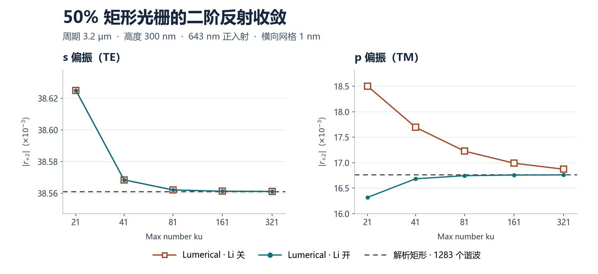

**02 16 µm AH53 的高阶反射谱及 p 偏振逐阶收敛**

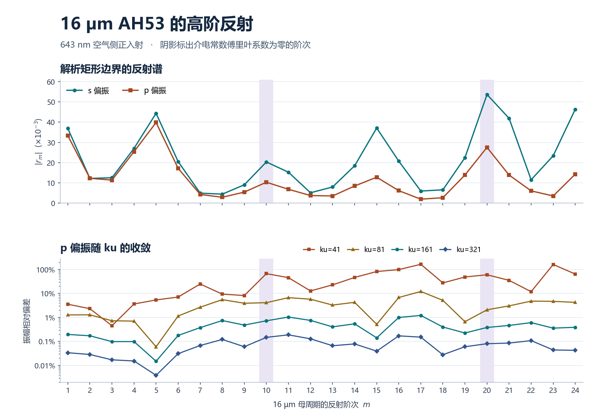

**03 几何傅里叶谱与各阶反射效率**

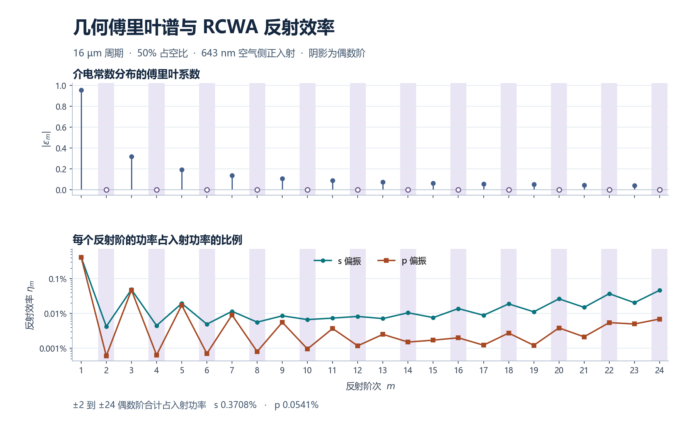

**04 典型偶数阶的绝对振幅与 ku 收敛**

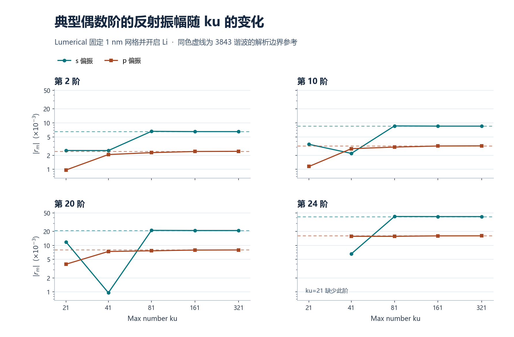

**05 s 和 p 偏振的逐阶带符号振幅偏差**

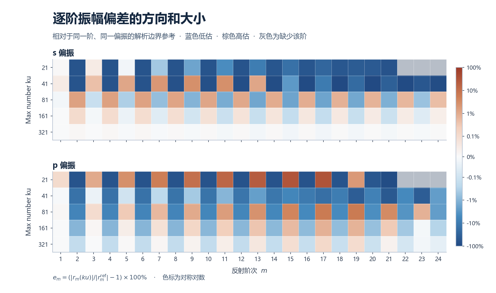

**06 四个典型偶数反射阶的相位收敛**

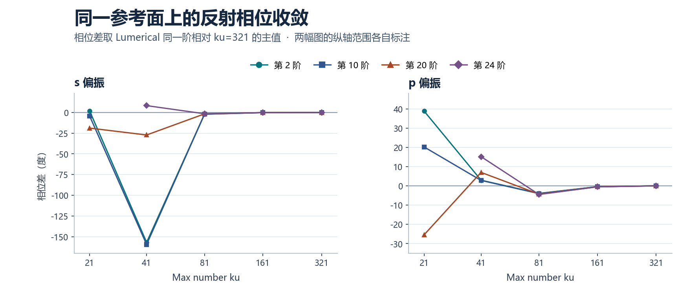

**07 38 个周期下 s、p 偏振达到 1% 和 0.1% 振幅精度所需的 ku**

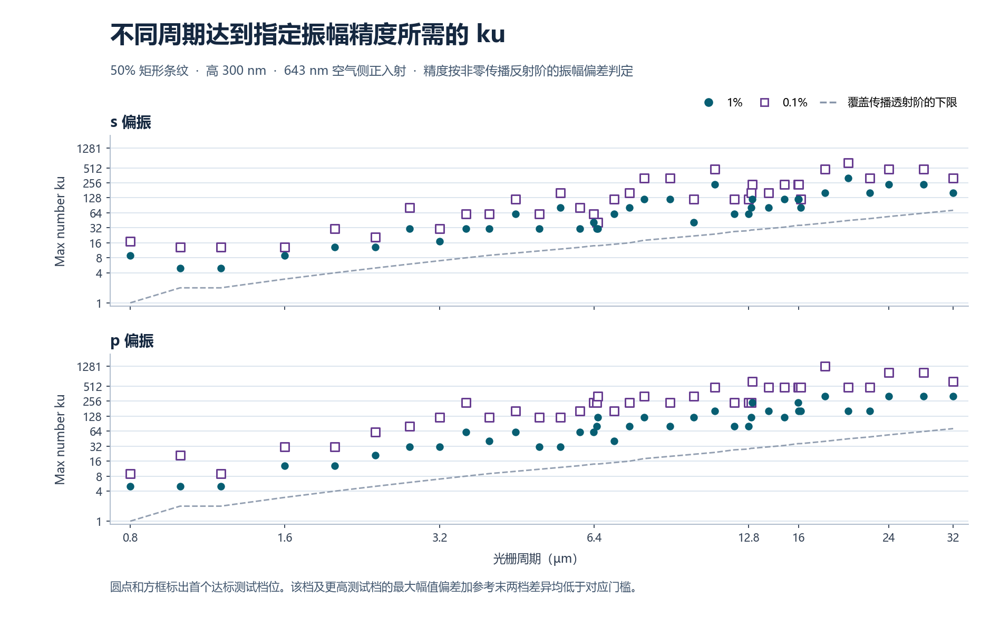

**08 高度和波长变化时，两偏振同时达到指定精度所需的 ku**

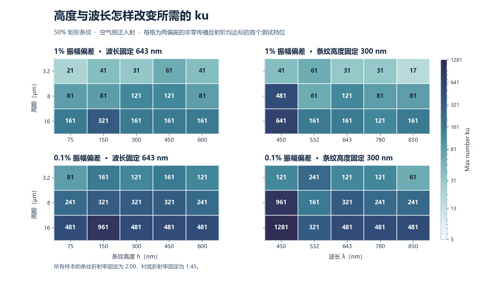

**09 最大偏差热图**

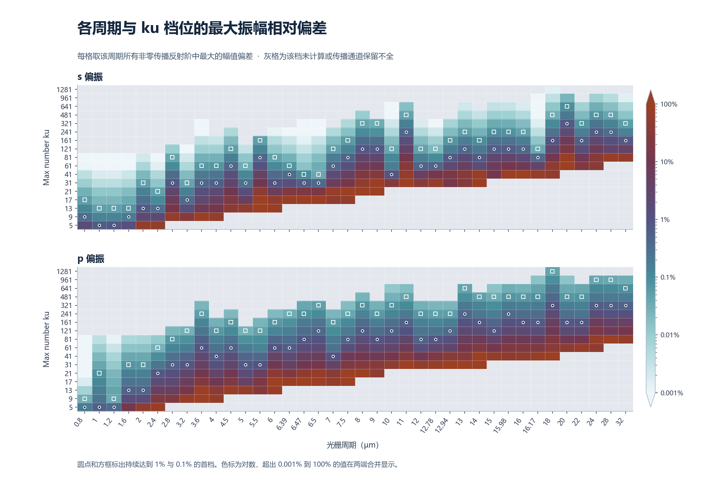

**10 不同 ku 的样本覆盖率图**

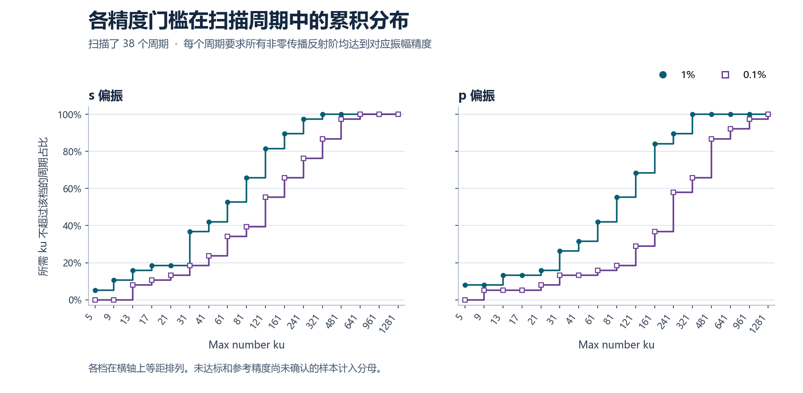

**11 周期与 ku 的总体趋势、两种误差尺度及 11 和 12 µm 的逐阶对照**

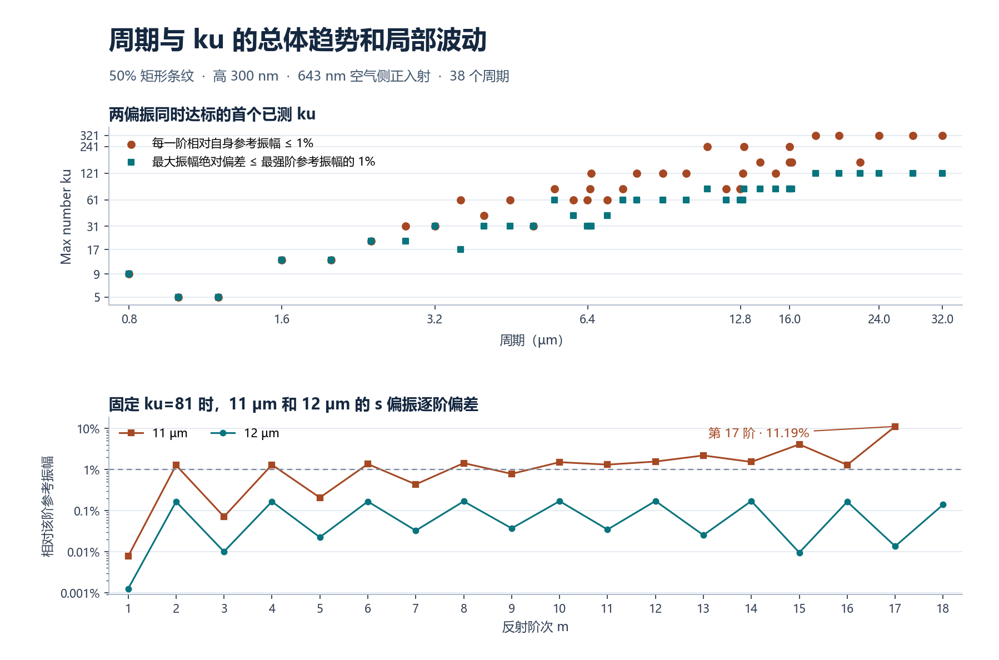

**12 不同边界采样间距造成的偶数阶偏差，以及增大 ku 后的收敛结果**

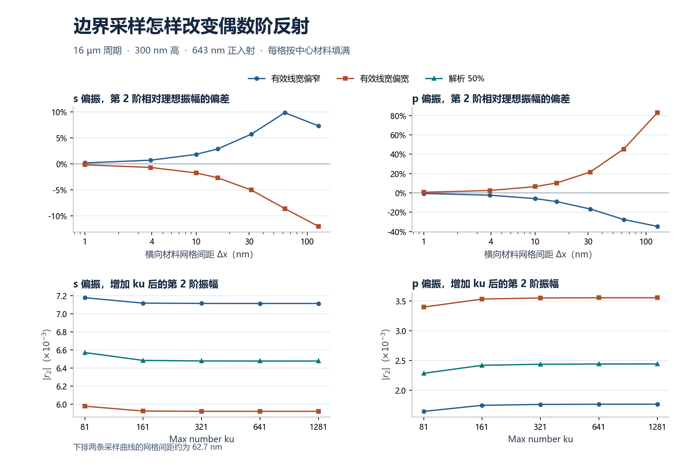

**13 16 µm 矩形 mark 的完整截面与不同网格下的左右边缘放大图**

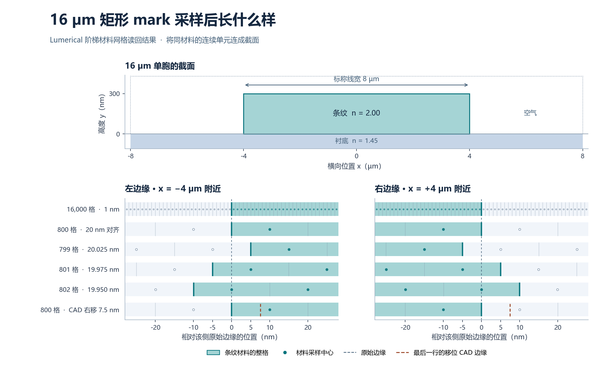

**14 同一条直边的整格采样与有限傅里叶重建**

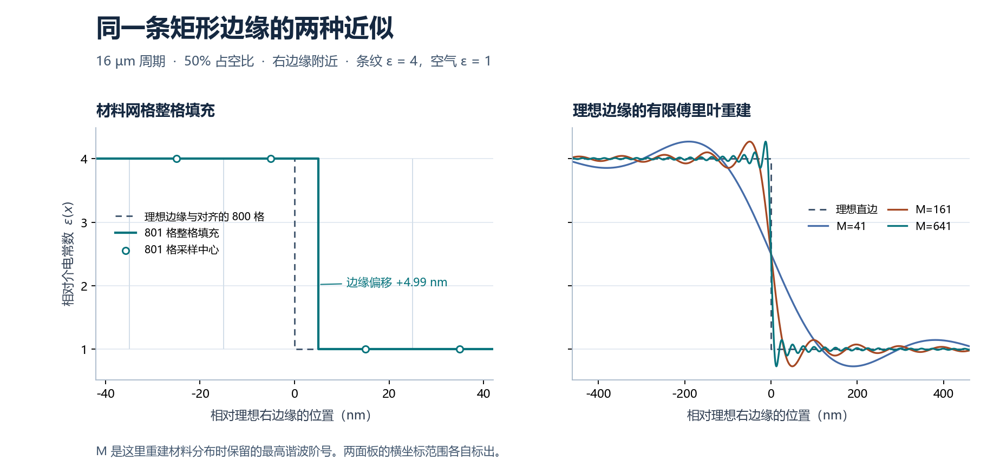

